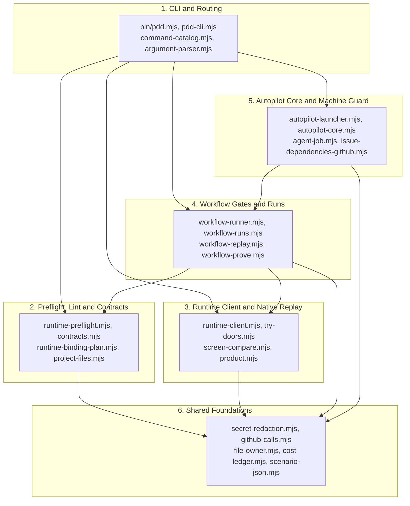

# PDD Architecture Map

In `pdd`, prompts are the source of truth and code follows them.
Module ownership comes from `pdd-bindings.json` (`modules`), a `Generated from <prompt.md> (sha256: ...)` header in the owned file's first 4 KiB, or an opening-sentence prose claim (`Own src/foo.mjs.`).
Run `node bin/pdd.mjs owner <path>` before you edit any file to see which prompt owns it.
Check the shared helpers table below before you write any file, GitHub, secret, or state helper.

## Six Core Domains



### Domain Guide

1. **CLI & Routing** (`bin/pdd.mjs`, `pdd-cli.mjs`, `command-catalog.mjs`, `argument-parser.mjs`, `completion.mjs`, `skills-install.mjs`, `project-setup.mjs`, `agent-mcp-setup.mjs`, `interpreter-version.mjs`)
   Parses command flags, routes public commands, prints help, checks `$PATH` shadowing, and installs skills or project settings.
2. **Preflight, Lint & Contracts** (`runtime-preflight.mjs`, `runtime-markdown.mjs`, `contracts.mjs`, `contract-refs.mjs`, `interface-draft.mjs`, `prompt-approve.mjs`, `runtime-bindings.mjs`, `runtime-binding-plan.mjs`, `project-files.mjs`, `svg-layout.mjs`)
   Parses prompts, validates `<details><summary>Runtime interface</summary>` JSON blocks, checks approvals, resolves ```` ```pdd-boundary ```` plans and bindings, and checks SVG or JSON contracts.
3. **Runtime Client & Native Replay** (`runtime-client.mjs`, `runtime-check-plan.mjs`, `runtime-outcome.mjs`, `runtime-output.mjs`, `runtime-slots.mjs`, `runtime-lint-receipt.mjs`, `try-doors.mjs`, `try-http.mjs`, `try-mcp.mjs`, `screen-compare.mjs`, `agent-chat.mjs`, `product.mjs`, `product-composition.mjs`)
   Runs `pdd test`, `pdd lint`, `pdd simulate`, `pdd try`, `pdd chat`, and multi-part `pdd product` checks.
4. **Workflow Gates & Runs** (`workflow-runner.mjs`, `workflow-runs.mjs`, `workflow-worktree.mjs`, `workflow-chat.mjs`, `workflow-story-card.mjs`, `workflow-replay.mjs`, `workflow-results.mjs`, `workflow-prove.mjs`, `workflow-pr-body.mjs`, `workflow-pr-evidence.mjs`, `workflow-github.mjs`, `workflow-view.mjs`, `workflow-inventory.mjs`)
   Manages isolated worktrees, PR 1 and PR 2 gates, saved replay evidence, native proof, and readable PR bodies.
5. **Autopilot Core & Machine Guard** (`autopilot-launcher.mjs`, `autopilot-core.mjs`, `agent-job.mjs`, `autopilot-doctor.mjs`, `autopilot-intake.mjs`, `autopilot-alerts.mjs`, `autopilot-reports.mjs`, `autopilot-regressions.mjs`, `autopilot-audit.mjs`, `autopilot.mjs`, `issue-dependencies-github.mjs`, `issue-dependency-graph.mjs`, `issue-sort.mjs`)
   Polls ready GitHub issues, checks machine capacity and slots, runs isolated agent jobs, and writes status reports.
6. **Shared Foundations** (`secret-redaction.mjs`, `github-calls.mjs`, `file-owner.mjs`, `cost-ledger.mjs`, `path-diagnostic.mjs`, `scenario-json.mjs`, `approval-policy.mjs`, `approval-evidence.mjs`, `runtime-workspace.mjs`, `agent-adapters.mjs`, `agent-packet.mjs`, `machine-resources.mjs`, `test-suite-queue.mjs`, `metrics-store.mjs`)
   Provides one shared home for secret redaction, GitHub API budgets, ownership lookup, cost ledgers, exact JSON, and machine checks.

## Where to Put Things

| Path | What Belongs Here | Rule |
| :--- | :--- | :--- |
| `prompts/cli/*.prompt.md` | Module behavior specs and `<details><summary>Runtime interface</summary>` (`json` code fence) blocks. | Record owned files in `pdd-bindings.json` or `Generated from` headers (opening-sentence prose claims are fallback). Keep prose clear and free of code details. |
| `src/*.mjs` | ESM modules using `node:*` built-in packages only. | Include the `Generated from <prompt.md> (sha256: ...)` header and reuse helpers from Domain 6. |
| `bin/pdd.mjs` | Thin CLI entry script. | Keep startup minimal and delegate routing to `src/pdd-cli.mjs`. |
| `user_stories/*.md` | Human-readable product Stories with `## Acceptance criteria`. | Describe user outcomes, not helper unit checks. Add a ```` ```pdd-boundary ```` block (`src/runtime-binding-plan.mjs`) when linking docs. |
| `test/runtime/*.json` | Paid Runtime scenario fixtures paired with `user_stories/<slug>.md`. | Reserve for user-facing Story checks that exercise a prompt's Runtime interface. |
| `test/*.test.mjs` | Fast deterministic `node:test` suites and regression checks. | Put helper checks, parser vectors, edge cases, and state rules here. Run with `test/helpers/test-home.mjs`. |
| `skills/<name>/SKILL.md` | Agent workflow playbooks (`pdd-prompting`, `pdd-feature`, `pdd-bug`, `pdd-small-change`, `pdd-product`, `pdd-setup`, `pdd-graph`). | Keep steps short and aligned with `docs/cli.md`. |
| `docs/*.md` | User-facing reference guides (`cli.md`, `prompting-guide.md`, `replay-evidence.md`). | Write for a first-time reader in the present tense. Do not add version history notes. |
| `<git-common-dir>/pdd/` (outside git) | Per-repo workflow `runs/<N>/`, prompt `approvals.json`, and `metrics/` transactions. | Never commit local state, logs, receipts, or evidence JSON to a git repository. |
| `~/.pdd/runtime/` (`$PDD_STATE_DIR`) | Local Runtime client `batches/`, `slots/`, `tries/`, and `agent-chat.log`. | Isolate in tests via `test/helpers/test-home.mjs`. |
| `~/.local/state/pdd/` | Cross-worktree `runs.json` index and `autopilot/` state (Autopilot runs, GitHub call ledgers, and ETag caches). | Isolate in tests via `test/helpers/test-home.mjs`. |

## Canonical Shared Helpers (Reuse, Do Not Duplicate)

Import these existing helpers instead of writing private copies inside feature modules.

| Need | Canonical Module | Exported Functions to Reuse |
| :--- | :--- | :--- |
| **Secret redaction** | `src/secret-redaction.mjs` | `redactSecrets(value, secrets = [])`, `rememberSecrets(...values)`, `redactingValues(emit, secrets)`, `knownSecretValues(env = process.env, secrets = [])` |
| **GitHub API calls, HTTP replies & budget** | `src/github-calls.mjs` | `githubCall(args = [])`, `githubReply(text)`, `githubListArgs(pick = '.')`, `githubListItems(stdout)`, `githubEtagCache({ root, repository, fs, now })`, `githubBudget({ usage, share, floor })`, `githubFloorGuard({ floor, entries, now } = {})`, `countGithubCalls(exec, { ledger, purpose, now } = {})` |
| **File & prompt ownership lookup** | `src/file-owner.mjs` | `resolveOwners({ paths, bindings, heads, prompts } = {})`, `findOwners({ root, paths = [] }, ports = {})`, `promptClaims(promptPath, content)`, `headerPrompts(content)` |
| **Workflow run state, atomic writes & Git root** | `src/workflow-runs.mjs` | `readRun(runDir)`, `writeRun(run, ports = {})`, `updateRun(runDir, update, ports = {})`, `resolveRun(ref, { cwd }, ports = {})`, `stateDirFor(ports = {})`, `gitContext(cwd, ports = {})` |
| **Run, batch & mode file locks** | `src/workflow-runner.mjs`, `src/autopilot-launcher.mjs`, `src/runtime-client.mjs` | `acquireRunLock(runDir, filename = 'chat-replacement.lock')`, `withAutopilotModeLock({ cwd, env }, action, ports = {})`, `acquireRuntimeBatchLock(folder, { onWarning } = {})` |
| **Exact JSON parse & stringify (64-bit safe)** | `src/scenario-json.mjs` | `parseScenarioJson(text)`, `stringifyScenarioJson(value, space)`, `jsonSafe(value)`, `withExactIntegers(value, leaves)`, `exactIntegerLeaves(value)` |
| **Prompt reading, interface blocks & SHA-256** | `src/runtime-preflight.mjs` | `readPrompt(root, visible, path, workspace)`, `interfaceBlocks(text)`, `proseSha256(text)`, `sha256(bytes)`, `preflight({ root, found, selected, workspace })` |
| **`$PATH` command shadowing diagnostic** | `src/path-diagnostic.mjs` | `pathDiagnostic({ packageRoot, cwd, env, mode })` *(diagnoses `$PATH` shadowing of `pdd`, e.g. Conda reordering `PATH`)* |
| **Token, Runtime & GitHub cost ledger** | `src/cost-ledger.mjs` | `captureCosts(before, run, ports = {})`, `applyCostMeasurement(run, input, at)`, `recordCostGithub(runDir, entry, { fs } = {})`, `costReport(runs, now)`, `costStatusLines(report)` |
| **Prompt approvals & policy** | `src/approval-policy.mjs` | `readApprovalPolicy({ root }, ports = {})`, `readPromptApprovals({ commonDir }, ports = {})`, `recordPromptApproval({ commonDir, evidence }, ports = {})`, `approvalActor(env = process.env)` |
| **Saved native session & approval evidence** | `src/approval-evidence.mjs` | `readApprovalEvidence(request, ports = {})`, `findNativeSessions(stage, ports = {})` |
| **Bounded workspace & path guards** | `src/runtime-workspace.mjs` | `loadRuntimeWorkspace({ root }, files)`, `allowsRuntimePath(policy, path)`, `requireRuntimePath(policy, { path, from, chain, role })` |
| **Agent CLI discovery, auth & stdin packets** | `src/agent-adapters.mjs`, `src/agent-packet.mjs` | `discoverAgents({ cwd, env, run, definitions } = {})`, `parseAgentAuthStatus({ agent, result } = {})`, `runAgentProcess(command, args, options = {})`, `askAgent(options = {})`, `buildAgentInput({ context, entries, supportsApply, supportsRun } = {})` |
| **Machine CPU/RAM checks & shared suite queue** | `src/machine-resources.mjs`, `src/test-suite-queue.mjs` | `readMachineResources({ cwd } = {}, ports = {})`, `runTestSuite({ cwd, command, timeout, env }, ports = {})`, `calculateCheckCapacity({ checks, runs } = {}, ports = {})`, `readCheckStatus({ env = process.env, checks, runs }, ports = {})` |
| **Metrics event log & snapshots** | `src/metrics-store.mjs` | `appendEvents({ root, events }, ports = {})`, `readEvents({ root }, ports = {})`, `exportMetrics({ root, metadata }, ports = {})`, `importMetrics({ root, bundle }, ports = {})`, `validateSnapshot(s, repository)` |

> **State file rule:** Do not add another private temp-file `writeFileSync` + `renameSync` helper, private `JSON.parse(readFileSync(...))` wrapper, or local `gh api --include` header parser. Reuse `writeRun` / `updateRun` for workflow state, `parseScenarioJson` / `stringifyScenarioJson` for exact JSON, `sha256` from `src/runtime-preflight.mjs`, and `githubReply` / `githubListArgs` / `githubListItems` from `src/github-calls.mjs`.

## Layering and Test Boundaries

Keep dependencies flowing downward toward Domain 6 (`Shared Foundations`):

- **Domain 6 stays mostly leaf-level.** Pure foundation modules (`secret-redaction.mjs`, `scenario-json.mjs`, `path-diagnostic.mjs`, `cost-ledger.mjs`, `approval-policy.mjs`, `runtime-workspace.mjs`, `metrics-store.mjs`) do not import higher domains; the narrow exceptions are `file-owner.mjs` and `agent-adapters.mjs` importing prompt/file helpers from `runtime-preflight.mjs` (Domain 2), and `test-suite-queue.mjs` importing `validation-evidence.mjs` and dynamically importing `acquireRunLock` from `workflow-runner.mjs` (Domain 4). Do not add new upward imports into Domain 6.
- **Domain 2 stays local and fast.** Preflight, lint, and contract checks (`runtime-preflight.mjs`, `contracts.mjs`, `runtime-bindings.mjs`) inspect repo files without paid network calls.
- **Paid Runtime Story vs. Native Unit Test:**
  - Create a `user_stories/<slug>.md` + `test/runtime/<slug>.json` pair only for real user-facing product behavior that exercises an entry prompt's Runtime interface.
  - Always add a ```` ```pdd-boundary ```` block in a Story when linking `AGENTS.md`, `RUNBOOK.md`, or reference docs so `pdd test` checks only the Story's own prompt closure.
  - Put parser edge cases, JSON field checks, state-file locks, and shared helper rules in fast native `test/*.test.mjs` files instead of separate micro-Stories.

## Before You Open a Pull Request

1. Run `node bin/pdd.mjs owner <file>` on every file you plan to edit.
2. Update the owning prompt first when module behavior or contracts change.
3. Reuse the canonical helpers above instead of writing duplicate GitHub, hash, secret, or state helpers.
4. Run focused tests on your machine (`node --import ./test/helpers/test-home.mjs --test test/<file>.test.mjs`).
5. Run the full test suite on the runner VM, not on a laptop.
6. State exact `+added / -removed` line counts in your PR description and keep diffs small.
