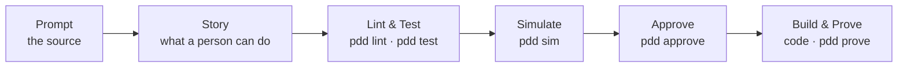

# PDD

## What PDD is

In PDD, you write prompts and Stories first. Prompts are the source of truth for your owned modules; Stories describe what a person can do. The PDD interpreter runs prompts with an AI before any code exists so you can test and try the behavior early. Then your coding agent writes the code from the approved prompts and proves the real user path with `pdd prove`.



PDD is the `pdd` command and one `/pdd` skill (`$pdd` in Codex, `/pdd` in Claude Code) with on-demand references for your coding agent. In interactive workflows, you approve changed prompts and authorize pull requests. An explicit Autopilot auto setup and start can delegate ordinary gates; strict approvals and required human reviews still need a person.

## Install

You need [Node.js](https://nodejs.org) 22.16.0 or newer (22.20.0+ for Autopilot), [Git](https://git-scm.com), and the [GitHub CLI](https://cli.github.com) signed in with `gh auth login`. Install Codex, Claude Code, Gemini CLI or Antigravity CLI to run PDD with your coding agent. Without `--agent`, pdd selects the first ready agent in that order. Remote `pdd test`, `pdd lint --remote`, and `pdd simulate` need access to the PDD interpreter (see [Access](#access)). PDD is tested on macOS and Linux.

```sh
npm install -g @promptdriven/pdd
pdd setup
pdd --version
cd your-repo
pdd init
```

1. `npm install -g @promptdriven/pdd` installs the `pdd` command.
2. `pdd setup` installs the global `/pdd` skill into `~/.agents/skills`, `~/.claude/skills` (cleaning marked retired skills and skipping duplicates when a Claude Code plugin is installed), and `~/.gemini/config/skills`, and previews Simulator MCP registration for detected Codex, Claude Code, Gemini, and Antigravity configs without editing any repository. Pass `--yes` to confirm previewed MCP registration without prompting, or `--skills-dir PATH` for a custom skill folder.
3. If you prefer another skills installer, `npx skills add promptdriven/pdd -g --skill pdd` installs the `/pdd` skill globally (without MCP registration).
4. `pdd --version` prints `0.1.50`. When an installed skill is older than pdd, it prints the update command on stderr.
5. `pdd init` adds a 4-line PDD block to `CLAUDE.md` (else `AGENTS.md`) inside a repository and detects its language and test command without editing root `.gitignore` (`.pdd/.gitignore` is managed automatically).

To update a global npm or Volta installation and its `.pdd-skill.json`-marked user skill in one step, run `pdd upgrade` (or `pdd upgrade --main` for the pinned `main` commit), then start a new agent chat. `pdd upgrade` installs `@promptdriven/pdd@<version>` from npm first with a GitHub tag fallback (using Volta's `npm` without `--prefix` on Volta installs), guards against mutating Git checkouts, PyPI `pdd-cli`, `pnpm`, `npx`, or local `node_modules` installs, and prints `npx skills add promptdriven/pdd -g --skill '*'` when unmarked copies are older. When a global install prints `npm error code EEXIST` on `<prefix>/bin/pdd`, remove the conflicting unscoped `pdd` package with `npm uninstall -g pdd && npm install -g @promptdriven/pdd`.

> [!IMPORTANT]
> Do not run `npm install -g pdd` or `npm update -g`. The npm registry has a different package with the name `pdd`.

## The PDD loop (your first Story in 5 minutes)

The names `my-story`, `tests/my-story.json` and `NAME` are placeholders. Your names come from your project.

### 1. Ask your agent

Open your coding agent in your repo and invoke the single `/pdd` skill (`$pdd` in Codex, `/pdd` in Claude Code):

```text
/pdd <the feature, bug, product plan, or small change in one or two sentences>
```

`/pdd` inspects the repo offline with `pdd status --json` and routes your request cleanly across four modes:

| Mode | Use it for | Prompt & Story? |
|---|---|---|
| `product` | Map a multi-part product and shared contracts ([product reference](skills/pdd/references/product.md)) | Product map, plan & contracts |
| `bug` | Reproduce a defect with failing-first tests, fix root cause, and prove contrast | Update owning prompt if wrong; pure code bugs skip prompt edits |
| `feature` | Author prompt, Story, tests, and implementation for new or changed behavior | Yes — prompt, Story & tests before code |
| `small-change` | Non-product edits only (docs, CI, config, lockfiles, test maintenance) with zero owned/product files | None — skip prompts and Stories |

All canonical guides live inside [`skills/pdd/references/`](skills/pdd/SKILL.md) (loaded on demand), including the [Prompting guide](skills/pdd/references/prompting.md), [Story guide](skills/pdd/references/stories.md), and [Verification guide](skills/pdd/references/verification.md).

For a `feature` or prompt-level `bug`, the agent writes these files before implementation:

| File | What it is |
|---|---|
| `prompts/NAME.prompt.md` | A prompt: the source of one part of the program. |
| `user_stories/my-story.md` | A Story: one thing that a person can do, with numbered acceptance criteria. |
| `tests/my-story.json` | The scenario tests of that Story. |
| `app-map.json` | Optional, only for multi-screen or timed UIs (single-screen UIs work with one plain-prose prompt). |

You read the Stories and approve changed prompts in the chat or terminal. Expected values come from you and the Stories, not from observed code output.

### 2. Lint and test prompts

```sh
pdd lint
pdd test
```

`pdd lint` runs fast offline structural, SVG, and scenario checks with 0 AI calls and 0 network calls. `pdd test` runs the tests of every Story on the PDD interpreter (name specific Stories like `pdd test my-story` to scope it). The output has this shape:

```text
Story        Test                    Result  Checks  Time
My story     tests/my-story.json     passed  20/20   41.4 s
Other story  tests/other-story.json  passed  34/34   89.1 s
Prompt tests (my-story): ✓ 2 of 2 criteria · 20/20 checks · 2 AI calls
Prompt tests (other-story): ✓ 5 of 5 criteria · 34/34 checks · 10 AI calls
Prompt tests: ✓ 7 of 7 criteria · 54/54 checks · 12 AI calls
2 of 2 stories passed.
Reports (anyone with a link can open it):
  my-story     https://…/r/…
  other-story  https://…/r/…
```

| You see | It means |
|---|---|
| `✓` | Every check passed. |
| `✗` / `FAILED` | A check failed. pdd shows the criterion, expected value, and actual answer. Usually the prompt is wrong, and your agent fixes it. A person decides expected values. |
| `REFUSED` / `no verdict` | A file rule or the AI service prevented a verdict. Read the reason and next step under the line. |
| `STOPPED` | One test step took more than 10 minutes, and the server stopped it. Make the step smaller. |
| `DRAFT` | A prompt is still a draft. A DRAFT pass is not an approval. |
| A report link | A page with each step, check, and answer. Anyone with the link can open it; it expires after 7 days. |

Checks show `✓` when all passed and `✗` when a check failed. Exit codes use this order: 3, 5, 4, 1, 0.

### 3. Simulate (try before coding)

`pdd simulate` (short: `pdd sim`) lets you use the program by hand in the PDD Simulator before writing code.

| Your program | Command | What you do |
|---|---|---|
| A screen | `pdd sim STORY` | Opens the PDD Simulator in your browser. On the **Screen** tab, click **Open the app**, then use it. |
| A command line | `pdd sim STORY --cli` | Prints an `export PATH=…` line. Run it, then run your program's commands. |
| An HTTP API | `pdd sim STORY --serve PORT` | Serves your prompt's routes at `http://127.0.0.1:PORT`. Send requests with `curl`. Ctrl-C stops the server. |
| Anything else | `pdd sim STORY` | On the **Form** tab, fill the fields and click **Run**. |

For a CLI named `my-program`, or an API with `/api/items`:

```sh
pdd sim my-story --cli
export PATH=/path/to/your-repo/.pdd/try/bin:"$PATH"
my-program --help
```

```sh
pdd sim my-story --serve 8091
curl http://127.0.0.1:8091/api/items
```

- **Budget:** A new simulation starts with 400 AI calls. Raise it in the Simulator or run `pdd sim STORY --new --max-calls 600`.
- **Save a case:** Click **Save as test** in the Simulator, or run `pdd sim --save-last` after a `--cli` command.
- **Keep the link private:** Anyone with a Simulator link can use it and spend its AI calls.
- **Stop it:** Simulations end after 24 hours, or sooner with `pdd sim --stop STORY`.
- **Ask your agent:** While `pdd sim` runs in your terminal, the Simulator's **Ask your agent** panel connects to your local Codex, Claude, or Gemini (`--agent NAME` to choose).

### 4. Approve prompts

When the behavior matches what you want, approve each changed prompt in your terminal or via chat:

```sh
pdd approve prompts/NAME.prompt.md
```

In chat, review the prompt diff your agent shows and reply in your own words; your agent records your reply with `pdd approve PROMPT --said - <<'PDD_SAID'`. Questions and change requests keep the prompt unapproved. See [Record a chat approval](docs/cli.md#record-a-chat-approval) for strict-mode and heredoc details.

### 5. Build, prove, and open one PR

Your agent implements the code from the approved prompts, runs the native test suite against the real user path, runs `pdd lint --diff` and `pdd prove`, and verifies with an independent fresh verifier/reviewer:

```sh
pdd lint --diff origin/main
pdd prove --base origin/main
```

- In interactive chat, your agent opens **one pull request** only when you ask (the only exception is `pdd product --through prompt-pr`, which explicitly stages a prompt PR first).
- The `pdd` CLI has no merge command. In manual workflows, ask your agent to merge under [Prompting guide §5](skills/pdd/references/prompting.md#5-expected-values-approvals-and-merges).

## Commands

| Command | What it does |
|---|---|
| `pdd setup [--yes] [--skills-dir PATH]` | Install laptop-wide `/pdd` skill and preview Simulator MCP setup. |
| `pdd init` | Add the 4-line PDD block to `CLAUDE.md` (else `AGENTS.md`) and detect stack/tests. |
| `pdd status [PATH...] [--changed] [--json]` | Compact offline overview of prompts, Stories, ownership, and `pdd.json` Feature Map. |
| `pdd lint [STORY...] [--diff [BASE]]` | Offline structural, SVG, scenario, and diff lint (0 AI, 0 network). Pass `--remote` for hosted lint. |
| `pdd prove [--base REF]` | Run offline lint, diff checks, repo tests, and merge-base `verify.paths` recipes (or `--test`/`--expect` bug contrast). |
| `pdd test [STORY...]` | Run Story tests on the PDD interpreter (`--files` previews uploads; `--read` reads saved results). |
| `pdd simulate [STORY\|PROMPT.md]` | Try prompts interactively in the PDD Simulator (short: `pdd sim`; `--cli`, `--serve PORT`, `--stop`). |
| `pdd approve PROMPT [--said WORDS]` | Review prompt diff and record approval (terminal y/N or `--said -`; strict mode requires terminal). |
| `pdd update [FILE...] [--branch] [--check]` | Inspect changed code vs owning prompts offline. |
| `pdd upgrade [--main]` | Update global `@promptdriven/pdd` and refresh marked user skill (`--main` tracks pinned `main`). |
| `pdd product status\|next\|start` | Track multi-part product plans and prepare scoped `/pdd` run handoffs. |
| `pdd autopilot doctor\|start\|status\|logs` | Preflight, start, inspect, and follow headless Autopilot workers. |
| `pdd accounts` | Manage enrolled and shared Codex/Claude logins in PDD Cloud and optional shell auto-switch. |
| `pdd help prompting` | Show the quick PDD authoring workflow and local guide paths. |

Run `pdd --help` for the overview, `pdd <command> --help` for full options, or read the [CLI reference](docs/cli.md).

## Key ideas

- **Prompt space and code space:** Your program lives in prompt space first (`prompts/*.prompt.md`, `user_stories/*.md`, `tests/*.json`). Check, simulate, and approve it there; code follows the approved prompts.
- **Stories:** One cohesive user loop per Story (`<= 35` lines, `1–6` numbered acceptance criteria) with exact checks in its scenario JSON.
- **Small test steps:** Keep each test step focused (one action or a short run; 10-minute server cap per step).
- **Draft and approved:** Prompts start as drafts. New behavior needs human approval (or an applicable Autopilot delegation); editing an approved prompt returns it to draft.
- **AI-call budgets:** Ceilings, not charges. Checks default to 12 calls/step (`18..1000`); new simulations start at 400 calls (`--max-calls 1..1000`).
- **Fakes:** The interpreter never touches real databases or external services; prompts declare `<port>.<op>` ports and tests bind deterministic fakes ([Ports and CLI](skills/pdd/references/ports-and-cli.md)).
- **Scoped uploads:** `pdd test` uploads only Git-visible files needed by the selected Stories and refuses secret-like names (`pdd test --files` previews).

## Access

`pdd test`, `pdd lint --remote`, `pdd simulate`, and the Try tools in `pdd mcp` use the hosted PDD interpreter with your GitHub login (`gh auth status`) once PDD Cloud approves your account. Sign up at [promptdriven.ai/login](https://promptdriven.ai/login) with that GitHub account; access activates within 1 minute of approval. For questions, [ask the team](https://github.com/promptdriven/pdd/issues/new?title=%5Baccess%5D%20Interpreter%20access%20for%20) with your GitHub login.

The `/pdd` skill and all other commands (`pdd setup`, `pdd init`, `pdd status`, `pdd lint`, `pdd prove`, `pdd owner`, `pdd files`, `pdd update`) run 100% locally offline.

## Autopilot on your own repository

Autopilot runs headless background workers on GitHub issues you mark with an opt-in label. For each issue, it opens one pull request, runs a fresh blind reviewer, runs your full test suite, and verifies the mechanical evidence contract (`pdd prove` + merge-base `verify.paths`). In `auto` mode, Autopilot merges the PR when CI, blind review, full tests, and the evidence contract pass. In `observe` mode, it runs the same checks and posts `"would merge"` for a person to merge. Required branch reviews, checks, and `strict_approvals` still apply.

Use a repository you own or can write to (fork first if needed), with **Node.js 22.20.0 or newer**.

1. Verify tools, GitHub login, and Git identity:

   ```sh
   node --version        # 22.20.0+ for Autopilot
   git --version
   gh auth login
   gh auth setup-git
   git config --global user.name "Your Name"
   git config --global user.email "you@example.com"
   pdd --version
   ```

2. Install and sign in to one coding agent (for Codex: `npm install -g @openai/codex && codex login && codex login status`; for Claude Code: `npm install -g @anthropic-ai/claude-code && claude auth login && claude auth status --json`).
3. Initialize your repository and pick a mode (`observe` recommended first):

   ```sh
   cd your-repo
   pdd init
   pdd autopilot observe   # or: pdd autopilot auto
   ```

   An empty `trust: []` trusts the repo owner and write-access collaborators; add explicit logins with `pdd autopilot trust NAME...`.
4. Commit and push your repo setup (`git add pdd.json AGENTS.md && git commit -m "Set up PDD" && git push`). If you cannot push directly to the default branch, `pdd autopilot observe|auto` updates `pdd.json` via GitHub API or opens a PR.
5. Run read-only preflight checks:

   ```sh
   pdd autopilot doctor
   ```

6. Opt in issues and start the 10-minute timer:

   ```sh
   pdd autopilot add 12 15
   pdd autopilot start --label pdd:autopilot
   pdd autopilot status
   pdd autopilot logs 12 -f
   ```

   When Autopilot needs a human decision, it comments one question and adds `pdd:needs-decision` (reply, then remove the label). Stop the timer with `pdd autopilot stop`. On Linux, `loginctl enable-linger` keeps user timers active after logout; on macOS, `caffeinate -i` keeps the machine awake.

See the [CLI reference](docs/cli.md#autopilot-on-this-machine) for all options and safeguards.

## Cloud accounts

`pdd accounts` stores enrolled Codex and Claude logins in PDD Cloud with envelope encryption and writes only short-lived stripped passes (`refresh_token: ""`) to local `0600` files so only PDD Cloud refreshes tokens. Inside `pdd` and `pdd autopilot`, steps lease an account automatically, isolate Codex steps in a disposable `0700` overlay folder, rotate when a 5-hour or weekly window reaches 100%, and never spend usage-reset credits. Plain terminal `codex` and `claude` sessions stay untouched unless you opt in with `pdd accounts auto on` (`pdd accounts auto off` removes the wrapper cleanly). See [Cloud accounts](docs/cli.md#cloud-accounts).

## When something goes wrong

| You see | What to do |
|---|---|
| `Your GitHub account does not have PDD interpreter access yet…` (exit 5) | Sign up at [promptdriven.ai/login](https://promptdriven.ai/login) with your `gh` GitHub account. See [Access](#access). |
| `PDD Cloud could not confirm your access. Try again in a minute.` (exit 5) | Wait one minute and retry the command. |
| `Please update pdd: …` | Run `pdd upgrade` (or re-run the install steps). |
| `npm error code EEXIST` on `<prefix>/bin/pdd` | Remove the conflicting unscoped package: `npm uninstall -g pdd && npm install -g @promptdriven/pdd` (never `--force`). |
| `REFUSED` / `no verdict` (exit 3, 4 or 5) | Read the reason under the line and run `pdd lint` first. See [Stories and scenario JSON](skills/pdd/references/stories.md). |
| `FAILED` (exit 1) | Read the failed check and report. A person decides expected values. |
| `UNKNOWN` or `Still running` (exit 3) | Run `pdd test --read` later; do not resend the same check. |
| `STOPPED … took more than 10 minutes` | Split the test step into smaller steps and re-run. |
| `This Try session is busy.` | Wait for the current simulation command to finish. |
| `The runtime is busy` (exit 5) or `Too many Try links are open.` | Wait a few minutes or close unused sessions with `pdd sim --stop STORY`. |
| `This Try has ended` | Simulation hit its call limit or 24-hour TTL; run `pdd sim STORY --new`. |
| `Autopilot did not start: it works only on the issues that you mark with an opt-in label.` | Run `pdd autopilot add N`, then `pdd autopilot start --label pdd:autopilot`. |
| `pdd --version` does not print `0.1.50` | Another `pdd` comes first on PATH. Run `"$(npm prefix -g)/bin/pdd" --version` for the exact fix line. |

The [usage guide](docs/USAGE.md#13-troubleshooting) has more.

## Report a problem

Follow [docs/ISSUES.md](docs/ISSUES.md) (your agent can follow it too):

1. Run `pdd --version` (must print `0.1.` and a number).
2. Search [open issues](https://github.com/promptdriven/pdd/issues) and comment if your issue already exists.
3. Otherwise fill the [issue form](https://github.com/promptdriven/pdd/issues/new?template=bug.yml) with one problem, exact command, and output (never paste tokens, Simulator links, or private code).

## Links

- [Documentation](docs/index.md): [Usage guide](docs/USAGE.md), [Workflows](docs/workflows.md), [CLI reference](docs/cli.md), and [Prompting guide](skills/pdd/references/prompting.md).
- [`skills/pdd/SKILL.md`](skills/pdd/SKILL.md): the `/pdd` skill and on-demand guides (`skills/pdd/references/`).
- [Release notes](https://github.com/promptdriven/pdd/releases).
- [Contributing](CONTRIBUTING.md).

## License

[MIT](LICENSE).
