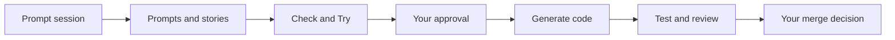

# PDD

**Prompts are the source. Code is generated from them.**

## Install

The launch installer is **coming soon** on macOS and Linux:

```sh
curl -fsSL https://promptdriven.ai/install | sh
```

**At launch, this installer replaces the old Python `pdd` command on your machine.**

That URL is planned for launch. Use it when the [setup guide](docs/setup.md) confirms availability.

After installation, show the command help:

```sh
pdd --help
```

## Commands

Use `pdd COMMAND --help` for the supported arguments and options.

| Command | What it does |
| --- | --- |
| `pdd --version` | Show the installed PDD CLI version. |
| `pdd` | Show every supported PDD command. |
| `pdd --help` | Show every supported PDD command. |
| `pdd -h` | Show every supported PDD command. |
| `pdd help` | Show every supported PDD command. |
| `pdd --skill` | Print the PDD skill for an AI coding assistant. |
| `pdd completion bash\|zsh` | Print shell completion for supported PDD commands. |
| `pdd session [--agent codex\|claude] [--request id] [--json]` | Open a PDD prompt session in this folder. |
| `pdd session make-it --request file\|--resume operation [--json]` | Start a workflow from a saved session request. |
| `pdd doctor [--fix] [--action conversation\|workflow\|publication\|simulation] [--details\|--json]` | Check this machine and show how to fix issues. |
| `pdd init [--codex-home path] [--codex-bin path] [--initial-commit] [--preparation background\|on-demand] [--json]` | Connect this checkout to PDD. |
| `pdd bootstrap-repo [--json]` | Prepare an existing repository for prompt space. |
| `pdd repo add [folder\|owner/name] [--preparation background\|on-demand] [--host machine] [--json]` | Add a project to PDD. |
| `pdd repo list [--host machine] [--query text] [--page number] [--json]` | List projects available to PDD. |
| `pdd repo browse owner/name [--host machine] [--json]` | Read project issues without cloning the repository. |
| `pdd repo disconnect owner/name [--json]` | Disconnect a project registration while keeping its files and work. |
| `pdd repo remove owner/name [--json]` | Remove a project registration across machines while keeping its files. |
| `pdd issues [number\|repo#number] [--repo owner/name] [--all] [--json\|--brief] [--limit number]` | List open issues or read one issue. |
| `pdd run start <issue> [--workflow name] [--base branch] [--checkout folder] [--repo owner/name] [--host machine] [--dry-run] [--from stage] [--skip stage,stage] [--ignore-blockers] [--ignore-flag] [--ignore-closing-pr] [--reason text] [--wait] [--json]` | Start a workflow for an issue. |
| `pdd run list [--json\|--brief] [--limit number]` | List recent runs and retained history. |
| `pdd run status <run\|issue> [--json\|--brief]` | Show one run. |
| `pdd run checkout-status <request-id> [--json]` | Read the status of a checkout request. |
| `pdd run open <run\|issue> [--json]` | Open the current session for a run. |
| `pdd run answer <run\|issue> [text] [--option number\|choice] [--json]` | Answer a question in a run. |
| `pdd run message <run\|issue> <text> [--json]` | Message the current agent for a run. |
| `pdd run changes <run\|issue> <note> [--kind solution\|story\|pr1\|pr2] [--json]` | Ask for changes to a run. |
| `pdd run merge <run\|issue> pr1\|pr2 [--json]` | Merge the current pull request through PDD. |
| `pdd run approve <run\|issue> [solution\|story] [--option number] [--note text] [--json]` | Approve the current revision of a run. |
| `pdd run stop <run\|issue> [--acknowledge-unknown-writer] [--json]` | Stop the current run. |
| `pdd run free-up <run\|issue> [--json]` | Free the run files while keeping sessions and history. |
| `pdd run free-space <run\|issue> [--json]` | Free the run files while keeping sessions and history. |
| `pdd run remove <run\|issue> [--delete-anyway] [--json]` | Remove run files and sessions after the existing confirmation. |
| `pdd now [--json\|--brief] [--limit number]` | Show what needs your attention. |
| `pdd status [--json\|--brief] [--limit number]` | Show what needs your attention. |
| `pdd watch` | Stay open for questions and approvals on this machine. |
| `pdd wait <run\|issue> [--until needs-you\|question\|solution\|story\|merge\|ended\|stage:id] [--timeout ms] [--json]` | Wait for a step or a person. |
| `pdd agents [--json\|--brief] [--limit number]` | List ordinary Codex sessions and retained history. |
| `pdd agents start [text] [--project owner/name] [--model name] [--effort name] [--host machine] [--json]` | Start an ordinary conversation. |
| `pdd agents start --list-models [--host machine] [--json]` | Show model and effort choices on a machine. |
| `pdd agents open <session-id\|exact-name> [--json]` | Read or message an existing ordinary conversation. |
| `pdd agents message <session> [text] [--file path ...] [--json]` | Send text and files in one step. |
| `pdd agents file-status <attachment-id> [--json]` | Read one file attachment status. |
| `pdd agents message-status <request-id> [--json]` | Read one message delivery status. |
| `pdd agents end <session> [--host machine] [--json]` | End an agent session while keeping its files and history. |
| `pdd agents resume <session> [--host machine] [--json]` | Resume the same retained conversation. |
| `pdd agents interrupt <session> --generation number --turn id [--json]` | Stop the observed turn of an ordinary conversation. |
| `pdd agents answer <session> <text> --request id --generation number [--json]` | Answer a pending question in an ordinary conversation. |
| `pdd agents approve <session> accept\|accept-session\|decline --request id --generation number [--json]` | Answer a pending tool approval. |
| `pdd workflow list [--json]` | List workflows from the current project. |
| `pdd workflow new <name> [--from template\|--describe text] [--json]` | Create a workflow for you to review and edit. |
| `pdd workflow edit [name] [--json]` | Open a workflow for editing. |
| `pdd phone [--json]` | Show the web app link and QR code to open PDD on your phone. |
| `pdd approve <code> [--json]` | Review a request to connect another computer. |
| `pdd machine approve <code> [--json]` | Review a request to connect another computer. |
| `pdd machine sign-in [--check]` | Show identity or sign in on this enrolled machine. |
| `pdd machine invite [--purpose personal\|testing\|preparation] [--primary] [--os darwin\|linux] [--kind personal\|shared] [--json]` | Make a one-use code for another computer. |
| `pdd machine list [--json]` | List computers connected to your account. |
| `pdd machine disconnect <name\|id> [--json]` | Disconnect a computer while keeping its work running. |
| `pdd machine reconnect <name\|id> [--json]` | Reconnect a computer to your account. |
| `pdd machine rename <name\|id> <new name> [--json]` | Rename a computer in your account. |
| `pdd machine remove <name\|id> [--json]` | Remove a computer from your account after the existing checks. |
| `pdd verify [scenario.json] [--live] [--json]` | Check a prompt scenario with a supported runtime. |
| `pdd verify --request id [--json]` | Read the result of an existing prompt check. |
| `pdd try [--json]` | Open the current prompts with the local Try settings. |
| `pdd try <prompt> --input <file\|json> [--repeat number] [--json]` | Try a prompt with the supplied input. |
| `pdd try --request id [--json]` | Read an existing Try request without sending it again. |
| `pdd try --run <issue> [--terminal] [--json]` | Open the guided Try page and show its link and phone QR. |
| `pdd try --terminal [--session id] [--command text] [--json]` | Type commands in a hosted session. |
| `pdd try --session id [--command text\|--request id] [--json]` | Send a line to or read a hosted session. |
| `pdd call <prompt> <operation> --input JSON [--session id] [--json]` | Invoke a prompt entry and print its view. |
| `pdd call --request id [--json]` | Read the result of an existing prompt call. |
| `pdd tests draft --story text [--json]` | Draft tests from a story. |
| `pdd tests --request id [--json]` | Read the result of an existing test draft. |
| `pdd lint [paths...] [--json]` | Check prompt rules for free. |
| `pdd lint --request id [--json]` | Read the result of an existing prompt check. |
| `pdd replay <saved-check> [--json]` | Read a saved prompt check or Try. |
| `pdd replay --request id [--json]` | Read the result of an existing replay request. |
| `pdd runtime --request id [--json]` | Read the result of an existing Runtime operation. |
| `pdd runtime discover [--json]` | Run the Runtime discovery operation. |
| `pdd runtime lint [--json]` | Run the Runtime lint operation. |
| `pdd runtime draft-scenario [--json]` | Run the Runtime scenario drafting operation. |
| `pdd runtime merge-scenario [--json]` | Run the Runtime scenario merge operation. |
| `pdd runtime report [--json]` | Run the Runtime report operation. |
| `pdd runtime debug [--json]` | Run the Runtime debugging operation. |
| `pdd runtime recover [--json]` | Run the Runtime recovery operation. |
| `pdd runtime replay-session [--json]` | Run the Runtime session replay operation. |

## Start with a conversation

PDD is Prompt Driven Development. Describe what your program must do. Check it against examples. Try it before you build. Then generate code, test it and review the change.

When behavior changes, change the owning prompt first. Keep prompts, stories and code together in Git.



A prompt session is your normal Codex or Claude Code conversation with the [PDD skill](skills/pdd/SKILL.md). It knows the [Prompting guide](docs/prompting-guide.md), the runtime tools and the workflows.

Start from an idea, an existing app or a bug. Ask it to write prompts, explain a rule or draft tests. You do not need an issue or a workflow to write prompts.

With a supported Host installed, `pdd session` opens that conversation. Connected commands need that separate built Host package. If it is unavailable, the public CLI says so. Installed end-to-end support is coming soon; local source checks alone do not prove it.

## Choose a workflow

Workflows are Markdown files. Edit the steps and keep them in Git.

| Work | Path |
| --- | --- |
| [Feature](.pdd/workflows/feature/WORKFLOW.md) | Understand → specify → write the Story → Check and optional Try → approve → generate → test → review. |
| [Bug](.pdd/workflows/bug/WORKFLOW.md) | Reproduce → find the cause → change the owning prompt and Story → check and try affected behavior → generate → prove the regression is fixed. |
| [Small change](.pdd/workflows/small-change/WORKFLOW.md) | Make a contained change → check it → open one PR → review and merge. No prompt setup is required. |

The feature and bug recipes separate the Prompt PR from the Code PR. You review the prompt change before generated code uses it. Approval and merge are separate decisions. [Workflows](docs/workflows.md).

## Check, then try

Write test vectors from the Story: input, expected result and the rule each case tests. Include normal cases, boundaries and errors. Review the expected answers before using them to judge the program.

`pdd verify` checks declared expectations. `pdd try` explores the prompt program. A Try observation is separate from a test verdict. Both need a supported execution connection; hosted execution is coming soon.

After generation, replay the vectors against real code. For a precise rule, a bounded formal check can add evidence. State its assumptions and limits. Tests alone are not a formal proof. If a checker is unavailable, report that the formal check did not run.

The [synthetic example](examples/ticket-status/README.md) shows the prompt, Story and vectors together. [Checks and evidence](docs/checks.md).

## Keep the decisions

Open PDD on your phone using the web app link. Add it to your Home Screen for easy access. Run `pdd phone` in your terminal to show the link and a QR code to scan with your phone.

On your phone, review the current proposal, answer questions and ask for changes. Approve only the revision you reviewed. Review the PR before merging it.

PDD keeps the check result, your Try feedback and your approval separate. A passing check never approves a change for you. A local Try page stays on its computer; cross-device Try is coming soon.

## What is open

This repository is [MIT licensed](LICENSE). It contains the public CLI client, the Prompting guide, the PDD skill, workflow recipes, user docs, synthetic examples and public CI.

Host source is **coming soon**. The current Host still combines dependencies that must remain separate; the launch plan uses its built package until its source can be separated cleanly. Workbench and Herdr source are also coming later.

The phone app, Coordinator/server, hosting, billing, model desk, account pool, execution runtime and operations tools remain closed. The runtime is a separate built package, free to use with PDD, with no copying or resale. The MIT license here does not change those separate package terms.

This PR prepares the new content in the existing public repository. Its old history and tags remain available. The replacement will merge at launch after review.

## Contributing

**Run from source (for contributors).** Use Node.js 22.16 or newer:

```sh
node bin/pdd.mjs --help
```

Local help, version, skill output, completion and workflow listing work from this source. Other commands need a supported installed Host. The client preserves that Host’s existing person and revision checks.

This source PR does not release the installer or install the Host or execution runtime. See [Contributing](CONTRIBUTING.md).

[Prompting guide](docs/prompting-guide.md) · [PDD skill](skills/pdd/SKILL.md) · [Workflows](docs/workflows.md) · [Setup](docs/setup.md) · [Commands](docs/cli.md) · [Report a problem](https://github.com/promptdriven/pdd/issues)
