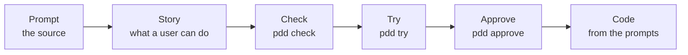

# PDD v2

## What PDD is

This is PDD version 2. In PDD, you write prompts and Stories. The prompts are the source of your program. The PDD runtime runs the prompts with an AI that acts as the code, so you can check and try the program before any code exists. Then your agent writes the code from the approved prompts.



PDD is the `pdd` command and a set of skills for your agent. Your agent writes the prompts, the Stories, the tests and the code. The runtime runs the checks and the Try. Only you approve.

## Install

You need [Node.js](https://nodejs.org) 22.20 or newer, [Git](https://git-scm.com), and the [GitHub CLI](https://cli.github.com) signed in with `gh auth login`. You also need an agent that can use skills, and access to the PDD runtime (see [Access](#access)). PDD is tested on macOS and Linux.

```sh
npm install -g github:promptdriven/pdd
npx skills add promptdriven/pdd#alpha -g
pdd --version
cd your-repo
pdd setup
```

1. `npm install -g github:promptdriven/pdd` installs the `pdd` command.
2. `npx skills add promptdriven/pdd#alpha -g` adds the PDD skills for your agents. The installer finds the agents on your computer, or asks you which agents get the skills. It can say `Failed to install` for an agent that cannot have global skills. That agent still gets them.
3. `pdd --version` must print `0.1.9`. When your skills are older than pdd, it also prints the command that updates them.
4. `pdd setup` adds a short PDD block to `AGENTS.md`, or to `CLAUDE.md` when the repo has one. Then every agent chat in the repo knows that the project uses PDD. A second run changes nothing.

To update, run the 2 install commands and `pdd setup` again, then start a new agent chat. After `npx skills add`, `npx skills update -g` also updates the skills.

> [!IMPORTANT]
> Do not run `npm install -g pdd` or `npm update -g`. The npm registry has a different package with the name `pdd`.

## The PDD loop

The names `my-story`, `tests/my-story.json` and `NAME` are placeholders. Your names come from your project.

### 1. Ask your agent

Open your agent in your repo. Ask it for a feature with the `pdd-feature` skill:

```
/pdd-feature <the feature, in one or two sentences>
```

The way to call a skill depends on your agent. You can also write "Use the pdd-feature skill to add …".

| Skill | Use it to |
|---|---|
| `pdd-feature` | add new behavior |
| `pdd-bug` | fix something that is broken |
| `pdd-small-change` | make a small change that is easy to undo |
| `pdd-prompting` | write or review prompts with the [Prompting guide](docs/prompting-guide.md) |
| `pdd-setup` | set up a repo for PDD |

The agent writes these files in prompt space:

| File | What it is |
|---|---|
| `prompts/NAME.prompt.md` | A prompt: the source of one part of the program. |
| `user_stories/my-story.md` | A Story: one thing that a user can do, with numbered acceptance criteria. |
| `tests/my-story.json` | The tests of that Story. |
| `app-map.json` | Only for a program with a screen. It connects the screen to the prompts. |

You read the Stories and approve them in the chat. The expected values come from you and the Stories, not from a run.

In a chat, the agent opens a pull request only when you say yes. For a full run with pull requests, start from a GitHub issue: `pdd workflow run feature 42`, where 42 is the issue number. A run needs [Herdr](https://herdr.dev). pdd opens the agent chats in Herdr, and you follow the same steps.

> [!WARNING]
> In a workflow run, the agents run with full access. They do not stop to ask for approval. They can change files and run commands as your user.

### 2. Check

```sh
pdd check --lint
pdd check
```

`pdd check --lint` checks the format of the files, with 0 AI calls. `pdd check` runs the tests of every Story on the runtime. To check only some Stories, name them, for example `pdd check my-story other-story`. The output has this shape:

```
Story        Test                    Result  Checks  Time
My story     tests/my-story.json     passed  20/20   41.4 s
Other story  tests/other-story.json  passed  34/34   89.1 s
Runtime check (my-story): ✓ 2 of 2 criteria · 20/20 checks · 2 AI calls
Runtime check (other-story): ✓ 5 of 5 criteria · 34/34 checks · 10 AI calls
Runtime check: ✓ 7 of 7 criteria · 54/54 checks · 12 AI calls
2 of 2 stories passed.
Reports (anyone with a link can open it):
  my-story     https://…/r/…
  other-story  https://…/r/…
```

| You see | It means |
|---|---|
| `✓` | Every check passed. |
| `FAILED` | A check failed. pdd shows the criterion, the expected value and the answer. Fix the prompt, or change the expected value. |
| `REFUSED` | A file breaks a rule, and nothing was judged. Fix the file that pdd names. |
| `STOPPED` | One test step took more than 10 minutes, and the server stopped it. Make the step smaller. |
| `DRAFT` | A prompt is still a draft. A DRAFT pass is not an approval. |
| A report link | A page with each step, check and answer. Anyone with the link can open it. It expires after 7 days. |

### 3. Try

`pdd try` lets you use the program by hand. There is no code: the runtime runs the prompts.

| Your program | Command | What you do |
|---|---|---|
| A screen | `pdd try STORY` | pdd opens the Try page in your browser. On the **Screen** tab, click **Open the app**, then use it. |
| A command line | `pdd try STORY --cli` | pdd prints an `export PATH=…` line. Run that line, because pdd cannot change the PATH of your terminal. Then run your program's commands. |
| An HTTP API | `pdd try STORY --serve PORT` | pdd serves the routes of the prompt at `http://127.0.0.1:PORT`. Send requests with `curl`. Ctrl-C stops the server. |
| Anything else | `pdd try STORY` | On the **Form** tab of the Try page, fill the fields and click **Run**. |

For a command line named `my-program`, and an API with a route `/api/items`:

```sh
pdd try my-story --cli
export PATH=/path/to/your-repo/.pdd/try/bin:"$PATH"
my-program --help
```

```sh
pdd try my-story --serve 8091
curl http://127.0.0.1:8091/api/items
```

The server keeps running, so send the requests from a second terminal. The command line and the API use the same Try data.

Each command or request runs on the runtime with no code. It takes about 10 to 20 seconds and uses AI calls from the Try budget. A Try runs one command at a time. Your agent can run the same commands after the PATH line, when it has network access and no sandbox that blocks files outside the repo.

On the Try page, the **Ask your agent** panel connects to an agent on your computer while `pdd try` runs in your terminal. It explains and fills fields, but it never clicks **Run**. To choose the agent, add `--agent NAME`.

- **Budget.** A new Try has 400 AI calls. For more, click **Raise the limit** on the Try page, or start a new Try with `pdd try STORY --new --max-calls 600`. `--new` starts with fresh data.
- **Save a case.** Click **Save as test** on the Try page, or run `pdd try --save-last` after a `--cli` command. pdd adds the case to the Story's test file.
- **Keep the link private.** Anyone with a Try link can use it and spend its AI calls.
- **Stop it.** A Try ends after 24 hours. To stop it before that, run `pdd try --stop STORY`.

### 4. Approve

When the program does what you want, approve each prompt in your terminal:

```sh
pdd approve prompts/NAME.prompt.md
```

pdd shows the interface of the prompt and the text changes since the last approval. Then it asks yes or no. Only a person at a terminal can approve. When an agent runs `pdd approve`, pdd refuses and tells it to ask you. You can also click **Approve** on the Try page while `pdd try` runs in your terminal.

### 5. Code space

In a workflow run, pdd opens two pull requests:

1. **Prompt space.** The prompts, the Stories and the tests. The pull request text starts with the `Runtime check` lines and the report links.
2. **Code space.** The code. To get it, say so in the chat, or run `pdd workflow approve 42`. The agent writes the code from the approved prompts. pdd runs the tests from prompt space on the code, and shows the results in a table with a formal check, for example **Proved (bounded)**.

pdd makes the code only after you approve each draft prompt. pdd never merges. You review and merge on GitHub.

## Commands

| Command | What it does |
|---|---|
| `pdd setup` | Set up this repo for PDD. |
| `pdd check --lint` | Check the format of the prompts, Stories and tests. 0 AI calls. |
| `pdd check [STORY...]` | Run the tests of the Stories on the runtime. |
| `pdd check --files` | List the files that a check sends. No network. |
| `pdd check --read` | Show saved check results again. Sends no check. |
| `pdd try STORY` | Open a Try page for the Story. |
| `pdd try STORY --cli` | Run the program as a command line in your terminal. |
| `pdd try STORY --serve PORT` | Serve the program as an HTTP API on localhost. |
| `pdd try STORY --agent NAME` | Connect an agent to the **Ask your agent** panel. |
| `pdd try STORY --new --max-calls N` | Start a new Try with a limit of N AI calls. |
| `pdd try --stop STORY` | Stop the Try link of a Story. |
| `pdd approve PROMPT` | Approve a prompt. Only for a person at a terminal. |
| `pdd workflow run NAME ISSUE` | Start a run on a GitHub issue. NAME is `feature`, `bug` or `small-change`. |
| `pdd workflow status [ISSUE]` | Show where each run is and what it waits for. |
| `pdd workflow view ISSUE` | Show the gates, approvals, pull requests and Try links of a run. Changes nothing. |
| `pdd workflow open ISSUE` | Open the chat of a run. |
| `pdd workflow approve [ISSUE]` | Approve the gate of a run, or start code space. |
| `pdd help` | Show all commands. |

The [CLI reference](docs/cli.md) has every command and option.

## Key ideas

**Prompt space and code space.** Your program lives in prompt space first: the prompts, the Stories and the tests. You check it, try it and change it there. When it does what you want, you approve the prompts, and the code in code space follows them.

**Stories.** A Story is one thing that a user can do. Its acceptance criteria are a numbered list that a person can check. The test file has at least one exact check for each criterion.

**Small test steps.** Keep each test step small: one action, or a short run of about 10 actions. The server stops a step after 10 minutes.

**Draft and approved.** A prompt starts as a draft. A draft can be checked and tried. Only a person approves a prompt. When an approved prompt changes, it goes back to draft.

**AI-call budgets.** A budget is a limit, not a price. You are charged only for calls that run. A check gives each test file 12 calls for each step, at least 18 and at most 1000. A new Try has 400 calls. `--max-calls N` sets another limit, from 1 to 1000, for a check or a new Try.

**Fakes.** The runtime never touches your real database, files or services. The prompt declares each one as a resource, the test gives its starting data, and the runtime fakes it. See [RUNBOOK §5](RUNBOOK.md#5-saved-data).

**Scoped uploads.** A check sends only the files that the selected Stories need. Each file must be visible to Git. pdd refuses files with secret-like names. `pdd check --files` shows the list.

## Access

`pdd check` and `pdd try` use the hosted PDD runtime. The runtime lets you in when PDD Cloud approves your GitHub account. To get access, sign up at [promptdriven.ai/login](https://promptdriven.ai/login) with the same GitHub account that `gh` uses. After the approval, access starts within 1 minute. For questions about access, [ask the team](https://github.com/promptdriven/pdd/issues/new?title=%5Baccess%5D%20Runtime%20access%20for%20) with your GitHub login.

The skills and the other commands run on your computer.

## When something goes wrong

| You see | What to do |
|---|---|
| `The lint result is unknown.` It comes after 1 or 2 minutes of `Still checking the files`. | pdd got no answer that it can read. One cause is access: PDD Cloud has not approved your GitHub account, or the PDD Cloud sign-in was slow. Make sure that PDD Cloud approved the GitHub account that `gh` uses. See [Access](#access). Then wait 1 minute and run the command again. |
| `Please update pdd: …` | Your pdd is too old for the runtime. Do the install steps again. |
| `REFUSED` (exit code 4) | Read the code and the fix under the line, and fix the file. Run `pdd check --lint` before a check. [RUNBOOK §11](RUNBOOK.md#11-pdd-check) lists the usual refusals. |
| `UNKNOWN` or `Still running` (exit code 3) | The check can still run on the server. Run `pdd check --read` later. Do not send the same check again. |
| `STOPPED … took more than 10 minutes and was stopped.` | Make the test step smaller, then check that Story again. |
| `This Try session is busy.` | The Try runs one command at a time. Wait for the first command to finish. |
| `The runtime is busy. Try again later.` (exit code 5), or `Too many Try links are open.` | Wait a few minutes, then run the command again. To close a Try that you do not use, run `pdd try --stop STORY`. |
| `This Try has ended` | The Try used all its AI calls or its 24 hours. Run `pdd try STORY --new`. |
| `pdd --version` does not print `0.1.9` | Another `pdd` comes first on your PATH. Run `"$(npm prefix -g)/bin/pdd" setup`. It shows the `export PATH=…` line that puts this pdd first. |

The [usage guide](docs/USAGE.md#13-troubleshooting) has more. To report a problem, [open an issue](https://github.com/promptdriven/pdd/issues/new?title=%5Balpha%5D%20) with **[alpha]** in the title.

## Links

- [Documentation](docs/index.md): the [usage guide](docs/USAGE.md), [workflows](docs/workflows.md), the [CLI reference](docs/cli.md) and the [Prompting guide](docs/prompting-guide.md).
- [RUNBOOK.md](RUNBOOK.md): how to write prompts and tests that the runtime can check.
- [The skills](skills/).
- [Release notes](https://github.com/promptdriven/pdd/releases/tag/alpha-v0.1.9).
- [Contributing](CONTRIBUTING.md).

## License

[MIT](LICENSE).
