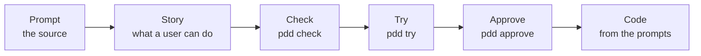

# PDD

## What PDD is

In PDD, you write prompts and Stories in plain words. The prompts are the source of your program. The PDD runtime runs your prompts with an AI that acts as the code, so you can check and try your program before any code exists. The code comes later, from the approved prompts.



PDD is a set of skills for your coding agent, and the `pdd` command. Your agent writes the prompts, the Stories, the tests and later the code. The runtime runs the check and the Try. Only you approve.

## Before you start

You need:

- [Node.js](https://nodejs.org) 22.20 or newer.
- [Git](https://git-scm.com).
- The [GitHub CLI](https://cli.github.com), signed in with `gh auth login`. pdd uses this login for the runtime and for pull requests.
- A coding agent that can use skills, signed in.
- Access to the PDD runtime, for `pdd check` and `pdd try`. See [Access](#access).
- [Herdr](https://herdr.dev), only for `pdd workflow run`.

PDD is tested on macOS and Linux.

## Install

```sh
npm install -g github:promptdriven/pdd       # 1. Install the pdd command.
npx skills add promptdriven/pdd#alpha -g     # 2. Add the PDD skills for your coding agent.
pdd --version                                # 3. Make sure that it prints 0.1.9.
cd your-repo
pdd setup                                    # 4. Set up this repo for PDD.
```

1. npm installs `pdd` from GitHub. The package has no dependencies and no build step. `npm install -g github:promptdriven/pdd#alpha` also works.
2. A skill is a folder of plain Markdown that your agent reads. The installer finds the coding agents on your computer, or asks you which agents get the skills. It can say `Failed to install` for agents that cannot have global skills. Your agent still gets them. Leave out `-g` to install the skills only in the current repo.
3. If you see another version, another `pdd` comes first on your PATH. See [When something goes wrong](#when-something-goes-wrong). When your skills are older than pdd, `pdd --version` also prints the command that updates them.
4. `pdd setup` adds a short PDD block (between `<!-- pdd:start -->` and `<!-- pdd:end -->`) to `AGENTS.md`, or to `CLAUDE.md` when the repo has one. Then every agent chat in the repo knows that the project uses PDD. It also installs the skills when they are missing. A second run changes nothing.

To update, do steps 1, 2 and 4 again. Then start a new agent chat.

> [!IMPORTANT]
> Do not run `npm install -g pdd` or `npm update -g`. The npm registry has a different package with the name `pdd`.

## Your first 10 minutes

This example makes a 2048 game that you can play in the browser, also on a phone. The outputs below come from a real 2048 project. Some lines are cut.

### 1. Ask your agent for a feature

Open your coding agent in your repo, as usual. Ask it to use the `pdd-feature` skill:

```
/pdd-feature Add a 2048 game that I can play in the browser, also on a phone.
```

The exact way to call a skill depends on your agent. You can also write "Use the pdd-feature skill to add a 2048 game …".

In a chat, the work stays in your folder. To get pull requests, start from a GitHub issue instead: `pdd workflow run feature 42`, where 42 is the issue number. pdd then opens the chats in Herdr, and you follow the same steps. Run `pdd help` to see which agents `pdd workflow run` can start.

> [!WARNING]
> In a workflow run, the agents run with full access. They do not stop to ask for approval. They can change files and run commands as your user.

### 2. The agent writes the prompts, the Stories and the tests

The files depend on your project. A small program can have one prompt, one Story and one test file. For the 2048 game, the agent wrote:

```
prompts/board.prompt.md      the board: how tiles move and merge
prompts/game.prompt.md       the game: score, new tiles, game over
prompts/ui.prompt.md         the screen in the browser
prompts/views/*.svg          a mockup of the screen
user_stories/*.md            5 Stories, for example "Move and merge tiles" and "Play on a phone"
tests/*.json                 one test file for each Story
app-map.json                 connects the screen to the prompts, for the Try page
```

This is one of the 2048 Stories (cut). Your Stories will look different. Each one tells, in plain words, what a user can do, and has numbered acceptance criteria that a person can check:

```markdown
# Move and merge tiles

As a player, I want to move and combine tiles and see my score grow, so I can
build larger tiles.

## Acceptance criteria

1. I can move tiles left, right, up or down. They slide toward the edge I choose.
2. Equal neighboring tiles join once in a move, starting from the direction of movement.
3. When tiles join, my score increases by the values of the new tiles.
4. A move that cannot change the board leaves it unchanged and adds no score.
5. An unsupported direction reports an error.
```

You read the Stories and approve them. The expected values come from you and the Stories, not from a run. If you want a change, say it in the chat. The agent changes the files and asks you again.

### 3. Check the prompts

The agent runs the check. You can run it too:

```sh
pdd check --lint     # check the format of the files; 0 AI calls
pdd check            # run the tests of every Story on the runtime
```

`pdd check --lint` prints:

```
  tests/game-over.json  passes lint
  tests/move-and-merge.json  passes lint
  tests/new-tile-after-move.json  passes lint
  tests/phone-play.json  passes lint
  tests/same-seed-same-game.json  passes lint
Lint: 5 of 5 tests pass. 0 AI calls. No checks were sent.
```

`pdd check move-and-merge game-over` checks two Stories. It prints one table, one `Runtime check` line for each Story, the overall line, and a report link for each Story:

```
Still running: 1 of 2 Stories done · 2 AI calls so far · 1 min
Story                 Test                       Result  Checks  Time
Game over             tests/game-over.json       passed  20/20   41.4 s
Move and merge tiles  tests/move-and-merge.json  passed  34/34   89.1 s
Runtime check (game-over): ✓ 2 of 2 criteria · 20/20 checks · 2 AI calls
Runtime check (move-and-merge): ✓ 5 of 5 criteria · 34/34 checks · 10 AI calls
Runtime check: ✓ 7 of 7 criteria · 54/54 checks · 12 AI calls
2 of 2 stories passed.
Reports (anyone with a link can open it):
  game-over       https://…/r/…
  move-and-merge  https://…/r/…
```

While pdd works, it tells you what it does, for example `Checking 14 files (125 KB) on the PDD runtime (lint, 0 AI calls)…`.

| You see | It means |
|---|---|
| `✓` | Every check passed. |
| `✗` with `FAILED` | A check failed. pdd shows the criterion, the path, the expected value and the answer, for example `AC1  result /score  expected …, got …`. You decide: fix the prompt, or change the expected value. |
| `✗` with `REFUSED` | A file breaks a rule. Nothing was judged. Fix the file that pdd names. |
| `STOPPED` | One test step took more than 10 minutes, and the server stopped it. There is no verdict. pdd tells you to make the step smaller, for example to split 30 moves into 3 steps of 10. |
| `DRAFT` | A prompt is still a draft. A draft runs, and pdd labels its result, for example `passed (DRAFT)`. A DRAFT pass is not an approval. |
| The report link | A page with each step, check and answer. Anyone with the link can open it. It expires after 7 days. |

### 4. Try it

`pdd try` lets you use the program by hand. There is no code yet: the runtime runs the prompts.

```sh
pdd try phone-play
```

pdd opens the Try page in your browser and prints the budget of this Try:

```
Try budget 400 calls; 400 remaining. You are charged only for calls that run.
```

On the **Screen** tab, click **Open the app**. The runtime draws the 2048 board (1 AI call). Then tap the arrows. In the real project, one move took 4 AI calls and 75 seconds. The page shows the calls that each tap uses and the calls that are left.

| Your program | Command | What you do |
|---|---|---|
| A web app or a screen | `pdd try STORY` | Use the **Screen** tab. It needs an app map. The agent writes one for a page or a screen. |
| A command line | `pdd try STORY --cli` | Copy the PATH line that pdd prints. Then run your program as usual. |
| An API | `pdd try STORY --serve 8080` | Send requests to `http://127.0.0.1:8080`, for example with `curl`. Press Ctrl-C to stop the server. The prompt names its routes ([RUNBOOK §19](RUNBOOK.md#19-use-a-try-from-your-terminal-or-curl)). |
| Anything else | `pdd try STORY` | Use the **Form** tab: fill the fields and press **Run**. |

**Ask your agent.** While `pdd try` runs in your terminal, the **Ask your agent** panel on the Try page talks to a coding agent on your computer. Ask it what to try, ask it to fill the fields from your words, or ask it to explain an answer. It only reads, and it never presses **Run** for you. It uses your agent's own sign-in and allowance, not the AI calls of the Try. To choose the agent, add `--agent NAME`. `pdd try --help` shows the agents that pdd can connect.

- **More AI calls.** When a Try runs low, click **Raise the limit** on the Try page and type a new limit. To start a new Try with another limit, run `pdd try STORY --new --max-calls 600`. `--new` starts again with fresh saved data.
- **Save a case.** To keep a case as a test, click **Save as test** on the Try page, or run `pdd try --save-last` after a `--cli` command. pdd adds it to the Story's test file. Read each saved case: it holds the answer that the AI gave, not always the answer that you expect.
- **Keep the link private.** Anyone with a Try link can use it and spend its AI calls. Do not put it in a PR or an issue.
- **Stop it.** A Try ends after 24 hours. To stop it before that, run `pdd try --stop phone-play`.

### 5. Approve the prompts

When the program does what you want, approve each prompt in your terminal:

```sh
pdd approve prompts/board.prompt.md
```

pdd shows the interface in plain words and the text changes since the last approval. Then it asks y/n. When you answer `y`, pdd sets the prompt to approved. Its next check results do not say DRAFT.

Only a person at a terminal can approve. When an agent runs `pdd approve`, pdd refuses and tells it to ask you. You can also click **Approve** on the Try page while `pdd try` runs in your terminal. pdd then asks y/n in that terminal.

### 6. PR 1, then the code PR

In a workflow run, pdd opens the pull requests:

1. After you try it and approve, pdd opens **PR 1**: the prompts, the Stories and the tests. The PR text starts with the `Runtime check` lines and the report links.
2. Then the chat asks if you want the code PR. To get it, say so in the chat, or run `pdd workflow approve 42`.
3. The agent builds the code from the approved prompts. pdd opens **PR 2**. It runs the PR 1 test cases on the real code and shows the results in a table, with a formal check.

In the 2048 project, PR 1 held the 3 prompts, the 5 Stories, their tests, the mockup and the app map. PR 2 held the code. It ran all 31 test steps of PR 1 on the real code, and its formal check said **Proved (bounded)**.

You can also stop at PR 1, merge it, and make the code PR later with `pdd workflow approve 42`. pdd makes the code PR only after you approve each draft prompt. pdd never merges. You review and merge on GitHub.

To see where a run is, run `pdd workflow status 42`. To open its chat, run `pdd workflow open 42`.

## The commands

| Command | What it does |
|---|---|
| `pdd check [STORY...]` | Run the tests of the Stories on the runtime. Print one table and a report link for each test. Add `--max-calls N` to set the AI-call limit. |
| `pdd check --lint` | Check only the format of the prompts, Stories and tests. 0 AI calls. |
| `pdd check --files` | List the files that a check sends, with their sizes. No network. |
| `pdd try [STORY]` | Open a Try page for the Story. Add `--cli` for a command line, `--serve PORT` for an API, or `--max-calls N` for the limit of a new Try. |
| `pdd try STORY --agent NAME` | Open a Try page, and connect a coding agent on your computer to its **Ask your agent** panel. |
| `pdd try --stop [STORY]` | Stop the Try link of a Story. |
| `pdd approve PROMPT` | Approve a prompt. Only for a person at a terminal. |
| `pdd workflow run NAME ISSUE` | Start a run on a GitHub issue. NAME is `feature`, `bug` or `small-change`. |
| `pdd workflow status [ISSUE]` | Show where each run is and what it waits for. |
| `pdd workflow view ISSUE` | Show a run: the gate, the approvals, the PRs and the Try links. It changes nothing. |
| `pdd workflow approve [ISSUE]` | Approve the gate of a run, or make the code PR. |
| `pdd setup` | Set up this repo for PDD, and install the skills when they are missing. |
| `pdd help` | Show all commands. |

The [CLI reference](docs/cli.md) has every command and option.

The skills:

| Skill | Use it to |
|---|---|
| `pdd-feature` | add new behavior |
| `pdd-bug` | fix something that is broken |
| `pdd-small-change` | make a small change that is easy to undo |
| `pdd-prompting` | write or review prompts with the [Prompting guide](docs/prompting-guide.md) |
| `pdd-setup` | set up a repo for PDD |

Call a skill the way that your agent calls skills, or ask for it by name.

## Key ideas

**Prompt space.** Your program lives in prompt space before it has code: the prompts, the Stories and the tests. You check it, try it and change it there. When it does what you want, you approve the prompts, and the code follows them.

**Stories and criteria.** A Story is one thing that a user can do, in plain words. Its acceptance criteria are a numbered list that a person can check. The test file copies each criterion word for word and has at least one exact check for it.

**Small test steps.** Keep each test step small: one action, or a short run of about 10 moves. The server stops one step after 10 minutes.

**Draft and approved prompts.** A prompt starts as a draft. A draft can be checked and tried, and pdd labels its results DRAFT. Only a person approves a prompt, with `pdd approve`. When an approved prompt changes, it goes back to draft, and you approve it again.

**AI-call budgets.** A budget is a limit, not a price. You are charged only for the calls that run.

- A check gives each test file 12 calls for each step, at least 18 and at most 1000. `pdd check --max-calls N` sets another limit, from 1 to 1000. Before a check of all Stories, pdd prints the likely number, for example `about 2 AI calls (at most 24)`.
- A new Try has 400 calls. `pdd try STORY --max-calls N` sets another limit, from 1 to 1000, when pdd starts a new Try. For a Try that is open, click **Raise the limit** on the Try page.

**Fakes for databases, files and services.** The runtime never touches your real database, files or services. The prompt declares each one as a resource, and the test gives its starting data. The runtime then fakes it: for example a key-value store, an SQL database in memory, files, or fixed HTTP answers. See [RUNBOOK §5](RUNBOOK.md#5-saved-data).

**Scoped uploads.** A check sends only what the selected Stories need: the Stories, their tests, the prompts that the tests reach, and the files that those prompts name. Each file must be visible to Git. pdd refuses files with secret-like names. To see the exact list and sizes before you send, run `pdd check --files` (no network).

## Access

`pdd check` and `pdd try` use the hosted PDD runtime. The hosted runtime is in early access. To get access, sign up at [promptdriven.ai/login](https://promptdriven.ai/login) with the same GitHub account that `gh` uses, or [open an access request](https://github.com/promptdriven/pdd/issues/new?title=%5Baccess%5D%20Runtime%20access%20for%20) with your GitHub login. Access follows PDD Cloud accounts soon.

The skills and the other commands run on your computer.

## When something goes wrong

| You see | What to do |
|---|---|
| `Your GitHub login NAME is not on the PDD runtime invite list yet.` | The PDD team must add your GitHub login. [Open an access request](https://github.com/promptdriven/pdd/issues/new?title=%5Baccess%5D%20Runtime%20access%20for%20) with your login. See [Access](#access). |
| `Please update pdd: …` | Your pdd is too old for the runtime. Do the install steps again, then run `pdd setup`. |
| `REFUSED` (exit code 4) | A file breaks a rule, and nothing was judged. Read the code and the fix under the line, and fix the file. Run `pdd check --lint` before a check. [RUNBOOK §11](RUNBOOK.md#11-pdd-check) lists the usual refusals. |
| `UNKNOWN` or `Still running` (exit code 3) | The check may still run on the server. Run `pdd check --read` later. Do not send the same check again. |
| `STOPPED … took more than 10 minutes and was stopped.` | One test step is too long. Make it smaller, for example split 30 moves into 3 steps of 10. Then check that Story again. |
| `The runtime is busy. Try again later.` (exit code 5), or `Too many Try links are open.` | The runtime hit a rate limit or is full. Wait a few minutes, then run the command again. For Try links, stop one that you do not use: `pdd try --stop STORY`. |
| `This Try has ended` | The Try used all its AI calls or its 24 hours. Run `pdd try STORY --new` for a fresh Try. Next time, click **Raise the limit** before the calls run out. A Try that paused after 15 minutes with no clicks opens again with `pdd try STORY`. |
| `pdd --version` does not print `0.1.9` | Another `pdd` comes first on your PATH. Run `"$(npm prefix -g)/bin/pdd" setup`. It shows each `pdd` on your PATH, and the `export PATH=…` line that puts this pdd first. |

The [usage guide](docs/USAGE.md#13-troubleshooting) has more. To report a problem, [open an issue](https://github.com/promptdriven/pdd/issues/new?title=%5Balpha%5D%20) with **[alpha]** in the title.

## Links

- [Documentation](docs/index.md): the [usage guide](docs/USAGE.md), [workflows](docs/workflows.md), the [CLI reference](docs/cli.md) and the [Prompting guide](docs/prompting-guide.md).
- [RUNBOOK.md](RUNBOOK.md): how to write prompts and tests that the runtime can check.
- [The skills](skills/).
- [Release notes](https://github.com/promptdriven/pdd/releases/tag/alpha-v0.1.9).
- [Contributing](CONTRIBUTING.md).

## License

[MIT](LICENSE).
