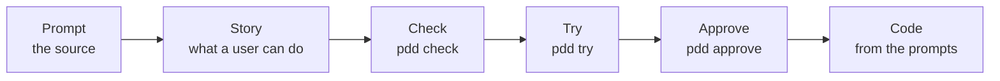

# PDD

**Prompt-driven development for Codex and Claude Code.**

> v1 is on the [`v1` branch](https://github.com/promptdriven/pdd/tree/v1) and on [PyPI](https://pypi.org/project/pdd-cli/) (`pdd-cli`).

## What PDD is

In PDD, you write prompts and Stories in plain words. The prompts are the source of your program. The PDD runtime runs your prompts with an AI that acts as the code, so you can check and try your program before any code exists. The code comes later, from the approved prompts.



Your agent writes the prompt, the Story, the tests and the code. The runtime runs the check and the Try. Only you approve.

## Before you start

You need:

- [Node.js](https://nodejs.org) 22 or newer.
- [Git](https://git-scm.com).
- The [GitHub CLI](https://cli.github.com), signed in with `gh auth login`. pdd uses this login for the runtime and for pull requests.
- [Codex CLI](https://developers.openai.com/codex/cli/) or [Claude Code](https://code.claude.com/docs/en/overview), signed in.
- Access to the PDD runtime, for `pdd check` and `pdd try`. See [Access](#access).
- [Herdr](https://herdr.dev), only for `pdd workflow run`.

PDD is tested on macOS and Linux.

## Install

```sh
npm install -g github:promptdriven/pdd                   # 1. Install the pdd command.
cd your-repo
npx skills add promptdriven/pdd -a codex -a claude-code   # 2. Add the PDD skills to Codex and Claude Code in this repo.
pdd --version                                            # 3. Make sure that it prints 0.1.8.
pdd setup                                                # 4. Set up this repo for PDD.
```

1. npm installs `pdd` from GitHub. The package has no dependencies and no build step. `npm install -g github:promptdriven/pdd#alpha` also works.
2. The skills are plain Markdown folders that your agent reads. Add `-g` to install them for all your projects.
3. If you see another version, another `pdd` comes first on your PATH. See [When something goes wrong](#when-something-goes-wrong).
4. `pdd setup` adds a short PDD block (between `<!-- pdd:start -->` and `<!-- pdd:end -->`) to `CLAUDE.md`, else to `AGENTS.md`. Then every chat in the repo knows that the project uses PDD. It also installs the skills when they are missing. A second run changes nothing.

To update, do steps 1, 2 and 4 again. Then start a new agent chat.

> [!IMPORTANT]
> Do not run `npm install -g pdd` or `npm update -g`. The npm registry has a different package with the name `pdd`.

## Your first 10 minutes

This example adds a small command-line program, `tipjar`, that splits a bill. You can use the same steps for a web page or an API.

### 1. Ask your agent for a feature

Open Codex or Claude Code in your repo, as usual. Call the `pdd-feature` skill.

In Codex:

```
$pdd-feature Add a tipjar command: "tipjar split 60 --people 3" prints what each person pays.
```

In Claude Code:

```
/pdd-feature Add a tipjar command: "tipjar split 60 --people 3" prints what each person pays.
```

In a chat, the work stays in your folder. To get pull requests, start from a GitHub issue instead: `pdd workflow run feature 42`, where 42 is the issue number. pdd then opens the chats in Herdr, and you follow the same steps. Add `--agent claude` for Claude Code. Codex is the default.

> [!WARNING]
> In a workflow run, the agents run with full access. They do not stop to ask for approval. They can change files and run commands as your user.

### 2. The agent writes the prompt, the Story and the tests

The agent writes three files:

```
prompts/tipjar.prompt.md     the program in plain words, and its runtime interface
user_stories/split-bill.md   the Story: what a user can do, as numbered criteria
tests/split-bill.json        the test cases: one or more checks for each criterion
```

The Story is short. You read it and approve it:

```markdown
# Split a bill

I can split a bill between friends, so each of us knows what to pay.

## Acceptance criteria

1. `tipjar split 60 --people 3` prints "Each person pays $20.00" and exits with code 0.
2. `tipjar split 60 --people 0` prints "tipjar: --people must be a whole number of 1 or more" to stderr and exits with code 2.
```

The expected values come from you and the Story, not from a run. If you want a change, say it in the chat. The agent changes the files and asks you again.

### 3. Check the prompt

The agent runs the check. You can run it too:

```sh
pdd check --lint     # check the format of the files; 0 AI calls
pdd check            # run every Story's tests on the runtime
```

`pdd check --lint` prints:

```
  tests/split-bill.json  passes lint
Lint: 1 of 1 tests pass. 0 AI calls. No checks were sent.
```

`pdd check` prints one table, one `Runtime check` line for each Story, and a report link (some lines are cut):

```
Story         Test                   Result          Checks  Time
Split a bill  tests/split-bill.json  passed (DRAFT)  4/4     23.4 s
Runtime check (split-bill) (DRAFT): ✓ 2 of 2 criteria · 4/4 checks · 2 AI calls
1 of 1 stories passed.
Reports (anyone with a link can open it):
  split-bill  https://…/r/…  (DRAFT)
```

| You see | It means |
|---|---|
| `✓` | Every check passed. |
| `✗` with `FAILED` | A check failed. pdd shows the criterion, the path, the expected value and the answer, for example `AC1  result /stdout  expected …, got …`. You decide: fix the prompt, or change the expected value. |
| `✗` with `REFUSED` | A file breaks a rule. Nothing was judged. Fix the file that pdd names. |
| `DRAFT` | The prompt is still a draft. A draft runs, and pdd labels its result DRAFT. A DRAFT pass is not an approval. |
| The report link | A page with each step, check and answer. Anyone with the link can open it. It expires after 7 days. |

### 4. Try it

`pdd try` lets you use the program by hand. There is no code yet: the runtime runs the prompt.

| Your program | Command | What you do |
|---|---|---|
| A web app or a screen | `pdd try STORY` | pdd opens the Try page in your browser. Use the **Screen** tab. It needs an app map: the agent writes one in the optional `visual` step. |
| A command line | `pdd try STORY --cli` | Copy the PATH line that pdd prints. Then run your program as usual. |
| An API | `pdd try STORY --serve 8080` | Send requests to `http://127.0.0.1:8080`, for example with `curl`. Press Ctrl-C to stop the server. The prompt names its routes ([RUNBOOK §19](RUNBOOK.md#19-use-a-try-from-your-terminal-or-curl)). |

For `tipjar`:

```console
$ pdd try split-bill --cli
Try is ready: tipjar
…/.pdd/try/bin/tipjar
export PATH=…/.pdd/try/bin:"$PATH"
Examples from this Story:
  tipjar split 60 --people 3
  tipjar split 60 --people 0
$ export PATH=…/.pdd/try/bin:"$PATH"
$ tipjar split 45.50 --people 3
Each person pays $15.17
```

- To keep a case as a test, click **Save as test** on the Try page, or run `pdd try --save-last` after a command. pdd adds it to the Story's test file. Read each saved case: it holds the answer that the AI gave, not always the answer that you expect.
- Anyone with a Try link can use it. Do not put it in a PR or an issue.
- A Try ends after 24 hours. To stop it before that, run `pdd try --stop split-bill`.

### 5. Approve the prompt

When the program does what you want, approve the prompt in your terminal:

```sh
pdd approve prompts/tipjar.prompt.md
```

pdd shows the interface in plain words and the text changes since the last approval. Then it asks y/n. When you answer `y`, pdd sets the prompt to approved. Its next check results do not say DRAFT.

Only a person at a terminal can approve. When an agent runs `pdd approve`, pdd refuses and tells it to ask you. You can also click **Approve** on the Try page while `pdd try` runs in your terminal. pdd then asks y/n in that terminal.

### 6. PR 1, then the code PR

In a workflow run, pdd opens the pull requests:

1. After you try it and approve, pdd opens **PR 1**: the prompt, the Story and the tests. The PR text starts with the `Runtime check` line and the report link.
2. Then the chat asks if you want the code PR. To get it, say so in the chat, or run `pdd workflow approve 42`.
3. The agent builds the code from the approved prompts. pdd opens **PR 2**. It runs the PR 1 test cases on the real code and shows the results in a table.

You can also stop at PR 1, merge it, and make the code PR later with `pdd workflow approve 42`. pdd makes the code PR only after you approve each draft prompt. pdd never merges. You review and merge on GitHub.

To see where a run is, run `pdd workflow status 42`. To open its chat, run `pdd workflow open 42`.

## The commands

| Command | What it does |
|---|---|
| `pdd check [STORY...]` | Run the tests of the Stories on the runtime. Print one table and a report link for each test. |
| `pdd check --lint` | Check only the format of the prompts, Stories and tests. 0 AI calls. |
| `pdd check --files` | List the files that a check sends, with their sizes. No network. |
| `pdd try [STORY]` | Open a Try page for the Story. Add `--cli` for a command line, or `--serve PORT` for an API. |
| `pdd try --stop [STORY]` | Stop the Try link of a Story. |
| `pdd approve PROMPT` | Approve a prompt. Only for a person at a terminal. |
| `pdd workflow run NAME ISSUE` | Start a run on a GitHub issue. NAME is `feature`, `bug` or `small-change`. |
| `pdd workflow status [ISSUE]` | Show where each run is and what it waits for. |
| `pdd workflow view ISSUE` | Show a run: the gate, the approvals, the PRs and the Try links. It changes nothing. |
| `pdd workflow approve [ISSUE]` | Approve the gate of a run, or make the code PR. |
| `pdd setup` | Set up this repo for PDD, and install the skills when they are missing. |
| `pdd help` | Show all commands. |

The [CLI reference](docs/cli.md) has every command and option.

The skills:

| Skill | Use it to |
|---|---|
| `pdd-feature` | add new behavior |
| `pdd-bug` | fix something that is broken |
| `pdd-small-change` | make a small change that is easy to undo |
| `pdd-prompting` | write or review prompts with the [Prompting guide](docs/prompting-guide.md) |
| `pdd-setup` | set up a repo for PDD |

Call a skill with `$name` in Codex or `/name` in Claude Code, or ask for it by name.

## Key ideas

**Prompt space.** Your program lives in prompt space before it has code: the prompts, the Stories and the tests. You check it, try it and change it there. When it does what you want, you approve the prompts, and the code follows them.

**Stories and criteria.** A Story is one thing that a user can do, in plain words. Its acceptance criteria are a numbered list with real values, for example `prints "Each person pays $20.00"`. The test file copies each criterion word for word and has at least one exact check for it.

**Draft and approved prompts.** A prompt starts as a draft. A draft can be checked and tried, and pdd labels its results DRAFT. Only a person approves a prompt, with `pdd approve`. When an approved prompt changes, it goes back to draft, and you approve it again.

**AI-call budgets.** Each test file has a ceiling of AI calls. By default, it is 4 for each step, at least 6 and at most 100. The ceiling is a limit, not a price. Only the calls that run count. Before a check of all Stories, pdd prints the likely number, for example `about 2 AI calls (at most 8)`. To raise the ceiling, run `pdd check --max-calls N` (at most 100). A Try has its own allowance. When it runs out, start a fresh Try with `pdd try STORY --new`.

**Fakes for databases, files and services.** The runtime never touches your real database, files or services. The prompt declares each one as a resource, and the test gives its starting data. The runtime then fakes it: for example a key-value store, an SQL database in memory, files, or fixed HTTP answers. See [RUNBOOK §5](RUNBOOK.md#5-saved-data).

**Scoped uploads.** A check sends only what the selected Stories need: the Stories, their tests, the prompts that the tests reach, and the files that those prompts name. Each file must be visible to Git. pdd refuses files with secret-like names. To see the exact list and sizes before you send, run `pdd check --files` (no network).

## Access

The hosted PDD runtime is invite-only today. Access will follow PDD Cloud accounts. To ask for access, [open an access request](https://github.com/promptdriven/pdd/issues/new?title=%5Baccess%5D%20Runtime%20access%20for%20) with your GitHub login.

Only `pdd check` and `pdd try` use the runtime. The skills and the other commands run on your machine.

## When something goes wrong

| You see | What to do |
|---|---|
| `Your GitHub login NAME is not on the PDD runtime invite list yet.` | Ask for access. See [Access](#access). |
| `Please update pdd: …` | Your pdd is too old for the runtime. Run the install line again, then `pdd setup`. |
| `REFUSED` (exit code 4) | A file breaks a rule, and nothing was judged. Read the code and the fix under the line, and fix the file. Run `pdd check --lint` before a check. [RUNBOOK §11](RUNBOOK.md#11-pdd-check) lists the usual refusals. |
| `UNKNOWN` or `Still running` (exit code 3) | The check may still run on the server. Run `pdd check --read` later. Do not send the same check again. |
| `The runtime is busy. Try again later.` (exit code 5), or `Too many Try links are open.` | The runtime hit a rate limit or is full. Wait a few minutes, then run the command again. For Try links, stop one that you do not use: `pdd try --stop STORY`. |
| `This Try has ended` | The Try used all its AI calls or its 24 hours. Run `pdd try STORY --new` for a fresh Try. A Try that paused after 15 minutes with no clicks opens again with `pdd try STORY`. |
| `pdd --version` does not print `0.1.8` | Another `pdd` (for example v1) comes first on your PATH. Run `"$(npm prefix -g)/bin/pdd" setup`. It shows each `pdd` on your PATH, and the `export PATH=…` line that puts this pdd first. |
| `No tests found.` | pdd lists the reasons under this line. Fix the files that it names. See [RUNBOOK §2](RUNBOOK.md#2-the-files). |

The [usage guide](docs/USAGE.md#13-troubleshooting) has more. To report a problem, [open an issue](https://github.com/promptdriven/pdd/issues/new?title=%5Balpha%5D%20) with **[alpha]** in the title.

## Links

- [Documentation](docs/index.md): the [usage guide](docs/USAGE.md), [workflows](docs/workflows.md), the [CLI reference](docs/cli.md) and the [Prompting guide](docs/prompting-guide.md).
- [RUNBOOK.md](RUNBOOK.md): how to write prompts and tests that the runtime can check.
- [The skills](skills/).
- [Release notes](https://github.com/promptdriven/pdd/releases/tag/alpha-v0.1.8).
- [Contributing](CONTRIBUTING.md).

## License

[MIT](LICENSE).
