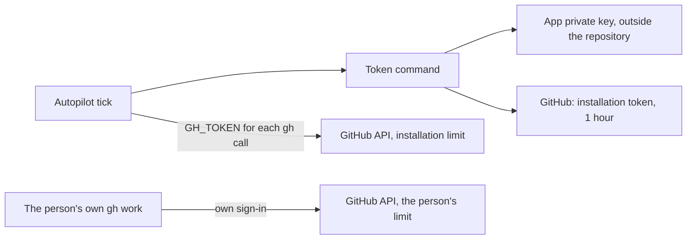

# A GitHub App token for Autopilot

This is a design note. pdd does not implement it. It tells how a team can give
Autopilot its own GitHub limit, and what must change in pdd to support it.

## The problem

Autopilot uses the `gh` sign-in of the person who runs `pdd autopilot start`.
GitHub gives one person 5,000 REST calls each hour, for all of their work. When
several coordinators run on one login, they can use the whole limit. Then every
`gh` call of that person fails with HTTP 403 until the reset, also their own
work, CI log reads and release steps. The [GitHub API budget](cli.md#github-api-budget)
keeps Autopilot to a share of the limit, but the limit is still shared.

## The design

A team creates one GitHub App and installs it on its repositories. Autopilot
then calls GitHub with a token of that installation. An installation has its own
limit: at least 5,000 REST calls each hour, plus 50 for each repository and
each user above 20, up to 12,500 (15,000 on GitHub Enterprise Cloud). GraphQL
also has its own points limit for the installation. The person's limit then
stays for the person.

### 1. The App

- Owner: the organization (or the person, for a personal repository).
- Repository permissions: Issues read and write, Pull requests read and write,
  Contents read, Metadata read, Checks read, Commit statuses read. Add Contents
  write only if the coordinator also pushes with the App.
- No webhook is needed: the tick polls.
- Install the App on the repositories that run Autopilot. Note the App ID and the
  installation ID. Keep the private key in a secret store, never in the
  repository.

### 2. The token

An installation token lives 1 hour. A token command makes a new one: it signs a
JSON Web Token (RS256, `iss` is the App ID or client ID, at most 10 minutes) with
the private key and calls `POST /app/installations/ID/access_tokens`. It prints
the token on stdout. A team can use a small script or a secret-store tool for
this. pdd never saves the token, never prints it and never puts it in a run
file, a log or a packet.

### 3. What pdd needs to add

- A setting for this machine and repository, like the alert token command:
  `pdd autopilot github set --token-command CMD` saves the command outside the
  repository; `pdd autopilot github clear` removes it.
- The tick runs the command at the start of each tick, and again when less than
  5 minutes of the token are left. It gives the token to each of its `gh` calls
  as `GH_TOKEN`; gh then uses it in place of the stored login. The timer
  environment does not hold the token.
- The ledger keeps the App calls apart, and the budget applies to the
  installation limit, not to the person's limit. `pdd autopilot status` names
  the App, never the token.
- When the command fails, the tick warns and waits for the next tick. It does
  not fall back to the person's login without a setting that says so.

Start with the no-AI tick: it makes most of the calls, all day. The coordinator
and worker chats run `gh` and `pdd` in their own shells, and a token that ends
after 1 hour does not fit a long chat. A later step can give those shells a
fresh token through a small `gh` wrapper on their PATH.

### 4. What changes on GitHub

Writes with the App token show the bot `APP-NAME[bot]` as their author, not the
person. This matters for the rules of pdd:

- Trust: the bot is not the repository owner or a collaborator. Add
  `APP-NAME[bot]` to `autopilot.trust`, or the tick does not trust the claim
  comments, dependency reviews and replies that the bot writes.
- Claims: a claim is the `pdd:working` label event and one comment by the same
  actor. One identity must add both. If the coordinator chat claims with the
  person's login and the tick writes the heartbeat with the App, the heartbeat
  edits the person's comment, which keeps the claim; but a claim that mixes the
  two identities for the label and the comment does not win.
- Reviews and merges: a review or approval by the bot is not a person's review.
  Repository rules that need a human review still need one. Merges stay under
  the [pdd-merge](../skills/pdd-merge/SKILL.md) rules.
- Audit: the GitHub history shows the bot for these actions. The person's own
  actions still show the person.

### 5. Open questions

- Should the token command be one per machine or one per repository?
- Should the coordinator chat use the App for its reads too, and how does it get
  a fresh token in a long chat?
- Should pdd trust its own App bot without a trust entry, from the installation
  identity?
