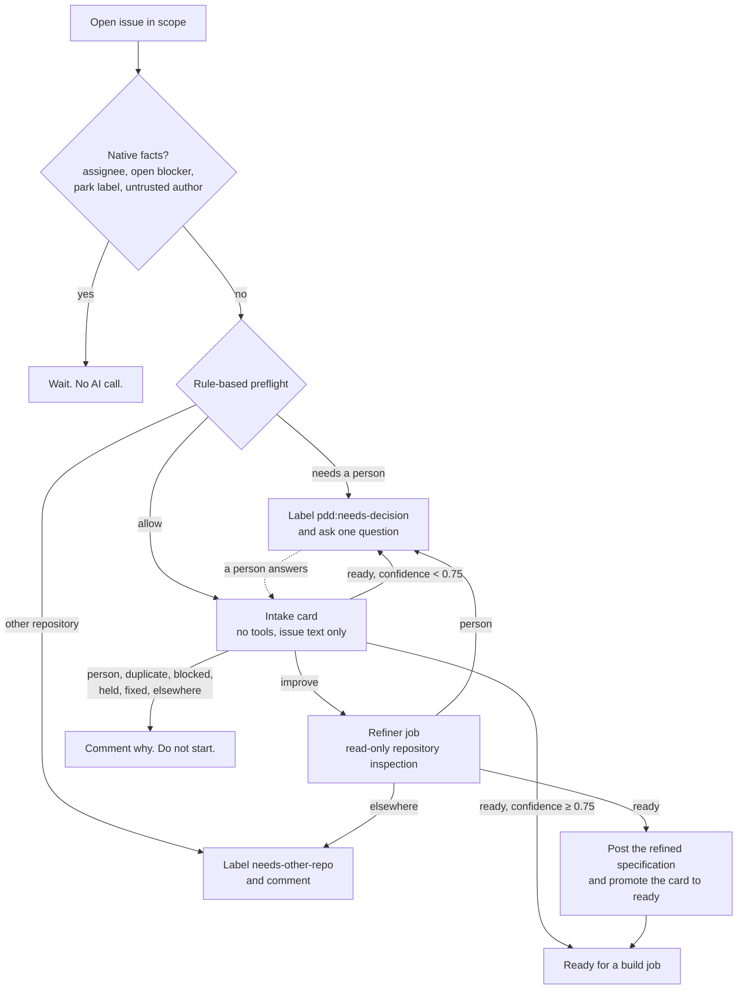

# Autopilot issue refinement

Autopilot gives one GitHub issue to one AI coding agent. The agent makes one pull
request. A weak issue gives a weak pull request. So Autopilot checks each issue
before any build starts. When an issue is not good enough, Autopilot tries to make
it stronger on its own. It asks a person only when the code cannot answer the
question.

This page has two parts:

1. [How Autopilot strengthens a weak issue](#how-autopilot-strengthens-a-weak-issue)
2. [How to write an issue that is ready at the first check](#how-to-write-an-issue-that-is-ready-at-the-first-check)

## How Autopilot strengthens a weak issue

### When refinement runs

Refinement runs only in active intake mode:

```sh
pdd autopilot start --intake active
```

In `--intake shadow` mode, Autopilot writes intake cards on this machine only. It
writes nothing to GitHub, and it does not refine issues. In `--intake off` mode (the
default), there are no cards. See [Intake cards](cli.md#intake-cards-shadow) for the
card details.

### The flow



### Step 1: Native facts and preflight

Some facts stop an issue with no AI call. Examples are an assignee, an open native
blocked-by link, open sub-issues, a park label (`pdd:stuck`, `pdd:needs-decision`,
`pdd:would-merge`) or an author that Autopilot does not trust.

Next, a rule-based preflight reads the issue text. It looks for paths that are not
in this repository, and for words that show a person must decide first. When it
finds one, it labels the issue and does not start an AI card.

### Step 2: The intake card

One headless agent job (Codex or Claude) reads the issue and gives it one class. The
job has no tools, no write access and no GitHub token. It sees only:

- the title, the labels and the body (up to 20,000 characters);
- up to 20 comments from trusted people;
- the titles of up to 200 other open issues.

Two classes matter for refinement:

| Class | Meaning |
| --- | --- |
| `ready` | The task is clear, technically sound, small enough for one PR, and has an obvious local check. |
| `improve` | The goal is clear, but the acceptance criteria, the reproduction or the scope are missing or too broad. |

A `ready` card needs a confidence of at least 0.75. With a lower score, Autopilot
asks a person to clarify the scope, the expected behavior and the local check.

### Step 3: The refiner job

An `improve` card from a trusted author starts one refiner job. This is the step
that strengthens a weak issue.

The refiner runs inside the repository checkout. It can read and search the code. It
cannot change anything:

- Claude gets only the `Read`, `Glob` and `Grep` tools, in plan mode.
- Codex runs in a read-only sandbox, with web search off and no MCP servers.
- Both get no GitHub token and a 20-minute time limit.

The refiner must find these facts in the code:

- the exact files or modules to change (up to 6);
- the root cause, or a reproduction;
- up to 8 concrete acceptance criteria that a person or a test can check;
- the size (`small`, `medium` or `large`) and related open issues.

It gives one of three outcomes:

| Outcome | What Autopilot does |
| --- | --- |
| `ready` | Posts a "refined the specification" comment and promotes the card to `ready`. |
| `person` | Posts one question, adds `pdd:needs-decision` and sends an alert. |
| `elsewhere` | Adds `needs-other-repo` and posts a comment. |

A `ready` answer with no acceptance criteria is not valid. Autopilot treats it as a
failed job, never as a guess.

### Step 4: What Autopilot writes on the issue

For `ready`, the comment has this shape (the content here is an example):

```markdown
Autopilot inspected the repository in read-only mode and refined the specification for this issue:

- Summary: Parse errors in config loading are hidden from the user.
- Areas: `src/config.mjs`, `test/config.test.mjs`
- Size: small
- Root cause / reproduction: loadConfig catches JSON.parse errors and returns {}.
- Acceptance criteria:
  - [ ] An invalid pdd.json makes `pdd status` exit non-zero and print the file path.
  - [ ] A valid pdd.json loads with the same result as today.
- Related issues: #123
```

The card gets a confidence of at least 0.85. The build agent then gets this refined
specification in its prompt, below the issue body. When Autopilot groups small issues
into one PR, each companion issue brings its own refined specification.

For `person`, the comment asks one question. It can list two or three options, and
mark one "(recommended)". You can answer with one letter. Then remove
`pdd:needs-decision`, or just reply. Autopilot reads your answer at its next check
and rates the issue again.

### Step 5: Limits

- The refiner runs at most once for each version of the issue. It runs again only
  after a trusted person edits the issue, adds a comment or removes
  `pdd:needs-decision`.
- Autopilot's own comment is not a human change. A refined issue stays `ready` until
  a person changes it.
- A failed or timed-out job is tried again after 6 hours.
- At most 2 intake jobs start in one tick, and at most 2 run at the same time.

## How to write an issue that is ready at the first check

The refiner is a safety net. It costs time and an agent run, and it can still end in
a question for you. An issue that is strong from the start goes straight to `ready`.

Research on coding agents gives the same message again and again. OpenAI removed
38.3% of SWE-bench samples from SWE-bench Verified because the problem statement was
underspecified. In another study, agents seldom noticed missing details, but did up
to 74% better when they got them. Maintainers would reject about half of the
benchmark PRs that passed the tests. The issue text is the agent's main input, so
make it complete.

### The template

Copy this into a new issue. Delete the sections that do not apply.

```markdown
## Goal
One sentence: what is true for the user when this is done.

## Context
Why this matters. Links to related issues, logs or designs. Decisions already made.

## Where
- Change: `path/to/module.mjs` (`functionName`)
- Copy the pattern in: `path/to/similar.mjs`

## Reproduction (bugs only)
- Version, OS and config:
- Minimal steps (you ran them):
- How often: always / sometimes

## Expected / Actual
- Expected:
- Actual: (paste the exact error and stack trace)

## Acceptance criteria
- [ ] When <trigger>, <the system> shall <observable result>.
- [ ] Given <state>, when <action>, then <observable result>.
- [ ] A new test covers this case and fails before the fix.

## Out of scope
- Do not change: <files, public commands, output formats>.
- No new dependencies.
- Follow-up work: #<issue>

## How to verify
`<exact test command>` passes on this machine, with no network and no live account.
```

### The practices behind the template

| # | Practice | Why it works | Source |
| --- | --- | --- | --- |
| 1 | Write the issue as the agent's whole prompt. | The agent reads the issue as its main instruction. A clear issue gives a better PR. | [GitHub Copilot coding agent](https://docs.github.com/en/copilot/how-tos/agents/copilot-coding-agent/best-practices-for-using-copilot-to-work-on-tasks) |
| 2 | Use four parts: goal, context, constraints, "done when". | It keeps the agent in scope and makes it guess less. | [OpenAI Codex best practices](https://learn.chatgpt.com/guides/best-practices) |
| 3 | Make the key decisions yourself, before you file. | Underspecified issues are the main reason good agents fail. | [SWE-bench Verified](https://openai.com/index/introducing-swe-bench-verified/), [Ambiguity study](https://arxiv.org/abs/2502.13069) |
| 4 | Name the files and functions. Give a pattern to copy. | Issues that name the location have the highest solve rates. | [Agentless](https://arxiv.org/html/2407.01489) |
| 5 | Write criteria that each pass or fail on their own. | "Better" or "make sure it works" gives the agent no target. | [Given/When/Then](https://martinfowler.com/bliki/GivenWhenThen.html), [Devin guide](https://docs.devin.ai/essential-guidelines/good-vs-bad-instructions) |
| 6 | Check an output that a person can see, not a hidden record. | Weak checks let wrong patches pass. | [Gherkin reference](https://cucumber.io/docs/gherkin/reference/), [SWE-Bench+](https://arxiv.org/abs/2410.06992) |
| 7 | Write down every exact name, flag and message text you need. | Tests often fail on details that the issue never stated. | [OpenAI audit](https://openai.com/index/why-we-no-longer-evaluate-swe-bench-verified/) |
| 8 | Give one command that proves the work is done. | With a pass/fail check, the agent can fix its own work. | [Claude Code best practices](https://code.claude.com/docs/en/best-practices) |
| 9 | For a bug, give a minimal reproduction that you ran. | Steps to reproduce are the most important part of a bug report. | [Minimal reproducible example](https://stackoverflow.com/help/minimal-reproducible-example), [Mozilla](https://bugzilla.mozilla.org/page.cgi?id=bug-writing.html) |
| 10 | Write expected and actual apart. Paste the exact error. | Stack traces are a strong clue to the location. | [Simon Tatham](https://www.chiark.greenend.org.uk/~sgtatham/bugs.html) |
| 11 | Give versions, OS and config. Mark guesses as guesses. | A diagnosis is an extra, not a replacement for the symptoms. | [Simon Tatham](https://www.chiark.greenend.org.uk/~sgtatham/bugs.html), [Chromium](https://www.chromium.org/for-testers/bug-reporting-guidelines/) |
| 12 | Keep one issue to one PR. | Agent PRs that do not merge are usually larger and touch more files. | [How OpenAI uses Codex](https://cdn.openai.com/pdf/6a2631dc-783e-479b-b1a4-af0cfbd38630/how-openai-uses-codex.pdf), [Google small CLs](https://google.github.io/eng-practices/review/developer/small-cls.html) |
| 13 | Split large work into sub-issues that each keep the build green. | Each part gets its own check and its own review. | [Devin guide](https://docs.devin.ai/essential-guidelines/instructing-devin-effectively), [INVEST](https://www.agilealliance.org/glossary/invest/) |
| 14 | List what is out of scope and must not change. | Unrelated edits are a top reason that maintainers reject agent PRs. | [METR](https://metr.org/notes/2026-03-10-many-swe-bench-passing-prs-would-not-be-merged-into-main/) |
| 15 | Keep repository-wide rules in `AGENTS.md`, not in each issue. | The issue can then stay short and focused on one task. | [Definition of Ready](https://www.agilealliance.org/glossary/definition-of-ready/) |

### Write acceptance criteria that a test can check

Two formats work well. Pick one for each criterion.

**EARS** (used by Kiro specs) gives one sentence for each rule:

| Pattern | Form |
| --- | --- |
| Always | The `<system>` shall `<response>`. |
| Event | When `<trigger>`, the `<system>` shall `<response>`. |
| State | While `<state>`, the `<system>` shall `<response>`. |
| Unwanted | If `<bad condition>`, then the `<system>` shall `<response>`. |
| Optional | Where `<feature is on>`, the `<system>` shall `<response>`. |

**Given/When/Then** is better when the result depends on a starting state:

```text
Given a pdd.json with a trailing comma
When I run `pdd status`
Then the command exits with code 1
And the message names pdd.json and the line number
```

Sources: [EARS](https://alistairmavin.com/ears/), [Kiro specs](https://kiro.dev/docs/specs/),
[Gherkin reference](https://cucumber.io/docs/gherkin/reference/).

### Strengthen a weak issue yourself, with an agent

You can do what the refiner does before Autopilot sees the issue. Open Codex or Claude
Code in the repository and paste this prompt:

```text
Read GitHub issue #N with `gh issue view N --comments`. Do not change any files.

1. Read the code that the issue touches. Name the exact files and functions.
2. For a bug, find the root cause or a minimal reproduction.
3. Ask me one question at a time about anything the code cannot answer.
   Stop when you have no more questions.
4. Mark anything still open as [NEEDS CLARIFICATION: <question>].
5. Rewrite the issue with these sections: Goal, Context, Where, Reproduction,
   Expected / Actual, Acceptance criteria, Out of scope, How to verify.
6. Write each acceptance criterion so it passes or fails on its own.
7. If the work needs more than one PR, propose sub-issues instead.
```

This prompt uses three proven methods:

- **Explore first, then plan.** The agent reads the code before it writes the
  specification ([Claude Code best practices](https://code.claude.com/docs/en/best-practices)).
- **One question at a time.** Short questions get clear answers
  ([Harper Reed's LLM codegen workflow](https://harper.blog/2025/02/16/my-llm-codegen-workflow-atm/)).
- **Mark the unknowns.** A `[NEEDS CLARIFICATION]` marker stops a guess from
  entering the specification ([GitHub Spec Kit](https://github.com/github/spec-kit)).

Answer every `[NEEDS CLARIFICATION]` before you add the issue to Autopilot. An open
question makes Autopilot stop and ask you again.

### Before and after

A weak issue:

```markdown
Config errors are confusing

When the config is broken pdd does weird stuff. Please fix.
```

The intake card gives this issue `improve` at best. The goal is unclear, and there is
no reproduction and no check.

The same issue, strengthened:

```markdown
`pdd status` hides JSON errors in pdd.json

## Goal
A person with a broken pdd.json sees which file and line are wrong.

## Where
- Change: `src/config.mjs` (`loadConfig`)
- Test: `test/config.test.mjs`

## Reproduction
1. Add a trailing comma to pdd.json.
2. Run `pdd status`.

## Expected / Actual
- Expected: exit code 1 and "pdd.json line 4: Unexpected token }".
- Actual: exit code 0 and the default settings, with no message.

## Acceptance criteria
- [ ] If pdd.json is not valid JSON, then `pdd status` shall exit with code 1.
- [ ] The error message shall name pdd.json and the line number.
- [ ] A valid pdd.json shall load with the same result as today.
- [ ] A new test fails before the fix and passes after it.

## Out of scope
- Do not change the pdd.json schema or other commands.

## How to verify
`npm test -- test/config.test.mjs` passes.
```

This version can go straight to `ready`.

### Ready checklist

Each line matches a reason that the intake card uses to hold an issue.

| Check | If it is missing, the card says |
| --- | --- |
| One goal that fits in one PR | `improve` (too broad) |
| Files or modules named | `improve` (the refiner then looks for them) |
| For a bug: reproduction, expected and actual | `improve` |
| Acceptance criteria that each pass or fail | `improve` |
| A local check, with no live account and no manual QA | `person` (`unverifiable_boundary`) |
| No open product, pricing, UX, security, money or publishing decision | `person` (`human_decision`) |
| The change belongs in this repository | `elsewhere` (`cross_repo`) |
| Blockers are native blocked-by links | `blocked` |
| No other open issue has the same goal | `duplicate` |
