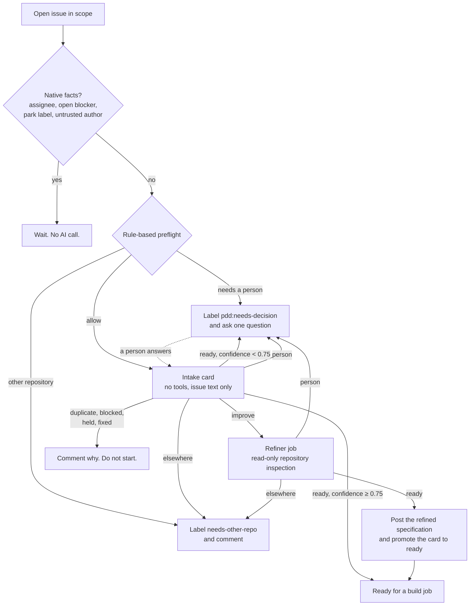

# Autopilot issue refinement

Autopilot gives one GitHub issue to one AI coding agent. The agent makes one pull
request. A weak issue gives a weak pull request. So Autopilot checks each issue
before any build starts. When an issue is not good enough, Autopilot tries to make
it stronger on its own. It asks a person only when the code cannot answer the
question.

This page has two parts:

1. [How Autopilot strengthens a weak issue](#how-autopilot-strengthens-a-weak-issue)
2. [How to write an issue that is ready at the first check](#how-to-write-an-issue-that-is-ready-at-the-first-check)

## How Autopilot strengthens a weak issue

### When refinement runs

Refinement runs only in active intake mode:

```sh
pdd autopilot start --intake active
```

In `--intake shadow` mode, Autopilot writes intake cards on this machine only. It
writes nothing to GitHub, and it does not refine issues. In `--intake off` mode (the
default), there are no cards. See [Intake cards](cli.md#intake-cards-shadow) for the
card details.

### The flow



### Step 1: Native facts and preflight

Some facts stop an issue with no AI call. Examples are an assignee, an open native
blocked-by link, open sub-issues, a park label (`pdd:stuck`, `pdd:needs-decision`,
`pdd:would-merge`) or an author that Autopilot does not trust.

Next, a rule-based preflight reads the issue text. It looks for paths that are not
in this repository, for words that show a person must decide first, for checks that
need a live service or manual QA, and for draft or empty issues. When it finds one,
it labels the issue and does not start an AI card.

### Step 2: The intake card

One headless agent job (Codex or Claude) reads the issue and gives it one class. The
job has no tools, no write access and no GitHub token. It sees only:

- the title, the labels and the body (up to 20,000 characters);
- up to 20 comments from trusted people;
- the titles of up to 200 other open issues.

Two classes matter for refinement:

| Class | Meaning |
| --- | --- |
| `ready` | The task is clear, technically sound, small enough for one PR, and has an obvious local check. |
| `improve` | The goal is clear, but the acceptance criteria, the reproduction or the scope are missing or too broad. |

A `ready` card needs a confidence of at least 0.75. This is the default; set
`autopilot.minIntakeConfidence` in `pdd.json` to change it. With a lower score, Autopilot
asks a person to clarify the scope, the expected behavior and the local check.

### Step 3: The refiner job

An `improve` card from a trusted author starts one refiner job. This is the step
that strengthens a weak issue.

The refiner runs inside the repository checkout. It can read and search the code. It
cannot change anything:

- Claude gets only the `Read`, `Glob` and `Grep` tools, in plan mode.
- Codex runs in a read-only sandbox, with web search off and no MCP servers.
- Both get no GitHub token and a 20-minute time limit.

The refiner must find these facts in the code:

- the exact files or modules to change (up to 6);
- the root cause, or a reproduction;
- up to 8 concrete acceptance criteria that a person or a test can check;
- the size (`small`, `medium` or `large`) and related open issues.

It gives one of three outcomes:

| Outcome | What Autopilot does |
| --- | --- |
| `ready` | Posts a "refined the specification" comment and promotes the card to `ready`. |
| `person` | Posts one question, adds `pdd:needs-decision` and sends an alert. |
| `elsewhere` | Adds `needs-other-repo` and posts a comment. |

A `ready` answer with no acceptance criteria is not valid. Autopilot treats it as a
failed job, never as a guess.

### Step 4: What Autopilot writes on the issue

For `ready`, the comment has this shape (the content here is an example):

```markdown
Autopilot inspected the repository in read-only mode and refined the specification for this issue:

- Summary: Parse errors in config loading are hidden from the user.
- Areas: `src/config.mjs`, `test/config.test.mjs`
- Size: small
- Root cause / reproduction: loadConfig catches JSON.parse errors and returns {}.
- Acceptance criteria:
  - [ ] An invalid pdd.json makes `pdd status` exit non-zero and print the file path.
  - [ ] A valid pdd.json loads with the same result as today.
- Related issues: #123
```

The card gets a confidence of at least 0.85. The build agent then gets this refined
specification in its prompt, below the issue body. When Autopilot groups small issues
into one PR, each companion issue brings its own refined specification.

For `person`, the comment asks one question. It can list two or three options, and
mark one "(recommended)". You can answer with one letter. Then remove
`pdd:needs-decision`, or just reply. Autopilot reads your answer at its next check
and rates the issue again.

### Step 5: Limits

- The refiner runs at most once for each version of the issue. It runs again only
  after a trusted person edits the issue, adds a comment or removes
  `pdd:needs-decision`.
- Autopilot's own comment is not a human change. A refined issue stays `ready` until
  a person changes it.
- A failed or timed-out job is tried again after 6 hours.
- At most 2 intake jobs start in one tick, and at most 2 run at the same time.

## How to write an issue that is ready at the first check

The refiner is a safety net. It costs time and an agent run, and it can still end in
a question for you. An issue that is strong from the start goes straight to `ready`.

Research on coding agents gives the same message again and again. When OpenAI built
SWE-bench Verified, its annotators flagged 38.3% of the SWE-bench samples they checked
for an underspecified problem statement. In another study, agents seldom noticed missing details, but did up
to 74% better when they got them. Maintainers would reject about half of the
benchmark PRs that passed the tests. The issue text is the agent's main input, so
make it complete.

### The template

Copy this into a new issue. Delete the sections that do not apply.

```markdown
## Goal
One sentence: what is true for the user when this is done.

## Context
Why this matters. Links to related issues, logs or designs. Decisions already made.

## Where
- Change: `path/to/module.mjs` (`functionName`)
- Copy the pattern in: `path/to/similar.mjs`

## Reproduction (bugs only)
- Version, OS and config:
- Minimal steps (you ran them):
- How often: always / sometimes

## Expected / Actual
- Expected:
- Actual: (paste the exact error and stack trace)

## Acceptance criteria
- [ ] When <trigger>, <the system> shall <observable result>.
- [ ] Given <state>, when <action>, then <observable result>.
- [ ] A new test covers this case and fails before the fix.

## Out of scope
- Do not change: <files, public commands, output formats>.
- No new dependencies.
- Follow-up work: #<issue>

## How to verify
`<exact test command>` passes on this machine, with no network and no live account.
```

### Write acceptance criteria that a test can check

Two formats work well. Pick one for each criterion.

**EARS** (used by Kiro specs) gives one sentence for each rule:

| Pattern | Form |
| --- | --- |
| Always | The `<system>` shall `<response>`. |
| Event | When `<trigger>`, the `<system>` shall `<response>`. |
| State | While `<state>`, the `<system>` shall `<response>`. |
| Unwanted | If `<bad condition>`, then the `<system>` shall `<response>`. |
| Optional | Where `<feature is on>`, the `<system>` shall `<response>`. |

**Given/When/Then** is better when the result depends on a starting state:

```text
Given a pdd.json with a trailing comma
When I run `pdd status`
Then the command exits with code 1
And the message names pdd.json and the line number
```

Sources: [EARS](https://alistairmavin.com/ears/), [Kiro specs](https://kiro.dev/docs/specs/feature-specs/),
[Gherkin reference](https://cucumber.io/docs/gherkin/reference/).

### Strengthen a weak issue yourself, with an agent

You can do what the refiner does before Autopilot sees the issue. Open Codex or Claude
Code in the repository and paste this prompt:

```text
Read GitHub issue #N with `gh issue view N --comments`. Do not change any files.

1. Read the code that the issue touches. Name the exact files and functions.
2. For a bug, find the root cause or a minimal reproduction.
3. Mark anything still open as [NEEDS CLARIFICATION: <question>].
4. Rewrite the issue with these sections: Goal, Context, Where, Reproduction,
   Expected / Actual, Acceptance criteria, Out of scope, How to verify.
5. Write each acceptance criterion so it passes or fails on its own.
```

This prompt uses two proven methods:

- **Explore first, then plan.** The agent reads the code before it writes the
  specification ([Claude Code best practices](https://code.claude.com/docs/en/best-practices)).
- **Mark the unknowns.** A `[NEEDS CLARIFICATION]` marker stops a guess from
  entering the specification ([GitHub Spec Kit](https://github.com/github/spec-kit)).

Answer every `[NEEDS CLARIFICATION]` before you add the issue to Autopilot. An open
question makes Autopilot stop and ask you again.

### Methods from top practitioners

These methods come from people and teams who build with coding agents every day.
Each one fits into a section of the template.

**Lauren Tan: pstack.** Lauren Tan works on React Compiler on the React core team.
[pstack](https://github.com/cursor/plugins/blob/main/pstack/README.md) is her Cursor
plugin. Its skills also load in Claude Code and Codex. It makes a task deeper, not
bigger:

- Write the goal, then a "Keep" line for behavior that must not change, then the
  check. Two examples from [Flavio Copes's pstack deep dive](https://flaviocopes.com/pstack/):
  "Keep the text output unchanged. Verify both forms against the sample project."
  and "Done means zero old callers, every parser fixture passes, and the old API is
  deleted."
- Before you rewrite a task, [`/sharpen`](https://github.com/cursor/plugins/blob/main/pstack/skills/sharpen/SKILL.md)
  asks four things. What would a top professional do that you did not ask for? What
  raw material would they start from? Which methods and tools would they use? What
  outside check shows that the result is right?
- Let an experiment settle every choice that it can. Leave product and preference
  choices to a person.

**Garry Tan: gstack `/spec`.** Its goal is an issue that an agent can do without a
single follow-up question. [`/spec`](https://github.com/garrytan/gstack/blob/main/spec/SKILL.md)
asks until five answers are clear:

1. Who is affected?
2. What is the current behavior (verified, not assumed)?
3. What should the behavior be instead?
4. Why now?
5. How will we know it is done (an observable result)?

Then it settles what is out of scope, the failure modes and the rollback.

**GitHub Spec Kit: `/clarify` and `/specify`.**

- [`/clarify`](https://github.com/github/spec-kit/blob/main/templates/commands/clarify.md)
  asks at most 5 questions, one at a time. It picks the questions with the highest
  impact and uncertainty, and it puts a recommended answer first. It writes each
  answer back into the specification.
- [`/specify`](https://github.com/github/spec-kit/blob/main/templates/commands/specify.md)
  allows at most 3 `[NEEDS CLARIFICATION]` markers. For every other gap, it uses a
  sensible default and lists it under Assumptions.

Autopilot asks in a similar shape: one question. When the refiner gives two or three
options, Autopilot lists them by letter and marks one "(recommended)".

**Kiro: bugfix specs.** A [bugfix spec](https://kiro.dev/docs/specs/bugfix-specs/)
starts with a `bugfix.md` in three WHEN … THEN parts: the current behavior, the expected behavior, and the
behavior that must stay. The third part has the form "WHEN `<condition>` THEN the
system SHALL CONTINUE TO `<existing behavior>`". It gives the agent a clear
regression boundary.

**Addy Osmani: three tiers of boundaries.** Sort the rules into Always, Ask first and
Never ([How to write a good spec](https://addyosmani.com/blog/good-spec/)). The agent
then knows where it can act alone.

**Kent Beck: watch for cheating.** Beck treats a disabled or deleted test as a sign
that the agent cheated ([Augmented coding](https://newsletter.kentbeck.com/p/augmented-coding-beyond-the-vibes)).
Say in the issue that existing tests must stay, and ask for a new test that fails
without the fix.

| Method | Template section |
| --- | --- |
| pstack "Keep" line, Kiro SHALL CONTINUE TO, Osmani "Never" tier | Out of scope |
| pstack "Done means", Beck's failing test | How to verify |
| gstack five questions | Goal, Context, Expected / Actual |
| Spec Kit questions and assumptions | Context |
| EARS and Given/When/Then | Acceptance criteria |

### Before and after

A weak issue:

```markdown
Config errors are confusing

When the config is broken pdd does weird stuff. Please fix.
```

The intake card most likely gives this issue `person` (`unclear_or_unsound`), because
`improve` needs a clear goal. The goal is unclear, and there is no reproduction and no
check.

The same issue, strengthened:

```markdown
`pdd status` hides JSON errors in pdd.json

## Goal
A person with a broken pdd.json sees which file and line are wrong.

## Where
- Change: `src/config.mjs` (`loadConfig`)
- Test: `test/config.test.mjs`

## Reproduction
1. Add a trailing comma to pdd.json.
2. Run `pdd status`.

## Expected / Actual
- Expected: exit code 1 and "pdd.json line 4: Unexpected token }".
- Actual: exit code 0 and the default settings, with no message.

## Acceptance criteria
- [ ] If pdd.json is not valid JSON, then `pdd status` shall exit with code 1.
- [ ] The error message shall name pdd.json and the line number.
- [ ] A valid pdd.json shall load with the same result as today.
- [ ] A new test fails before the fix and passes after it.

## Out of scope
- Do not change the pdd.json schema or other commands.

## How to verify
`npm test -- test/config.test.mjs` passes.
```

This version can go straight to `ready`.

### Ready checklist

Each line matches a reason that the intake card uses to hold an issue.

| Check | If it is missing, the card says |
| --- | --- |
| One goal that fits in one PR | `improve` (too broad) |
| Files or modules named | `improve` (the refiner then looks for them) |
| For a bug: reproduction, expected and actual | `improve` |
| Acceptance criteria that each pass or fail | `improve` |
| A local check, with no live account and no manual QA | `person` (`unverifiable_boundary`) |
| No open product, pricing, UX, security, money or publishing decision | `person` (`human_decision`) |
| The change belongs in this repository | `elsewhere` (`cross_repo`) |
| Blockers are native blocked-by links | `blocked` |
| No other open issue has the same goal | `duplicate` |
