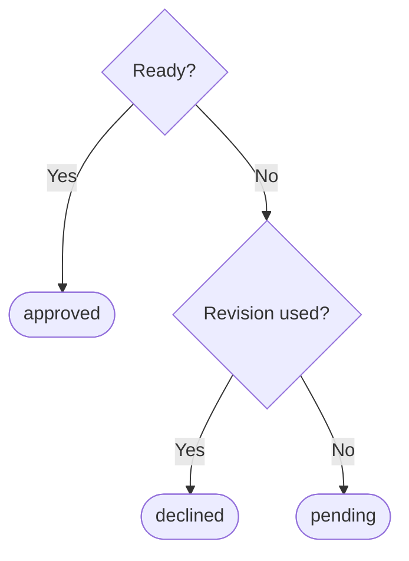

# Prompting guide

Each module has one canonical `.prompt.md`, including independently generated
frontend children. It states **what the module must do and why**, with explicit
ownership, decisions and consequential edges.

**Preservation sets the boundary; abstraction chooses the expression.** Keep
required observations and reasons. Use domain rules, leaving algorithms, helpers
and representations free within the [preservation promise](#preservation).

## Contract content and ownership

The contract states its preservation promise and the permitted evidence that
supports it. Decisions and exact boundaries have these owners; small contracts
may combine them:

| Owner | Required meaning | Placement |
|---|---|---|
| Domain decisions | Purpose, responsibility, inputs, outcomes, guards and precedence; why consequential rules exist | Visible first; enough to trace ordinary flow and a consequential edge |
| Public contract | Exact signatures, defaults, bindings, metadata and output schema | Beside a small rule, otherwise one named interface reference |
| Consequential operations | Evaluation boundaries and effects that qualify a decision, including failure | Beside the affected rule, otherwise one linked compatibility reference |

The public contract names **every output key, field or tuple position**, its
meaning, units and representation. Include conditional presence, ordering and
identity where observable. A quantity's description cannot substitute for its
external name. Group repeated shapes once and refer to them from outcomes.
Declarations from interfaces or callers belong to declared consumer context;
required meaning never depends on inference from excluded source.

Within the selected preservation promise, retain each public owner and binding
kind: module function, instance method, staticmethod or classmethod. Preserve
public annotations and declaration metadata, including evaluation timing and
stored representation. Equivalent resolved types
can expose different raw annotations. Include observable docstrings within the
selected promise. Retain identifier values exposed through public operations,
even when stored privately; unrelated private organization remains free.

Give consequential operations one compact expression or ordered table. For each
boundary, state its guard, evaluation and surviving effects if it fails; include
skipped work and winning errors. Include consequential truth conversion, attribute
access, hashing, equality, formatting and path operations across public calls
within the selected promise. Preserve order, count, lock state, reentry, captures
and repeated reads where observable. Operand selection and later consumption
may require separate truth tests. Assignment
order may change surviving state even when successful results match.

This reference qualifies domain decisions; it must not retell their normal route.
Link each affected rule to its exact boundary and name the local consequence.
Distinguish optional absence from malformed required values, early exit from
completion or budget exhaustion, and comparison values from retained or returned
values. Keep full error class, message and structured data. An annotation or
unsupported-input disclaimer cannot exclude consequences within the selected
preservation promise.

Use compact grouped mappings for aliases: canonical spellings once, additional
spellings by target, complete accepted set and unknown-value behavior. Do not
make readers guess spelling or decode invented codes. Name disclosures by the
question they answer; keep domain decisions visible when references are closed.

Keep module policy in the root. Shared-policy links state authority and local
consequence; dependencies declare loading without repeating rules. Inaccessible
references cannot supply meaning, and new sidecars are not compression.

## Representations of consequential behavior

Use Mermaid when it clarifies branches or returns; prefer prose or a table for a
single rule, conjunction, lookup or short sequence. The diagram and adjacent
rules jointly own the answer, replacing repeated structure at equal completeness.
Label decisions and endings, including exceptions, shared interrupts and precedence.
Define predicates once, scope negation and resolve overlaps. Keep guards, equations,
identity and effects near their routes.

Use domain states and responsibilities, not invented lifecycles for independent
gates or stateless components. Prefer short top-to-bottom diagrams with plain
labels and few branch lanes. Labels remain readable without opaque codes.
Mermaid explains relationships; SVG supplies appearance.

### Synthetic example: a small contract with one compatibility boundary

A fictional exhibition owns caption approval and permits one correction. The
supplied caption has an identity and Boolean `accurate` and `fits` attributes.
**Ready** means `accurate AND fits`. Initially `revision_used` is false. New-work
requirements authorize this input domain; they are not a source-preservation
exclusion. Review returns a fresh mapping with exactly `outcome` (one of
`approved`, `declined`, `pending`) and `caption_id` (the current supplied identity,
without conversion).



Accept a replacement only while pending; otherwise raise
`ValueError("correction unavailable")` without state change.
An accepted replacement consumes the correction and becomes current before review.
Without replacement, review leaves state unchanged. Accuracy assessment is outside
this task. The figure owns review routes; the mapping above owns all outputs.

**Replacement compatibility.** The accepted contract permits assignment hooks;
keep these two observable commits in order. Errors propagate unchanged, with no
rollback. A failure returns no mapping and skips review.

| Commit | If this assignment raises before storing |
|---|---|
| Set `revision_used` true | Current caption and flag remain unchanged; skip replacement |
| Set current caption to the supplied replacement | Flag remains true; old caption remains current |

The table owns failure effects; private helpers and storage remain free.

## Dependency declarations

Link to the canonical dependency prompt or public contract with an ordinary
relative Markdown link. Use a stable fragment when only a section is relevant,
for example `[status rules](../../contracts/review-record.md#status-values)`.
Paths are relative to the file containing the link. **Clickable does not mean
loaded:** a navigation link alone supplies no context to a generator or runtime.

Use one explicit `## Dependencies` section as the loading declaration. For each
required input, identify its canonical file or selection, role, purpose and the
uses for which it supplies required context. The canonical prompt owns what a
fragment or selection includes and why it is needed.
Identify any other accepted mechanism that supplies required context. Other
links are navigation-only unless explicitly designated as required; avoid a
second manual loading list.

Required shared rules must be available with all transitively required context
for the declared use. Loading only direct links does not establish completeness.
A missing file or fragment, or a cycle in required context, is an explicit gap
in the affected dependency declaration. The unresolved chain has no invented
replacement or claim of completeness. Navigation-only cycles are allowed. A
changed shared contract can affect consumers whose prompt text is unchanged.

Declare necessary runtime dependencies and deterministic arithmetic facilities.
Any declared transport formats and interfaces express the canonical contract
without adding policy.

## SVG appearance content for frontend modules

Every frontend module must have an embedded SVG mockup, including badges,
buttons and labels. A small component may reuse a canonical shared view that
clearly identifies it. Keep previews minimal and show representative states
needed to explain the owned appearance, without an exhaustive state gallery.
Shared views and imports do not merge module ownership. Mark surrounding regions
`context-only`.

SVG owns appearance; prose owns behavior, responsive conditions and accessibility,
including click and keyboard outcomes, focus, names and announcements. SVG shape
order is not DOM or focus order. Give each fact one owner across these views and
the behavioral rules.

Use `views/<state>[--<variant>]__<layout-mode>.ui.svg` for materially distinct
arrangements. Name the arrangement, such as `split-pane` or `stacked`, rather than
a device or pixel size. Beside each view identify its ID, state, layout condition,
fidelity and relevant reference viewport.

Declare fidelity once:

- **Relational:** visual direction and named relationships, without pixel
  equivalence.
- **Measured:** declared geometry, alignment, spacing, fold, control placement,
  type hierarchy and resolved design tokens at a named viewport.
- **Exact:** a fixed external image contract within its stated bounds.

When preserving an existing UI's appearance, default to measured fidelity unless
authorized requirements permit redesign or select another level. State missing
reference evidence; do not present an invented layout as a measured
reconstruction. For measured or exact work, name the accepted comparator, scope
and applicable tolerances. Do not infer tolerances from the SVG or turn a
reference viewport into a fixed runtime screen size.

State whether the content is **illustrative** or a **comparison reference for
named states**. An illustration identifies its sample content and the authority
for actual values. A comparison reference shows the named state and all
module-owned appearance facts within its declared scope. Keep fidelity, state
and ownership consistent between prose and image. These declarations belong to
the canonical contract; any runtime metadata expresses the same view purpose
and fidelity. Shared status/text rules stay with their owner; sample labels and context-only surroundings do not silently
become additional requirements.

Embed each primary SVG using Markdown image syntax
(``) beside the requirement it
illustrates so GitHub displays the preview. Additional views may be disclosed,
with blank lines around the Markdown image. Use the same asset in the image and
dependency declaration; do not copy its contents into a second authority.

Each SVG needs a `viewBox`, `title`, `desc` and stable intent-based region IDs.
Preserve meaningful bounds, hierarchy, alignment, spacing, controls and resolved
tokens. Simplify ornament without losing those facts. Exclude event handlers,
framework structure/classes, external resources, base64 media and hidden alternate
designs. Keep meaningful labels readable at displayed size. A focused detail view
may clarify a necessary label or region while retaining its ownership and
relationship to the overview; it must not duplicate behavioral policy.

## Readable organization without duplicate rules

Each rule has one authoritative expression. Operation references contain the
boundaries that qualify domain decisions, without repeating the normal route.
Signature lists contain declarations, without parallel behavior descriptions.
Shared errors, returns and output shapes have one definition with local links.
Where native semantics matter, one readable ordered expression states the guards
and effects without a parallel prose translation.

Purpose, domain decisions and meaningful exceptions remain visible when detailed
references are closed. Named references provide exact declarations and boundaries.
Disclosures organize necessary detail; they do not hide duplicate explanations.
Labels and prose remain readable at their intended display size, including narrow
layouts. Additional space is appropriate for necessary meaning and legibility.

The contract states exact defaults, boundaries, payloads and failure precedence
without word caps, diagram quotas, opaque shorthand or hidden sidecars. Dependency
declarations name required context and facilities without absent-package lists or
repeated independence claims. Links and image paths are relative to the prompt
that contains them.

Required meaning is complete within the declared, permitted context. Access to
other source does not make it part of that context. Missing evidence and unresolved
requirements are explicit gaps; clear wording alone is not a claim of correct
execution or human understanding.

<a id="preservation"></a>
<details>
<summary><strong>Required reference — preservation and numerical meaning</strong></summary>

### Preservation promise and evidence

Policy comes from authorized requirements and accepted consumer or shared
contracts. The prompt distinguishes obligations, source observations, authorized
changes and unresolved conflicts. Source mechanisms are not automatically policy;
generated code is not its own independent specification.

**Behavioral refinement** preserves named behavior and essential interfaces;
state permitted variation and exclusions. **Drop-in replacement** additionally
preserves promised invocation, representation, identity and effects. With source
alone and no selected mode, use provisional behavioral refinement: conservatively
retain module-owned public declarations and metadata, explicit exports and
consequential observed behavior. Declaration preservation includes annotation
evaluation and storage, not only resolved type meaning. Values exposed through
public operations remain observable even when held by private bindings; preserve
their identifier values without prescribing unrelated private organization.
Identify uncertain reexports and unavailable consumer contracts; do not claim
unseen compatibility. Authorized interface changes and any freedom to design
interfaces for new work are explicit parts of the promise. Unknown evidence does
not authorize narrower inputs or changed semantics.

Within the selected promise, state conditions and required results, errors, state
changes and external effects, including consequential forbidden behavior, so
readers can determine compliance. Preserve relevant domains, units, defaults, absence, equality boundaries, ties,
duplicates, order, identity, mutability, serialization, errors, effects, concurrency
and termination. Missing, null, empty, zero and false may differ. Name shared rules
and explain nonobvious reasons beside them.

Names and annotations do not establish business meaning or runtime validation.
Under provisional source preservation, retain visible public failures for unsupported
values as well as successes. Distinguish error categories, including failures before
explicit rejection, and consequential effects without requiring their private
container or operation. “Errors propagate” is incomplete when replacement operations
can fail differently.

Excluding such behavior requires an authorized boundary, not an author's generic
“out of domain” or “unspecified” disclaimer. Separate a genuinely missing fact
from a visible consequence; mark only the affected unknown promise incomplete.
Imported utilities are not automatically owned exports. Evidence outside the
declared context does not supply missing contract content.

For financial or evidence-related modules, retain consequential publication time,
source identity, metric definition, fiscal period and vintage. Do not invent
funding, counterparties, dates, quantities or probabilities. Label synthetic
examples as synthetic.

### Domain arithmetic and numerical compatibility

Define each financial quantity once: units, valid states, equations, inputs and
outputs, rounding and consequential decisions. Preserve accepted nonfinite and
intermediate-overflow behavior; finite inputs do not guarantee finite results.
Unresolved behavior is a stated gap, not permission to invent rejection or admit
invalid financial states.

Exact machine compatibility, when promised, additionally requires relevant
formats, comparisons, grouping, accumulation order and output representation.
Keep this mechanical reference distinct from financial rationale. A source loop
alone does not establish domain policy; an equation does not authorize changing
observed numbers through finite-precision algebraic rewrites. If the numerical
preservation boundary is unresolved, provisionally retain consequential observed
semantics and mark the compatibility claim incomplete. Do not silently substitute
exact-real arithmetic, change rounding or restrict inputs for agreement.

An authorized approximation needs a metric, bound, units and scope. Distinguish
decision tolerance, allowed output error and evaluation tolerance. An output
allowance cannot loosen eligibility, rejection or status. The contract states
whether those boundaries remain stable across the error envelope and names any
permitted variation in decisions.

</details>

## Runtime interface declarations

A behavior prompt ends with one Runtime interface block when it has a truthful
Runtime entry. A native verification-command contract without such an entry
records the gap instead of inventing an interface. Omit `kind` for its full
checkable contract; use `kind: partial` for a declared subset. An explicit
`"kind": "full"` in a draft gets a warning at `/kind`; `pdd test --fill-hash`
removes that redundant field from drafts while leaving approved prompts unchanged. Use `kind: native-only` only with a nonblank `reason` that names
the effect that bound ports cannot fake (RUNBOOK §21). A checker confirms the
reason. Approval records it; checks show not run and preserve the reason.

`pdd interface draft PROMPT` drafts a missing block locally from explicit contract
schemas. `pdd interface draft --all` drafts the repository and lints each result.
Unresolved facts include field questions and a `--contract FILE` recovery command.
Use `--extend --contract FILE` to add operations while preserving existing
declarations, or `--refresh [--contract FILE]` to reopen a stale or changed block
as draft. File, network and program ports use RUNBOOK §21 resources. A clean local
lint is not a Runtime check; run `pdd lint STORY` for admission.
The automatic-check-pass approval route needs unchanged committed behavior, passing
existing native tests and a full prompt check on current source. New behavior and
strict approval mode require a person.

## Native verification when Runtime cannot admit a case

Keep the real module's contract and Runtime interface intact. A native public
boundary may expose behavior outside that interface, or a repository may need
to verify an existing top-level test command. Describe the verification command
in its own prompt only when it is a new owned code module; do not assign its
behavior to unrelated helper prompts. Do not invent a Runtime entry, widen an
interface for a test, or claim a native effect that does not exist.

Write a Story and requirement-derived native cases with exact inputs and expected
returns or error names and messages, independently of observed output. Identify
the real function or command and run each case there. The runnable
Node example in `examples/native-replay/` and its cases show a
native command, including a non-string input to a public function. From the
repository root, run:

```sh
node examples/native-replay/replay.mjs examples/native-replay/cases.json examples/native-replay/count-words.mjs
```

The fixture is synthetic and does not reproduce another project. Adapt the
command and cases to the actual public boundary, preserving its own contract.
Check wrong results, wrong or missing expected errors and unexpected errors with
controls; setup failures and crashes before the assertion are not detection.

For a bug, run the issue case against the current native code before repairing
the harness or target. Record the command, source identity, exit, assertion and
actual result separately from the expected case. Run `pdd test` for admitted
Runtime scenarios and retain its actual result. An out-of-interface case is not
an admitted Runtime check; a native failure does not prove the prompt failed or
that the bug is code-only. Record an unavailable Runtime verdict as such. Never
omit criteria to manufacture a full check or derive expected values from code.

For a workflow Story, add a `## Native validation` section with one link to the
owning prompt's `#native-validation-profile-ID` anchor. The profile inventories
required native test identities and maps each Story criterion to them. See the
[replay profile](../examples/native-replay/replay.prompt.md) and the
[native evidence contract](../prompts/cli/workflow-results.prompt.md#native-profile-and-criterion-assessment-draft)
for the declaration and original report requirements. In this example,
`node examples/native-replay/capture.mjs /tmp/pdd-replay` runs the Node test and
retains its events and source, selection and execution records in that directory.
From the run worktree, associate the current workspace with the selected paths:

```sh
pdd workflow evidence-associate ISSUE --workspace . --stage current --test examples/native-replay/replay.mjs examples/native-replay/count-words.mjs examples/native-replay/cases.json examples/native-replay/capture.mjs examples/native-replay/capture.prompt.md test/native-replay-recipe-3160.test.mjs examples/native-replay/replay.prompt.md
pdd workflow evidence ISSUE --summary /tmp/pdd-replay/import.json
```

Use the actual issue number. Capture and association must refer to the same
unchanged source. For a before check, run the capture on the before source with
`before` as its second argument, then associate that source with `--stage before
--commit SHA` and the same paths. Preserve those originals separately from the
current capture. For another project, adapt the producer to its own real runner
and profile; preserve the original observations and process outcome.
Associate their workspace and stage with `pdd workflow evidence-associate`, then
import the originals with `pdd workflow evidence --summary`; `pdd lint STORY`
shows the resulting criterion assessment. A missing, stale, incomplete or
unreviewed profile is not a pass. The Story and profile must be approved before
their evidence can support the manual PR gate.

Native evidence does not create an automatic-check-pass or waive Story, strict,
PR or required human approvals. Existing workflow gate rules still apply.
