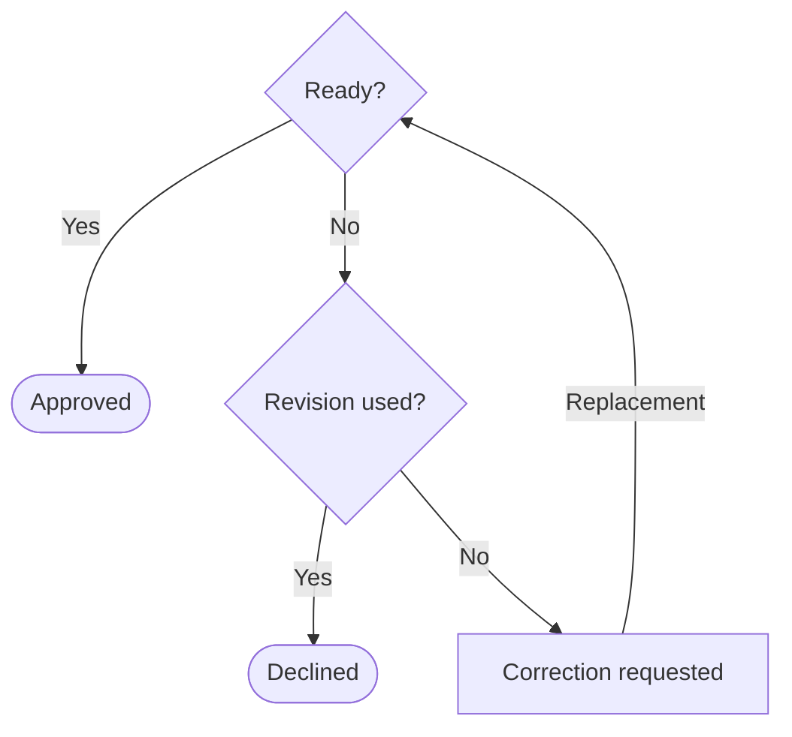

# Prompting guide

Write one canonical `.prompt.md` per code module, including frontend children
generated independently. Explain **what the module must do and why** so a
maintainer can locate a decision and follow a consequential edge case without
mentally executing an algorithm. Generated code is one implementation of that
contract.

**Preservation sets the boundary; abstraction chooses the expression.** Keep
required observations and their reasons. Replace implementation narration with
domain rules while leaving algorithms, private helpers and representations free
within the selected [preservation promise](#preservation).

## Give the reader a useful first path

Open with purpose, ownership, inputs, main outcomes and the preservation promise.
Make the consequential decisions easy to find, with nearby links to their exact
rules. Use consistent domain terms and explain what the module decides before
presenting language declarations. These are reading goals, not a mandatory
section inventory or repeated capability checklist.

Give each obligation one authoritative home. Put substantial exact rules,
exceptional cases and necessary declarations in clearly named `
`
disclosures, grouped by reader task. A summary such as “Required export binding,
record schema and errors” tells readers what is inside. Keep the first path
meaningful with disclosures closed; required detail remains part of the contract.
Avoid a giant undifferentiated reference or hiding details far from their use.

Keep module-owned policy in the root. Link to the accessible, accepted owner of
genuine shared policy; state only this module's local consequence beside that
link. A dependency entry names the authority and its use, without repeating its
rules. An inaccessible reference, declaration or claimed lookup cannot supply
missing meaning. Moving requirements to new sidecars is not compression.

Recover declarations only from interfaces and callers available in the intended
consumer's permitted context. Retain unavailable essential declarations in a
labeled required interface reference. Where invocation affects the promise,
name the **public owner and binding kind once** beside the capability's rule:
module function, instance method, staticmethod or classmethod as applicable. A
section heading alone must not determine ownership. This does not require a
duplicate API catalog or any private implementation shape.

## Choose a representation for a consequential question

Identify the hardest consequential reader question about relationships,
decisions or changes of state. When answering requires following alternatives,
precedence or a return, use a small Mermaid diagram as the default replacement
for that structural passage. Choose prose or a table instead for a single rule,
conjunction, lookup or short linear sequence, or when a complete diagram would
be harder to read at narrow width. Make that choice deliberately during authoring;
the delivered prompt need not explain why it has no diagram.

Let the diagram and adjacent named rules jointly own the answer. Show normal
alternatives and endings, and label every decision edge. Every consequential
branch, return and exception must be represented either in the view or in an
explicit adjacent rule. Shared interrupts or restarts may be clearer beside the
figure than as many crossing arrows: state where they apply and which rule wins.
When the selected question concerns a return, make that return easy to trace.
A common-case picture must not make omitted behavior seem impossible or optional.

Replace the corresponding structural prose or table; do not repeat the complete
route as a checklist. Keep exact guards, equations, errors, ordering, identity
and effects in complementary rules close enough to follow without hunting.
Define predicates once, group mixed Boolean conditions and scope negation.
Distinguish necessary from sufficient conditions and resolve overlaps. Require
internal check order only when it changes a promised result or effect.

Use domain states, outcomes and responsibilities rather than private calls or
loops. Do not turn independent gates, supplied status values or a stateless
component into an invented lifecycle. Prefer a short top-to-bottom layout with
brief, plain labels and few branch lanes. Simplify the question or choose prose
before shrinking labels or introducing unexplained codes. Mermaid explains
relationships; SVG supplies appearance.

### A small synthetic example

This fictional exhibition gives a caption one chance for correction. The reader
question is **when can a correction return, and what ends review?** Each supplied
caption has an identity and Boolean attributes: `accurate` means factually
correct; `fits` means within the exhibit's space allowance. **Ready** means
`accurate AND fits`. Initially `revision_used` is false.

“Revision used?” reads `revision_used`. On **Replacement**, use the supplied
replacement caption and set `revision_used` to true before its review. Without a
replacement, correction remains pending. Each review returns the reached outcome
with the current caption's supplied identity. Reject inputs outside the stated
domain; assessing factual accuracy is outside this task. The figure owns routes
and endings; these adjacent rules own the meanings and observations.

## Make dependencies navigable and usable

Link to the canonical dependency prompt or public contract with an ordinary
relative Markdown link. Use a stable fragment when only a section is relevant,
for example `[status rules](../../contracts/review-record.md#status-values)`.
Resolve paths from the file containing the link. **Clickable does not mean
loaded:** a navigation link alone supplies no context to a generator or runtime.

Use one explicit `## Dependencies` section as the loading declaration. For each
required input, identify its canonical file or selection, role and required uses
(authoring, generation, runtime, verification or testing, as applicable).
Identify any other accepted mechanism that supplies required context. Other
links are navigation-only unless explicitly designated as required; avoid a
second manual loading list.

Required shared rules must be available with their own required context. A
missing file or fragment, or a cycle in required context, leaves the affected
use incomplete: identify the unresolved chain rather than inventing a
replacement or claiming completeness. Navigation-only cycles are allowed. A
changed shared contract can affect consumers whose prompt text is unchanged.

Keep public invocation, concrete inputs, results/errors and required state or
identity mapping unambiguous for the intended use. Declare necessary runtime
dependencies and deterministic arithmetic facilities. Tool-specific transport
formats are derived from the canonical prompt, not another authored policy.

For a module interface, use the path and exports that the implementation exposes.
For a CLI, name the module it runs. For an API, name its module and public
exports. Give function entries useful inputs and outcomes. The prompt-space
checker may warn when these declarations look incomplete; review the warning
in context rather than editing prose solely to satisfy a check.

## Include readable SVG previews for frontend modules

Every frontend module must have an embedded SVG mockup, including badges,
buttons and labels. A small component may reuse a canonical shared view that
clearly identifies it. Keep previews minimal and show representative states
needed to explain the owned appearance, without an exhaustive state gallery.
Shared views and imports do not merge module ownership. Mark surrounding regions
`context-only`.

SVG owns appearance; prose owns behavior, responsive conditions and accessibility,
including click and keyboard outcomes, focus, names and announcements. SVG shape
order is not DOM or focus order. Give each fact one owner across these views and
the behavioral rules.

Use `views/<state>[--<variant>]__<layout-mode>.ui.svg` for materially distinct
arrangements. Name the arrangement, such as `split-pane` or `stacked`, rather than
a device or pixel size. Beside each view identify its ID, state, layout condition,
fidelity and relevant reference viewport.

Declare fidelity once:

- **Relational:** visual direction and named relationships, without pixel
  equivalence.
- **Measured:** declared geometry, alignment, spacing, fold, control placement,
  type hierarchy and resolved design tokens at a named viewport.
- **Exact:** a fixed external image contract within its stated bounds.

When preserving an existing UI's appearance, default to measured fidelity unless
authorized requirements permit redesign or select another level. State missing
reference evidence; do not present an invented layout as a measured
reconstruction. For measured or exact work, name the accepted comparator, scope
and applicable tolerances. Do not infer tolerances from the SVG or turn a
reference viewport into a fixed runtime screen size.

State whether the content is **illustrative** or a **comparison reference for
named states**. An illustration identifies its sample content and the authority
for actual values. A comparison reference shows the named state and all
module-owned appearance facts within its declared scope. Keep fidelity, state
and ownership consistent between prose and image. Shared status/text rules stay
with their owner; sample labels and context-only surroundings do not silently
become additional requirements.

Embed each primary SVG using Markdown image syntax
(``) beside the requirement it
illustrates so GitHub displays the preview. Additional views may be disclosed,
with blank lines around the Markdown image. Use the same asset in the image and
dependency declaration; do not copy its contents into a second authority.

Each SVG needs a `viewBox`, `title`, `desc` and stable intent-based region IDs.
Preserve meaningful bounds, hierarchy, alignment, spacing, controls and resolved
tokens. Simplify ornament without losing those facts. Exclude event handlers,
framework structure/classes, external resources, base64 media and hidden alternate
designs. Keep meaningful labels readable at displayed size. A focused detail view
may clarify a necessary label or region while retaining its ownership and
relationship to the overview; it must not duplicate behavioral policy.

## Edit for reading effort

Remove duplicate obligations, recoverable declarations and private mechanisms.
Use tables for comparisons across the same few dimensions. Keep labels short
and move long explanations into adjacent named rules. If a table is unreadable
at narrow width, split it by reader question or use a short definition list;
keep each guard with its outcome. Vertical length can be preferable to clipped
columns or tiny text.

Compare the complete replacement passage, including captions, guards and
exceptions, with what it removes. Aim for no net growth across the root and its
required companions; count disclosed requirements and SVG assets in full.
Preserve meaning and readability before size. A necessary explanation or detail
view may earn space, but compare it with a concise prose/table alternative.
Do not use a word cap, diagram quota, dense shorthand or hidden sidecars to
manufacture savings.

Before delivery, use only the declared reading context to explain the purpose,
locate a consequential decision and trace an edge case. Check that reorganization
retained the promised observations. Resolve Markdown links and image paths from
the prompt's actual repository location, and check SVG XML/renderability.
Inspect actual Markdown, Mermaid and SVG presentation with disclosures closed
and expanded at the declared narrow and desktop reading widths. Read labels,
follow branches and returns,
and look for clipping at displayed scale; containment alone is not legibility.
Fix presentation defects or identify unavailable inspection as unverified.

Keep editorial rationales and inspection records outside the business prompt.
Testing, proofs, benchmark procedures, tool commands, hashes and execution
machinery belong to the surrounding task, not this authoring guide. They can
check a contract but cannot replace a missing requirement. The surrounding task
defines permitted context; author access does not grant a replacement generator
permission to retrieve an excluded target. Clarity alone establishes neither
correct execution nor measured human understanding.

<strong>Required reference — preservation and numerical meaning</strong>

### Select the promise before compressing it

Establish policy from authorized requirements and accepted consumer or shared
contracts. Distinguish accepted obligations, source observations, authorized
changes and unresolved conflicts. Source and tests are evidence; source
mechanisms are not automatically policy, and generated code is not its own
independent specification.

**Behavioral refinement** preserves named behavior and essential interfaces;
state permitted variation and exclusions. **Drop-in replacement** additionally
preserves promised invocation, representation, identity and effects. With source
alone and no selected mode, use provisional behavioral refinement: conservatively
retain module-owned public declarations, explicit exports and consequential
observed behavior. Identify uncertain reexports and unavailable consumer
contracts; do not claim unseen compatibility. Interface changes need
authorization; new work may expressly permit interface design. Unknown evidence
does not authorize narrower inputs or changed semantics.

Describe the relevant conditions and required result, error, state change or
external effect, including consequential forbidden behavior. A reader must be
able to determine what satisfies or violates a rule. Preserve relevant domains,
units, defaults, absence, equality boundaries, ties, duplicates, order, identity,
mutability, serialization, errors, effects, concurrency and termination. Missing,
null, empty, zero and false may differ. Give a rule a stable name when another
rule needs to refer to it, and explain nonobvious reasons beside the rule.

Discover signatures, fields, method kinds, defaults, exports and enum values only
from available interfaces or demonstrated caller use. Imported utilities are not
automatically owned exports; names and annotations do not establish business
meaning. Availability to the author does not imply availability to the generator
or runtime. Mark consequential gaps and affected promises incomplete.

For financial or evidence-related modules, retain consequential publication time,
source identity, metric definition, fiscal period and vintage. Do not invent
funding, counterparties, dates, quantities or probabilities. Label synthetic
examples as synthetic.

### Separate domain arithmetic from compatibility

Define each financial quantity once: units, valid states, equations, inputs and
outputs, rounding and consequential decisions. Preserve accepted nonfinite and
intermediate-overflow behavior; finite inputs do not guarantee finite results.
Unresolved behavior is a stated gap, not permission to invent rejection or admit
invalid financial states.

Exact machine compatibility, when promised, additionally requires relevant
formats, comparisons, grouping, accumulation order and output representation.
Keep this mechanical reference distinct from financial rationale. A source loop
alone does not establish domain policy; an equation does not authorize changing
observed numbers through finite-precision algebraic rewrites. If the numerical
preservation boundary is unresolved, provisionally retain consequential observed
semantics and mark the compatibility claim incomplete. Do not silently substitute
exact-real arithmetic, change rounding or restrict inputs for agreement.

An authorized approximation needs a metric, bound, units and scope. Distinguish
decision tolerance, allowed output error and evaluation tolerance. An output
allowance cannot loosen eligibility, rejection or status: establish boundary
stability across the error envelope or state the permitted decisions. Scoring
and proof models do not redefine the contract.

