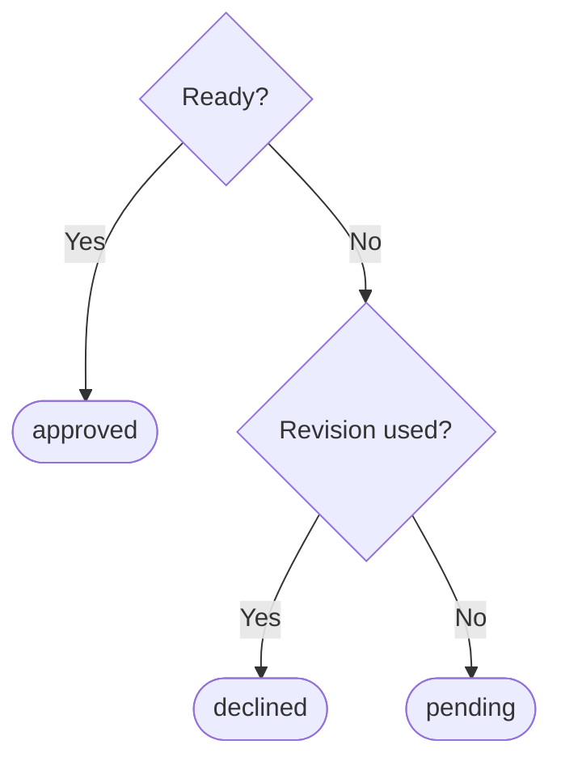

# Prompting guide

Each production module has one canonical `.prompt.md` (including independently generated frontend children). It states **what the module must do and why**, with explicit ownership, domain decisions, public operations and consequential failure edges.

**Preservation sets the boundary; abstraction chooses the expression.** Keep required observations and reasons. State domain rules, leaving algorithms, private helpers and internal data structures free within the [preservation promise](#preservation).

## Contract content and ownership

A contract states its preservation promise and permitted supporting evidence across three owners (small modules may combine them):

| Owner | Required meaning | Placement |
|---|---|---|
| Domain decisions | Purpose, responsibility, inputs, outcomes, guards, precedence and why consequential rules exist | Visible first; enough to trace normal flow and consequential edges |
| Public contract | Exact operation names, signatures, defaults, bindings, units and input/output/error shapes | Beside a small rule, or in one named interface/contract section |
| Consequential operations | Evaluation order, port effects and surviving state when a guard or dependency fails | Beside the affected rule, or in one compact boundary table |

Make every observable input and output key, field or tuple position, unit and error shape explicit:

- When a prompt links a shared `$contract` schema, that schema is the single owner of the field, type and requiredness inventory; prose states domain rules, invariants, ordering and nonobvious semantics instead of repeating property tables.
- Without a shared `$contract` schema, name every input/output field and group repeated shapes once so lazy interface synthesis derives exact strict schemas without guessing.
- Retain public binding kinds (module function, method, CLI entry), observable metadata and public identifier values within the selected promise.
- Distinguish optional absence from malformed required values, early refusal from partial state mutation, and comparison values from returned/stored values. Group aliases compactly (canonical spelling, accepted aliases, unknown-value behavior). Never minify JSON onto one line.
- Keep module policy in the owning prompt. Never duplicate the same business rule across two prompts; link the canonical owner instead.

## Representations of consequential behavior

Use Mermaid (`flowchart TD`) when branching or state transitions clarify precedence; prefer prose or a compact table for a single rule, lookup or short sequence. Define predicates once, label yes/no branches and terminal outcomes, and keep failure commits beside their guards.

### Synthetic example: a small contract with one compatibility boundary

A fictional exhibition owns caption approval and permits one correction. A supplied caption has `caption_id` and Boolean `accurate` and `fits` fields. **Ready** means `accurate AND fits`. Initially `revision_used` is `false`. Review returns `{outcome, caption_id}` where `outcome` is `approved`, `declined` or `pending`.



Accept a replacement only while `pending`; otherwise raise `ValueError("correction unavailable")` without state change. An accepted replacement sets `revision_used` to `true` and becomes current before review:

| Commit | If assignment raises before storing |
|---|---|
| Set `revision_used` true | Current caption and flag remain unchanged; skip replacement |
| Store replacement caption | `revision_used` stays true; previous caption stays current |

## Dependency declarations and port direction

Use one explicit `## Dependencies` section as the loading declaration, linking canonical dependency prompts or shared contracts with relative Markdown links (plus `#fragment` when only one section applies). Navigation links outside `## Dependencies` are not loaded automatically. Required context must be transitively reachable without missing files, broken fragments or required-context cycles.

Inject outside effects (databases, filesystem, HTTP/network, clocks, randomness, child processes) as named `<port>.<op>` operations in prose so `pdd test` fakes them deterministically (RUNBOOK §21):

- **Dependency direction for `kind: native-only` boundary adapters:** Checkable domain, CLI flow and screen prompts must depend on shared contracts or checkable peers over injected `<port>.<op>` interfaces — **never** list a `kind: native-only` adapter prompt under `## Dependencies` of a checkable prompt (including Story `entry_path` prompts). Invert the dependency so the thin `kind: native-only` adapter depends on the checkable domain prompt.

## SVG appearance content for frontend modules

Every user-facing frontend module links minimal representative `.ui.svg` mockups (`views/<state>[--<variant>]__<layout-mode>.ui.svg`) using Markdown image syntax (``) under `## Appearance`. Backend servers, routers, CLIs and daemons carry no `.ui.svg` screens.

- **Single source of truth:** SVG owns visual layout, visible labels, spatial order and stable intent-based `id`s (`viewBox`, `<title>`, `<desc>`; mark unowned surroundings `data-context-only="true"` or class `context-only`; exclude scripts, event handlers, framework classes, external fonts/assets and base64 blobs). Prose owns behavior, responsive rules, keyboard/click flows, accessibility/focus order and dynamic data authority.
- **Fidelity and purpose:** Declare whether each view is **illustrative** or a **comparison reference** for a named state, and state fidelity once (**Relational**, **Measured** at a reference viewport with comparator/tolerances, or **Exact**).
- **Stylesheets and fast authoring lint:** HTML operation screens (`"source": "operation"`, `"format": "html"`) list CSS files under `"stylesheets"` in `app-map.json` and name matching CSS classes in the screen prompt. During authoring, verify `.ui.svg` alignment with `pdd lint --local` (`<50ms`, zero browser/AI calls); render `.ui.svg` to PNG only when a person explicitly requests PNG previews.

<a id="preservation"></a>
<details>
<summary><strong>Required reference — preservation and numerical meaning</strong></summary>

### Preservation promise and evidence

Policy comes from authorized requirements and accepted consumer or shared contracts. Distinguish obligations, source observations, authorized changes and unresolved conflicts.

- **Behavioral refinement** preserves named behavior and essential interfaces while stating permitted variation. **Drop-in replacement** additionally preserves invocation forms, representation, identity and observable side-effect ordering. With source alone and no selected mode, default to provisional behavioral refinement: retain public declarations, exports, error categories and consequential observed behavior (including visible failures on unsupported inputs unless an authorized boundary excludes them).
- Missing, `null`, empty, `0` and `false` may differ; preserve domains, units, defaults, ties, duplicates, ordering, mutability and serialization. Mark genuine evidence gaps explicitly rather than inventing narrower rules.
- For financial or evidence modules, preserve publication time, source identity, metric definitions, units, rounding and nonfinite/overflow behavior. Exact machine compatibility additionally preserves accumulation order and representation; authorized approximations state metric, bound, units and scope without loosening eligibility or rejection boundaries. Label synthetic examples as synthetic.

</details>

## Choose evidence before Stories

List each claimed behavior and its proof before splitting work into Stories. Stories cover user-observable behavior that a person can read and approve in one minute (ask the person before creating `> 3` Stories for one issue):

- `0` Runtime Stories applies **only** when (a) no user-observable accept, reject, state or output outcome changes, or (b) an existing Story and Runtime test in `user_stories/` already cover the enclosing user-facing flow over an injected port.
- When a native, cryptographic or I/O change alters an uncovered user-observable flow, write `1` Story and Runtime test for the enclosing checkable flow prompt over an injected port alongside any thin `kind: native-only` adapter (`0` Stories of its own).
- Test suites, fixtures, CI configs, package manifests and docs never get `.prompt.md` owners. Mixed modules keep deterministic policy in a checkable prompt and isolate raw OS/socket/byte-level I/O in a thin `kind: native-only` adapter proved by native tests.

## Prompt format and native-only declarations

A behavior prompt is plain Markdown: purpose, `## Domain decisions`, public operations, failure edges and `## Dependencies` (no embedded `Runtime interface` block). Owned code files carry `Generated from <path>.prompt.md` near line 1 (or line 2 after `#!`; commentless files use `pdd-bindings.json`).

Use YAML frontmatter at the very top of the file **only** when a prompt owns pure physical/OS plumbing with `0` Runtime Stories:

```yaml
---
kind: native-only
reason: <the native effect that bound ports cannot fake>
---
```

`reason` must name the concrete physical effect bound ports cannot fake (`fsync`, live sockets, OS signals, subprocess TTYs, crypto primitives). `pdd approve` records prompt approval in the local journal without editing the prompt file.
