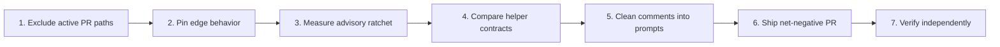

# Refactor runbook

This runbook defines a repeatable pass for cleaning up structure in an agent-maintained PDD
repository without changing public behavior or colliding with active pull requests. Run it as a
standing cleanup lane so your codebase stays small, modular, and safe for coding agents to copy.

## Why agent-maintained codebases drift ("pattern contagion")

Coding agents work from local context. When an agent opens a file to fix a bug or build a feature,
it matches the structure, helper style, error handling, and comment density of the nearest
surrounding code.

When a repository leaves local shortcuts in place, pattern contagion spreads them across future
pull requests:

- **Duplicate helpers:** two ways to parse JSON, lock a file, or format errors turn into ten copies
  because each agent copies whichever version it reads first.
- **One-site point-patches:** an extra conditional branch or regex added for one caller invites the
  next agent to append another branch instead of fixing the shared helper.
- **Oversized multi-concern files:** a module that mixes routing, persistence, formatting, and
  retries attracts more responsibilities because every change already opens it.
- **Historical narration comments:** inline notes explaining workarounds, past pull requests, or
  unfinished cleanups teach future agents to write long justifications instead of fixing root causes.

Written rules in `AGENTS.md` or `CLAUDE.md` do not stop pattern contagion while source files show
the opposite pattern. The durable fix is structural: remove dead paths, keep one clear helper per
contract, keep files focused on one responsibility, and clean the examples that agents read first.

## Core rule: separate structure from behavior

**Never mix a behavior change into a structural refactor pull request, and never mix broad
structural cleanup into a bug or feature pull request.**

When one pull request changes structure and behavior together, test failures become ambiguous and
reverts discard working fixes along with structural moves. If you find a live bug during a refactor
pass, preserve the current behavior in the structural pull request, file a separate issue, and fix
the defect in its own `/pdd` `bug` pull request.

Declare one of three structural classes in every cleanup pull request:

| Class | Scope | `.prompt.md` changes | Test changes | Interpreter calls |
|---|---|---|---|---|
| **Class A** | Internal structure | None (`pdd owner` stays current) | Existing assertions stay unchanged; extend the module's test file only for a shared helper | `0` |
| **Class B** | Module and boundary splits | Step 1: none (code keeps source header). Step 2: separate prompt-split PR | Import paths, generated module lists, or direct unit tests for extracted helpers; existing behavior assertions stay unchanged | `0` in Step 1 |
| **Class C** | Verified dead-code removal | Remove dead prompts and dead `## Dependencies` links in the same PR | Delete only tests that cover the removed dead surface; all other tests stay unchanged | `0` (unless an active Story prompt changes) |

- **Class A (Internal structure):** Deduplicate helpers, simplify control flow, or remove
  non-essential comments inside existing prompt boundaries. Owning `.prompt.md` files and public
  behavior stay unchanged, and `pdd owner` stays green with zero AI calls. For unowned repository
  files outside PDD (docs, CI, config, lockfiles, or test-only maintenance), `/pdd` `small-change`
  mode applies directly.
- **Class B (Module and boundary splits):** Split an oversized source file along real domain
  responsibilities, not arbitrary line counts. First, split code only while keeping the source
  file's ownership header on extracted modules and re-exporting compatibility bindings when needed:
  ```js
  // src/orders-pricing.mjs
  // Prompt: prompts/orders.prompt.md

  export function calculateOrderTotal(items, taxRate) { /* ... */ }
  ```
  ```js
  // src/orders.mjs
  // Prompt: prompts/orders.prompt.md

  export { calculateOrderTotal } from './orders-pricing.mjs';
  ```
  Because prompt contracts do not change in this first pull request, no prompt re-approval is
  needed. Later, once callers import directly from `src/orders-pricing.mjs`, remove the
  compatibility re-export and split the `.prompt.md` files in a separate small, reviewable pull
  request when prompt boundaries change.
- **Class C (Verified dead-code removal):** Prove unreachability across static `import` statements,
  dynamic `import()` calls, CLI command routes, and `package.json` `exports` or `bin` entries:
  ```sh
  git grep -n 'legacyOrderSync' src/ bin/ prompts/ package.json
  ```
  Remove the unreachable code, dead prompts, dead prompt dependency links, and obsolete tests
  together in one pull request. If editing an active prompt to remove a dead export or dependency,
  run `pdd test` on any Story that reaches that prompt.

## The 7-step clean-kitchen pass



### 1. Exclude active pull request paths

Start in a dedicated worktree created from `origin/main` so structural work stays isolated:

```sh
git fetch origin
git worktree add -b refactor/cleanup-pass ../repo-cleanup origin/main
cd ../repo-cleanup
```

Query every open pull request and paginate its touched files (`gh pr list --state open --json number,files`
caps both pull requests and per-PR file lists at 100 entries, so paginate through `gh api` to avoid
missing paths on large branches):

```sh
gh api --paginate 'repos/{owner}/{repo}/pulls?state=open&per_page=100' --jq '.[].number' |
  while read -r pr; do
    gh api --paginate "repos/{owner}/{repo}/pulls/${pr}/files?per_page=100" \
      --jq ".[] | (.filename, (.previous_filename // empty)) | \"#${pr}: \(.)\""
  done
```

GitHub's `pulls/{pr}/files` REST endpoint caps at 3,000 files; for any pull request with
`changed_files >= 3000` (or 3,000 returned entries), fetch the pull request ref directly
(`git fetch origin "pull/${pr}/head" && git diff --no-renames --name-only origin/main...FETCH_HEAD`)
to list every path.

Exclude every file touched by an open pull request, along with files claimed by active
`pdd autopilot` jobs or high-churn shared command catalogs. Leaving active paths untouched prevents
rebase pileups across open branches.

### 2. Pin observable behavior at the edge

Unit tests that import internal modules directly can break during a harmless internal reshape or
stay green while CLI wiring breaks. Before moving code, pin observable behavior at the edge.

Capture `{argv, env, stdin} -> {stdout, stderr, exit code, written files}` across 20 to 40
representative CLI or API calls using deterministic local fakes on `PATH` and temporary directories:

```js
// Example golden case pinned at the CLI edge
{
  name: 'invoice-summary-json',
  argv: ['invoice', 'summary', '--json'],
  env: { NO_COLOR: '1' },
  stdin: ''
  // Compare { exitCode, stdout, stderr, writtenFiles } on origin/main vs HEAD
}
```

- For CLI Stories that declare `implementation.kind: "cli"`, run `pdd test --target code` (zero AI calls).
- For additional CLI flags, help output, error codes, lock contention, and state files, run your
  golden runner on `origin/main` and on `HEAD`.

On a structural pull request, base and head edge outputs match with zero diff.

### 3. Measure with an advisory ratchet (`exit 0`)

Compare base versus head structural metrics and paste the table into the pull request description:

| Metric | Base (`origin/main`) | Head (`HEAD`) | Delta |
|---|---|---|---|
| Net lines (`+added / -removed`) | `18,420` | `18,295` | `-125` (`+48 / -173`) |
| Duplicate token blocks | `14` | `9` | `-5` |
| Files above size budget (`> 1,500` lines) | `3` | `3` | `0` |
| Upward layer imports / import cycles | `2` | `1` | `-1` |
| Non-keep-list comment lines | `410` | `382` | `-28` |
| `pdd owner` status on touched source files | `current` | `current` | `ok` |

Keep the ratchet script **advisory (`exit 0`)**. Never turn subjective line targets, file-size
budgets, or comment counts into blocking CI gates, hash pins, or exact-wording tests. Advisory
numbers make structural direction visible on every pull request without blocking urgent bug fixes.

### 4. Write a difference table before merging copied helpers

Copied helpers often look alike while differing on one critical guarantee. Before merging copies of
JSON readers, atomic file writers, locks, subprocess wrappers, or retry loops, compare every copy:

| Helper copy | Error handling on missing/corrupt file | Defaults | File permissions | Atomicity | Injected ports |
|---|---|---|---|---|---|
| `src/orders.mjs` | missing -> `{}`; corrupt -> throws | UTF-8 | default | direct write | `fs` port |
| `src/invoices.mjs` | missing -> `{}`; corrupt -> throws | UTF-8 | default | direct write | `fs` port |
| `src/tokens.mjs` | missing -> `null`; corrupt -> `null` | UTF-8 | `0o600` | temp + rename | none |

Consolidate only genuinely equivalent helpers (`orders.mjs` and `invoices.mjs` above) into a leaf
module with zero upward imports. Leave distinct contracts (`tokens.mjs`, which enforces `0o600` mode
and atomic temp-file writes) as separate named helpers instead of adding boolean flags that blur
security or error contracts.

### 5. Keep comments minimal and move "why" into prompts

Agents copy the comment density of surrounding files, and stale comments can mislead future edits.
Keep only four comment kinds in source code:

1. **Prompt ownership headers** inside the first 4 KiB (after any shebang `#!`, directive, or SPDX line, followed by a blank line):
   `// Prompt: prompts/<module>.prompt.md`. `pdd owner` reads the first 4 KiB—never
   strip this header or place `import` statements above it (commentless files use `pdd-bindings.json`; legacy `Generated from` headers stay readable).
2. **Shebangs** on line 1 of executable scripts, such as `#!/usr/bin/env node`.
3. **License notices** required by your project or third-party code.
4. **Non-obvious external or OS invariants** forced by an operating system, language runtime,
   protocol, or third-party tool that your code cannot reshape:
   ```js
   // external: https://nodejs.org/api/fs.html#fsrenameoldpath-newpath-callback — EXDEV across mount points requires copy+unlink
   ```

In PDD, the owning `.prompt.md` holds the durable "why" (`## Domain decisions`) and Git holds the
change history:

- If the owning `.prompt.md` already records the rule behind a comment, delete the duplicate comment
  in a Class A pull request.
- If a comment captures a real domain decision that is absent from the owning prompt, add that rule
  under `## Domain decisions` in the owning prompt before updating code, keep the `// Prompt:` header intact, and delete the code comment afterward.
- Delete changelog narration (`// Added for #128`, `// Phase 2`, `// Temporary workaround`) and
  comments that repeat what the code already says. Run `pdd lint --local` (zero AI calls) to check
  local prompt and source-comment hygiene.

### 6. Keep each pull request net-negative and single-purpose

Subtract before you add. Check `git diff --numstat origin/main` after each edit and ensure the pull
request removes more lines than it adds. Drop any wrapper or indirection layer that increases total
line count or reader load.

Handle one helper family, one verified dead subsystem, or one seam extraction per pull request so a
reviewer can verify behavioral equivalence in minutes and revert cleanly if needed. When adding unit
coverage for a consolidated leaf helper, extend that module's existing test file rather than
creating a separate test file per pull request.

### 7. Verify independently

Run all five checks before requesting merge:

1. **Prompt ownership (zero AI calls):**
   ```sh
   pdd owner $(git diff --name-only origin/main)
   ```
   Confirm every touched source file reports its expected `.prompt.md` owner with `current` header state.
2. **Focused module tests:** run the unit and vector tests for every touched module locally.
3. **Full test suite on your CI or runner machine:** run `npm test` (or your project's full test
   command) in a clean environment. Confirm all pre-existing tests continue to pass without weakened
   assertions (`after >= before` test count on Class A and Class B changes, accounting explicitly for
   any new direct helper tests; on Class C changes, base minus only the explicitly listed dead-surface
   tests, never silently dropping surviving behavioral cases).
4. **Golden CLI diff:** re-run your Step 2 edge harness and confirm `0` behavior delta between
   `origin/main` and `HEAD`.
5. **Fresh independent review:** have an independent reviewer—preferably a fresh session from
   another model family that wrote none of the diff—check specifically for accidental behavior
   drift, dropped error paths, or hidden contract changes.

Open the pull request stating its structural class (`Class A`, `Class B`, or `Class C`), exact
`+added / -removed` line counts, the advisory ratchet table, and exact test results.
