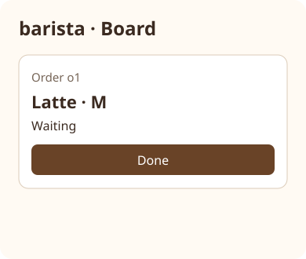
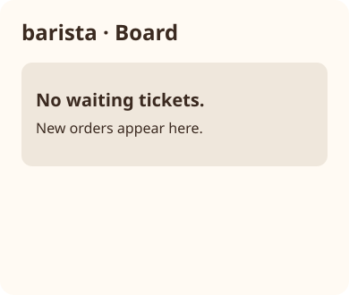

# Coffee pickup: barista

Own tickets only. refresh reads orders and tickets and appends one {id,drink,size,done:false} for each Ordered order without a ticket, saves tickets and returns added count. mark_done sets matching ticket done true, saves tickets and returns done true only if a matching ticket exists. Unknown id returns done false with no save. render returns waiting tickets (done false) and barista · Board HTML, drink and size per ticket, buttons name="done" id=the ticket id, and No waiting tickets when empty. Read through the corresponding KEY.load; write only tickets through the corresponding KEY.save.


Relational illustrative previews at 390 × 844; sample values come from the contracts and current world. The stacked arrangement applies at narrow and desktop widths with a readable content column.





## Dependencies

- [Shared world](../../contracts/world.md): required generation/runtime context for shared records and single-writer ownership.
- [Phone/server contract](../../contracts/phone-server.md): required generation/runtime schema authority for order input.
- [Server/barista contract](../../contracts/server-barista.md): required generation/runtime schema authority for tickets and completion input.
- [Appearance](../../views/barista-board__stacked.ui.svg)
- [Appearance](../../views/barista-empty__stacked.ui.svg)

Follow the linked stacked-card appearance: part heading, primary action, status below. HTML escapes user-controlled strings. World resources are real persistence ports; never cache world between calls or invent returned records.

Pass the resource’s own key as the const key argument to every load/save. Each KEY.load uses its named top-level world key; KEY.save replaces only that key. Native adapters bind these ports to shared persistence.

<details><summary>Runtime interface</summary>

```json
{
  "status": "draft",
  "prose_sha256": "d053440a3cc1d90ac16a142b4b784283d5218c7c5cfa4b1703a550097b03e434",
  "entries": [{"operation":"render","input_schema":{"type":"object","properties":{},"required":[],"additionalProperties":false},"result_schema":{"type":"object","properties":{"html":{"type":"string"},"waiting":{"type":"array","items":{"$contract":"examples/coffee-pickup/contracts/server-barista.md#ticket"}}},"required":["html","waiting"],"additionalProperties":false},"errors":[]},{"operation":"refresh","input_schema":{"type":"object","properties":{},"required":[],"additionalProperties":false},"result_schema":{"type":"object","properties":{"added":{"type":"integer"}},"required":["added"],"additionalProperties":false},"errors":[]},{"operation":"mark_done","input_schema":{"$contract":"examples/coffee-pickup/contracts/server-barista.md#ticket_done"},"result_schema":{"type":"object","properties":{"done":{"type":"boolean"}},"required":["done"],"additionalProperties":false},"errors":[]}],
  "calls": [],
  "resources": [{"name":"menu","kind":"key-value","access":"read","operations":[{"name":"load","access":"read","arguments_schema":{"type":"object","properties":{"key":{"type":"string","const":"menu"}},"required":["key"],"additionalProperties":false},"result_schema":{"type":"object","properties":{"value":{"type":"array","items":{"$contract":"examples/coffee-pickup/contracts/world.md#menu_entry"}}},"required":["value"],"additionalProperties":false}}]},{"name":"orders","kind":"key-value","access":"read","operations":[{"name":"load","access":"read","arguments_schema":{"type":"object","properties":{"key":{"type":"string","const":"orders"}},"required":["key"],"additionalProperties":false},"result_schema":{"type":"object","properties":{"value":{"type":"array","items":{"$contract":"examples/coffee-pickup/contracts/world.md#order"}}},"required":["value"],"additionalProperties":false}}]},{"name":"tickets","kind":"key-value","access":"write","operations":[{"name":"load","access":"read","arguments_schema":{"type":"object","properties":{"key":{"type":"string","const":"tickets"}},"required":["key"],"additionalProperties":false},"result_schema":{"type":"object","properties":{"value":{"type":"array","items":{"$contract":"examples/coffee-pickup/contracts/server-barista.md#ticket"}}},"required":["value"],"additionalProperties":false}},{"name":"save","access":"write","arguments_schema":{"type":"object","properties":{"value":{"type":"array","items":{"$contract":"examples/coffee-pickup/contracts/server-barista.md#ticket"}},"key":{"type":"string","const":"tickets"}},"required":["value","key"],"additionalProperties":false},"result_schema":{"type":"object","properties":{"value":{"type":"array","items":{"$contract":"examples/coffee-pickup/contracts/server-barista.md#ticket"}}},"required":["value"],"additionalProperties":false}}]},{"name":"order_requests","kind":"key-value","access":"read","operations":[{"name":"load","access":"read","arguments_schema":{"type":"object","properties":{"key":{"type":"string","const":"order_requests"}},"required":["key"],"additionalProperties":false},"result_schema":{"type":"object","properties":{"value":{"type":"array","items":{"$contract":"examples/coffee-pickup/contracts/world.md#order_request"}}},"required":["value"],"additionalProperties":false}}]}],
  "limits": {"max_steps":20,"max_model_calls":12},
  "conventions": []
}
```
</details>
