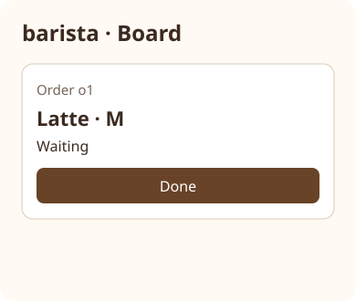
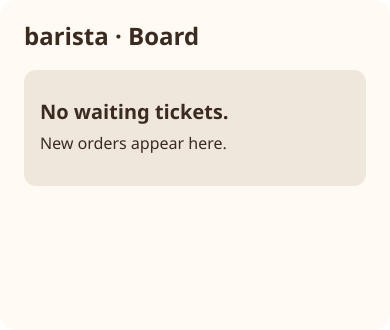

# Coffee pickup: barista

Own tickets only. refresh reads orders and tickets and appends one {id,drink,size,done:false} for each Ordered order without a ticket, saves tickets and returns added count. mark_done sets matching ticket done true, saves tickets and returns done true only if a matching ticket exists. Unknown id returns done false with no save. render returns waiting tickets (done false) and barista · Board HTML, drink and size per ticket, buttons name="done" id=the ticket id, and No waiting tickets when empty. Read through the corresponding KEY.load; write only tickets through the corresponding KEY.save.

Relational illustrative previews at 390 × 844; sample values come from the contracts and current world. The stacked arrangement applies at narrow and desktop widths with a readable content column.

## Dependencies

- [Shared world](../../contracts/world.md): required generation/runtime context for shared records and single-writer ownership.
- [Phone/server contract](../../contracts/phone-server.md): required generation/runtime schema authority for order input.
- [Server/barista contract](../../contracts/server-barista.md): required generation/runtime schema authority for tickets and completion input.
- [Appearance](../../views/barista-board__stacked.ui.svg)
- [Appearance](../../views/barista-empty__stacked.ui.svg)

Follow the linked stacked-card appearance: part heading, primary action, status below. HTML escapes user-controlled strings. World resources are real persistence ports; never cache world between calls or invent returned records.

Pass the resource’s own key as the const key argument to every load/save. Each KEY.load uses its named top-level world key; KEY.save replaces only that key. Native adapters bind these ports to shared persistence.
