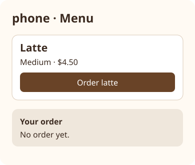
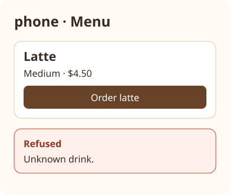

# Coffee pickup: phone

Own only phone rendering and appending order_requests. Read menu, orders and order_requests with the corresponding KEY.load. order appends {id:"order-N",drink,size}, where N is previous request count plus one, saves only order_requests, and returns id and status Ordered. render shows phone · Menu, the menu prices in cents formatted as dollars (450 is $4.50), a button value="order-latte", and the latest order status or an empty string. A refused order shows its reason. Return html and status. Do not write orders, tickets or menu.


Relational illustrative previews at 390 × 844; sample values come from the contracts and current world. The stacked arrangement applies at narrow and desktop widths with a readable content column.





## Dependencies

- [Shared world](../../contracts/world.md)
- [Phone/server contract](../../contracts/phone-server.md)
- [Server/barista contract](../../contracts/server-barista.md)
- [Appearance](../../views/phone-menu__stacked.ui.svg)
- [Appearance](../../views/phone-refused__stacked.ui.svg)

Follow the linked stacked-card appearance: part heading, primary action, status below. HTML escapes user-controlled strings. World resources are real persistence ports; never cache world between calls or invent returned records.

Pass the resource’s own key as the const key argument to every load/save. Each KEY.load uses its named top-level world key; KEY.save replaces only that key. Native adapters bind these ports to shared persistence.

<details><summary>Runtime interface</summary>

```json
{
  "status": "draft",
  "prose_sha256": "1bdf9c2f14d7a1335da917f7454de9e37c31cd445770f1de505d50c63217db3c",
  "entries": [{"operation":"render","input_schema":{"type":"object","properties":{},"required":[],"additionalProperties":false},"result_schema":{"type":"object","properties":{"html":{"type":"string"},"status":{"type":"string"}},"required":["html","status"],"additionalProperties":false},"errors":[]},{"operation":"order","input_schema":{"type":"object","properties":{"drink":{"type":"string"},"size":{"type":"string","enum":["S","M","L"]}},"required":["drink","size"],"additionalProperties":false},"result_schema":{"type":"object","properties":{"id":{"type":"string"},"status":{"type":"string"}},"required":["id","status"],"additionalProperties":false},"errors":[]}],
  "calls": [],
  "resources": [{"name":"menu","kind":"key-value","access":"read","operations":[{"name":"load","access":"read","arguments_schema":{"type":"object","properties":{"key":{"type":"string","const":"menu"}},"required":["key"],"additionalProperties":false},"result_schema":{"type":"object","properties":{"value":{"type":"array","items":{"type":"object","properties":{"drink":{"type":"string"},"size":{"type":"string"},"priceCents":{"type":"integer"}},"required":["drink","size","priceCents"],"additionalProperties":false}}},"required":["value"],"additionalProperties":false}}]},{"name":"orders","kind":"key-value","access":"read","operations":[{"name":"load","access":"read","arguments_schema":{"type":"object","properties":{"key":{"type":"string","const":"orders"}},"required":["key"],"additionalProperties":false},"result_schema":{"type":"object","properties":{"value":{"type":"array","items":{"type":"object","properties":{"id":{"type":"string"},"drink":{"type":"string"},"size":{"type":"string"},"status":{"type":"string","enum":["Ordered","Ready","Refused"]},"reason":{"oneOf":[{"type":"string"},{"type":"null"}]}},"required":["id","drink","size","status","reason"],"additionalProperties":false}}},"required":["value"],"additionalProperties":false}}]},{"name":"tickets","kind":"key-value","access":"read","operations":[{"name":"load","access":"read","arguments_schema":{"type":"object","properties":{"key":{"type":"string","const":"tickets"}},"required":["key"],"additionalProperties":false},"result_schema":{"type":"object","properties":{"value":{"type":"array","items":{"type":"object","properties":{"id":{"type":"string"},"drink":{"type":"string"},"size":{"type":"string"},"done":{"type":"boolean"}},"required":["id","drink","size","done"],"additionalProperties":false}}},"required":["value"],"additionalProperties":false}}]},{"name":"order_requests","kind":"key-value","access":"write","operations":[{"name":"load","access":"read","arguments_schema":{"type":"object","properties":{"key":{"type":"string","const":"order_requests"}},"required":["key"],"additionalProperties":false},"result_schema":{"type":"object","properties":{"value":{"type":"array","items":{"type":"object","properties":{"id":{"type":"string"},"drink":{"type":"string"},"size":{"type":"string"}},"required":["id","drink","size"],"additionalProperties":false}}},"required":["value"],"additionalProperties":false}},{"name":"save","access":"write","arguments_schema":{"type":"object","properties":{"value":{"type":"array","items":{"type":"object","properties":{"id":{"type":"string"},"drink":{"type":"string"},"size":{"type":"string"}},"required":["id","drink","size"],"additionalProperties":false}},"key":{"type":"string","const":"order_requests"}},"required":["value","key"],"additionalProperties":false},"result_schema":{"type":"object","properties":{"value":{"type":"array","items":{"type":"object","properties":{"id":{"type":"string"},"drink":{"type":"string"},"size":{"type":"string"}},"required":["id","drink","size"],"additionalProperties":false}}},"required":["value"],"additionalProperties":false}}]}],
  "limits": {"max_steps":20,"max_model_calls":12},
  "conventions": []
}
```
</details>
