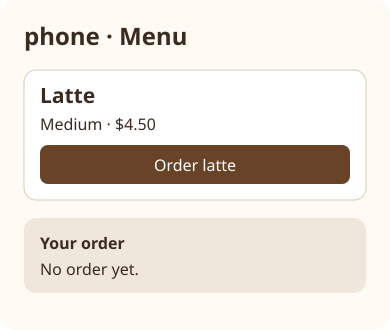
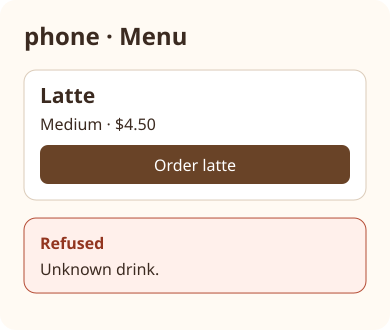

# Coffee pickup: phone

Own only phone rendering and appending order_requests. Read menu, orders and order_requests with the corresponding KEY.load. order appends {id:"order-N",drink,size}, where N is previous request count plus one, saves only order_requests, and returns id and status Ordered. render shows phone · Menu, the menu prices in cents formatted as dollars (450 is $4.50), a button value="order-latte", and the latest order status or an empty string. A refused order shows its reason. Return html and status. Do not write orders, tickets or menu.

Relational illustrative previews at 390 × 844; sample values come from the contracts and current world. The stacked arrangement applies at narrow and desktop widths with a readable content column.

## Dependencies

- [Shared world](../../contracts/world.md): required generation/runtime context for shared records and single-writer ownership.
- [Phone/server contract](../../contracts/phone-server.md): required generation/runtime schema authority for order input.
- [Server/barista contract](../../contracts/server-barista.md): required generation/runtime schema authority for tickets and completion input.
- [Appearance](../../views/phone-menu__stacked.ui.svg)
- [Appearance](../../views/phone-refused__stacked.ui.svg)

Follow the linked stacked-card appearance: part heading, primary action, status below. HTML escapes user-controlled strings. World resources are real persistence ports; never cache world between calls or invent returned records.

Pass the resource’s own key as the const key argument to every load/save. Each KEY.load uses its named top-level world key; KEY.save replaces only that key. Native adapters bind these ports to shared persistence.
