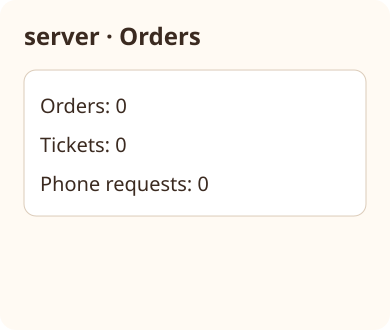

# Coffee pickup: server

Own only menu/orders. forward_tickets reads all four world keys. For each request without an order, create an order with its request id, drink and size: Ordered with null reason when menu contains drink/size; otherwise Refused with reason Unknown drink or size. Then mark any Ordered order whose corresponding ticket is done as Ready. Save orders only and return processed as number of newly created orders. Never remove requests and never write tickets. render returns server · Status HTML and orders. Do not call phone or barista operations.


Relational illustrative previews at 390 × 844; sample values come from the contracts and current world. The stacked arrangement applies at narrow and desktop widths with a readable content column.



## Dependencies

- [Shared world](../../contracts/world.md): required generation/runtime context for shared records and single-writer ownership.
- [Phone/server contract](../../contracts/phone-server.md): required generation/runtime schema authority for order input.
- [Server/barista contract](../../contracts/server-barista.md): required generation/runtime schema authority for tickets and completion input.
- [Appearance](../../views/server-status__stacked.ui.svg)

Follow the linked stacked-card appearance: part heading, primary action, status below. HTML escapes user-controlled strings. World resources are real persistence ports; never cache world between calls or invent returned records.

Pass the resource’s own key as the const key argument to every load/save. Each KEY.load uses its named top-level world key; KEY.save replaces only that key. Native adapters bind these ports to shared persistence.

<details><summary>Runtime interface</summary>

```json
{
  "status": "draft",
  "prose_sha256": "bd55dc8f0be7725c3193746bce2ac71ecfd796461f77372c87d95f0b1a1f658f",
  "entries": [{"operation":"render","input_schema":{"type":"object","properties":{},"required":[],"additionalProperties":false},"result_schema":{"type":"object","properties":{"html":{"type":"string"},"orders":{"type":"array","items":{"$contract":"examples/coffee-pickup/contracts/world.md#order"}}},"required":["html","orders"],"additionalProperties":false},"errors":[]},{"operation":"forward_tickets","input_schema":{"type":"object","properties":{},"required":[],"additionalProperties":false},"result_schema":{"type":"object","properties":{"processed":{"type":"integer"}},"required":["processed"],"additionalProperties":false},"errors":[]}],
  "calls": [],
  "resources": [{"name":"menu","kind":"key-value","access":"write","operations":[{"name":"load","access":"read","arguments_schema":{"type":"object","properties":{"key":{"type":"string","const":"menu"}},"required":["key"],"additionalProperties":false},"result_schema":{"type":"object","properties":{"value":{"type":"array","items":{"$contract":"examples/coffee-pickup/contracts/world.md#menu_entry"}}},"required":["value"],"additionalProperties":false}},{"name":"save","access":"write","arguments_schema":{"type":"object","properties":{"value":{"type":"array","items":{"$contract":"examples/coffee-pickup/contracts/world.md#menu_entry"}},"key":{"type":"string","const":"menu"}},"required":["value","key"],"additionalProperties":false},"result_schema":{"type":"object","properties":{"value":{"type":"array","items":{"$contract":"examples/coffee-pickup/contracts/world.md#menu_entry"}}},"required":["value"],"additionalProperties":false}}]},{"name":"orders","kind":"key-value","access":"write","operations":[{"name":"load","access":"read","arguments_schema":{"type":"object","properties":{"key":{"type":"string","const":"orders"}},"required":["key"],"additionalProperties":false},"result_schema":{"type":"object","properties":{"value":{"type":"array","items":{"$contract":"examples/coffee-pickup/contracts/world.md#order"}}},"required":["value"],"additionalProperties":false}},{"name":"save","access":"write","arguments_schema":{"type":"object","properties":{"value":{"type":"array","items":{"$contract":"examples/coffee-pickup/contracts/world.md#order"}},"key":{"type":"string","const":"orders"}},"required":["value","key"],"additionalProperties":false},"result_schema":{"type":"object","properties":{"value":{"type":"array","items":{"$contract":"examples/coffee-pickup/contracts/world.md#order"}}},"required":["value"],"additionalProperties":false}}]},{"name":"tickets","kind":"key-value","access":"read","operations":[{"name":"load","access":"read","arguments_schema":{"type":"object","properties":{"key":{"type":"string","const":"tickets"}},"required":["key"],"additionalProperties":false},"result_schema":{"type":"object","properties":{"value":{"type":"array","items":{"$contract":"examples/coffee-pickup/contracts/server-barista.md#ticket"}}},"required":["value"],"additionalProperties":false}}]},{"name":"order_requests","kind":"key-value","access":"read","operations":[{"name":"load","access":"read","arguments_schema":{"type":"object","properties":{"key":{"type":"string","const":"order_requests"}},"required":["key"],"additionalProperties":false},"result_schema":{"type":"object","properties":{"value":{"type":"array","items":{"$contract":"examples/coffee-pickup/contracts/world.md#order_request"}}},"required":["value"],"additionalProperties":false}}]}],
  "limits": {"max_steps":20,"max_model_calls":12},
  "conventions": []
}
```
</details>
