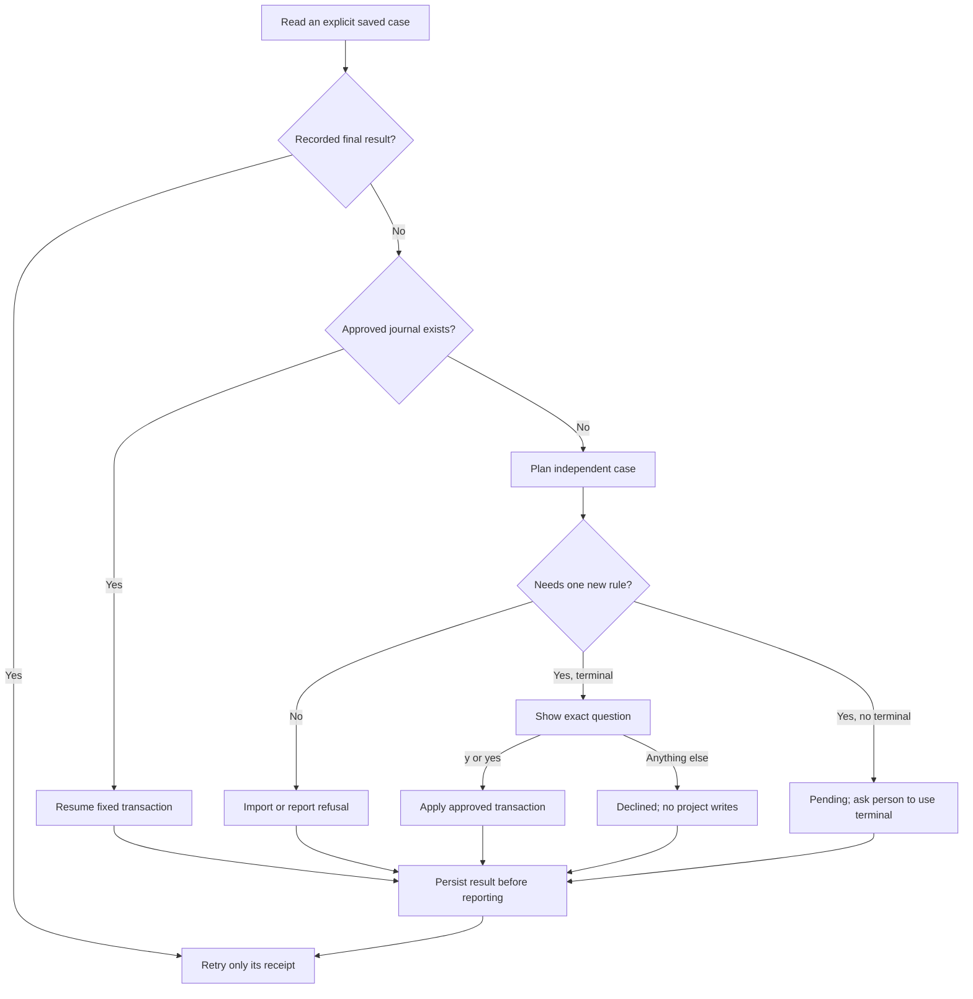

# Import explicit Try-page cases

Own `src/agent-case-collector.mjs`. Export async `collectAgentSavedCases(context,tryId,{answers=null,timeoutMs=30000}={})`, returning ok/missing/ended. This collector owns owner-authenticated case reads, terminal decisions, private import records and receipt reporting. It never imports an unsaved chat suggestion, invokes an agent/program or approves a prompt. `context` supplies root, ports(stdout,now), store(folder/read/write), runtime.send, secrets, interruption/signal and optional onAgentCaseSaved. `answers.ask()` is the existing person's terminal reader; null means no terminal.

## From Save to a real file

GET `/v1/try/<id>/tests`. Authentication/expiry401/403/410 means ended. A lost GET leaves uncertain imports untouched and returns ok; a missing/unsupported endpoint returns missing. Accept at most50 case records, with existing safe case IDs. Invalid records never select filesystem paths. For a safe public ID whose payload cannot be fingerprinted, persist and report a generic failed receipt once without exposing the invalid contents. An invalid payload under an already handled identity cannot replace that result; require a new case ID. Every new page-saved case uses the separate-case importer; CLI save-last remains with its legacy owner. Never choose a destination from server path/original_path.

Use the case and Story-rule owners for validation, planning, safe writes and recovery. Exactly one missing rule may be proposed. Ask the plan's exact brief question; only case-insensitive y/yes after trimming authorizes apply. Without answers, persist pending and print one plain terminal instruction without fabricating a decision. If interrupted before applying, write no new project data. An already approved journal resumes without asking again; an interrupted or blocked approved transaction stays pending so restored files can later resume the same approved plan. Other refusals become failed, never saved. Existing legacy handled records stay handled without reimporting old cases.

## Private once-only records and public receipts

Use the existing `tries/<tryId>.tests.json` keyed by public case ID. Helper identities are `try-case-` plus lowercase SHA-256 hex of UTF-8 tryId, one NUL byte, then public case ID. This scopes file/journal identity to the Try; HTTP and per-bridge memory keep the public case ID. Match the stored payload fingerprint before any resume, so one public ID cannot approve different data. Record a payload fingerprint, state, plain result, optional importer receipt, approved-journal flag, posted flag and notice metadata. A changed payload under one ID cannot replace an earlier plan/result. Final added/declined/failed entries never repeat a write or question. Store result before making a receipt request; a lost POST retries only the exact stored metadata. A pending result may change when the person answers or an approved transaction completes.

POST `/v1/try/<id>/tests/<caseId>/result` with bounded `{state,message,path?,step_ids?,criterion_id?}`. State is pending/added/declined/failed. Added includes the actual locally chosen safe path and original step IDs; new-rule completion may include its canonical criterion ID. Strip credentials/controls from messages and bound them to500characters; no raw tests, world, file contents or terminal answer are sent. An exact acknowledged result sets posted; an uncertain or failed receipt remains retryable. An unsupported404 receipt endpoint is tolerated without reimporting or claiming page confirmation. Owner expiry ends collection. Never retry a program/provider or report an uncertain file import as added.

Print each changed result once. Notify optional onAgentCaseSaved only after a newly recorded successful import; pass id/name/Story/result without raw test data. Observer errors cannot affect saving. Pending/declined/failed results never mark guide memory saved. Keep private records bounded by server case limits; memory-only transport state can note an unsupported receipt endpoint.

## Dependencies

- [Standalone case importer](agent-saved-case.prompt.md): required runtime/authoring/verification owner for independent files, exact worlds/checks and receipts.
- [Approved Story rule](agent-story-rule.prompt.md): required runtime/authoring/verification owner for read-only plans and approved journal recovery.
- [Runtime output](runtime-output.prompt.md): cleanText removes owner credentials and terminal controls from public result text.
