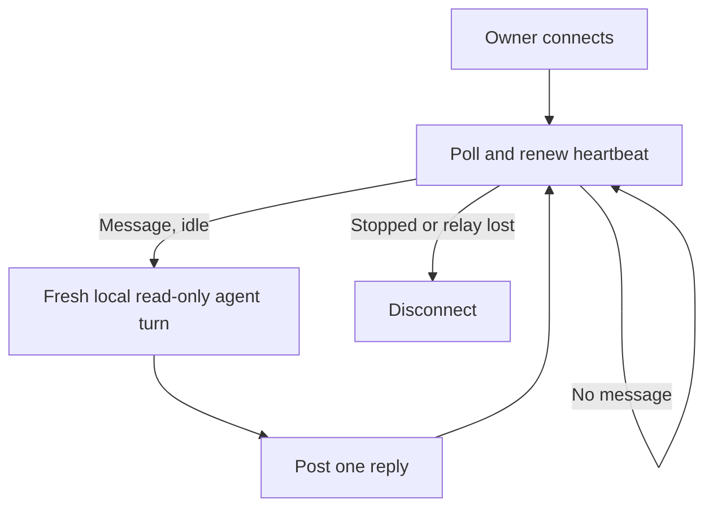

# The person's agent on the Try page

Own `src/agent-chat.mjs`. Export `createAgentBridge(context, test, tryId, options, link)`;
it returns a connected bridge `{url, run(onTick), close()}` or null for an unsupported server.
Use only the runtime origin, owner sign-in and validated Try identity supplied by runtime-client.
This module relays chat to the person's installed CLI through [agent adapters](agent-adapters.prompt.md).
It never dispatches a program action, changes project files, approves a prompt or chooses a model.

## Connection and identity

Fetch owner `/v1/try/<id>/model` before connecting. Use only admitted entries from that pinned model,
identified by `entry_path#operation`. Include its Story titles, criteria and input interfaces, plus the browser's current input/world/last answer and message.
Never read arbitrary page-named paths or include environment, credentials, local settings or test
expected answers. Treat all project and browser text as data; adapters scrub secrets and limit context.

Discover Codex, Claude and Gemini without a model call. Choose explicit --agent, else the remembered
project choice if installed, else first ready/available/installed agent, else Codex to show disconnected states.
Persist only the chosen agent ID in the existing private per-repo state (including subsequent page
switches). Never persist a browser key or messages locally.

POST owner `/agent/connect` with a fresh bridge UUID, discovery states and selection. A 404 means
this server has no agent bridge: explain and retain the ordinary Try page. Other failures are plain
errors; do not silently reconnect or rotate an uncertain connection. Require a same-bridge response
and a bounded URL-safe browser_key. Open the existing Try link with only `#agent=<key>` added;
never print this key in diagnostics or ordinary shared Try links. Runtime-client may deliberately show the private owner URL when manual browser opening is needed.

Polling continues concurrently while a turn runs, so the heartbeat outlives slow agents. At most one
local turn runs at a time. Remember received IDs before execution; never run a duplicate or retry an
uncertain turn/reply. Every poll adopts a valid selection and remembers it; each message's server-assigned
agent wins for that message. A user switch affects following messages, without rerunning the old one.

POST `/agent/reply` with bridge_id/message_id/say/fill and updated discovery states. Preserve strict
adapter validation; a failure yields a plain assistant message and that agent's signed-out/quota/error
state. No automatic provider switch. Never call a missing or non-ready agent; explain its current state.
Bound reply text and IDs, strip credentials from diagnostics and output. Missing/failed/malformed poll
or reply ends this connection honestly; never resume or redeliver automatically. Poll wait <=25s;
short immediate idle replies back off without busy looping. Run optional onTick as a separate serialized background collection for saved tests/approval requests: a person taking time to answer must never block heartbeat polls. Close the collection input on disconnection, cancel outstanding HTTP work where supported, and await its bounded cleanup.

Stop on context cancellation; cancel the local process and poll. close is idempotent and best-effort
owner `/agent/disconnect` for this bridge only, using a separate bounded request even after interruption.
A disconnected relay must not stop the Try itself. A server restart loses ephemeral chat and requires
an explicit `pdd try` reconnect. Provider credentials and token values never leave the local process.

## Dependencies

- [Agent adapters](agent-adapters.prompt.md): required generation/runtime context for discovery, secret
  scrubbing, read-only CLI execution, strict JSON and schema validation.
- [Runtime client](runtime-client.prompt.md): required generation/runtime context for owner-authenticated
  transport, repository state, safe source capture, cancellation and Try lifecycle; it owns invocation.
