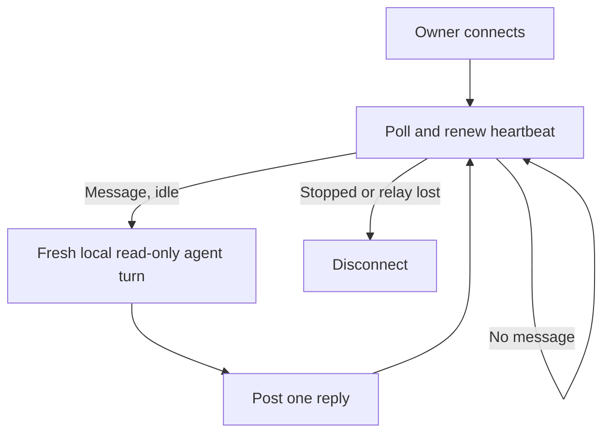

# The person's agent on the Try page

Own `src/agent-chat.mjs`. Export `createAgentBridge(context, test, tryId, options, link)`;
it returns a connected bridge `{url, run(onTick), close()}` or null for an unsupported server.
Use only the runtime origin, owner sign-in and validated Try identity supplied by runtime-client.
This module relays chat to the person's installed CLI through [agent adapters](agent-adapters.prompt.md).
It never dispatches a program action, changes project files, approves a prompt or chooses a model.

## Connection and identity

Fetch owner `/v1/try/<id>/model` before connecting. Use only admitted entries from that pinned model,
identified by `entry_path#operation`. Include its Story titles, criteria and input interfaces, plus the browser's current input/world/last answer and message.
Never read arbitrary page-named paths or include environment, credentials or local settings. Authored test expectations are local judge inputs only; the agent receives sanitized check outcomes and the first difference, never the full test or an expected-answer catalog. Treat all project and browser text as data; adapters scrub secrets and limit context.

Use the private `context.agentDefinitions` from runtime-client, or load definitions locally for direct callers before any network access. An empty list is a plain configuration error. Discover each configured definition independently without a model call. The picker and relay receive only `{id,name,state,detail?}`, with names and IDs taken from local definitions, never command, kind or environment. Ignore discovery rows outside those definitions. Explicit --agent matches an exact display name, with builtin lowercase IDs retained as aliases. Unknown explicit choices fail before connecting. Otherwise choose the remembered display name (migrating old builtin IDs), if installed, then first ready/available/installed definition, then the first definition to show unavailable states.
Persist only the chosen display name in existing private per-repo state, including subsequent page switches. Wire selections and messages use opaque IDs, checked against the local definitions. Each turn passes its matching private definition separately to the adapter with the unchanged base environment; the adapter owns child-only environment merging. Never persist a browser key or messages locally.

POST owner `/agent/connect` with a fresh bridge UUID, discovery states, selection and `features`: the list
apply/progress/run_events/expect/save/run this client handles. A relay that gets no list assumes a
released 0.1.9 client and never offers run, so the page never promises a run. A 404 means
this server has no agent bridge: explain and retain the ordinary Try page. Other failures are plain
errors; do not silently reconnect or rotate an uncertain connection. Require a same-bridge response
and a bounded URL-safe browser_key. Open the existing Try link with only `#agent=<key>` added;
never print this key in diagnostics or ordinary shared Try links. Runtime-client may deliberately show the private owner URL when manual browser opening is needed.

Polling continues concurrently while a turn runs, so the heartbeat outlives slow agents. At most one
local turn runs at a time. Remember received IDs before execution; never run a duplicate or retry an
uncertain turn/reply. Every poll adopts a valid selection and remembers it; each message's server-assigned
agent wins for that message. A user switch affects following messages, without rerunning the old one.

POST `/agent/reply` with bridge_id/message_id/say/fill and updated discovery states. Negotiate optional apply/progress/run_events/expect/save/run from a bounded string-array connect response; ignore unknown features. Absent features use the legacy say/fill payload only and a manual Fill fields then Run prompt variant. Preserve strict
adapter validation; a failure yields a plain assistant message and that agent's signed-out/quota/error
state. No automatic provider switch. Never call a missing or non-ready agent; explain its current state.
Bound reply text and IDs, strip credentials from diagnostics and output. Missing/failed/malformed poll
or reply ends this connection honestly; never resume or redeliver automatically. Poll wait <=25s;
short immediate idle replies back off without busy looping. Run optional onTick as a separate serialized background collection for saved tests/approval requests: a person taking time to answer must never block heartbeat polls. Close the collection input on disconnection, cancel outstanding HTTP work where supported, and await its bounded cleanup.

Stop on context cancellation; cancel the local process and poll. close is idempotent and best-effort
owner `/agent/disconnect` for this bridge only, using a separate bounded request even after interruption.
A disconnected relay must not stop the Try itself. A server restart loses ephemeral chat and requires
an explicit `pdd simulate` reconnect. Provider credentials and token values never leave the local process.

## Terminal lines

The owner watches the terminal where `pdd simulate` runs. The terminal reports connection and reply outcomes even when the page can show only a safe summary. Write every line to stderr in the [progress](runtime-output.prompt.md#progress-and-causes) style:
- Before discovery: `Connecting your agent to the Simulator…`.
- When connected: `Ask your agent is connected (<Name>). Keep this window open for Ask your agent; Ctrl-C disconnects the chat and keeps the Simulator open.`
- For each message: `<Name> is answering a question from the Simulator…`, then `<Name> answered.` (plus ` It proposed input for the form.` with a fill), or `<Name> could not answer: <the adapter's message>`.
- A deterministic guide reply uses `PDD checked the run against the local test cases.` rather than claiming that an unavailable agent answered or could not answer.
- A failed model read or connect names its reason: the network cause, else the server's message, else the HTTP status.

## Memory, project knowledge and run checks

Delegate preparation, RAM-only memory across agent switches, safe project/scenario reads, coverage, deterministic run checks, own-expectation bindings and wire projection to the [Try guide](agent-guide.prompt.md). The guide owns its exact windows, modes, conservative pass rules and local-source change semantics. Never send full local tests or an expected-answer catalog. Adapters retain input schemas locally and the packet owner supplies the bounded guide request. Keep the person's model and effort unchanged.

Supply owner credentials and secret values from the base environment and every configured launcher to the guide before retaining or transmitting memory. Pass safe local-reader replacements through optional ports.guidePorts. Prepare each valid message before choosing a deterministic fast reply or a fresh CLI turn. A deterministic clear-pass reply takes priority even when the selected agent is unavailable, because it needs no provider; preserve that agent's unavailable state. Other messages explain the unavailable state without invoking it. The bridge introduces no run events itself in phase A.

After a successful relay reply, call delivered with its accepted person/reply pair. Failed delivery creates no remembered offer. Install a private context.onAgentCaseSaved callback for id/name/Story/result notices from collectSavedTests; remove only that callback on close. Close guide memory on disconnection. These notices never authorize saving or changing a Story.

## Dependencies

- [Try guide](agent-guide.prompt.md): required generation/runtime context for memory, coverage, own-case checks and compatibility projection.
- [Run judge](agent-judge.prompt.md): required generation/runtime context for deterministic verdicts and ordered progress.
- [Project card](agent-project.prompt.md): required generation/runtime context for safe local facts and latest official check.
- [Agent packet](agent-packet.prompt.md): required generation/runtime context for bounded request layout and compatibility wording.
- [Agent configuration](agent-config.prompt.md): required generation/runtime context for local launcher selection and private definitions.
- [Agent adapters](agent-adapters.prompt.md): required generation/runtime context for discovery, secret
  scrubbing, read-only CLI execution, strict JSON and schema validation.
- [Runtime client](runtime-client.prompt.md): required generation/runtime context for owner-authenticated
  transport, repository state, safe source capture, cancellation and Try lifecycle; it owns invocation.

Advertised run is passed as supportsRun to the adapter and retained for guide wire
projection. Only the current manual person's request can authorize the agent's run flag;
interpret intent in any wording, never a fixed word list. Automatic run observations
cannot authorize another action. The bridge never dispatches it; the negotiated page
uses its ordinary funded action path and guards. Without run capability, omit the field.
