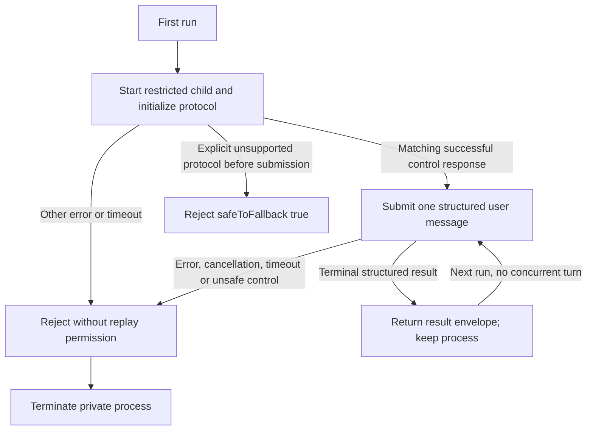

# One private warm Claude chat

Own `src/agent-claude-session.mjs`. Export module function
`createClaudeSession({command='claude',cwd,env,args=[],spawn,timeoutMs=120000,maxBytes=131072})`
returning instance methods `run(input,{signal,timeoutMs,maxBytes}={})` and asynchronous
idempotent `close()`. run resolves `{code,stdout,stderr}` for one structured terminal
result, with stdout the complete JSON result envelope consumed by the existing adapter.
It never invokes a product action, changes files or configuration, selects a provider,
sets a model/effort or shares a process across instances. Parent owns fallback/resume,
transcript cleanup, scrub and final answer/schema validation.

Use a direct child process with persistent piped stdio, no shell, the supplied command,
cwd and unchanged child environment. Keep the caller's cold safe flags: print, safe-mode,
Read/Grep/Glob tools, plan permission mode, no permission prompts, strict MCP config,
no Chrome and no session persistence. Empty args use those defaults. Refuse supplied
args missing these restrictions. Replace input/output format options with stream-json
and add verbose; add no execution tools or authorization. Do not mutate caller args/env.

Only the initialize request is sent before protocol readiness. Each run then sends exactly
one newline-delimited user object, with role user and content equal to the complete input,
parent_tool_use_id null, a fresh UUID and client_composed true (no slash/@ expansion).
Do not finish on assistant prose, tool output or partial events. An early/duplicate result,
wrong session identity, malformed JSON, unknown frame or permission/control violation
cannot become another turn's answer. Matching initialization uses request_id; sequential
terminal results use the single active submitted turn and one stable session_id when
reported. Ignore bounded documented system, user acknowledgments and streaming progress;
allow only observed Read/Grep/Glob tool_use names. Do not render or parse TUI text.

Deny every can_use_tool control request with the same request_id and behavior deny;
never grant a permission. Unknown tool names or unknown controls receive a structured
control error and terminate the session. No setting/model/control mutation is accepted.
A result envelope requires type result, a nonempty session_id, boolean is_error and,
for success, string result. Error results remain structured envelopes (code0 transport),
then close the session; the adapter interprets their is_error/result/errors fields.

One run may be active; reject concurrent callers without submitting or poisoning the
active turn. Preserve split UTF-8 and split NDJSON lines. Bound all stdout/stderr bytes
received per turn, including intermediate frames and partial lines. Idle output also has
a bound and never accumulates indefinitely. Reset output accounting and stderr per run.
Reject malformed input/options before submission. Timeout/cancel/exit/write failures or
output overflow reject the active promise and make the session unusable. Terminate the
process group with TERM and a bounded KILL escalation; close must not leave active work.

Every error has boolean safeToFallback, true ONLY for an explicit unsupported streaming
CLI/protocol startup diagnosis before any user message was submitted. Missing executable,
auth/quota/provider errors, uncertain transport loss and failures after submission are
false. Errors contain bounded stderr for caller diagnostics, never stdout prompts.

## Dependencies

- [Adapters](agent-adapters.prompt.md): navigation-only caller/ownership context. The
  complete consumed return interface is declared above; parent supplies its existing
  safe cold argv, and this module never performs adapter reply validation.
- Node child_process.spawn, crypto.randomUUID and StringDecoder: required runtime
  built-ins for direct subprocesses, request identities and split UTF-8 decoding.
- [Anthropic CLI reference](https://code.claude.com/docs/en/cli-reference) and
  [official SDK control protocol](https://github.com/anthropics/claude-agent-sdk-python/blob/main/src/claude_agent_sdk/_internal/query.py):
  required verification references. Consumed wire declarations are included above;
  no SDK/package dependency or model call is required.

Supplied argv is the existing cold print profile, optionally containing only format and
verbose switches in addition to that profile. Reject duplicate safety/value switches,
unknown switches and positional prompts before spawning, so later argv cannot override
plan mode or introduce an early model prompt before initialization. Stderr UTF-8 chunks
receive the same lossless decoding treatment as stdout. Structured error envelopes
without a textual result stay available to the adapter, never trigger warm replay.

A terminal result cannot leave a partial trailing stdout frame to be completed under the
next caller. Reject that uncertain boundary. When terminal frames supply UUIDs, retain
up to 256 distinct result UUIDs and reject replay or saturation rather than recycling
identities. Late terminal output while idle closes the session instead of buffering an
answer for the next message. Closing an active run rejects it once and is idempotent.

Process-group teardown outlives direct-child exit: descendants may retain the group while
the CLI exits on TERM. Keep the KILL escalation pending and target that group even after
the direct child closes. close also sends the final group KILL before returning.

Spontaneous direct-child exit is also a teardown trigger: failure starts TERM/KILL on the
remaining process group even when the child is already marked exited. Cleanup cannot
depend on the caller later invoking close.
