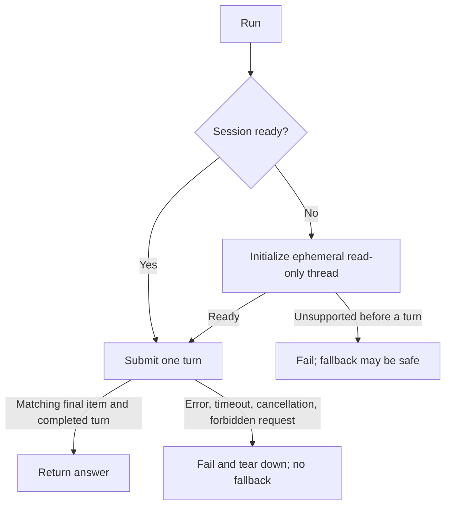

# One bounded warm Codex conversation

Own `src/agent-codex-session.mjs`. Export `createCodexSession({command,cwd,env,configArgs=[],spawn=child_process.spawn,timeoutMs=120000,maxBytes=131072})`, returning `{run(input,{signal,timeoutMs,maxBytes}={}),close()}`. This new low-level transport runs an installed personal Codex app-server, not a shell or program tool. The parent supplies safe launch overrides and owns adapter validation, credentials scrubbing and any cold fallback. Preserve the person's model, reasoning effort and base policy: never supply model/effort overrides or replace base/developer instructions.

## Session and answer identity

Spawn lazily as command with `['app-server',...configArgs]`, piped stdio, supplied cwd/env and an isolated process group where supported. Initialize once with clientInfo, send initialized, then thread/start once with cwd, sandbox:'read-only', approvalPolicy:'never', ephemeral:true and config:{project_doc_max_bytes:0}. That documented config prevents repository instruction loading; --ignore-rules only concerns execpolicy rules. No persisted/resumed thread is used. Require a nonempty returned thread ID, thread.ephemeral exactly true, explicit approvalPolicy never and an explicit read-only sandbox. Current servers return sandbox:{type:readOnly,networkAccess:false}; accept that object with no enabled network access or the legacy read-only string. Missing or contradictory confirmations refuse before any turn submission, with safeToFallback true. A subsequent run reuses this thread, submitting exactly one turn/start with this thread ID and one text input. Never supply tools or inputs requested by the server.

Only a completed agentMessage for the exact thread AND acknowledged turn may provide stdout. Ignore commentary phase, deltas and unrelated thread/turn messages. Accept absent/null phase for older compatible servers. Require matching turn/completed with status completed and no error after the final item; never return partial output from failed/interrupted/error turns. Preserve final text exactly. Notifications may precede the turn/start response: retain bounded same-thread events and replay against the acknowledged turn ID, rather than losing the final answer. Success returns `{code:0,stdout,stderr}`; stderr contains bounded child stderr for the caller to scrub. All failure paths reject an Error with boolean safeToFallback and bounded stderr diagnostics. Preserve structured turn.error.message or matching error-notification params.error.message in Error.message and .stderr, so the caller can classify quota/auth failures and scrub private logs. Never use final agentMessage text as an error diagnostic. Other transport failures use generic messages while retaining already received bounded child stderr.

## No tools and no uncertainty replay

Decline modern command/file approvals with `{decision:'decline'}`, legacy exec/patch approvals with `{decision:'abort'}`, and permission approvals with `{permissions:{},scope:'turn'}`. Unknown methods, tool calls, authentication callbacks, elicitation and user-input requests receive JSON-RPC method-not-found, never credentials, tool output or person input. Any server request then fails the session closed; no model continuation may succeed after it. Item notifications permit only userMessage, agentMessage, reasoning, plan and contextCompaction; tool, hook, subagent and unknown item types fail closed too. Parent launch flags are required to disable tools/hooks/plugins; denial is defense in depth.

safeToFallback is true only for startup spawn unavailability, an explicit first stderr line diagnosing an unknown/unrecognized/unsupported app-server command, or unsupported/malformed startup protocol before ANY turn/start was submitted in this session. Recognize the app-server command diagnosis narrowly; ordinary exits, auth/quota/provider diagnostics are never fallback permission. Mark submission before writing the request. It is false for quota/auth/provider errors, cancellation, timeout, close, concurrent admission, process exit after submission or any uncertain/in-flight failure. The transport never retries or falls back itself. One active run is admitted; concurrent calls reject without disturbing it. A failed or closed session is terminal, including before startup, and cannot respawn.

## Bounded framing and lifetime

Use newline-delimited JSON-RPC with correlated monotonically increasing IDs and fragmented UTF-8 support. Empty lines may be ignored; malformed JSON/response shapes fail. Bound all stdout plus stderr received during each run (including protocol framing, notifications and partial lines) by maxBytes; retain no unbounded idle output or event queue (at most256 early events). Per-run timeout includes startup and settles all request/turn promises. Reject invalid limits/input before spawning, including input UTF-8 bytes above maxBytes. Decode fragmented stderr UTF-8 without replacement corruption. Cancellation, protocol errors, output overflow and child error/exit terminate the session and reject all pending work. close is idempotent, rejects active work, ends stdin and terminates the process group with TERM then KILL within a bounded interval, including descendants surviving the direct child. Remove abort listeners/timers. No background process remains after close completes.

## Dependencies

- [Official app-server protocol](https://learn.chatgpt.com/docs/app-server): required authoring/protocol reference. The installed CLI's generated JSON schemas for ThreadStartParams, TurnStartParams, ItemCompletedNotification, TurnCompletedNotification and server approval requests are the version-specific authority; consumed fields and decline decisions are stated above so no private artifact is required at runtime.
- Node child_process, StringDecoder and timers provide process isolation, incremental decoding and bounded lifecycle. No package, network fetch or provider call is used by transport verification.
