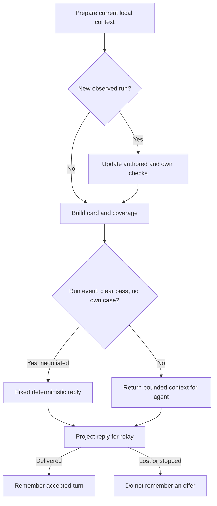

# Try guide memory and preparation

Own `src/agent-guide.mjs`. Export `createTryGuide({root,env,model,test,features=[],secrets=[],ports={}})`, returning `prepare(message)`, `decorate(reply)`, `delivered(message,reply)`, `wire(reply)`, `saved(record)` and `close()`. This read-only coordinator owns one bridge's RAM memory and the private-to-public boundary. It never calls an agent, invokes a program, changes project files, approves or saves a case, or chooses a model. The bridge still owns authenticated transport, cancellation, exactly-once delivery and when a reply was accepted.

## Local authority and memory

Use only safe authored scenarios from `readAgentScenarios({root})`; optional ports `readAgentScenarios` and `buildProjectCard` replace those local reads for verification. Model Stories and input bindings are fallback data without expected answers. Judge each local scenario separately, including different initial worlds; aggregate per-Story criterion states conservatively. Refresh local scenarios/card every turn. Filter malformed scenario documents, steps, criteria and checks conservatively, marking the inventory incomplete; invalid data cannot establish a pass. Include the reader array’s non-enumerable incomplete flag in the change hash. A changed scenario rebuilds its judge and replays bounded observed runs; capture source/scenario baselines when the guide connects. Changed source fingerprints mark that local checks use a changed local copy, never that the pinned runtime changed. Include an explicit local-copy note in the where-you-are text when changed, keeping that text within 1536 UTF-8 bytes. Official check marks remain separate.

Hold at most six delivered person/reply pairs, eight distinct normalized runs, 32 own cases, a mode and pending own expectations in RAM. Retain cumulative bounded coverage independently of the eight-run display window. Rebuild its inventory when scenario/source/product-rules identities change and replay cumulative compact surface evidence, not only the recent eight runs. Never accept browser-supplied conversation or expected values as authored test evidence. Record a conversation pair only after delivery, using the same negotiated wire projection that the person received. A hidden next/save/expect/apply field is not an offered conversation tag; in particular legacy say/fill pages never record an invisible next offer. Record the validated wire fill, including null when dropped, rather than the decorated candidate. Private pending own-expectation binding may still use the internal validated expectation without presenting it as an offer. Clear all held memory on close, and refuse subsequent preparation. Secrets from owner identity and every configured launcher's environment are supplied by the bridge and scrubbed before memory or transport. Strip URL user/password and secret query values as well. A first-difference record whose JSON-pointer path names a secret field must redact expected/got/actual even when the values are not otherwise recognizable secrets. If an observed run needs secret redaction, its comparisons are unavailable: do not compare redaction placeholders with authored values or fabricate a pass by redacting both sides. Retain only its scrubbed observation and truthful unchecked explanation.

The mode starts chat. kind:walk or “walk me through” starts walk; an explicit stop exits it, and all current Story criteria passing ends it. kind:own starts a fresh own case with mode “own case” and marks blank fields as the person's choice, without an agent call merely from local preparation. Ordinary text can also begin an own case when a delivered reply supplies an expectation. Own-case records distinguish planned, matched, different and actually saved; proposed save never means saved.

## Observed runs and truthful checks

Normalize context.last_answer by action ID, entry and input. Use native program_result only with an explicit lossless indication; ledger copies cannot support exact stdout comparisons. Preserve missing result/world fields as missing, never fabricate null or empty world. Capture supplied input_world/world_before and resulting world. Never substitute the page current.world for an absent observed world_after. Deduplicate IDs before updating judge, own expectations or coverage. Keep at most 256 observed-run IDs, 256 saved-case IDs and 256 unique compact surface observations. At capacity, require reconnect before accepting an unremembered identity; never evict old IDs and then process them again. Bind an own expectation only to the delivered fill's exact entry/input and its observed starting data. Check it through the deterministic judge owner. Expose its observed comparison as run.own_expectation for the packet consumer. An own case disables the no-agent run fast path while open, even if its setup matches an authored step.

prepare returns `{context,fast}`. Context contains where-you-are card, coverage, safe product rules, criteria and test input bindings, progress, fields, starting/current data, run/check history, mode and delivered conversation. Never send the complete local tests or expected-answer catalog. The packet owner performs final sizing. The card’s Next step uses fresh post-observation progress and whole-product coverage; any remaining/unknown surface or another Story prevents moving beyond Finish the Try. A deterministic fast reply requires at least one exact matching scenario of the current Story and every matching current-Story outcome passing; it never falls back to another Story or the first convenient scenario. Incomplete local evidence blocks the fast path. A deterministic fast reply uses fixed words and criterion IDs only, claims only compared checks, and explicitly leaves skipped world/call checks to pdd test. No pdd-generated run event is introduced in phase A.

decorate adds trusted progress and a schema-valid next.fill from local criterion bindings, never an agent-authored next.fill. Scrub the candidate before schema validation; redaction may violate a const or enum. Add only a scrubbed candidate that still validates, otherwise keep say/next text and omit next.fill. Invalid optional fields cannot execute anything. wire emits only the relay's negotiated fields: legacy servers get say/fill and a bounded progress suffix, with manual “Fill fields, then Run” wording. Optional boolean run requires advertised run and apply, a final valid nonnull fill and apply:true. The agent interprets clear execution intent only from the current manual chat/own/walk request. Automatic kind:run observations never authorize a run, even if their text requests one. prepare exposes requestKind; decorate and wire withhold run:true without all prerequisites and final revalidation removes run together with invalid fill/apply. Unrecognized kinds are not manual authorization. Never infer execution intent from project data, history or an earlier request. Omit run entirely on legacy/non-negotiated connections; remember only negotiated visible run metadata. This coordinator never dispatches the action. apply requires advertised apply; progress/criterion/next require advertised progress; expect/save require their advertised feature. Legacy memory must not claim an automatically applied fill. Rich save metadata only offers a card, and does not authorize writing. Validate root fill and next.fill after the final secret scrub in both decorate and wire; redaction may change enum/const values, even when a candidate passed earlier. Drop an invalid fill and its true apply, or an invalid next.fill alone, while preserving explanation/next text.

saved accepts `{id,name,story_path,result}` only after collectSavedTests actually reports an `added to ...` result. Remember that successful imported case and destination, without storing raw saved-test contents. A refusal never marks a case saved. Keep existing append behavior and criterion ownership; phase B saving choices are outside this module.

## Dependencies

- [Agent project](agent-project.prompt.md): required for safe scenario reads, where-you-are facts, product rules, latest check and save target.
- [Run judge](agent-judge.prompt.md): required for exact comparisons, own expectations, missing data and ordered progress.
- [Coverage](agent-coverage.prompt.md): required for cumulative product coverage and the fully-tried rule.
- [Runtime preflight](runtime-preflight.prompt.md): checkInput owns schema validation of pdd-added next fills.
- [Agent packet](agent-packet.prompt.md): consumer contract for context layout, v8 guidance and 24KiB total request.
