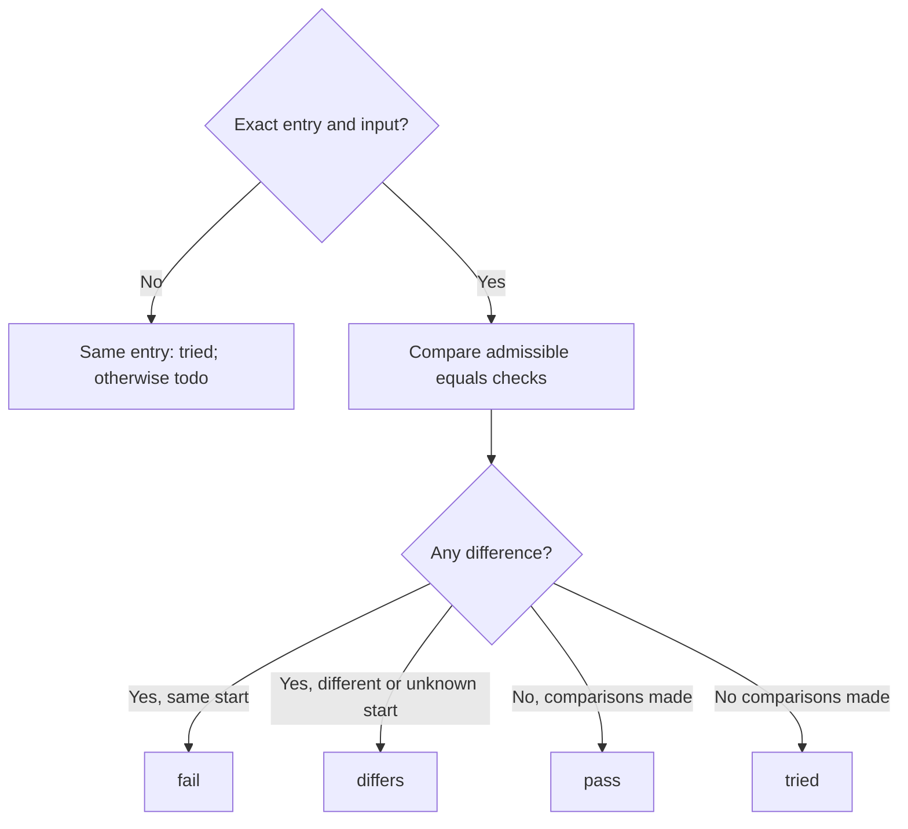

# Local Try run judge

Own `src/agent-judge.mjs`: deterministically compare a Try run against the person's local scenario, preserving exact JSON values and string newlines. This new module never executes a program, contacts a model, reads files or treats official Check results as Try evidence. It uses only supplied JSON data and keeps evidence in RAM.

Export `createRunJudge({scenario,checkPassed=[]})`. `scenario` has local test `criteria`, `steps` and optional `initial_world`. Return methods `record(run)`, `snapshot()` and `bindings()`. A normalized run has `{id,entry,input,result,world_before?,world_after?,lossless}`; entry is `entry_path#operation`. IDs deduplicate events: repeated IDs return the original verdict without updating progress. Missing IDs are independently judged. `lossless:true` is required for exact stdout comparisons; false or absent means ledger output, whose newlines are untrustworthy. The bridge owns normalization, authentication, bounds and secret scrubbing.

## Matching and safe comparisons

Exact matching requires identical entry and deeply equal complete input; JSON object key order is irrelevant, array order and all string bytes matter. Judge every matching step rather than choosing a convenient duplicate. An unmatched input on the same entry is `tried` for that entry's criteria; other criteria remain untouched. Inputs containing `$step_result` anywhere cannot match or become input bindings. Expected values containing this reference are unchecked, never guessed.

Only `equals` checks are compared, using JSON Pointers (`""` selects the whole value, `~0` and `~1` decode). Missing paths, including an absent whole result/world at the empty pointer, differ from explicit null. Refuse malformed pointers as unchecked, and never follow inherited object properties. Result checks compare `run.result`. Missing observations (absent or undefined result/world_after) are unchecked, not failed product behavior. Explicit null is observed JSON, and a missing pointer inside observed JSON remains a real difference. Skip `/stdout` and its descendants, or whole-result checks containing stdout, unless lossless is true. World checks compare `run.world_after` only when the complete `world_before` equals the authored expected start. The first step's expected start is its scenario's `initial_world` when supplied. Each later step's expected start is known only if the immediately previous step has a whole-world `equals` check with a concrete object value; partial world assertions never reconstruct the complete world. When any whole-world expectation is unresolved, nonobject or conflicts with another, the start is unknown. A missing world_before is never an exact start. Calls checks are always unchecked: only pdd check observes resource counts. Unsupported targets/operations and unresolved references are explicitly unchecked.

Each per-criterion verdict includes `{id,state,compared,unchecked}` and optional `first_difference:{target,path,expected,got,missing?}`. `unchecked` is an ordered deduplicated list of plain reasons, including calls requiring pdd check, different/unknown world start, ledger stdout, unsupported checks and references. Difference fields preserve their exact JSON values. A missing actual path uses `got:null,missing:true`, keeping absence distinct. Verdict `record` returns `{state,matched,start_matches,items,first_difference?,step_id?}`; `step_id` identifies the first exact match. Overall state prefers fail, then differs, then tried, then pass; an unrelated run is todo. First difference follows scenario step/check order. A comparison passing with unchecked checks means only the compared checks passed; no count/storage claim is implied.

## Ordered progress and input bindings

Progress follows scenario criterion order. Track latest exact evidence per criterion per authored step. A criterion is pass only when every step containing checks for it has pass evidence; fail wins over differs, which wins over tried, with missing step evidence todo until another step was tried (then tried). Unmatched input marks otherwise untouched criteria tried but never destroys existing exact evidence. `snapshot()` returns `{line,items}` where items are `{id,state}` with `check_passed:true` only for supplied official criterion IDs. The line is `Story progress: N of M pass · AC1✓ AC2✗ AC3~ AC4·`; tried and differs use ~, todo uses ·. Official success adds ` (check ✓)` beside its criterion, without changing Try state.

`bindings()` returns the first safe input per criterion, in criterion order, as `{id,entry,input}`. Inputs come from the first step with a check for that criterion and no unresolved reference. Never include expected values or checks in bindings. All public return values are fresh JSON data; mutating them cannot alter scenario, evidence, deduplication or later outputs.

## Own expectations

Also export `compareExpectation({expect,run,entry,input,world_before?})`, a stateless comparison of the expectation delivered with a fill. The supplied entry and input identify that fill; compare nothing unless the run has exactly that entry and deeply equal complete input, with no unresolved references. Return `{state:'match'|'differs'|'not_compared',compared,unchecked,first_difference?}`. An absent expectation, missing binding or mismatch returns not_compared with a plain reason. Compare expect.checks in order as implicit equals checks; explicit non-equals operators, calls/other targets, malformed pointers and unresolved values remain unchecked. Reuse the result/stdout lossless and missing-value rules above. World expectations compare only when supplied fill-start world_before is known and exactly equals run.world_before; never infer it from current data. At least one compared check and no differences gives match; any difference gives differs; no compared checks gives not_compared. Preserve the first difference and return fresh JSON values. This result is own-case evidence, never a Story pass or authority to save or execute a case.

## Dependencies

Node's built-in util deep equality provides deterministic structural comparisons. The caller supplies the authored scenario and normalized run; no filesystem or provider dependency is required.
