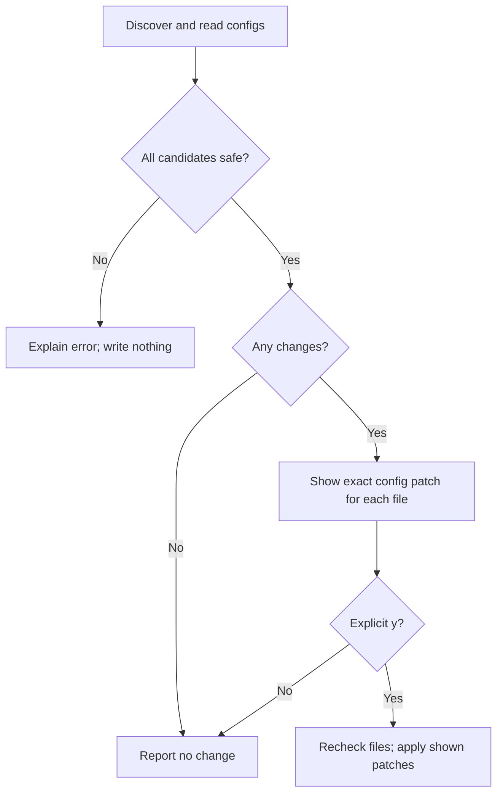

# Register Try tools with the person's agents

Own `src/agent-mcp-setup.mjs`; export async module function `setupAgentMcp({env, packageRoot}, {stdin, stdout, stderr, confirm})`, returning exit code 0 or 1. Setup discovers installed Codex, Claude Code and Gemini through executables on PATH or their configuration homes. It offers this package's `pdd mcp` stdio server named `pdd`. Pin the running package: command is `process.execPath`, args are `[absolute packageRoot/bin/pdd.mjs, "mcp"]`. Never resolve `pdd` through PATH: an older installation may shadow this package. Keep each argument separate, preserving spaces. Preserve every unrelated setting and existing server; never alter global approval policy.

## Consent and safe writes

A preview identifies each absolute filename and exact added JSON pointer/value or appended TOML text, and explains JSON formatting. Ask once `Register these PDD Try tools? [y/N] `. Only trimmed case-insensitive `y` consents; other answers, EOF and noninteractive input default to no. An injected async `confirm` receives that question and may supply an answer for callers/tests; normal input requires stdin and stdout TTY. No config directories or files are created before consent. The project's PDD block and skills are outside this module.

Reject malformed JSON/TOML, non-object JSON roots/mcpServers, existing conflicting `pdd` entries and any symlink in the target path with a clear filename diagnostic. Matching existing server fields are idempotent, retaining additional settings. Recheck the original bytes and path safety after consent; if changed meanwhile, write nothing and ask for setup again. Create missing directories privately and files with mode 0600; preserve an existing file's mode. Never overwrite unrelated config entries. Errors return 1 with a finite `pdd setup:` diagnostic.

## Agent registrations

| Agent | User config file | Added registration |
|---|---|---|
| Codex | `$CODEX_HOME/config.toml`, else `$HOME/.codex/config.toml` | `[mcp_servers.pdd]`, `command = NODE`, `args = [ABSOLUTE_ENTRY, "mcp"]`, `default_tools_approval_mode = "approve"`, `tool_timeout_sec = 600` |
| Claude Code | `$CLAUDE_CONFIG_DIR/.claude.json` when set, else `$HOME/.claude.json` | `/mcpServers/pdd`: `{"type":"stdio","command":NODE,"args":[ABSOLUTE_ENTRY,"mcp"]}` |
| Gemini | `$HOME/.gemini/settings.json` | `/mcpServers/pdd`: `{"command":NODE,"args":[ABSOLUTE_ENTRY,"mcp"],"trust":true,"timeout":600000}` |

Home defaults to os.homedir(). Detection honors the selected agent home and also detects its executable (`codex`, `claude`, `gemini`) without executing it. Codex approval applies only to this server; Gemini trust likewise. Explain that runs use the Try budget and appear on its page. Claude's normal tool approval controls remain in force; no broad permissions allowlist is added. Existing incompatible pdd configuration needs manual resolution instead of replacement. Use a proper TOML parser before appending so malformed or inline namespace collisions cannot corrupt the config. JSON may be serialized with two-space indentation and final newline while retaining all unrelated values.

## Dependencies

Read the [Prompting guide](../../docs/prompting-guide.md) for authoring. [CLI](pdd-cli.prompt.md) owns sequencing with existing setup actions; [Try MCP](try-mcp.prompt.md) owns tool execution. Runtime uses Node filesystem/path/os/readline and the BSD-3-Clause `smol-toml` 1.9.1 parser vendored with its license under `src/vendor/smol-toml/`. Official registration references: [Codex](https://developers.openai.com/codex/mcp/), [Claude Code](https://code.claude.com/docs/en/mcp), [Gemini](https://geminicli.com/docs/tools/mcp-server/).

NODE is the absolute running Node executable; ABSOLUTE_ENTRY is the absolute package-root bin/pdd.mjs path. Default packageRoot comes from this module’s own package location when omitted. TOML strings use valid escaped basic-string literals for both paths.
