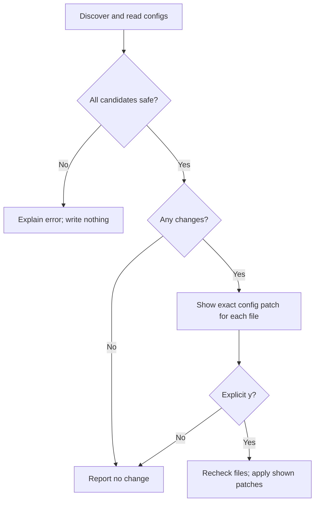

# Register Try tools with the person's agents

Own `src/agent-mcp-setup.mjs`; export async module function `setupAgentMcp({env, packageRoot}, {stdin, stdout, stderr, confirm})`, returning exit code 0 or 1. Setup discovers installed Codex, Claude Code and Gemini through executables on PATH or their configuration homes. It offers this package's `pdd mcp` stdio server named `pdd`. Pin the running package: command is `process.execPath`, args are `[absolute packageRoot/bin/pdd.mjs, "mcp"]`. Never resolve `pdd` through PATH: an older installation may shadow this package. Keep each argument separate, preserving spaces. Preserve every unrelated setting and existing server; never alter global approval policy.

## Consent and safe writes



A preview identifies each absolute filename and exact added JSON pointer/value or appended TOML text, and explains JSON formatting. Ask once `Register these PDD Try tools? [y/N] `. Only trimmed case-insensitive `y` consents; other answers, EOF and noninteractive input default to no. An injected async `confirm` receives that question and may supply an answer for callers/tests; normal input requires stdin and stdout TTY. No config directories or files are created before consent. The project's PDD block and skills are outside this module.

Reject malformed JSON/TOML, non-object JSON roots/mcpServers, existing conflicting `pdd` entries and any symlink in the target path with a clear filename diagnostic. Matching existing server fields are idempotent, retaining additional settings. Recheck the original bytes and path safety after consent; if changed meanwhile, write nothing and ask for setup again. Create missing directories privately and files with mode 0600; preserve an existing file's mode. Never overwrite unrelated config entries. Errors return 1 with a finite `pdd setup:` diagnostic.

## Agent registrations

| Agent | User config file | Added registration |
|---|---|---|
| Codex | `$CODEX_HOME/config.toml`, else `$HOME/.codex/config.toml` | `[mcp_servers.pdd]`, `command = NODE`, `args = [ABSOLUTE_ENTRY, "mcp"]`, `default_tools_approval_mode = "approve"`, `tool_timeout_sec = 600` |
| Claude Code | `$CLAUDE_CONFIG_DIR/.claude.json` when set, else `$HOME/.claude.json` | `/mcpServers/pdd`: `{"type":"stdio","command":NODE,"args":[ABSOLUTE_ENTRY,"mcp"]}` |
| Gemini | `$HOME/.gemini/settings.json` | `/mcpServers/pdd`: `{"command":NODE,"args":[ABSOLUTE_ENTRY,"mcp"],"trust":true,"timeout":600000}` |

Home defaults to os.homedir(). Detection honors the selected agent home and also detects its executable (`codex`, `claude`, `gemini`) without executing it. Codex approval applies only to this server; Gemini trust likewise. Explain that runs use the Try budget and appear on its page. Claude's normal tool approval controls remain in force; no broad permissions allowlist is added. Existing incompatible pdd configuration needs manual resolution instead of replacement. Use a proper TOML parser before appending so malformed or inline namespace collisions cannot corrupt the config. JSON may be serialized with two-space indentation and final newline while retaining all unrelated values.

## Dependencies

Read the [Prompting guide](../../docs/prompting-guide.md) for authoring. [CLI](pdd-cli.prompt.md) owns sequencing with existing setup actions; [Try MCP](try-mcp.prompt.md) owns tool execution. Runtime uses Node filesystem/path/os/readline and the BSD-3-Clause `smol-toml` 1.9.1 parser vendored with its license under `src/vendor/smol-toml/`. Official registration references: [Codex](https://developers.openai.com/codex/mcp/), [Claude Code](https://code.claude.com/docs/en/mcp), [Gemini](https://geminicli.com/docs/tools/mcp-server/).

NODE is the absolute running Node executable (`execPath`); ABSOLUTE_ENTRY is the absolute package-root `bin/pdd.mjs` path. Default `packageRoot` comes from this module’s own package location when omitted. TOML strings use valid escaped basic-string literals for both paths.

Bind installed-agent detection through `host.detectAgents({env})`, config inspection, recheck and updates through `files.stat`, `files.read` and `files.write`, consent through `prompt.confirm({question})`, and preview/diagnostic output through `output.stdout` and `output.stderr`. `setupAgentMcp({env, packageRoot, execPath})` returns `{exitCode}` (`0` on success or declined consent, `1` on unsafe symlink, malformed config or conflicting `pdd` server) and raises `invalid-setup-context` when `packageRoot` or `execPath` is not an absolute path. Native PATH executable probing, TTY readline and file mode `0600` permissions remain native obligations (`test/agent-mcp-setup.test.mjs`).

<details><summary>Runtime interface</summary>

```json
{
  "status": "draft",
  "prose_sha256": "54d4161704ee1dec2b261f14a04f5c5d5cc1077af39cbb668b43c17511ed378f",
  "entries": [
    {
      "operation": "setupAgentMcp",
      "input_schema": {
        "type": "object",
        "properties": {
          "env": {
            "type": "object",
            "properties": {
              "HOME": { "type": "string" },
              "CODEX_HOME": { "type": "string" },
              "CLAUDE_CONFIG_DIR": { "type": "string" }
            },
            "required": ["HOME"],
            "additionalProperties": false
          },
          "packageRoot": { "type": "string" },
          "execPath": { "type": "string" }
        },
        "required": ["env", "packageRoot", "execPath"],
        "additionalProperties": false
      },
      "result_schema": {
        "type": "object",
        "properties": {
          "exitCode": { "type": "integer", "enum": [0, 1] }
        },
        "required": ["exitCode"],
        "additionalProperties": false
      },
      "errors": ["invalid-setup-context"],
      "resource_operations": [
        "host.detectAgents",
        "files.stat",
        "files.read",
        "files.write",
        "prompt.confirm",
        "output.stdout",
        "output.stderr"
      ]
    }
  ],
  "calls": [],
  "resources": [
    {
      "name": "host",
      "kind": "port",
      "access": "write",
      "operations": [
        {
          "name": "detectAgents",
          "access": "write",
          "arguments_schema": {
            "type": "object",
            "properties": {
              "env": {
                "type": "object",
                "properties": {
                  "HOME": { "type": "string" },
                  "CODEX_HOME": { "type": "string" },
                  "CLAUDE_CONFIG_DIR": { "type": "string" }
                },
                "required": ["HOME"],
                "additionalProperties": false
              }
            },
            "required": ["env"],
            "additionalProperties": false
          },
          "result_schema": {
            "type": "object",
            "properties": {
              "codex": { "type": "boolean" },
              "claude": { "type": "boolean" },
              "gemini": { "type": "boolean" }
            },
            "required": ["codex", "claude", "gemini"],
            "additionalProperties": false
          }
        }
      ]
    },
    {
      "name": "files",
      "kind": "blob",
      "access": "write",
      "operations": [
        {
          "name": "stat",
          "access": "read",
          "arguments_schema": {
            "type": "object",
            "properties": {
              "path": { "type": "string" }
            },
            "required": ["path"],
            "additionalProperties": false
          },
          "result_schema": {
            "type": "object",
            "properties": {
              "exists": { "type": "boolean" },
              "size": { "type": "integer", "minimum": 0 },
              "is_symlink": { "type": "boolean" }
            },
            "required": ["exists", "size", "is_symlink"],
            "additionalProperties": false
          }
        },
        {
          "name": "read",
          "access": "read",
          "arguments_schema": {
            "type": "object",
            "properties": {
              "path": { "type": "string" }
            },
            "required": ["path"],
            "additionalProperties": false
          },
          "result_schema": {
            "type": "object",
            "properties": {
              "content": { "type": "string" }
            },
            "required": ["content"],
            "additionalProperties": false
          }
        },
        {
          "name": "write",
          "access": "write",
          "arguments_schema": {
            "type": "object",
            "properties": {
              "path": { "type": "string" },
              "content": { "type": "string" }
            },
            "required": ["path", "content"],
            "additionalProperties": false
          },
          "result_schema": {
            "type": "object",
            "properties": {},
            "required": [],
            "additionalProperties": false
          }
        }
      ]
    },
    {
      "name": "prompt",
      "kind": "port",
      "access": "write",
      "operations": [
        {
          "name": "confirm",
          "access": "write",
          "arguments_schema": {
            "type": "object",
            "properties": {
              "question": { "type": "string" }
            },
            "required": ["question"],
            "additionalProperties": false
          },
          "result_schema": {
            "type": "object",
            "properties": {
              "answer": { "type": "string" }
            },
            "required": ["answer"],
            "additionalProperties": false
          }
        }
      ]
    },
    {
      "name": "output",
      "kind": "port",
      "access": "write",
      "operations": [
        {
          "name": "stdout",
          "access": "write",
          "arguments_schema": {
            "type": "object",
            "properties": {
              "text": { "type": "string" }
            },
            "required": ["text"],
            "additionalProperties": false
          },
          "result_schema": {
            "type": "object",
            "properties": {
              "ok": { "type": "boolean" }
            },
            "required": ["ok"],
            "additionalProperties": false
          }
        },
        {
          "name": "stderr",
          "access": "write",
          "arguments_schema": {
            "type": "object",
            "properties": {
              "text": { "type": "string" }
            },
            "required": ["text"],
            "additionalProperties": false
          },
          "result_schema": {
            "type": "object",
            "properties": {
              "ok": { "type": "boolean" }
            },
            "required": ["ok"],
            "additionalProperties": false
          }
        }
      ]
    }
  ],
  "limits": {
    "max_steps": 32,
    "max_model_calls": 16
  },
  "conventions": []
}
```
</details>
