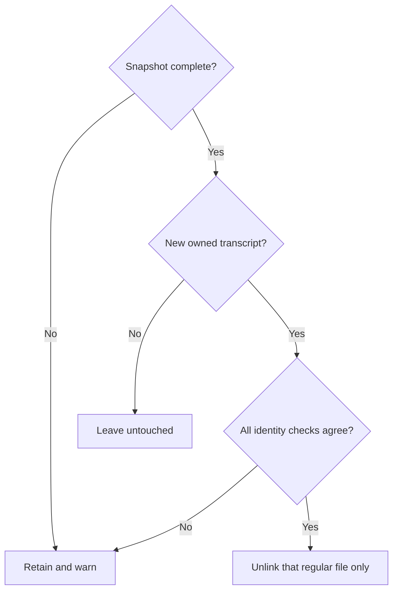

# Owned Try agent transcripts

`src/agent-session-files.mjs` owns deletion of native transcripts created by this
Try chat's persistent fallback. It does not launch agents, select a session to
resume, discover personal chats, or change account files. Its preservation
promise is conservative deletion: a file whose ownership cannot be established
stays on disk, with a generic warning. Callers stop the native process before
cleanup so it cannot recreate its transcript.

## Dependencies

- [Workflow chat](workflow-chat.prompt.md): runtime import of the public
  `validSessionId` binding from `src/workflow-chat.mjs`; UUID syntax only. Do not
  reuse its launcher or native-session discovery as deletion authority.
- Node filesystem, path and OS modules: bounded directory inspection, regular
  file descriptors and environment-derived user home. No providers or network.

## API and ownership

Export `createSessionFiles({agent,cwd,env=process.env,now=Date.now})`, returning
`{prepare,own,cleanup}`. Agent is `codex` or `claude`; cwd and the selected home
must be absolute. Invalid configuration throws a generic error. Capture the
configuration at creation. Codex inspects only `CODEX_HOME/sessions` (otherwise
`HOME/.codex/sessions`); Claude inspects only
`CLAUDE_CONFIG_DIR/projects/<escaped-cwd>` (otherwise `HOME/.claude/projects/...`).
The escaped cwd replaces every non-ASCII-alphanumeric character with `-`.

`prepare()` is asynchronous and read-only. It snapshots existing paths before
the first persistent launch, preserving existing directory identities. Missing
roots are allowed. A second call does not refresh the snapshot. An unsafe or
incomplete snapshot rejects; subsequent cleanup cannot delete anything.

`own(id,startedAt)` is synchronous and returns Boolean. Only the manager supplies
an ID emitted by its new native child, or a new UUID it generated for Claude;
browser data never grants ownership. Require successful prepare, valid UUID,
finite start time between preparation and now, and no preexisting transcript
with that ID. UUID comparison is case-insensitive. Limit ownership to 64 IDs.
No ownership may be added after cleanup starts.

## Cleanup boundary

`cleanup()` returns `{deleted,retained,errors}`: counts of deleted and retained
owned candidate files, and an array of generic warnings. It never includes paths,
transcript text or environment values. A failed prepare produces a warning and
zero deletions. Repeated cleanup is safe; missing files need no warning.

Only new paths absent from the snapshot are candidates. Codex names are
`rollout-<nonempty-prefix>-<UUID>.jsonl` below its sessions root; Claude names are
exactly `<UUID>.jsonl` immediately in the escaped project directory. Never visit
archives, remove directories, or touch database, auth, index, or other files.
Codex directory traversal is bounded to depth 8 and 8192 total entries; Claude
only lists its immediate directory. Exceeding a bound makes the whole scan
incomplete and prevents all deletion in that cleanup.

Interpret ancestor components with the host platform’s path separator. Every
existing ancestor must be a real directory, never a symlink. Previously
observed directories must retain device/inode identity. Any symlink or unusual
entry encountered by the bounded scan fails it conservatively. Open candidates
with no-follow and nonblocking flags, verify the descriptor is a regular file
with one hard link, and inspect at most 64 KiB. Require a complete newline-ended
JSON prefix; ignore only the unfinished final line. Malformed complete JSON,
conflicting identity rows, or absent creation evidence retains the candidate.
Codex creation evidence is `session_meta.payload.{id,cwd,timestamp}`; reject metadata
marked as a subagent or carrying a parent thread. Claude
creation evidence is a non-meta, non-sidechain user or assistant row with
`{sessionId,cwd,timestamp}`. All identity rows in the inspected prefix must agree
on the owned UUID and exact cwd; the first creation timestamp must be within
`[startedAt,cleanup-start]`. A caller-supplied UUID alone is insufficient.

Immediately before unlink, revalidate safe ancestors and compare the path's
regular file, link count and device/inode with the opened descriptor, including unchanged size and modification/change times. Refuse
replacement or drift. Do not recursively remove anything. An unverifiable or
failed deletion increments retained and produces a generic warning rather than
broadening the search or deleting a personal file. This is a best-effort local
cleanup, not a claim of secure erasure or protection against a hostile process
running under the same OS account.
