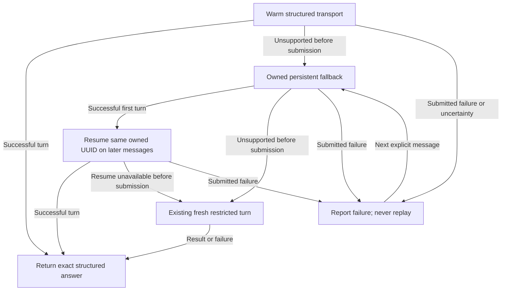

# One local agent session for a Try chat

Own `src/agent-session.mjs`. Export `createAgentSession({kind,run,spawn,now,createCodex,createClaude,createFiles})`, returning process-port-compatible asynchronous `run(command,args,options)` and idempotent asynchronous `close()`. The bridge creates one instance per selected private launcher. This module selects a structured transport and owns safe fallback, not the guide's interpretation, reply validation, execution intent or runtime actions. Preserve the existing restricted cold adapter result `{code,stdout,stderr}` and never change the person's model, effort, authentication or persistent settings.

## Lifetime and fallback

Codex starts one lazy app-server with one ephemeral thread; Claude starts one lazy stream-json process. Both receive the packet supplied by the adapter, unchanged. Gemini and other kinds keep the supplied per-message process port. Bind the first command, cwd and child environment to this instance; refuse changed launcher identity rather than sharing a conversation across homes or projects. Concurrent turns and use after close refuse. Closing cancels the warm process, awaits any active bounded process and then cleans owned fallback transcripts.

The deadline covers all startup, cleanup and fallback attempts of one message. Validate nonempty text <=24KiB and finite positive caller limits before any transport. A teardown failure ends this session and prevents replacement processes. If a process-port error reports `teardownUncertain: true`, retain fallback transcripts with a cleanup warning instead of deleting while a writer may remain. Transport `safeToFallback` authorizes same-message fallback only when no user/model turn was submitted. Cancellation, timeout, malformed/incomplete output after submission, quota, authentication and provider failures never authorize replay. A later explicit message may recover through the next transport. Do not retry or switch providers. A failed warm process is closed before recovery. A structured transport's success is not a guide success until the existing adapter parses and validates it.

### Owned persistent fallback

An ephemeral app-server thread cannot be resumed from disk. W2 therefore creates a new persistent `codex exec --json` session only after leaving warm mode; later messages use `codex exec resume ID --json`. Extract only the UUID from `thread.started` produced by this fresh invocation, validate with the existing workflow `validSessionId`, and never discover a personal session to resume. Read only structured `item.completed` agent_message output. A successful JSONL stream needs a completed turn and nonempty final agent text; malformed streams, changed session identities, failed/interrupted turns and missing terminal output refuse.

Pass the same child-only environment and every safety config override from the adapter. Remove `--ephemeral` only for the owned persistent fallback. Codex resume uses `-c sandbox_mode="read-only"`, approval never, disabled web search, empty MCP table, the same disabled features, and `project_doc_max_bytes=0`; start and resume also keep --ignore-rules. On a failed first persistent launch, retain bounded structured stdout only to claim its newly created UUID for cleanup; if ownership remains unknown, report that a transcript may remain. No raw output is published. No model/effort override is added. An unknown-session or unsupported resume option is a safe pre-submission fallback only when the process failed without any structured stdout and its first error explicitly names that startup problem. Provider/model error text is insufficient.

Claude persistent fallback retains safe mode, Read/Grep/Glob only, plan permissions, no prompts, strict MCP and no Chrome. Remove only --no-session-persistence; first invocation supplies a fresh UUID using --session-id, later calls use --resume that UUID. Require a structured result and validate any returned session ID against the owned one. Never use --continue, a personal transcript lookup, --bare or a permission bypass.

Before creating any persistent session, prepare the transcript owner's snapshot. If safe preparation is unavailable, use the existing ephemeral fresh adapter instead. Claim only newly created native IDs or the deliberately generated Claude ID. Delete only verified owned transcripts on close; never edit history databases, auth/config or unrelated files. Surface a generic cleanup warning when ownership cannot be verified; preserving an unverified file wins over deletion.

Input remains <=24KiB, subprocess output <=128KiB, and a turn <=120seconds unless the caller supplies a smaller bound. Keep cancellation effective while switching modes and bound teardown. Error text reaches only the existing adapter's sanitizing diagnostic path.

## Dependencies

- [Agent adapters](agent-adapters.prompt.md): required generation/verification owner of restricted argv, process port, packet construction, secret scrub and final reply validation.
- [Codex session](agent-codex-session.prompt.md) and [Claude session](agent-claude-session.prompt.md): required generation/runtime/verification owners of structured streaming and pre-submission fallback classification.
- [Owned transcript cleanup](agent-session-files.prompt.md): required generation/runtime/verification owner of snapshot, UUID ownership and conservative deletion.
- [Workflow chat](workflow-chat.prompt.md): required runtime/verification context for public module function `validSessionId(id)`; it validates canonical UUID-shaped native IDs without launching a workflow.
