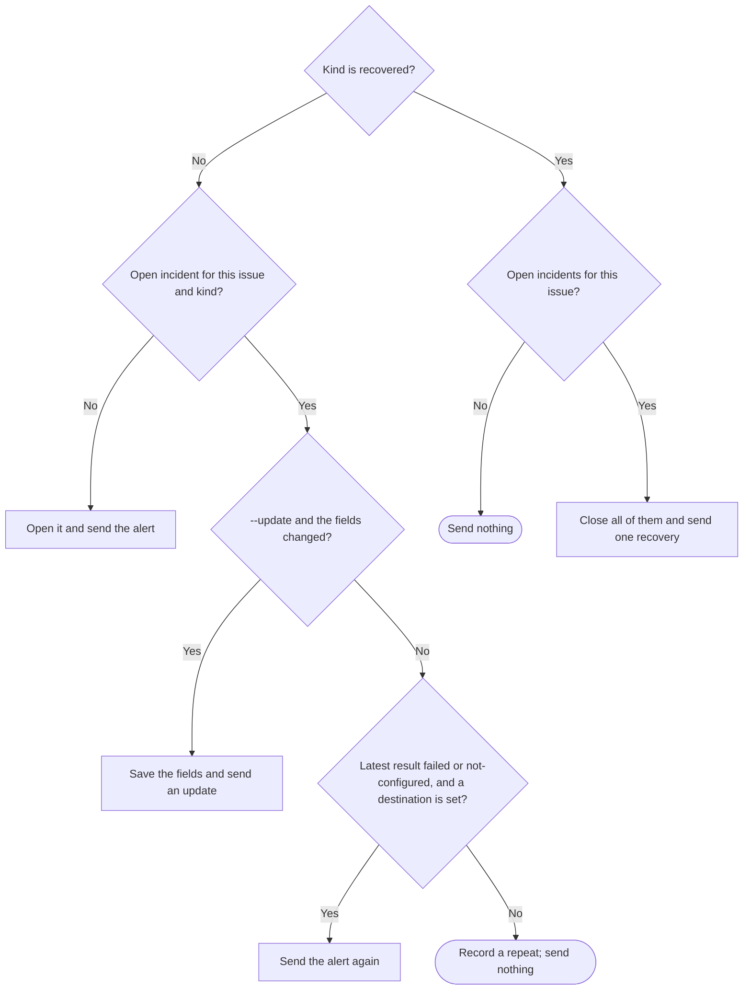

# Autopilot alerts

`src/autopilot-alerts.mjs` lets Autopilot tell a person about an operational
incident or a real human decision. Each person sets their own destination once
per machine: a Discord or Slack incoming webhook. The coordinator sends one
alert per incident, material updates and one recovery message. The answer goes
on the GitHub issue, so it stays with the original run.

Export module functions `runAutopilotAlerts(input, ports)` and
`alertStatusLine(input, ports)`. `runAutopilotAlerts` takes `action` `set`,
`test`, `clear` or `alert` and returns `{exitCode, message}` with a one-line
message. The [CLI](pdd-cli.prompt.md) owns streams and reads stdin into
`input.text`. The [launcher](autopilot-launcher.prompt.md) shows the status line.
This is a new public interface.

## The webhook URL is a secret

- Take the URL only from stdin (`set`). No command takes it as an argument.
- Never write the URL, or any part of it, to stdout, stderr, the alert record or
  an error. Delivery messages name only the service, the HTTP status and a short
  Slack error word such as `no_service`.
- Save it outside every repository, in
  `<XDG_CONFIG_HOME or HOME/.config>/pdd/autopilot-alerts.json` as
  `{"v":1,"service":"discord|slack","url":URL}`. Create the folder with mode
  0700. Write the file atomically with mode 0600. If a read finds wider file
  permissions, set them back to 0600.

## Destination commands

| Action | Result |
| --- | --- |
| `set` | Trim `text`. Save it when it is a supported webhook. Exit 0 and name the service. Otherwise exit 2 and save nothing. |
| `test` | Send one test message, `PDD Autopilot test alert (HOST).` Exit 0 only when it is delivered. Exit 1 when no destination is set, or delivery failed or is unconfirmed. Record nothing. |
| `clear` | Remove the destination file. Exit 0, also when no file exists. |

Supported webhooks use `https`, no user name or password and no port:

- Discord: host `discord.com`, `discordapp.com`, `ptb.discord.com` or
  `canary.discord.com`; path `/api/webhooks/ID/TOKEN` or `/api/vN/webhooks/ID/TOKEN`.
- Slack: host `hooks.slack.com`; path `/services/` and more path parts.

## Delivery and readback

| Service | Request | Delivered when |
| --- | --- | --- |
| Discord | POST JSON `{"content":TEXT,"allowed_mentions":{"parse":[]}}` to the URL with query `wait=true` added | The status is 2xx and the reply is the created message: a string `id` and the same `content` after trim |
| Slack | POST JSON `{"text":TEXT}`, with `&`, `<` and `>` escaped as `&amp;`, `&lt;`, `&gt;` | The status is 200 and the body is `ok` after trim |

`allowed_mentions` and the Slack escapes stop issue text from paging a whole
channel. Each send is one request with a 10-second limit. The module does not
retry inside one call. Clip each field to 500 characters and TEXT to 1900.

Each send has one result:

- `delivered`: the readback above.
- `failed`: the status is not 2xx (`HTTP 404`), or the request did not reach the
  server (the HTTP port throws an error with code `unreached`).
- `unconfirmed`: any other error, such as a timeout, or a 2xx reply without
  readback. The message can exist, so a repeat call does not send it again.
- `not-configured`: no destination is set. The alert stays in the local record.

## Alerts

`alert` input: `cwd`, `issue` (a positive integer as text), `kind`, `update`
(Boolean) and `text`, a JSON object from stdin. Kinds:

| Kind | Use |
| --- | --- |
| `usage-limit` | An AI account usage limit; give the reset time when known |
| `resource` | A CPU, memory or disk failure |
| `access` | An access or spending decision |
| `decision` | An unresolved product choice |
| `stuck` | An issue stuck after its retry time |
| `recovered` | The open incidents of the issue ended |

The JSON has nonblank string fields `cause`, `tried` and `need`. For `recovered`
only `cause` (what changed) is needed. A missing or invalid issue, kind or field
exits 2 and records nothing.

Find the repository with `gh repo view --json nameWithOwner` in `cwd`. If that
fails, read a `github.com` owner and name from the `origin` remote. If both fail,
exit 1. The issue link is `https://github.com/OWNER/REPO/issues/N`. HOST is this
machine's host name. An alert or update has these lines:

```text
PDD Autopilot alert: KIND (HOST)
Repository: OWNER/REPO
Issue: https://github.com/OWNER/REPO/issues/N
Cause: CAUSE
Tried: TRIED
Needs: NEED
Answer on the GitHub issue.
```

An update starts with `PDD Autopilot update: KIND (HOST)`. A recovery starts with
`PDD Autopilot recovered: KIND, KIND (HOST)` and has the Repository and Issue
lines and `What changed: CAUSE`.

An incident is one repository, issue and kind. This answers the question
**when does a call send, and what ends an incident?**



Compare fields after trim. Each send sets the latest result of its incident. A
closed incident has no further sends; the next alert for that issue and kind
opens a new incident.

Record every call that reaches the diagram, also one that sends nothing, in
`<state root>/alerts/<ID>.json`, with mode 0600. The state root is
`ports.stateRoot`, else `HOME/.local/state/pdd/autopilot` (the launcher's state
folder). ID is the first 20 hex characters of the SHA-256 of the lowercase
`OWNER/REPO`. The record keeps the open incidents (issue, kind, fields, open and
update times, latest result and detail) and the newest 200 log rows (time,
issue, kind, action `alert`, `update`, `retry`, `repeat` or `recovered`, result
and detail). It never holds the URL.

`alert` exits 0 when the record is saved, whatever the delivery result, so work
continues. Its message names the issue, the kind and the result. A failed or
unconfirmed result says that `pdd autopilot status` shows it. A `not-configured`
result says that the alert is recorded on this machine and names
`pdd autopilot alerts set`. A repeat says that nothing was sent and names
`--update`. A failure to save the record exits 1.

## Status line

`alertStatusLine({repo, env}, ports)` reads only local files: no network and no
GitHub. It returns the empty string when `repo` is absent, the record is absent
or unreadable, or there is no problem. A problem is an open incident whose latest
result is not `delivered`, or a newest send (of any action) that is `failed` or
`unconfirmed`. Then it returns one line, for example:

```text
Alerts: 1 open alert not delivered; last delivery failed (HTTP 404) for #12 usage-limit at 2026-11-06T10:00:00.000Z; check with pdd autopilot alerts test.
```

Without a destination the end is `; set one with pdd autopilot alerts set.`

## Dependencies

- [Prompting guide](../../docs/prompting-guide.md): authoring.
- [CLI](pdd-cli.prompt.md): generation and testing of dispatch, stdin and streams.
- [Autopilot launcher](autopilot-launcher.prompt.md): status calls
  `alertStatusLine` with its saved repository and state root.
- Native runtime: Node `fs`, `crypto`, `os` and `fetch`.
- Input `env` (default: the process environment) gives HOME and
  XDG_CONFIG_HOME; a relative value is ignored.
- Ports, all optional: `http({url, body})` returns `{status, text}` or throws
  (code `unreached` means the request did not reach the server);
  `repository({cwd})` returns `{nameWithOwner}`; `now()`; `hostname()`;
  `stateRoot`. Tests inject `http`; no test sends a real webhook request.
