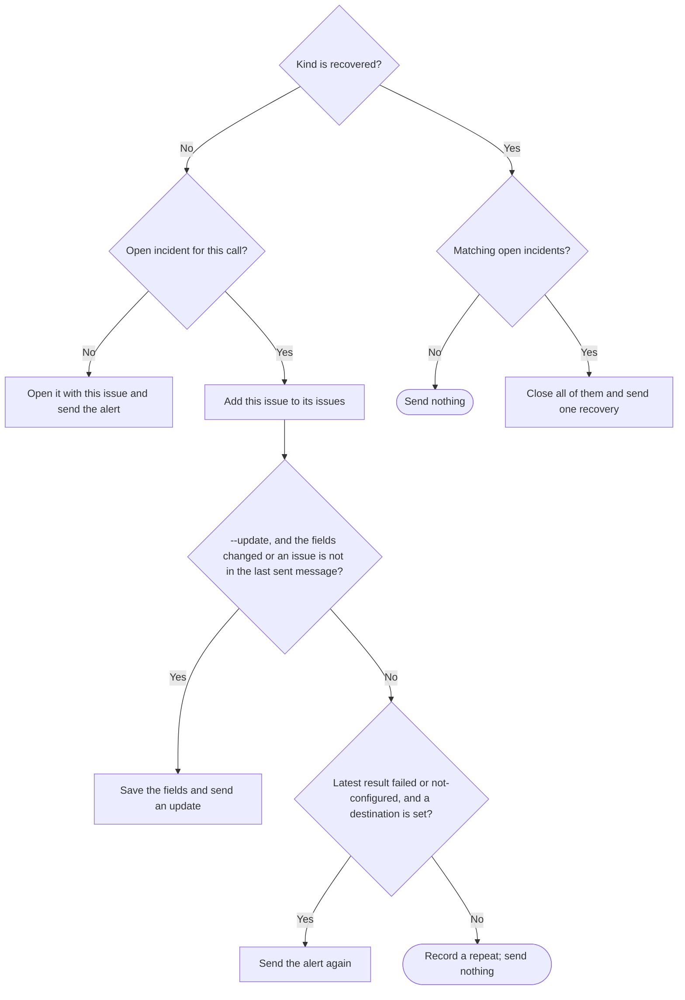

# Autopilot alerts

`src/autopilot-alerts.mjs` lets Autopilot tell a person about an operational
incident or a real human decision. Each person sets their own destination once
per machine: a Discord or Slack incoming webhook, or a Discord bot that posts in
one channel. The coordinator sends one
alert per incident, material updates and one recovery message. The answer goes
on the GitHub issue, so it stays with the original run.

Export module functions `runAutopilotAlerts(input, ports)` and
`alertStatusLine(input, ports)`. `runAutopilotAlerts` takes `action` `set`,
`test`, `clear` or `alert` and returns `{exitCode, message}` with a one-line
message. The [CLI](pdd-cli.prompt.md) owns streams and reads stdin into
`input.text`. The [launcher](autopilot-launcher.prompt.md) shows the status line.
This is a new public interface.

## The webhook URL is a secret

- Take the URL only from stdin (`set`). No command takes it as an argument.
- Never write the URL, or any part of it, to stdout, stderr, the alert record or
  an error. Delivery messages name only the service, the HTTP status and a short
  Slack error word such as `no_service`.
- Save it outside every repository, in
  `<XDG_CONFIG_HOME or HOME/.config>/pdd/autopilot-alerts.json` as
  `{"v":1,"service":"discord|slack","url":URL}`. Create the folder with mode
  0700. Write the file atomically with mode 0600. If a read finds wider file
  permissions, set them back to 0600.

## An absolute home folder

A relative path resolves in the current folder, which is often a checkout. So
use only absolute paths for the destination and the alert record:

- Use `XDG_CONFIG_HOME` only when it is absolute.
- Use `HOME` only when it is absolute. When it is empty or relative, use the
  account home folder from the operating system (`os.userInfo().homedir`).
  `os.homedir()` is not a fallback, because it returns the same bad `HOME`.
- When no absolute home folder exists, `set`, `test`, `clear` and `alert` exit 1
  with one line that asks for an absolute `HOME`, and read, save, record and send
  nothing. The `alert` line also says `Continue other work.`
  `alertStatusLine` returns the empty string.

## A Discord bot destination

`set` with `discordChannel` (from `--discord-channel ID`) saves a bot
destination instead of a webhook. The channel ID has 17 to 20 digits. The bot
token comes from one of two places:

- stdin (`text`), when `tokenCommand` is absent. Save
  `{"v":1,"service":"discord-bot","channel":ID,"token":TOKEN}` like the webhook,
  with mode 0600. A token is 20 to 256 characters of letters, digits, `.`, `_`
  and `-`.
- `tokenCommand` (from `--token-command CMD`), for example a cloud secret
  manager command. Save `{"v":1,"service":"discord-bot","channel":ID,"tokenCommand":CMD}`
  and no token. Run CMD with `/bin/sh -c` in `cwd` at each send and each test,
  with a 30-second limit. Its trimmed stdout is the token. A nonzero exit, a
  timeout or output that is not a token is the result `failed` with detail
  `token command failed (exit N)` or `token command gave no token`; nothing is
  sent. Never save, print or log the command output or its stderr.

The bot token is a secret under the same rules as the URL. `tokenCommand`
without `discordChannel`, or an invalid channel, token or command, exits 2 and
saves nothing. The CLI gives `--discord-channel` and `--token-command` only to
`set`.

Bot requests go to Discord REST v10, `https://discord.com/api/v10`, with headers
`Authorization: Bot TOKEN` and `User-Agent: DiscordBot (https://github.com/promptdriven/pdd, VERSION)`,
where VERSION is the package version.

- Send: `POST /channels/ID/messages` with
  `{"content":TEXT,"allowed_mentions":{"parse":[]},"flags":4}`. Flag 4 stops
  link embeds. A status that is not 2xx is `failed` (`HTTP 403`). A 2xx reply
  without a numeric message `id` is `unconfirmed` (`no message id`).
- Readback: `GET /channels/ID/messages/MESSAGE_ID`. It is `delivered` only when
  the reply has the same `id` and the [same content](#delivery-and-readback).
  Otherwise it is `unconfirmed`: `readback mismatch`, `readback HTTP N` or
  `readback no reply`.
- `test` first makes two read-only checks: `GET /users/@me` and
  `GET /channels/ID`. If one fails, exit 1 and send nothing. Otherwise send the
  test message with readback. Exit 0 only when it is delivered. The message names
  the bot `username` and the channel `name`.

## Destination commands

| Action | Result |
| --- | --- |
| `set` | Trim `text`. Save it when it is a supported webhook. Exit 0 and name the service. Otherwise exit 2 and save nothing. |
| `test` | Send one test message, `PDD Autopilot test alert (HOST).`, with the host name. Exit 0 only when it is delivered. Exit 1 when no destination is set, or delivery failed or is unconfirmed. A bot destination also makes the [read-only checks](#a-discord-bot-destination). When the test is delivered, add a log row (action `test`, result `delivered`, no issue) to each alert record that already exists on this machine. Otherwise record nothing. |
| `clear` | Remove the destination file. Exit 0, also when no file exists. |

Supported webhooks use `https`, no user name or password and no port:

- Discord: host `discord.com`, `discordapp.com`, `ptb.discord.com` or
  `canary.discord.com`; path `/api/webhooks/ID/TOKEN` or `/api/vN/webhooks/ID/TOKEN`.
- Slack: host `hooks.slack.com`; path `/services/` and more path parts.

## Delivery and readback

| Service | Request | Delivered when |
| --- | --- | --- |
| Discord | POST JSON `{"content":TEXT,"allowed_mentions":{"parse":[]}}` to the URL with query `wait=true` added | The status is 2xx and the reply is the created message: a string `id` and the same content |
| Slack | POST JSON `{"text":TEXT}`, with `&`, `<` and `>` escaped as `&amp;`, `&lt;`, `&gt;` | The status is 200 and the body is `ok` after trim |

The same content means equal text after this normalization of both sides: CRLF
and CR become LF, each line loses its trailing whitespace, and the whole text is
trimmed. A chat service can store the text in this form, so this change alone is
not a mismatch.

`allowed_mentions` and the Slack escapes stop issue text from paging a whole
channel. Each send is one request with a 10-second limit. The module does not
retry inside one call. Clip each field to 500 characters and TEXT to 1900.

Each send has one result:

- `delivered`: the readback above.
- `failed`: the status is not 2xx (`HTTP 404`), or the request did not reach the
  server (the HTTP port throws an error with code `unreached`).
- `unconfirmed`: any other error, such as a timeout, or a 2xx reply without
  readback. The message can exist, so a repeat call does not send it again.
- `not-configured`: no destination is set. The alert stays in the local record.

## Alerts

`alert` input: `cwd`, `issue` (a positive integer as text), `kind`, `update`
(Boolean) and `text`, a JSON object from stdin. Kinds:

| Kind | Use | One incident per |
| --- | --- | --- |
| `usage-limit` | An AI account usage limit; give the reset time when known | repository, machine and kind |
| `resource` | A CPU, memory or disk failure | repository, machine and kind |
| `access` | An access or spending decision | repository, issue and kind |
| `decision` | An unresolved product choice | repository, issue and kind |
| `stuck` | An issue stuck after its retry time | repository, issue and kind |
| `recovered` | A matching open incident ended | |

`usage-limit` and `resource` are machine incidents: they are not specific to
one issue. One usage limit that blocks 5 runs is one incident and one alert. The
incident lists every affected issue. An access or spending decision belongs to
its issue, so two different decisions on two issues are two incidents and two
alerts, and a recovery of one leaves the other open.

The JSON has nonblank string fields `cause`, `tried` and `need`. For `recovered`
only `cause` (what changed) is needed, and an optional `kind` names the one
incident that ended: `usage-limit`, `resource`, `access`, `decision` or `stuck`.
A missing or invalid issue, kind or field exits 2 with one line that names the
problem, and records nothing.

Find the repository with `gh repo view --json nameWithOwner` in `cwd`. If that
fails, read a `github.com` owner and name from the `origin` remote. If both fail,
exit 1. The issue link is `https://github.com/OWNER/REPO/issues/N`. HOST is the
machine name of the alert:

- the `machine` value of the coordinator's saved launcher state: first this
  checkout's own state file (the launcher's id: the first 20 hex characters of
  the SHA-256 of `cwd`, which is the Git top level for the coordinator), then
  the other `<state root>/<20 hex>.json` files in file-name order. Use the first
  one whose `repo` is this repository (ignoring case) and whose `machine` is a
  nonblank string;
- else this machine's host name.

The launcher saves `machine` once, at the first start. A host name can change,
for example when macOS renames the host on a network change. The saved name does
not change, so a repeat after a rename finds the same incident. This checkout's
state comes first, so two machines that share one home keep their own incidents.

An alert or update has these lines:

```text
PDD Autopilot alert: KIND (HOST)
Repository: OWNER/REPO
Issue: https://github.com/OWNER/REPO/issues/N
Cause: CAUSE
Tried: TRIED
Needs: NEED
Answer on the GitHub issue.
```

When the incident lists more than one issue, the third line is
`Issues: LINK, LINK` in issue-number order. It shows at most 10 links and then
` and N more`. An update starts with `PDD Autopilot update: KIND (HOST)`. A
recovery starts with `PDD Autopilot recovered: KIND, KIND (HOST)` and has the
Repository line, the Issue or Issues line of the closed incidents and
`What changed: CAUSE`.

The incident of a call is its machine incident (this repository, HOST and kind)
for `usage-limit` and `resource`, else the incident of its issue and kind. This answers the question **when does a call send, and what ends an
incident?**



Compare fields after trim. A repeat keeps the fields of the last send. A repeat
that adds an issue says so, sends nothing and names `--update`. Each send sets
the latest result of its incident and the issues that its message named.

A recovery for issue N matches:

- with `kind`: the open incident of that kind, which is the machine incident of
  this HOST for a machine kind, else the incident of issue N;
- without `kind`: every open incident of issue N and every machine incident of
  this HOST that lists issue N.

A closed incident has no further sends. The next alert for that incident opens a
new one.

Record every call that reaches the diagram, also one that sends nothing, in
`<state root>/alerts/<ID>.json`, with mode 0600. The state root is
`ports.stateRoot`, else `<home folder>/.local/state/pdd/autopilot` (the
launcher's state folder), with the [home folder](#an-absolute-home-folder)
above. ID is the first 20 hex characters of the SHA-256 of the lowercase
`OWNER/REPO`. The record keeps the open incidents (kind, affected issues,
issues in the last sent message, fields, open and update times, latest result
and detail) and the newest 200 log rows (time, issue, kind, action `alert`,
`update`, `retry`, `repeat`, `recovered` or `test`, result and detail). It never
holds the URL.

`alert` exits 0 when the record is saved, whatever the delivery result, so work
continues. Its message names the issue, the kind and the result. A delivered
result says `the webhook confirmed it` for a webhook and
`the Discord bot readback confirmed it` for a bot. A failed or
unconfirmed result says that `pdd autopilot status` shows it. A `not-configured`
result says that the alert is recorded on this machine and names
`pdd autopilot alerts set`. A repeat says that nothing was sent and names
`--update`. A failure to save the record exits 1. A repeat after a `failed` or
`not-configured` result is how a coordinator sends a failed alert again, so the
coordinator may repeat the same call on a later tick while the need lasts.

## Status line

`alertStatusLine({repo, env}, ports)` reads only local files: no network and no
GitHub. It returns the empty string when `repo` is absent, the record is absent
or unreadable, or there is no problem. A problem is an open incident whose latest
result is not `delivered`, or a newest send (of any action) that is `failed` or
`unconfirmed`. Then it returns one line, for example:

```text
Alerts: 1 open alert not delivered; last delivery failed (HTTP 404) for #12 usage-limit at 2026-11-06T10:00:00.000Z; check with pdd autopilot alerts test.
```

Without a destination the end is `; set one with pdd autopilot alerts set.`

A failed recovery is not sent again, because its incident is closed. A delivered
`test` adds the newest send to every record, so it ends the `last delivery` part
of an older failed or unconfirmed send, for example of that recovery. An open
incident that is not delivered still counts, and the next call for it sends it
again.

## Dependencies

- [Prompting guide](../../docs/prompting-guide.md): authoring.
- [CLI](pdd-cli.prompt.md): generation and testing of dispatch, stdin and streams.
- [Autopilot launcher](autopilot-launcher.prompt.md): status calls
  `alertStatusLine` with its saved repository and state root.
- Native runtime: Node `fs`, `crypto`, `os` and `fetch`.
- Input `env` (default: the process environment) gives HOME and
  XDG_CONFIG_HOME; a relative or empty value is ignored, as
  [above](#an-absolute-home-folder).
- Ports, all optional: `http({method, url, headers, body})` returns
  `{status, text}` or throws (code `unreached` means the request did not reach
  the server); method defaults to POST, and a GET has no body;
  `tokenCommand(command, {cwd})` returns the command stdout or throws with an
  optional numeric `exitCode`; the default runs `/bin/sh -c`;
  `repository({cwd})` returns `{nameWithOwner}`; `now()`; `hostname()`;
  `userInfo()` returns `{homedir}` or throws (default `os.userInfo`);
  `stateRoot`. Tests inject `http`; no test sends a real webhook request.
