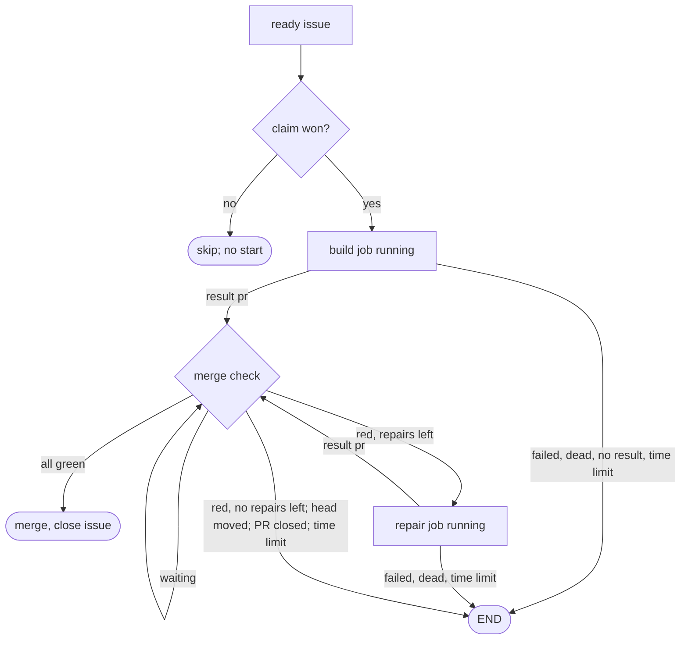

# Autopilot core engine

Own `src/autopilot-core.mjs`. It is the small native Autopilot engine that a
repository selects with `autopilot.engine: "core"` in `pdd.json`. One tick takes
ready issues, runs one headless agent job per issue, checks the PR natively and
merges it, or ends that one job with one comment. There is no AI in scheduling, no
Herdr, no coordinator chat and no parking. The [launcher](autopilot-launcher.prompt.md)
owns the timer, the tick lock, the GitHub budget and the issue list; it calls
`tickCore` when the engine is core and returns its result.

The rule behind every decision here: **every failure ends one job**. No job waits
for another job, for a person or for a tool fix. Jobs share only the slot count and
the GitHub budget. A person retries an ended issue by removing `pdd:stuck`.

## Settings

`autopilotEngine(config)` returns `core` only when `config.autopilot.engine` is the
string `core`; any other value, or none, is `full`.

`coreSettings(config, packageJson)` reads the `autopilot` object of a parsed
`pdd.json` and returns exactly these fields:

| Field | Source and default |
|---|---|
| `engine` | `autopilotEngine(config)` |
| `mode` | `off`, `observe` or `auto`; anything else is `off` |
| `trust` | the nonblank strings of `autopilot.trust`, else `[]` |
| `runs` | positive safe integer, default 2: the slot count |
| `label` | trimmed nonblank opt-in label, for example `pdd:autopilot`, else `null` |
| `jobTimeoutMinutes` | positive safe integer, default 120 |
| `report` | `file`, `draft` or `off`, default `draft` |
| `repairs` | safe integer of at least 0, default 2 |
| `testCommand` | nonblank `autopilot.testCommand`; else `npm test` when `packageJson.scripts.test` exists; else `null` |

`readCoreSettings(cwd, fs)` applies it to `cwd/pdd.json` and `cwd/package.json`;
an unreadable file counts as absent.

## State

The launcher passes `ports.root`, one folder for this repository on this machine.
It holds `jobs/N.json` (one file per issue in progress), `logs/` (job inputs,
logs, exit records and result files), `worktrees/` (`N` for the job branch,
`N-review` and `N-suite` for clean checkouts of the PR head), `history.jsonl`
(one line per finished job: time, issue, outcome, text, PR, log; and strike lines,
below) and `core.json` (the machine pause and the pending no-result). The job file and the GitHub labels are the whole state; a
restart reads them again. A job file has `issue`, `title`, `url`, `body`,
`branch`, `worktree`, `claim {commentId, labelEventId, lastSeen}`, `phase`
(`running`, `pr` or `ending`), `role` (`build` or `repair`), `repairs`, `started`,
`deadline`, the started `agent` job, and in phase `pr` also `pr`, `head`,
`runtime`, `review` and `suite`.

Slots come only from these job files, never from workflow allocation or other
local records. A job holds a slot while its process runs or its outcome is not yet
handled (phase `running` or `pr`). A job in phase `ending` has its outcome decided
and only finishes its GitHub writes, so it holds no slot. Each tick advances every
job before intake, so a job whose process died, for example after a restart, is
ended or moved to the merge check before free slots are counted.

## Tick

`tickCore({state, settings, budget}, ports)` returns `{exitCode: 0, message}`.
`state` is the launcher state (`cwd`, `repo`, `coordinatorId`, `machine`,
`baseBranch`, `agent`, `packageRoot`). Steps, in order:

1. Mode `off` returns `Autopilot is off.` Then read `core.json` and save `lastTick`
   (now). A **sleep gap** is a gap since the saved `lastTick` that is longer than the
   job time limit (a laptop sleep; a clock that went back is no gap). Mode `observe`
   does everything that `auto` does (claim, build, PR, review, suite, CI, Runtime,
   base check, repairs, END) **except the merge** (merge check step 7); its message
   starts `Autopilot core (observe: no merge):`.
2. Read the open issues through `ports.listIssues()`. A failed list skips the
   person checks and intake for this tick; jobs still advance.
3. A person stops a job by closing the issue, removing `pdd:working`, adding
   `pdd:stuck` or assigning someone. Then stop its processes and clean up locally,
   with no GitHub write, and do not take that issue again in this tick. A job with a
   PR reads it first: a merged PR (GitHub closes the issue from "Fixes #N") finishes
   as merged, not as a person stop.
4. For each own claim of a job that is not past its deadline, read the winning claim
   with the owners port first. The job still owns the issue only while the winner is
   this machine's coordinator, machine and claim comment. When the owner is unknown
   because a later claim comment names this job's label event (a loser whose delete
   failed), delete those later comments and read again. When another machine holds
   it live, hand over (below). Else
   heartbeat it through `refreshClaimHeartbeat` of the
   [GitHub dependency reader](issue-dependencies-github.prompt.md). A claim not
   refreshed for 4 hours gets no heartbeat: expiry is final. At the GitHub reserve
   floor (`budget.state` `reserve`) the tick stops after the heartbeats.
   **GitHub share**: every claim read through the owners port that is live (`active`,
   not `expired`) records its `machine` with the time in `core.json` `peers` (kept 4
   hours). The core's budget divides the launcher's `allowed` calls by k, the number
   of machines with live claims on this repository (the saved peers, and this machine
   when it holds a live claim; at least 1), and is `low` when `used` reaches that.
   With a `low` budget no new job starts: intake is held with `intake held: the GitHub
   budget is low (this machine used U of A calls in the last hour, a S% share for k
   machine(s) with live claims)`. Jobs still advance.
5. Advance each job, each in its own error boundary. An error saves `lastError` on
   that job, and `lastErrorTool` true when it came from a GitHub or Git call, and the
   tick continues with the next job. A job that waits with no error clears both, and
   so does a new head. A job whose advance fails on 2 ticks after its deadline ends
   (`job` / `no-result`), so no job holds a slot or a claim past its deadline plus 2
   ticks. A `running` job with no agent record (the tick died between its two saves)
   ends at once as `no-result`. After a sleep gap, a job whose deadline passed in the
   gap is this machine's fault, never a timeout or claim-expired END: a running job
   (and a PR whose claim expired) ends as a **machine no-result**: a release with no
   comment and no `pdd:stuck`, which is not counted for the issue (no cooldown, no
   strike) and does not add to `streak`. A PR in its checks with a live claim gets a
   new deadline (now plus the time limit) and goes on.

**Hand-over**: a job that lost its claim to another machine stops its processes,
changes nothing on the issue (no comment, no label), marks this machine's own open
PR of that job as draft with one note (one try; a failure only warns) and cleans up
locally with outcome `handed-over`. It never merges.
6. Intake fills free slots (see below).

The message counts started, merged and ended jobs and repairs, the busy slots and
any intake hold, for example
`Autopilot core: 1 started, 0 merged, 0 ended, 0 repair(s); 1 of 2 slots busy.`

## Ready rule

`readyIssues({state, settings}, ports, rows)` returns the issue numbers in intake
order. An issue is ready when all hold: it is an open issue (not a PR); it has no
assignee; it has no `pdd:stuck`; it is not cooling down (no `noResult` history
line of the last 24 hours on this machine after the issue's latest `reset` line); it has neither report label (`pdd:runtime`,
`pdd:autopilot-report`: report issues wait for a later self-fix lane); it has the
opt-in label when `label` is set; no
local job holds it; its author is trusted (`ports.trusted(row)`, the launcher's
trust rule); no open issue blocks it; and it has no live `pdd:working` claim by
anyone. Blocking means a GitHub issue dependency (`dependencies/blocked_by`, read
only when the row's dependency summary is not zero) or a body line
`blocked by #N`, `blocked by OWNER/REPO#N` or `blocked by` an issue URL, that
names an open issue, or, for an issue with comments, the hidden marker
`<!-- pdd:core-blocked-by:OWNER/REPO#N:FINGERPRINT -->` in its latest core END
comment when OWNER/REPO#N is open. A labeled issue is ready only when its winning claim, read
with the dependency reader's owners port, is expired and not takeover-limited.
Order is oldest `created_at` first, then the lower number. A read error skips only
that issue for this tick.

## Claim and start

For each ready issue while slots are free, at most 3 claim attempts per tick:

1. Make the job worktree first, so that a local failure touches no issue. Fetch
   `origin/BASE` once per tick; a fetch failure is not about one issue, so it stops
   intake for this tick. A leftover `worktrees/N` is ours: remove it with
   `git worktree remove -f -f` (this also removes a worktree that Git left locked),
   then the folder, then `git worktree prune`. If it still exists, or
   `git worktree add -b pdd/core-N-STAMP worktrees/N origin/BASE` fails, skip only
   this issue for this tick and go on with the next one. Removal also runs when the
   folder is gone: `git worktree unlock` and `remove -f -f` clear a registration that
   Git still lists, then `prune`. STAMP is the time in base 36
   and a short random part, so a retry of the same issue never meets the kept branch
   of an earlier job. Each job file has a random `id`; each started process has the
   id `N-ROLE-STAMP`.
2. Claim with the shared label and comment rule: read the issue again and give up
   when it is closed, stuck or assigned, or when a claim is live. An expired, not
   takeover-limited `pdd:working` is removed first, but only when a fresh timeline
   read shows that the winning label event is still the expired claim's event: a
   newer event is someone's fresh claim. Add `pdd:working`. The winning label event
   is the first `pdd:working` label event after the last removal. Post one claim
   comment with a fenced JSON record
   `{repository, coordinatorId, machine, labelEventId, lastSeen: ""}`. The machine
   wins only when its comment is by the winning event's actor and is the earliest
   such comment that names that event, and a read of the winning claim through the
   owners port shows no other live owner. A loser deletes its own comment, removes
   its worktree and starts nothing. Two machines with one GitHub login therefore
   agree on one winner. A claim that fails partway leaves nothing of its own: this
   machine's comment is deleted, and the label is removed only when the winning label
   event is its own: the era it saw after its label POST is still the current era, the
   winner's actor is this machine's login (its comment's author, else `GET user`),
   and no other claim comment names that event. Otherwise (another login, a later era,
   or an error in these reads) the label stays.
3. Close the issue's older core PRs: each open PR of this repository (not a fork)
   whose head branch starts with `pdd/core-N-` and is not the new branch, and that
   is not merged, gets `state: closed` and one short note with the marker
   `<!-- pdd:autopilot-core:superseded:N:BRANCH -->`; its branch stays. A PR from
   another branch prefix is never touched. A failure only warns.
4. Save the job file, then start the build job (below). A start error, also one that
   the spawn reports later, ends the job as `no-result`; it never stops the tick.

Intake is held, and nothing is claimed, when the saved agent is not Codex or
Claude, when `ports.agentReady()` is false at the first ready issue (for example a
Codex usage limit), or while a machine pause runs (below).

**No result is a machine fault first.** An agent that exited with no result, a start
failure (also one that the spawn reports later), a dead process (a restart or a
sleep), a job with no agent record, a job that cannot advance past its deadline, a
reviewer that twice gives no valid verdict and a suite runner that died 3 times all
end as `no-result`. Every job kind follows the same rules, in every machine state.

1. A `no-result` end releases the issue: delete this machine's claim comment, remove
   `pdd:working`, post no issue comment and add no label. Close this job's own open PR
   (found by its number, or by its branch through `pulls?state=open&head=OWNER:BRANCH`):
   first set `state: closed`, then post one short note with the marker
   `<!-- pdd:autopilot-core:release:N:JOB-ID -->`; the branch stays. A GitHub error
   leaves the release unfinished, so a later tick tries the close again (the job saves
   `prClosed` when it is done). Record `released` in the history and skip the issue
   for the rest of the tick.
2. Counting. A `no-result` end is **counted** for its issue only when it is the first
   one after a job result on this machine (`streak` was 0). Later ones in the same
   streak are the machine: they only release. A counted end has `noResult: true` in
   its `released` line, so the issue cools down for 24 hours (ready rule). It is also
   saved as `pending {issue, at}` in `core.json`. When the next end on this machine is
   a job result, the pending end fell between results: append the strike line
   `{at, issue, strike: true}` (the time of the no-result). When the next end is
   another `no-result`, the pending end is dropped; no strike. So an outage gives a
   strike only when it ends exactly one job, and a bad issue that fails between
   results gets a strike each time. A counted end of an issue with 2 strikes in the last 7 days is a normal
   END: one comment and `pdd:stuck`. Nothing else marks an issue stuck for no result.
   Each `ended` line has `reset: true`: the cooldown and the strikes read only the
   issue's lines after its latest reset, so a person's retry starts fresh.
3. Machine pause, saved in `core.json` as `streak`, `hours` (the next pause length),
   `pausedUntil` and `pausedHours`. Each `no-result` end adds 1 to `streak`. When no
   pause runs and `streak` is 3 or more, no new job starts for `hours` hours (1, then 2,
   4 and 8 at most) and one `usage-limit` alert goes out through `ports.alert` with
   `update` and the text "Autopilot paused new jobs for H h: the agent ended N jobs with
   no result. Check sign-in and limits." (the machine and the end time follow). When
   the pause ends, intake goes on as usual. Any job result (a build or repair PR or
   reported failure, a valid review verdict, a merge) sets `streak` to 0 and `hours`
   to 1. Jobs that already run always go on. Unknown or broken saved state (a missing,
   `null`, non-object or non-JSON file, a pause end that is not within its length
   from now, for example after the clock went back, or a `pending` that is not
   `{issue, at}` numbers) reads as not paused, `streak` 0, `hours` 1, no pending; it
   never stops a tick or status.
4. `history.jsonl` is read line by line and a line that does not parse is skipped.
   Before each append, the file gets a newline when it does not end with one, so a cut
   line never swallows the next record.

## Jobs

Jobs run through the [headless job runner](agent-job.prompt.md) with
`agentCommand(state.agent)` and `jobEnvironment(env)`, in `logs/`, with id
`N-ROLE-STAMP`. The prompt names the job's result file path. Every job runs the pdd
that runs the tick: the tick writes `bin/pdd` in `ROOT` (`#!/bin/sh` and `exec 'NODE'
'PACKAGE/bin/pdd.mjs' "$@"`, with this Node and this package, quoted for the shell;
rewritten only when it differs) and puts `ROOT/bin` first on the job's `PATH`, before
any other pdd (for example an older global install).

- **Build** (in `worktrees/N`): the issue title, URL and body as data from a trusted
  author, and these rules: choose pdd-small-change, pdd-bug or pdd-feature, but make
  ONE PR with prompt, Story, tests and code; this is not a `pdd workflow run`, so no
  `pdd workflow` command, no Herdr, no person wait and no `steps/autopilot.md`;
  prompts first; focused tests, with the full test command named; when a prompt
  changed, run `pdd test` for the changed Stories and put exactly one `Runtime: PASS`,
  `Runtime: FAIL (…)` or `Runtime: not run (…)` line in the PR body. **Only a real
  Runtime FAIL verdict is a failure** (fix the code until it passes). When Runtime
  could not check (a lint refusal, no interface or a binding refusal, a scenario limit
  such as a value that is not a safe integer, no verdict, an interpreter error), the
  job does not stop and does not invent an interface: it covers the case with native
  tests, ships the PR with `Runtime: not run (EXACT REASON)` and puts the reason and
  the tool error in the result's `runtime` with kind `runtime`. One `Evidence:` line
  in the PR body and the same text as the result's `evidence` (below). No review
  verdict or review claim (for example "Review: no must-fix") in the PR body or a
  comment: only the core's fresh reviewer gives one. Push the job
  branch and open one PR against BASE with `Fixes #N`; never merge, push to BASE,
  force-push or close the issue, and never assign it or change its labels. The result
  file is JSON: `outcome` `pr` with `pr`, `head`, `promptChanged` (Boolean),
  `evidence` and optional `runtime {state, cause, kind, component, code, detail}`, or
  `outcome` `failed` with `kind` (`pdd` or `job`), `component`, `code`, `cause`
  and a short `detail` without repository code. A Runtime check that could not run is
  never a failure.
- **Evidence** (for metrics): one fixed line, `Evidence: runtime=<pass|fail|not-run>
  (<n>/<m>); vectors=<pass|fail|not-run> (<n>/<m>); formal=<proved|bounded|failed|not-run|not-applicable>;
  tests=<pass|fail> (<n>/<m>)` (runtime = `pdd test` on the changed Stories, vectors =
  the Story vector replays, formal = the formal tests, tests = the focused tests; a
  count may be left out). The tick parses it with an allowlist: the first PR body line
  that starts with `Evidence:` after the Runtime-line marks go, else the result's
  `evidence`; each `key=value` part with a known key and value is kept once, with its
  count when it is `n/m` with n ≤ m (never for formal); anything else is dropped. The
  parsed value is saved on the job (`evidence`, or null) and in its history line.
- **Repair** (same worktree and branch): the red findings, the job log folder, then
  the build rules; push to the same branch, no new PR, and update the `Runtime:` and
  `Evidence:` lines when they change.
- **Review** (in `worktrees/N-review`, a detached checkout of the head): a fresh agent
  that did not write the change. It checks the issue fit, prompt-first agreement,
  tests that fail without the fix, no weakened test, an honest Runtime line and no
  unrelated or unsafe change. A Runtime FAIL line in the PR body means a FAIL verdict. It writes no files and makes no GitHub write. Its
  result is `{verdict: PASS|FAIL, head, summary, mustFix[]}`.
- **Suite** (in `worktrees/N-suite`): `node bin/pdd.mjs workflow suite --command
  TEST --timeout MIN` through the [shared full-suite queue](test-suite-queue.prompt.md),
  with MIN = the smaller of 120 and `jobTimeoutMinutes`. Exit 0 is green; any other
  exit code of the repository's test command is a red suite, and repairs apply. Only a
  failure of the runner itself is not a test result: a run that died (no exit record)
  or was killed by a signal, the wrapper's exit 127 (could not start), no output at
  all, or a runner line in the log ("Shared test suite queue failed", "Test suite
  execution timeout", "Test suite could not start", "Test suite ended by SIG…",
  "Test suite descendants could not be confirmed", "Supply a suite command"). It
  starts again in the same checkout, at most twice. On the 3rd failure, a runner that
  died on all 3 tries (the deaths count over every try of this suite run) is a
  `no-result` end; any other runner failure ends the job with a
  `pdd` cause `suite-broken`. It never uses a repair. A fresh checkout has no
  installed dependencies: when it has `package-lock.json` and `package.json` lists
  dependencies (`dependencies`, `devDependencies` or `optionalDependencies`), the suite
  job is `/bin/sh -c 'npm ci --ignore-scripts --no-audit --no-fund || …exit 86; exec
  "$@"'` before the same suite command. An install failure (exit 86 or the line
  "Autopilot core: dependency install failed") is a runner failure, not a red suite.
  A repository with no dependencies installs nothing.

A running build or repair job past its `deadline` (start plus `jobTimeoutMinutes`)
is stopped and ends with `timeout`. An exited or dead job: a valid `pr` result moves
to the merge check in the same tick. The PR number may be a number or a string of
digits (an optional `#`); it becomes an integer above 0. The head is 40 hex digits in
any case and is saved in lower case. Any other PR value is no result. A `failed`
result ends with the agent's cause; anything else ends with `no-result`.

## Merge check

Phase `pr` has its own deadline (entry plus `jobTimeoutMinutes`). Each tick, in order:

1. Read the PR. Merged: finish as merged, also past the deadline, so END never runs
   on a merged issue. Past the deadline: stop the checks and end with the last error,
   a `pdd` cause `merge-check-tool` when the PR read fails or the last saved error
   came from a GitHub or Git call, else a `job` cause `checks-timeout`. Closed: end
   `pr-closed`. The PR head SHA, head branch or base differs from the job: end
   `head-moved`.
2. `Runtime: not run (…)` is allowed, and the PR body is not rewritten. When the
   job's `runtime` has state `not-run` and kind `runtime` (Runtime could not check),
   file or count one report through the [report owner](autopilot-reports.prompt.md)
   with the cause `{kind: runtime, component, code, text, detail, shipped: true}`
   (component default `pdd-test`, code default `not-run`), once per job and
   component/code (`job.runtimeReport`). It never blocks or ends the job. A not-run
   with no Runtime kind (for example no prompt changed) files nothing.
3. Red findings. The Runtime gate is an allowlist (fail closed). A Runtime line is a
   PR body line that, after heading, list, quote, table, bold and code marks go,
   starts with "Runtime" or holds "Runtime:". Its value, after leading signs such as
   an emoji, must start with PASS (or PASSED) or "not run", in any case; any other
   value is red, and the repair prompt quotes the line. Lines that disagree (PASS and
   not run) are red. The result's `runtime.state` (lower case, spaces as `-`) must be
   absent, `pass` or `not-run`, and must agree with the body; else red. A body with no
   Runtime line is red unless the result says `"promptChanged": false`. Then a
   failed CI check
   (check runs and commit statuses of the head; neutral and skipped pass); else
   a review FAIL or a failed suite. With no red finding yet, start the review and
   the suite for this head when missing; CI may still be pending. A reviewer that
   twice gives no valid verdict for the head ends as `no-result`; no test command
   ends `no-test-command`; a broken suite ends `suite-broken`. The tick posts each verdict once as a PR comment with
   the head, summary and must-fix list.
4. Any red finding: stop the other checks. With repairs left, start one repair job,
   count it and give it a new deadline. Without, end `checks-red` with the findings.
5. Wait while CI, review or suite is not green. CI is green when the head has at
   least one check and none is pending. When the head has no check run and no
   status 10 minutes after the job reported the PR (`prAt`, set each time a build
   or repair job reports a head), CI is `none`: the full suite and the fresh review
   decide alone. A pending check still waits, within the time limit.
6. The head must contain the current base tip (`compare/BASE...HEAD`,
   `behind_by` 0). When the base moved, refresh natively in the job worktree: reset to
   the job head, merge `origin/BASE` (identity "PDD Autopilot", no hooks, no signing),
   push the branch and take the new head; this is not a repair. The suite and CI
   always run again for the new head. When the merge was clean and the PR's own
   change is the same (the diff `origin/BASE...HEAD` before and after, without its
   `index` lines and hunk line numbers, has the same SHA-256), the PASS review is
   kept for the new head (`review.kept`, `keptFrom`) and the refresh does not count.
   Otherwise the review runs again and the refresh counts (at most 3 counted
   refreshes, then END `base-moving`). A merge conflict is aborted and starts a
   repair job with the conflict as its red finding.
   Run `checkAutopilotBase` of the [automatic base](autopilot-base.prompt.md). A
   read failure ("could not verify", "unavailable", "retry") waits; another
   refusal ends `base-check`.
7. Read the winning claim again: another live owner means hand-over and no merge; a
   claim that is not confirmed as this job's waits. Post one merge comment on the PR for this head: `CI: green (N check(s))` or
   `CI: none (…)`, the suite, the review (`Review: PASS from a fresh reviewer`, or
   `Review: PASS (kept after a clean base refresh, same change)`), the PR's Runtime
   line, the parsed evidence
   (`Evidence: runtime=pass (11/11); …` in the fixed key order, or `Evidence: none`)
   and the base check,
   with the marker `<!-- pdd:autopilot-core:merge:HEAD -->`. Then
   `gh pr merge PR --repo REPO --merge --match-head-commit HEAD`. A failed merge
   waits for the next tick. A confirmed merge closes the issue when it is open,
   removes `pdd:working`, cleans up locally (see END) and records `merged`.
   In mode `observe`, the same comment starts `Autopilot would merge this PR (observe
   mode): every check passed for head HEAD. It stays open and ready for review;
   Autopilot does not merge it.` with the marker
   `<!-- pdd:autopilot-core:would-merge:HEAD -->`. Then a draft PR is marked ready
   (`gh pr ready`; a refusal only warns), this machine's claim comment and
   `pdd:working` go (no issue comment, no label), the result counts (`produced`), and
   local cleanup records `would-merge` with the evidence: validation passed, not
   merged. The ready rule skips an issue with a `would-merge` line after its latest
   reset, because its PR waits for a person.

## END

`END(cause)` takes `{kind, component, code, text, detail}`; kinds are `runtime`
(no verdict, lint refusal, binding refusal, interpreter error), `pdd` (CLI error,
crash, claim error, merge-check tool error) and `job` (the agent did not do the
task, a time limit, red checks). It stops the job's processes and saves phase
`ending`, then, resumable step by step on later ticks:

0. Each tick counts one try. After 6 tries, or 24 hours in phase `ending`, send one
   `stuck` alert through `ports.alert` (its own tried and need: finish the END by hand), clean up locally with
   outcome `abandoned` and stop retrying.
1. When the job has a PR, read it first: a merged PR finishes as merged, never as END.
   A PR that cannot be read is retried on 2 more ticks, then the END goes on.
   Read the claim. When another machine holds it live, hand over. A resumed END or
   release reads the claim again right before each write on the issue (the release's
   claim comment and label delete, the END's dependency link and comment, and the
   labels): when another machine owns it now, hand over and write nothing on the
   issue.
2. For a `runtime` or `pdd` cause, file or count one report through the
   [report owner](autopilot-reports.prompt.md) with the repository's settings.
3. A `runtime` or `pdd` cause whose report has a GitHub reference **waits for the
   report, not for a person**. Loop breaker first: when an earlier END comment on
   this issue has a blocked-by marker with the same fingerprint and that report is
   now closed, the cause came back after its fix, so a person decides. Otherwise
   link the issue natively: `POST repos/REPO/issues/N/dependencies/blocked_by` with
   the report's issue id. A refused link (for example across repositories) leaves
   the hidden marker in the END comment as the only record; the ready rule reads it.
4. Post one issue comment with the cause text (one final period), kind and code, the
   log file name (`Log: \`NAME.log\` on this machine`), the
   branch and PR, `Blocked by REF` when a report has a reference (`#N` in the
   same repository), a draft note naming `pdd autopilot report`, and either "ready
   again when REF closes" or how to retry (remove `pdd:stuck`). Every comment with a
   report reference carries `<!-- pdd:core-blocked-by:REF:FINGERPRINT -->`. A hidden
   marker `<!-- pdd:autopilot-core:end:N:JOB-ID -->` makes a retry after an uncertain
   post find the earlier comment instead of posting twice.
5. Remove `pdd:working` (an absent label is fine). Add `pdd:stuck` for a `job` cause,
   for a `runtime` or `pdd` cause without a GitHub report (draft, off or over the
   daily limit: nothing to wait on), and for a loop.
6. When the job has an open PR, leave it open: mark it draft (`gh pr ready PR --undo`;
   a refusal only warns) and comment the cause on the PR once, with the marker
   `<!-- pdd:autopilot-core:end-pr:N:JOB-ID -->`. A failing GitHub call retries on the
   next tick; after 3 failed tries the note is skipped with a warning.
7. Only then clean up locally (below). Record `ended`.

Local cleanup, after END, a merge, a hand-over or a person's stop: stop the job's
processes; remove every `worktrees/N…` folder of the issue (as in intake); remove every
`logs/N-…` file except the `.log` files that the END comment and the history name;
append the history line. Each step has its own error boundary and only warns.
`jobs/N.json` goes last in a `finally`, so a failed step never keeps the job. A merge also deletes the local branch; other outcomes keep it, because the
agent's commits may exist only there.

## Status

`coreStatus({state, settings}, {root, reportRoot, now, fs})` returns text from local
files only: the engine line (mode, repository, folder, base, agent), the slot line
(`B of R slots busy`, time limit, repairs, report mode, opt-in label), the pause
line (`New jobs paused until TIME (H h): …` or `No pause: N no-result end(s) in a row …`), one line per job (`#N build running 12m (log …)`, `#N PR #P at SHA: review …,
suite …`, `#N ending: …`), the last 5 results (`#N ended TIME: cause`; strike lines are not results) and the count
of local report drafts.

## Text on GitHub

Every comment that this engine posts (review verdict, merge note, END comment, PR
notes) first becomes public text: an absolute path (`/a/b…` or `~/a/b…`, two parts or
more, after a space, quote, bracket, `=` or `,`) keeps only its file name; this
machine's host name becomes `this machine`; and the local user name (the last part of
HOME, or `ports.user`) becomes `[user]`. Texts never name another machine: a
hand-over says "another machine holds the claim now". A cause sentence ends with one
period, never two. Then it goes through [secret redaction](secret-redaction.prompt.md) and is cut to at
most 20,000 characters; hidden markers at the end stay whole. A saved `lastError` is
redacted and cut to 300 characters. The claim comment holds only the claim record.

## Machine settings

`state.engine` (`core` or `full`, saved by `pdd autopilot start --engine`),
`state.label` (saved by `start --label`) and `state.mode` (saved by `start --mode`)
win over `pdd.json` for this repository on this machine. The launcher applies them;
`coreStatus` takes `sources: {engine, label, mode}` (`machine` or `pdd.json`) and
names the source: `engine core (this machine: pdd autopilot start --engine core)` or
`engine core (pdd.json autopilot.engine)`, `only issues with LABEL (this machine)`
or `(pdd.json)`, and `mode M (this machine)`; mode `observe` adds `(every check, no
merge)`.

## Ports

`gh(args, {input})` and `git(args, {cwd})` return `{code, stdout, stderr}`; GitHub
REST calls use `gh api --include --method M ENDPOINT [--input -]`. Also `now()`,
`fs`, `root`, `reportRoot`, `env`, `version` (the PDD version), `listIssues()`,
`trusted(row)`, `agentReady()`, `warn(text)`, `alert({issue, kind, text, tried, need, update})`, and the replaceable `jobs`
(`start`, `read`, `stop`), `owners(numbers)`, `heartbeat(job)` and `checkBase(input)`
with the native defaults named above.

## Dependencies

- [Headless job runner](agent-job.prompt.md): required for job start, outcome and stop.
- [GitHub dependency reader](issue-dependencies-github.prompt.md): required for the
  winning-claim read (owners port), `refreshClaimHeartbeat` and `takeoverLimited`.
- [Automatic base](autopilot-base.prompt.md): required for `checkAutopilotBase`.
- [Report owner](autopilot-reports.prompt.md): required for `fileReport` and drafts.
- [Shared full-suite queue](test-suite-queue.prompt.md): required context for the
  `pdd workflow suite` job.
- [Secret redaction](secret-redaction.prompt.md): required for suite log tails.
