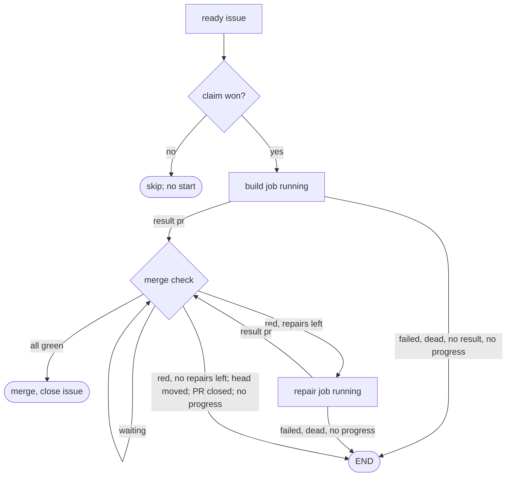

# Autopilot core engine

Own `src/autopilot-core.mjs`. It is the small native Autopilot engine that a
repository selects with `autopilot.engine: "core"` in `pdd.json`. One tick takes
ready issues, runs one headless agent job per issue, checks the PR natively and
merges it, or ends that one job with one comment. There is no AI in scheduling, no
Herdr, no coordinator chat and no parking. The [launcher](autopilot-launcher.prompt.md)
owns the timer, the tick lock, the GitHub budget and the issue list; it calls
`tickCore` when the engine is core and returns its result.

The rule behind every decision here: **every failure ends one job**. No job waits
for another job, for a person or for a tool fix. Jobs share only the slot count and
the GitHub budget. A person retries an ended issue by removing `pdd:stuck`.

## Settings

`autopilotEngine(config)` returns `core` only when `config.autopilot.engine` is the
string `core`; any other value, or none, is `full`.

`coreSettings(config, packageJson)` reads the `autopilot` object of a parsed
`pdd.json` and returns exactly these fields:

| Field | Source and default |
|---|---|
| `engine` | `autopilotEngine(config)` |
| `mode` | `off`, `observe` or `auto`; anything else is `off` |
| `trust` | the nonblank strings of `autopilot.trust`, else `[]` |
| `runs` | positive safe integer, default 2: the slot count |
| `label` | trimmed nonblank opt-in label, for example `pdd:autopilot`, else `null` |
| `quietMinutes` | positive safe integer, default 45: the no-progress period (there is no fixed time limit); the tick uses at least 2 timer ticks (`ports.tickMinutes`, default 10), and a core start refuses a value below that |
| `ciStuckMinutes` | positive safe integer, default 360: how long CI may stay pending with no change; at least 3 timer ticks |
| `maxJobHours` | positive safe integer, default 24: the floor of the backstop (see the process rule); no value turns it off |
| `report` | `file`, `draft` or `off`, default `draft`: nothing is posted unless the operator chooses `file` |
| `decisions` | `ask` or `decide`, default `decide` (T10, for the trial on test repositories; the release default comes later): `ask` asks a person ONE question only for a big decision; `decide` never asks, and every choice (big ones too) is listed in the PR |
| `runtimeRepo` | `autopilot.reports.runtimeRepo` when it is `OWNER/NAME` (the Runtime report repository), else `null` |
| `runtimeOwner` | `autopilot.reports.runtimeOwner` when it is a GitHub login (letters, digits and single inner hyphens, at most 39 characters), else `null`: the assignee of a Runtime report in `runtimeRepo` |
| `repairs` | `autopilot.maxRepairs` (the old key `autopilot.repairs` is an alias): safe integer of at least 0, default 6, the safety cap of repairs for one job |
| `testCommand` | nonblank `autopilot.testCommand`; else `npm test` when `packageJson.scripts.test` exists; else `null` |

`readCoreSettings(cwd, fs)` applies it to `cwd/pdd.json` and `cwd/package.json`;
an unreadable file counts as absent.

## State

The launcher passes `ports.root`, one folder for this repository on this machine.
It holds `jobs/N.json` (one file per issue in progress), `logs/` (job inputs,
logs, exit records and result files), `worktrees/` (`N` for the job branch,
`N-review` and `N-suite` for clean checkouts of the PR head), `history.jsonl`
(one line per finished job: time, issue, outcome, text, PR, log; and strike lines,
below) and `core.json` (the machine pause and the pending no-result). The job file and the GitHub labels are the whole state; a
restart reads them again. A job file has `issue`, `title`, `url`, `body`,
`branch`, `worktree`, `claim {commentId, labelEventId, lastSeen}`, `phase`
(`running`, `pr` or `ending`), `role` (`build`, `repair` or `conflict`), `repairs`, `started`,
`progress {sig, at, running}`, the started `agent` job, and in phase `pr` also `pr`,
`head`, `runtime`, `review` and `suite`.

**The process rule (debate C, one function `watchProcess`).** It applies to every agent
process: build, repair, conflict, review and suite. Each tick, for each running process:

- **T1 "something new".** The process makes progress when one of these is new to it (a
  16-hex SHA-256 prefix that is not in its seen set, the file `LOG.seen`): (P1) the commit
  at HEAD; (P2) the worktree state: HEAD, `git status --porcelain=v1
  --untracked-files=all`, `git diff HEAD` and each new file with its content hash (files up
  to 1 MB; the size only above), so a re-run that writes the same file or an edit that flips
  back is not new; (P3) a tool call in its own stream that is not a wait (Codex `--json`
  `item.completed` with its type and fields; Claude `stream-json` `tool_use` with its name and
  input; the tools `wait`, `wait_agent`, `sleep`, `list_agents`, a `write_stdin` with no
  input and a `sleep N` command are waits); (P4) a tool output line (also of a wait) or a
  plain log line, after normalization: dates, clock times and durations removed; UUIDs, hex
  ids of 7 or more characters and 20 or more base64 characters with a digit and a letter
  become `X`; temp paths become `T`; digits become `N`; spaces trimmed; (P5) 10 s or more of
  CPU time since the last tick in the process's children (`ports.jobs.cpu`, by pid, without
  the wrapper and the agent CLI). The log size, prose, reasoning and token counts are never
  new. The reviewer and the suite have no P1 and P2; the suite has no P3 (its log lines are
  P4). Each tick reads only the new whole lines after a saved offset (at most 8 MB). The
  first look sets the baseline (the clock keeps the process start); a sleep gap restarts
  the clock, and the part of a shorter tick gap beyond one timer interval (`ctx.tickGap`)
  moves the clock forward (a short sleep or a late timer is not quiet time). A suite that
  waits in the machine's suite queue is never quiet (like a CI wait): from a log line that
  starts with "waiting for a check slot" until the line "running the full test suite" (the
  queue admitted it), each tick counts as new. Only the queue time is exempt: before the
  queue (`npm ci`, the start of the suite command) and after the admission, T1 applies as
  usual. The note and the backstop count from the process start. **End:** nothing new for `quietMinutes` (at least 2 ticks) stops the process.
  Build, repair or conflict with no valid result: `no-result` ("the ROLE agent made nothing
  new for N minutes (no new commit, file state, tool call, output line or CPU use)"). A
  reviewer: no verdict (one retry, then `no-result`). A suite: a runner failure, started
  again at most twice; nothing new on all 3 tries (or deaths and quiet ends together 3
  times) is `no-result`, never `pdd` / `suite-broken`.
- **The note** (alert only): at `noteHours` = 3 h of process age, one `long-running` alert
  per process with the issue, the role, the age, the new commits, file states and stream
  items of the last hour, the log name and "This job goes on … To stop it, remove
  pdd:working or add pdd:stuck."
- **The backstop:** the process age is the time since its own start (`started`) minus the
  sleep gaps of this machine (`job.gaps`); nothing resets it (no line, commit, file, CI
  change or lane wait). The limit is max(`maxJobHours`, 4 × L), where L is the longest
  process of the same role that ended with a valid result by itself in this repository on
  this machine in the last 30 days (`durations.jsonl` rows `{at, role, minutes}`; a process
  that T1 or the backstop stopped never counts). At the limit: stop the process, write
  `git status --porcelain` and `git diff HEAD` (redacted) to `logs/ID.partial.log` for a
  worktree process, send one `stuck` alert per process, and end the job as `job` /
  `no-result` with `ceiling: true` ("the ROLE ran N h (its limit: the larger of
  autopilot.maxJobHours and 4 times the longest successful ROLE here, D) with no
  result"). The job file keeps the alert keys (`alerted`).

The build, repair and conflict prompts say: "Do not wait for CI and do not run the full
test suite. Autopilot runs both after you finish." Status shows each running process as
"ROLE AGE; last new thing D ago (new KIND); quiet limit N min; backstop H h (longest
success here D)". `progress {sig, at, running}` mirrors the clock of the running agent.
In phase `pr` the signature
is the head, the CI state and picture (each check's name, state, conclusion and time),
the review and suite states and the reviewer's log; it runs while CI is pending (queued
or in progress, or no check yet within its 10 minutes), the reviewer runs or the suite
process is alive. CI that stays pending with no change of its picture for
`ciStuckMinutes` ends the job with `job` / `checks-stuck` under the no-result rules
(named pending checks; a cause with `noResult` follows them like `no-result`). A new job, a repair, a PR result and a base
refresh start the clock again.

Slots come only from these job files, never from workflow allocation or other
local records. A job holds a slot while its process runs or its outcome is not yet
handled (phase `running` or `pr`). A job in phase `ending` has its outcome decided
and only finishes its GitHub writes, so it holds no slot. Each tick advances every
job before intake, so a job whose process died, for example after a restart, is
ended or moved to the merge check before free slots are counted.

## Tick

`tickCore({state, settings, budget}, ports)` returns `{exitCode: 0, message}`.
`state` is the launcher state (`cwd`, `repo`, `coordinatorId`, `machine`,
`baseBranch`, `agent`, `packageRoot`). Steps, in order:

1. Mode `off` returns `Autopilot is off.` Then read `core.json` and save `lastTick`
   (now). A **sleep gap** is a gap since the saved `lastTick` that is longer than the
   quiet period (a laptop sleep; a clock that went back is no gap). Mode `observe`
   does everything that `auto` does (claim, build, PR, review, suite, CI, Runtime,
   base check, repairs, END) **except the merge** (merge check step 8); its message
   starts `Autopilot core (observe: no merge):`.
2. Read the open issues through `ports.listIssues()`. A failed list skips the
   person checks and intake for this tick; jobs still advance.
3. A person stops a job by closing the issue, removing `pdd:working`, adding
   `pdd:stuck` or assigning someone. Then stop its processes and clean up locally,
   with no GitHub write, and do not take that issue again in this tick. A job with a
   PR reads it first: a merged PR (GitHub closes the issue from "Fixes #N") finishes
   as merged, not as a person stop.
4. For each own claim of a job that is not quiet, read the winning claim
   with the owners port first. The job still owns the issue only while the winner is
   this machine's coordinator, machine and claim comment. When the owner is unknown
   because a later claim comment names this job's label event (a loser whose delete
   failed), delete those later comments and read again. When another machine holds
   it live, hand over (below). Else
   heartbeat it through `refreshClaimHeartbeat` of the
   [GitHub dependency reader](issue-dependencies-github.prompt.md). A claim not
   refreshed for 4 hours gets no heartbeat: expiry is final. At the GitHub reserve
   floor (`budget.state` `reserve`) the tick stops after the heartbeats.
   **GitHub share**: every claim read through the owners port that is live (`active`,
   not `expired`) records its `machine` with the time in `core.json` `peers` (kept 4
   hours). The core's budget divides the launcher's `allowed` calls by k, the number
   of machines with live claims on this repository (the saved peers, and this machine
   when it holds a live claim; at least 1), and is `low` when `used` reaches that.
   With a `low` budget no new job starts: intake is held with `intake held: the GitHub
   budget is low (this machine used U of A calls in the last hour, a S% share for k
   machine(s) with live claims)`. Jobs still advance.
5. Advance each job, each in its own error boundary. An error saves `lastError` on
   that job, and `lastErrorTool` true when it came from a GitHub or Git call, and the
   tick continues with the next job. A job that waits with no error clears both, and
   so does a new head. A quiet job whose advance fails on 2 ticks ends (`job` /
   `no-result`), so no job holds a slot or a claim long past its quiet period. A
   `running` job with no agent record (the tick died between its two saves) ends at
   once as `no-result`. After a sleep gap nothing could make progress: every job's
   quiet clock starts again (`progress.at` = now). A claim that expired in the gap, or
   an agent whose process ended in the gap with no exit record, is this machine's
   fault, never a timeout or claim-expired END: a **machine no-result**, a release
   with no comment and no `pdd:stuck`, which is not counted for the issue (no
   cooldown, no strike) and does not add to `streak`.

**Hand-over**: a job that lost its claim to another machine stops its processes,
changes nothing on the issue (no comment, no label), marks this machine's own open
PR of that job as draft with one note (one try; a failure only warns) and cleans up
locally with outcome `handed-over`. It never merges.
6. Intake fills free slots (see below).
7. After intake, call `intakeTick(ctx, rows)` of the
   [intake cards](autopilot-intake.prompt.md) inside a try/catch: with
   `settings.intake` `shadow` (the launcher sets it from the machine) and an issue
   list it runs one shadow pass; otherwise it only stops card jobs that still run.
   An error is one warning, and it never changes a start, a slot or the message.

The message counts started, merged and ended jobs and repairs, the busy slots and
any intake hold, for example
`Autopilot core: 1 started, 0 merged, 0 ended, 0 repair(s); 1 of 2 slots busy.`

## Ready rule

`readyIssues({state, settings}, ports, rows)` returns the issue numbers in intake
order. An issue is ready when all hold: it is an open issue (not a PR); it has no
assignee; it has no `pdd:stuck`, `pdd:needs-decision` or `pdd:would-merge`; it is not cooling down (no `noResult` history
line of the last 24 hours on this machine after the issue's latest `reset` line); it has neither report label (`pdd:runtime`,
`pdd:autopilot-report`: report issues wait for a later self-fix lane); it has the
opt-in label when `label` is set; no
local job holds it; its author is trusted (`ports.trusted(row)`, the launcher's
trust rule); no open issue blocks it; and it has no live `pdd:working` claim by
anyone. Blocking means a GitHub issue dependency (`dependencies/blocked_by`, read
only when the row's dependency summary is not zero) or a body line
`blocked by #N`, `blocked by OWNER/REPO#N` or `blocked by` an issue URL, that
names an open issue, or, for an issue with comments, the hidden marker
`<!-- pdd:core-blocked-by:OWNER/REPO#N:FINGERPRINT -->` in its latest core END
comment when OWNER/REPO#N is open. A labeled issue is ready only when its winning claim, read
with the dependency reader's owners port, is expired and not takeover-limited.
Order is oldest `created_at` first, then the lower number. A read error skips only
that issue for this tick.

## Claim and start

**No label, no claim.** When the settings have `labelRequired` (the launcher sets it) and no `label`, intake claims
nothing and returns `intake held: no opt-in label; run pdd autopilot start --label pdd:autopilot and mark issues with
pdd autopilot add N`. Jobs still advance. Without `labelRequired` (a direct `tickCore` call), no label means every
ready issue.

**Collisions at start (debate B 5.1, 5.2; notes and hints, never a lock).** S2: intake
reads up to the free slots plus 4 ready issues and starts first those whose named
paths (paths in the title and body) meet no other running job (its named paths and its
changed files); else the oldest. A slot is never left idle for it. S3: the build brief
lists each other running job of the repository (this machine's job files; for other
machines the `files` of the claim records of `pdd:working` issues, at most 10, read only
when an issue is ready) with
"Other jobs change these files now. Change them only when the issue needs it. Keep such
edits small and on their own lines.", and the base merges of the last 24 hours that
touched files that the issue names. P1: at each push (once per head) the job's changed
files are written into its claim record (`files`) with a PATCH of its own claim comment.

For each ready issue while slots are free, at most 3 claim attempts per tick:

1. Make the job worktree first, so that a local failure touches no issue. Fetch
   `origin/BASE` once per tick; a fetch failure is not about one issue, so it stops
   intake for this tick. A leftover `worktrees/N` is ours: remove it with
   `git worktree remove -f -f` (this also removes a worktree that Git left locked),
   then the folder, then `git worktree prune`. If it still exists, or
   `git worktree add -b pdd/core-N-STAMP worktrees/N origin/BASE` fails, skip only
   this issue for this tick and go on with the next one. Removal also runs when the
   folder is gone: `git worktree unlock` and `remove -f -f` clear a registration that
   Git still lists, then `prune`. STAMP is the time in base 36
   and a short random part, so a retry of the same issue never meets the kept branch
   of an earlier job. Each job file has a random `id`; each started process has the
   id `N-ROLE-STAMP`.
2. Claim with the shared label and comment rule: read the issue again and give up
   when it is closed, stuck or assigned, or when a claim is live. An expired, not
   takeover-limited `pdd:working` is removed first, but only when a fresh timeline
   read shows that the winning label event is still the expired claim's event: a
   newer event is someone's fresh claim. Add `pdd:working`. The winning label event
   is the first `pdd:working` label event after the last removal. Post one claim
   comment `Autopilot core claim.` with a fenced JSON record
   `{repository, coordinatorId, machine, labelEventId, lastSeen: ""}`, where `machine`
   is this machine's id (`state.machineId`, else `m-` and the first 12 hex digits of
   the SHA-256 of the host name), never the host name. The job saves it as
   `claim.machine` and heartbeats with it. A claim whose record names this machine's
   host name (an older build) or its id is this machine's. The machine
   wins only when its comment is by the winning event's actor and is the earliest
   such comment that names that event, and a read of the winning claim through the
   owners port shows no other live owner. A loser deletes its own comment, removes
   its worktree and starts nothing. Two machines with one GitHub login therefore
   agree on one winner. A claim that fails partway leaves nothing of its own: this
   machine's comment is deleted, and the label is removed only when the winning label
   event is its own: the era it saw after its label POST is still the current era, the
   winner's actor is this machine's login (its comment's author, else `GET user`),
   and no other claim comment names that event. Otherwise (another login, a later era,
   or an error in these reads) the label stays.
3. Close the issue's older core PRs: each open PR of this repository (not a fork)
   whose head branch starts with `pdd/core-N-` and is not the new branch, and that
   is not merged, gets `state: closed` and one short note with the marker
   `<!-- pdd:autopilot-core:superseded:N:BRANCH -->`; its branch stays. A PR from
   another branch prefix, or one with a `would-merge` or `needs-approval` note by this
   engine's own login (observe mode validated it, or it waits for a person), is never
   touched. A failure only warns.
4. Save the job file, then start the build job (below). A start error, also one that
   the spawn reports later, ends the job as `no-result`; it never stops the tick.

Intake is held, and nothing is claimed, when the saved agent is not Codex or
Claude, when `ports.agentReady()` is false at the first ready issue (for example a
Codex usage limit), or while a machine pause runs (below).

**No result is a machine fault first.** An agent that exited with no result, a start
failure (also one that the spawn reports later), a dead process (a restart or a
sleep), a job with no agent record, a quiet job that cannot advance, a quiet agent, a
reviewer that twice gives no valid verdict and a suite runner that died 3 times all
end as `no-result`. Every job kind follows the same rules, in every machine state.

1. A `no-result` end releases the issue: delete this machine's claim comment, remove
   `pdd:working`, post no issue comment and add no label. Close this job's own open PR
   (found by its number, or by its branch through `pulls?state=open&head=OWNER:BRANCH`):
   first set `state: closed`, then post one short note with the marker
   `<!-- pdd:autopilot-core:release:N:JOB-ID -->`; the branch stays. A GitHub error
   leaves the release unfinished, so a later tick tries the close again (the job saves
   `prClosed` when it is done). Record `released` in the history and skip the issue
   for the rest of the tick.
2. Counting. A `no-result` end is **counted** for its issue only when it is the first
   one after a job result on this machine (`streak` was 0). Later ones in the same
   streak are the machine: they only release. A counted end has `noResult: true` in
   its `released` line, so the issue cools down for 24 hours (ready rule). It is also
   saved as `pending {issue, at}` in `core.json`. When the next end on this machine is
   a job result, the pending end fell between results: append the strike line
   `{at, issue, strike: true}` (the time of the no-result). When the next end is
   another `no-result`, the pending end is dropped; no strike. So an outage gives a
   strike only when it ends exactly one job, and a bad issue that fails between
   results gets a strike each time. **An AI-service problem is the agent account, not
   the issue (T08):** a build, repair, conflict or review agent that ended with no result
   because the AI service refused it is never counted: no cooldown, no `pending`, no
   strike. It adds 1 to `streak` like every `no-result` (the machine pause below). Its
   text names the service message: "the ROLE agent exited with CODE with no result: the
   AI service said "MESSAGE" (an agent account or service problem, not this issue)". The
   message comes from the last 64 KB of the agent log: the last error event (Codex
   `{"type":"error"}` or `turn.failed`, Claude a `result` with `is_error`, any JSON with
   an `error` message) in its last 40 lines, or one of its last 5 plain lines, when it
   has the shape of a provider message, not a single word: "model is at capacity",
   "out of credits", "credit balance is too low", "insufficient quota" or "exceeded your
   current quota", "hit your usage limit" or "usage limit reached", "rate limit
   exceeded" or `rate_limit_error`, "too many requests", `overloaded_error`, "not logged
   in", "please run /login" or "please log in", "invalid API key" or
   `authentication_error`, or a status shape for 401, 429 or any 5xx ("API Error: 529",
   "HTTP 501 Not Implemented", "HTTP 520", "status 429", "401 Unauthorized", "503 Service
   Unavailable"). A terminal error event (the Codex error or `turn.failed`, the Claude
   `result` with `is_error`) also counts with a clear account or service refusal shape:
   "out of credits", "SERVICE is at capacity" or "SERVICE overloaded" (SERVICE one of
   service, server, model, provider, API), a message that starts with "sign-in required",
   "login required" or "authentication required", or "quota exceeded". A message that
   reads like a test diagnostic (it names a test, an assertion, an expected value, a
   fixture or a spec) is never a service problem, in any shape. An ordinary error line,
   plain or in an event (for example "login test failed", "rate limit test failed:
   expected 3 requests, got 2" or "quota of 3 items exceeded in the fixture"), keeps its
   strike. A counted end of an issue with 2 strikes in the last 7 days is a normal
   END: one comment and `pdd:stuck`. Nothing else marks an issue stuck for no result.
   Each `ended` line has `reset: true`: the cooldown and the strikes read only the
   issue's lines after its latest reset, so a person's retry starts fresh.
3. Machine pause, saved in `core.json` as `streak`, `hours` (the next pause length),
   `pausedUntil` and `pausedHours`. Each `no-result` end adds 1 to `streak`. When no
   pause runs and `streak` is 3 or more, no new job starts for `hours` hours (1, then 2,
   4 and 8 at most) and one `usage-limit` alert goes out through `ports.alert` with
   `update` and the text "Autopilot paused new jobs for H h: the agent ended N jobs with
   no result. Check sign-in and limits." (the machine and the end time follow; when the
   end that starts the pause is an AI-service problem, the text also has `The agent
   said: "MESSAGE".`, so the alert names the account state). When
   the pause ends, intake goes on as usual. Any job result (a build or repair PR or
   reported failure, a valid review verdict, a merge) sets `streak` to 0 and `hours`
   to 1. Jobs that already run always go on. Unknown or broken saved state (a missing,
   `null`, non-object or non-JSON file, a pause end that is not within its length
   from now, for example after the clock went back, or a `pending` that is not
   `{issue, at}` numbers) reads as not paused, `streak` 0, `hours` 1, no pending; it
   never stops a tick or status.
4. `history.jsonl` is read line by line and a line that does not parse is skipped.
   Before each append, the file gets a newline when it does not end with one, so a cut
   line never swallows the next record.

## Jobs

Jobs run through the [headless job runner](agent-job.prompt.md) with
`agentCommand(state.agent)` and `jobEnvironment(env)`, in `logs/`, with id
`N-ROLE-STAMP`. The prompt names the job's result file path. Every job runs the pdd
that runs the tick: the tick writes `bin/pdd` in `ROOT` (`#!/bin/sh` and `exec 'NODE'
'PACKAGE/bin/pdd.mjs' "$@"`, with this Node and this package, quoted for the shell;
rewritten only when it differs) and puts `ROOT/bin` first on the job's `PATH`, before
any other pdd (for example an older global install).

- **Build** (in `worktrees/N`): the issue title, URL and body as data from a trusted
  author, and these rules: choose pdd-small-change, pdd-bug or pdd-feature, but make
  ONE PR with prompt, Story, tests and code; this is not a `pdd workflow run`, so no
  `pdd workflow` command, no Herdr, no person wait and no `steps/autopilot.md`. Rule 1
  also carries the choice rule (T10, Serhan: a person is asked only for the big
  decisions of the repository, never for small things). A choice is **big** only when
  all of these are true: (a) the issue and the person's answers in the brief do not
  settle it; (b) it has 2 or more reasonable answers with different results that users
  see; (c) it is hard to undo or others depend on it: a public contract (a command,
  option, config key, API, output or file format, stored data), a change or removal of
  behavior that users rely on, or a product direction. An open trusted issue that asks
  the same question (for example an open decision issue) also makes it big. Every other
  choice is **small**: internal names, code structure, tests, message wording, docs
  wording, small defaults that are easy to change. The job decides each small choice
  itself and lists it in the PR body under `Choices Autopilot made:`, one line each with
  its reason (`- CHOICE (REASON)`). With `decisions` `ask`, a big choice is ONE question
  and no PR: the `needs-person` result with `question` (one plain question), `options`
  (2 or 3 answers) and `recommended` (the letter of the option the job recommends), so a
  person can answer with one letter; at most one question per issue. With `decisions`
  `decide` (the default), the job never asks about a choice: it decides big choices
  too and lists them first under `Choices Autopilot made:`, each marked `(big)`. A vague
  issue is never a reason to ask about a small choice; a clear issue, or a person's
  answer in the brief, is built. The brief lists the open issues that the issue names by number and the titles
  of up to 20 other open issues (not PRs, not this issue, only by trusted authors:
  `ports.trusted(row)`, read once per login and tick and shared with the ready rule; a
  failed read is not trusted and warns once per login and tick), so the
  job can see an open decision;
  **the path from file ownership** (debate A, the exact text of A-VERDICT section 6.1):
  the brief has the owner table of the job worktree (`ownerTable`, below; up to 400
  owned files), and the rules say: a file is owned when pdd-bindings.json, a
  `Generated from` header or a prompt's opening paragraph names it (not sure = owned);
  path a (owned code, the contract changes: the owning prompt first, in the issue's
  words, then Story, tests, code), b (owned code, the contract stays: prompt unchanged;
  quote the restored line or "no contract change"), c (a new code file with new
  behavior: its prompt first, with a binding or header; moved code keeps its owner), d
  (any other file: direct, never a new prompt; a value that a prompt states must agree
  with it; docs take facts from the owning prompt), e (existing unowned code: direct,
  with a regression test, and the file in the result's `adopt` list); never add a
  binding or header for a file of the base unless the issue asks to adopt PDD; tests
  only for a change of the public surface (a test that fails on base), else the done
  check; one `Path: <a|b|c|d|e> — <files> — <owner or unowned> — <prompt changed | quote
  file:line | no contract change | new prompt> — Test: <file | done check>` line per
  path in the PR body; prompt and code may share a commit; never rewrite history;
  focused tests, with the full test command named; the Runtime rule (#3227 fix 5, the
  words of RUNBOOK §15 "Autopilot core jobs"): changed means against the base
  (`git diff --name-only origin/BASE...HEAD`, never since the previous PR head; a Story
  or prompt that a base merge brought in is not changed); commit every change, then run
  `pdd test` for each changed Story and write one `Runtime:` line for each changed Story,
  the verdict first and the Story in the parentheses: `Runtime: PASS (STORY, N/N
  checks)`, `Runtime: FAIL (STORY, N of M checks failed: STEPS)` or `Runtime: not run
  (STORY: REASON)` (STORY the Story file path as `git diff` shows it); a single line with
  no Story is valid only when the PR changes one Story or none; two lines for the same
  Story are red; a PASS of a Story that the PR does not change never counts; a FAIL line
  blocks the merge, and a failed check is a FAIL also when its batch has no verdict.
  `not run` is only for a cause that this PR cannot fix: a native-only prompt, a Story
  with no Runtime test, no verdict with no failed step, or a refusal that pdd gives no
  fix for; a refusal with a fix from pdd (for example a whole number outside the
  interpreter's range: apply the Number spelling that pdd prints) is this PR's work. The
  job does not wait for maintenance: pdd has sent nothing yet, so the job stops pdd and
  writes `Runtime: not run (STORY: maintenance until HH:MM UTC)` with the end time that
  pdd printed (the engine sends that check itself when maintenance ends); it never sends
  a check again itself and never cuts short a check that pdd has sent. When Runtime could
  not check, the job does not stop and does not invent an interface: it covers the case
  with native tests, ships the PR with the not-run line and puts the reason and the tool
  error in the result's `runtime` with kind `runtime`. One `Evidence:` line
  in the PR body and the same text as the result's `evidence` (below). No review
  verdict or review claim (for example "Review: no must-fix") in the PR body or a
  comment: only the core's fresh reviewer gives one. **Approval (auto and observe
  mode):** observe mode does everything that auto mode does except the merge, so the
  operator's start is the approval of the job's prompt changes in both. For each changed
  `*.prompt.md`, after its checks pass, the job runs `printf '%s' 'WORDS' | pdd approve
  PROMPT --said -` with WORDS exactly `Operator action: pdd autopilot start --engine
  core in MODE mode for REPO on MACHINE-ID at TIME` (MODE is the real mode, `auto` or
  `observe`, because the words must be true; the machine id, never the host; TIME =
  `state.startedAt`, else `state.activatedAt`) and commits the result in the PR. The
  merge check makes an unapproved changed prompt red in both modes, with the same
  command, so a repair records it. In a repository whose worktree `pdd.json` has
  `strict_approvals: true` the rule says instead: do not run `pdd approve` and do not
  edit an interface status; in auto mode "Autopilot asks a person"; in observe mode
  "Autopilot lists the prompts for a person in its note": observe asks no one (a
  question only makes sense when a merge would follow), adds no `pdd:needs-decision`,
  and its would-merge note lists `Prompts that need a person's approval before a merge
  (strict_approvals): …`. Push the job
  branch and open one PR against BASE with `Fixes #N`; never merge, push to BASE,
  force-push or close the issue, and never assign it or change its labels. The result
  file is JSON: `outcome` `pr` with `pr`, `head`, `promptChanged` (Boolean),
  `evidence` and optional `runtime {state, cause, kind, component, code, detail}`, or
  `outcome` `failed` with `kind` (`pdd` or `job`), `component`, `code`, `cause`
  and a short `detail` without repository code, or `outcome` `needs-person` with one
  clear `question`, only when the job cannot go on without a person's decision. A Runtime check that could not run is
  never a failure.
- **Evidence** (for metrics): one fixed line, `Evidence: runtime=<pass|fail|not-run>
  (<n>/<m>); vectors=<pass|fail|not-run> (<n>/<m>); formal=<proved|bounded|failed|not-run|not-applicable>;
  tests=<pass|fail> (<n>/<m>)` (runtime = `pdd test` on the changed Stories, vectors =
  the replay tests that the change touches: each changed `*.vectors.test.*` file and each
  vector test file that names a changed scenario file, run with `node --test` (the merge
  check runs the same files and compares the counts), formal = the changed formal
  tests, tests = the focused tests; a count may be left out). The job prompt says this. The tick parses it with an allowlist: the first PR body line
  that starts with `Evidence:` after the Runtime-line marks go, else the result's
  `evidence`; each `key=value` part with a known key and value is kept once, with its
  count when it is `n/m` with n ≤ m (never for formal); anything else is dropped. The
  parsed value is saved on the job (`evidence`, or null) and in its history line. The
  merge check parses it from the PR body each time and makes it a red finding when it
  contradicts itself or the checks: a `fail` (or `formal=failed`), a `pass` with fewer
  passed than total or 0 of 0, or a runtime value other than `fail` that disagrees
  with the PR's Runtime line (PASS or not run).
- **Repair** (same worktree and branch): the red findings, the job log folder, then
  the build rules; push to the same branch, no new PR, and update the `Runtime:` and
  `Evidence:` lines when they change, with "changed" against `origin/BASE...HEAD`. After
  a merge from the base, the repair and the conflict update check that the fix is still
  needed (#3227 fix 5): the PR's changed tests run on the new merge base in a throwaway
  worktree; when they pass there too, the base holds the fix, and the PR keeps only what
  the base does not hold and says so in its body.
- **Review** (in `worktrees/N-review`, a detached checkout of the head): a fresh agent
  that did not write the change. It gets the base owner table of the PR's changed files
  and the R5 hints (below), and checks the issue fit; (2) Path and (3) Tests with the
  exact text of A-VERDICT section 6.2 (the Path lines match the owner table, disputed
  only by naming a missed binding, header or prompt line; a and c trace to the issue; b
  keeps the contract; d agrees with any prompt that states a changed value;
  must-fixes: a new prompt for a non-code file, a binding or header added for an
  unowned file of the base, owned code that disagrees with its prompt; never a new
  prompt for an unowned file; never commit order; a missing test is a must-fix only
  with the surface and the result named; no test that only copies a value from the
  diff); an honest Runtime line and no unrelated or unsafe change; and (6) **the choices
  (T10)**: every choice that the issue did not settle is listed under `Choices Autopilot
  made:` with its reason; a missing or wrong line is a P2 must-fix (fix the list), never a
  decision item. A small choice (rule 1) is never a decision item. With `decisions`
  `ask`, a big choice (rule 1: all of a, b and c, or an open trusted issue that asks the
  same question) that the job made instead of asking is a P2 must-fix with the word
  `decision:` after its severity or its place (`P2 decision: …` or `P2 FILE:LINE decision:
  …`), and the result's `question`, `options` (2 or 3) and `recommended` (a letter) are
  the one question for a person. With `decisions` `decide`, the brief has no decision
  item: the reviewer only checks the list (a big choice is listed and marked `(big)`). A person's
  answer to an earlier question is in the brief (the same answer text as the build), so a
  settled choice is not asked again. The brief has the linked open issues: each open
  issue (not a PR, not this issue, only by trusted authors, from the tick's issue list)
  that the issue title, the issue body or the PR body names by number (`#N`, `REPO#N` or
  its URL), or whose title or body names a file that the PR changes by its full path, at
  most 5, each body cut to 2,000 characters; or "(none)". A Runtime FAIL line in the PR body means a FAIL verdict. It writes no files and makes no GitHub write. Its
  result is `{verdict: PASS|FAIL, head, summary, mustFix[], question?, options?,
  recommended?}`. **A decision is a question, not a repair (only with `decisions`
  `ask`):** when a blocking item of a FAIL is a decision item (P1 or P2, then the word
  `decision:` within its first 200 characters), the merge check ends the job as **needs
  a person** (below), in auto and in observe mode (a question is not a merge; observe
  mode only leaves out the merge), with that one question (the
  reviewer's `question`, else "The review found a choice that issue #N did not make: ITEM.
  Which option do you want?"), not a repair round, also when other items exist (the
  answer can change the whole change; the next build reads the answer and the review
  runs again). The open PR gets one note (`<!-- pdd:autopilot-core:needs-decision-pr:P -->`):
  it waits for the answer and does not merge; the next build closes it as usual. With
  `decisions` `decide`, a decision item is an ordinary must-fix (a repair), never a
  question. Each must-fix item starts
  with its severity and place: `P1 file:line …` (wrong behavior or unsafe), `P2 file:line …`
  (fix before the merge) or `P3 file:line …` (a follow-up); a PASS lists only P3 items
  (the scoped check is asked the same). **Fail closed:** an item is a follow-up only when
  it starts with P3 and names no P1 or P2 anywhere; every other item blocks, also in a
  PASS (a numbered, a "Severity P2:" or an untagged item, or "P3/P1"). The split comes
  before each list is cut to 20 items, so no blocking item is lost. The verdict is PASS
  only when no item blocks and the reviewer said PASS or listed at least one follow-up. A
  string `mustFix` is one item; a missing or empty list is none, and a FAIL with no item
  stays a FAIL (its red line says "see the review comment on the PR"); a verdict that is
  not exactly PASS or FAIL is no verdict. The tick lists them as follow-ups in the review comment,
  in one section at the end of the PR body (a follow-up never reads as a `Runtime:`, `Path:`
  or `Evidence:` line) and in one note on the issue (marker
  `<!-- pdd:autopilot-core:follow-ups:N -->`), each updated in place and with no item twice.
  A follow-up never closes an issue: an issue reference (`#18`, `owner/repo#18` or an issue
  URL) becomes `issue 18` (`owner/repo issue 18`).
- **Suite** (in `worktrees/N-suite`): `node bin/pdd.mjs workflow suite --command
  TEST --timeout 0` through the [shared full-suite queue](test-suite-queue.prompt.md):
  no fixed time limit (the process rule watches it), with `CI=true` in its environment so
  watch modes end. Exit 0 is green; any other
  exit code of the repository's test command is a red suite, and repairs apply. Only a
  failure of the runner itself is not a test result: a run that died (no exit record)
  or was killed by a signal, the wrapper's exit 127 (could not start), no output at
  all, or a runner line in the log ("Shared test suite queue failed", "Test suite
  execution timeout", "Test suite could not start", "Test suite ended by SIG…",
  "Test suite descendants could not be confirmed", "Supply a suite command"). It
  starts again in the same checkout, at most twice. On the 3rd failure, a runner that
  died on all 3 tries (the deaths count over every try of this suite run) is a
  `no-result` end; any other runner failure ends the job with a
  `pdd` cause `suite-broken`. It never uses a repair. A fresh checkout has no
  installed dependencies: when it has `package-lock.json` and `package.json` lists
  dependencies (`dependencies`, `devDependencies` or `optionalDependencies`), the suite
  job is `/bin/sh -c 'npm ci --ignore-scripts --no-audit --no-fund || …exit 86; exec
  "$@"'` before the same suite command. An install failure (exit 86 or the line
  "Autopilot core: dependency install failed") is a runner failure, not a red suite.
  A repository with no dependencies installs nothing.

A running build, repair or conflict agent that T1 stops ends as `no-result` with no
valid result file (the no-result rules apply); with one it goes on as an exited job. A
reviewer that T1 stops counts as no verdict unless its result file is valid. An exited or dead job: a valid `pr` result moves
to the merge check in the same tick. The PR number may be a number or a string of
digits (an optional `#`); it becomes an integer above 0. The head is 40 hex digits in
any case and is saved in lower case. Any other PR value is no result. A `failed`
result ends with the agent's cause; anything else ends with `no-result`.

**Needs a person.** A result `{"outcome": "needs-person", "question", "options"?,
"recommended"?}` with a nonblank question counts as a job result (`produced`) and goes
through the resumable END steps with a question instead of a cause: read the claim again
before each write (hand over when another machine owns it); post one issue comment
`Autopilot needs a decision from a person to go on with this issue:`, the question as
`> ` quote lines, and "Please answer in a comment, then remove the `pdd:needs-decision`
label. The next Autopilot job reads this question and your answer.", with the marker
`<!-- pdd:autopilot-core:question:N:JOB-ID -->` (found again after an uncertain post). The question text
(T10 format) is the plain question on one line, then, with 2 or 3 nonblank options,
one line per option `A) OPTION`, `B) …`, `C) …`, the recommended one ending with
` (recommended)` (`recommended` is a letter, a 1-based number or the option text), and
the line `Reply with one letter, for example: X` (X the recommended letter, else A);
with fewer than 2 or more than 3 options the question goes alone. The same format is
used for a review decision. Then add `pdd:needs-decision` (never `pdd:stuck`); delete this machine's claim comment and
remove `pdd:working`; clean up locally with outcome `needs-person`. The slot is free.
The person answers and removes the label; **the label removal is the signal**, a
comment alone changes nothing. When the core claims an issue with comments, it reads
the latest question comment that this engine posted (author = the engine's own login,
`GET user`, and a marker that names this issue; a marker comment by anyone else is
not a question) and the comments after it by trusted people (`ports.trusted`), leaving
out comments with a `<!-- pdd:` marker and claim comments. Only a removal of
`pdd:needs-decision` after the question by a trusted person (the timeline
`unlabeled` event's actor) answers it; otherwise the core puts the label back, undoes
its claim (claim comment and `pdd:working`) and starts nothing. The next build prompt
then has the question and those answers as data, or "no written answer" when there
is none.

**Owner table** (`ownerTable(fs, root, files)`, the one owner function; it can call
`pdd owner PATH` when pdd ships it): bindings first (`pdd-bindings.json` modules: module
to prompt), then a `Generated from PROMPT.prompt.md` header anywhere in the first 4 KiB
of a file, then the first paragraph of each prompt that is not a heading or a comment,
for each path in it that is a file of the tree (uncertain = owned). The first owner
found wins. **Path e** results carry `adopt` (file paths): the tick files them as one
deduped PDD report (`autopilot-core` / `adopt-pdd`), and it never blocks the job.

## Merge check

Phase `pr` has no deadline; it ends only when it is quiet. Each tick, in order:

1. Read the PR. Merged: finish as merged, also when quiet, so END never runs on a
   merged issue. Quiet: stop the checks and end with the last error, a `pdd` cause
   `merge-check-tool` when the PR read fails or the last saved error came from a
   GitHub or Git call, else a `job` cause `checks-quiet` ("the PR checks made no
   progress for N minutes"). Closed: end
   `pr-closed`. The PR head SHA, head branch or base differs from the job: end
   `head-moved`.
2. `Runtime: not run (…)` is allowed, and the PR body is not rewritten. When the
   job's `runtime` has state `not-run` and kind `runtime` (Runtime could not check),
   file or count one report through the [report owner](autopilot-reports.prompt.md)
   (with `runtimeRepo` and `runtimeOwner`) with the cause `{kind: runtime, component, code, text, detail, shipped: true}`
   (component default `pdd-test`, code default `not-run`), once per job and
   component/code (`job.runtimeReport`). It never blocks or ends the job. A not-run
   with no Runtime kind (for example no prompt changed) files nothing.
3. Red findings. The Runtime gate is an allowlist (fail closed). A Runtime line is a
   PR body line that, after heading, list, quote, table, bold and code marks go,
   starts with "Runtime" or holds "Runtime:". Its value, after leading signs such as
   an emoji, names its Story in the parentheses after the verdict (`Runtime: PASS (STORY,
   …)`, the form of the briefs and the RUNBOOK); a Story path first (`Runtime: STORY
   PASS (…)`) is read too. Then the verdict must start with PASS (or PASSED) or "not run", in any
   case; any other value is red, and the repair prompt quotes the line. **Per-Story
   lines (#3227):** with more than one Runtime line, each line names its Story and no
   Story has two lines (else red); different Stories may have different verdicts. A
   single line with no Story is accepted only when the change has at most one changed
   Story (else red: one line per changed Story). With Story lines, each changed Story
   needs its own line, and a PASS line of a Story that the PR does not change is red. The result's `runtime.state` (lower case, spaces as `-`) must be
   absent, `pass` or `not-run`, and must agree with the body when all lines have one
   verdict; else red. A body with no
   Runtime line is red when the change has a `*.prompt.md` (Git decides, also when the
   result says `"promptChanged": false`); with no changed prompt it is red unless the
   result says `"promptChanged": false`. **A Runtime pass must be true (T01):** every
   positive Runtime claim is checked: a "Runtime: PASS" line, an Evidence part
   `runtime=pass` (of the PR body, else of the result) and a result `runtime.state`
   `pass`. With Story lines, only the Stories of PASS lines need the cover below, and a
   changed prompt that no passing check reaches is fine when it is in the upload of the
   tests of a Story with a not-run line (that line says the prompt was not checked). A
   claim counts only when the saved Runtime checks cover the change at the
   agent's exact head (`agentHead`, the head of the last build, repair or conflict
   result). The read is saved as `coverage` for that head; a new agent result and a
   repair clear it (and `vectors`), because `pdd test` saves its checks outside the
   repository, so a repair that only runs `pdd test` keeps the same head. The changed
   files are `git diff --name-only -z --diff-filter=d origin/BASE...HEAD` (NUL mode, so
   every name stays exact). The read uses a clean checkout of that head
   (`worktrees/N-agent`): the Stories and their tests come from `findTests` there, with
   fixture projects excluded (as a full `pdd test` does), and `savedStoryEvidence` of the
   [runtime client](runtime-client.prompt.md) reads the checks that `pdd test` saved for
   the job worktree (`root`) and compares their source with the clean checkout
   (`comparisonRoot`, with `withTests`, so each row names the tests that its check ran).
   So an uncommitted or untracked file of the job worktree never counts as the head. A
   Story is changed when its Story file or one of its test files changed. Each test of a
   Story is its own scope: for each test, the latest check of exactly this source that
   ran it (`current`, the largest `at`) decides; a tie with a check that did not pass, or
   a newer failed or no-verdict check, is not a pass. So independent checks of different
   tests of one Story combine (two big tests that cannot go in one upload are checked
   apart), and no check lends its pass to a test that it did not run. A Story passes when
   every scope that a current check has passes. Each changed Story needs such a pass, and
   each changed test must have a passing deciding check of its own; a changed Story file is
   in the upload of every test of that Story, so each test of a changed Story needs its
   own passing deciding check too (Claude round 4). Each changed
   `*.prompt.md` must be in the upload of a passing deciding check: `captureSource` of
   exactly that check's tests at the clean checkout (its `files`, what the check sent),
   never the footprint of other, unchecked tests of the Story; each Story in its own error boundary (changed Stories
   first; stop when every changed prompt is reached), so a broken unrelated Story never
   hides a healthy one, and unchecked siblings never make the selection too big. Else red: "CLAIM, but
   the saved pdd test checks at head H do not cover FILES (the saved check of S is for
   another source: a stale Runtime batch, for example an older commit or files that are
   not committed; the latest check of S at this source did not pass; no check of S at this
   source ran T; the source of S
   could not be read: CAUSE). A PASS of other Stories does not count. Run pdd test for
   the Stories of these changes at this head, or write "Runtime: not run (REASON)" (and
   runtime=not-run) when they have no Runtime check (for example a native-only prompt or
   a Story with no Runtime test)." CLAIM names each claim, for example `The PR body says
   "Runtime: PASS"`. A PR that changes no prompt, no Story and no Story test needs no
   coverage. A reader error (for example `findTests` throws, or the clean checkout cannot
   be made) is red with its cause, never a tick error. The reader is a port: `ports.runtimeEvidence({root, tree, head}, ctx)`
   returns `{stories, storyFiles, tests, footprint(story, row)}` (`tests` rows `{path,
   files, stories}`; story rows may have `tests`; `footprint` gives the upload `{files}`
   of the row's tests, or `{error}`); a test port may give a `footprints` map instead
   (then a row with no `tests` covers its Story's tests). **Prompt gate**
   (once per head, saved as `approvals {head, strict, problems}`): after a fetch of the
   base and the branch, each changed prompt of `git diff --name-status --find-renames
   origin/BASE...HEAD` (added, modified, renamed or copied; the new path) is read in a
   clean checkout of the head (`worktrees/N-approve`) with the
   [preflight](runtime-preflight.prompt.md)'s own `readPrompt` and `promptRefusal`. A
   problem is: a refusal (two blocks, invalid JSON, a bad status, a stale prose hash), a
   status other than `approved`, an interface that the base had and the head removed
   (no interface on both sides is not an approval matter), or an approved status with
   no approval: not the same interface and prose hash as the base version at the old
   path (a pure rename keeps the approval that Git has), and no entry for that path and
   prose hash in the approval journal of the repository's common Git dir
   (`readPromptApprovals`). Its finding says: set the status to "draft", then run `pdd
   approve` (it records an approval only for a draft or stale prompt). A strict
   repository accepts only a person's approval: a trusted APPROVED review of the head
   on GitHub, or a journal entry made at a terminal. `strict` is true
   when `strict_approvals` is true in `pdd.json` on the base or at the head. In auto
   mode, problems in a strict repository end the job as **needs a person** (below)
   with the question "PR #P changes prompts that need a person's approval in this
   repository (strict_approvals): … Please approve the PR on GitHub (or approve each
   prompt with pdd approve on its branch and push), then remove pdd:needs-decision:
   Autopilot checks the same PR again, with no new build. To give up on it, close the
   PR.", the PR stays open with one note `<!-- pdd:autopilot-core:needs-approval:P -->`.
   After a trusted removal of the label, intake resumes that PR (phase `pr`, its
   branch in the job worktree, `resumed: true`) instead of a new build (a failed fetch or
   checkout of that branch undoes the claim and removes the worktree, as other intake
   failures do; the next tick tries again); in other repositories they are red,
   with the approval command and words in the finding (one repair, then END as usual).
   Observe mode approves as auto mode does, with "in observe mode" in the words (above),
   so problems outside a strict repository are red there too. In a strict repository
   observe mode asks no person: it lists the problems in its "would merge" note.
   **Path checks** (debate A section 6.3, no AI, once per head and PR body, saved as
   `paths`): from clean checkouts of the base tip and the head, the owner tables before
   and after, and the changed files (`--name-status --find-renames`). Red: R1 a file in
   the files field of a path d or e line that the base owns (the files field is the text
   after the letter up to the next dash separator ` — `, ` – ` or ` - `; a file named in
   the owner, contract or test text, for example "owning prompt for docs/errors.md", is
   not on that path: T09); R3 an added prompt that owns no added code file
   of the PR (with an issue that asks to "adopt PDD", any changed file); R4 a file of the
   base with no owner that the head gives a binding or header (unless the issue asks to
   adopt PDD); R6 no `Path:` line. R5 is only a hint for the reviewer: prompts at the head
   that mention a changed unowned file. Then a
   failed CI check
   (check runs and commit statuses of the head; neutral and skipped pass); else
   a review FAIL or a failed suite. With no red finding yet, start the review and
   the suite for this head when missing; CI may still be pending. A reviewer that
   twice gives no valid verdict for the head ends as `no-result`; no test command
   ends `no-test-command`; a broken suite ends `suite-broken`. The tick posts each verdict once as a PR comment with
   the head, summary and must-fix list.
   **The engine's own replay and formal run (T04):** with the review and the suite, at the
   final head (once per head, saved as `vectors`; a repair clears it, so a repair at the
   same head runs it again, like the suite). The set is complete: each changed
   `*.vectors.test.*` and `*.formal.test.*` file, and each `*.vectors.test.*` file that
   names any changed scenario file (a changed `.json` under a `test`, `tests`, `runtime`
   or `vectors` folder, by its base name: `git grep -z -l -F` at the head, 100 names per
   call). Discovery is in NUL mode (`-z`), so every name stays exact. Only node:test
   files run: a `.js`, `.mjs` or `.cjs` file whose text at the head holds `node:test`, or
   that imports by a relative path (two levels at most, inside the checkout) a file that
   holds it (pdd's replay helpers), and whose absolute path in the checkout has no
   backslash (Node refuses such a module path). Each other file is "Not run by Autopilot (REASON)" in the note. It
   still counts for its kind: a kind with such a file cannot substantiate a positive
   claim (below), for a mixed set too. More than 400 files, or a command over 100,000 bytes, runs
   nothing: "not run (too many replay and formal files: N; the limit is 400)", never a
   part of the set. The run is one bash command through the machine's suite queue in a
   clean checkout (`worktrees/N-vectors`, the suite's dependency install, `CI=true`),
   watched by the process rule (role `vectors`, like the suite). **Per-file accounting
   (Codex round 4):** each file runs alone, directly as a script with the TAP reporter
   (`node --test-reporter=tap -- 'ABSOLUTE-FILE' 2>&1`; no glob reads the path, so
   brackets, braces such as `{a,b}`, stars, a leading `-` and such characters in the
   checkout path all work, checked on Node 22.23.2), then the marker line `# pdd-autopilot-
   NONCE: KIND I exit CODE` (NONCE a random hex per run, KIND `vectors` or `formal`, I the
   file's index in its kind). All files of the run go through one awk filter, so the
   bound is for the whole log: after 4 MB of output it passes the marker lines, TAP
   result and location lines cut to 300 characters for 1 MB more, and once `# pdd-
   autopilot: output cut after 4194304 bytes`; it prints no other line, and keeps only
   the last top-level TAP summary line of each key and the last plan line of the current
   file, which it prints just before that file's marker. So the log stays near 5 MB, also
   with many summary-shaped lines, and each file's counts stay true. The engine reads the
   log in 1 MB parts, line by line (bounded memory), and keeps for each file the last TAP
   summary before its marker (`tests`, `pass`, `fail`, `skipped`, `todo`), the exit code,
   and at most 20 failing tests of its kind with their files. A file passes with exit 0,
   at least one test and 0 failures; it fails with a non-zero exit or a failure (also a
   non-zero exit with no summary: the file did not load); a file with exit 0 and no test
   has no result. A kind is the sum of its files; a kind with a failed file fails, and a
   kind with a file with no result cannot substantiate a positive claim. A positive
   aggregate never hides a missing file. A runner line counts only when the line
   starts with the phrase (the queue and the install print them so; a failing test's
   TAP text, which quotes such a phrase in an indented YAML line, is a test failure); the
   suite's runner lines follow the same rule. A kind with exit 0 and 0 failures passes; a
   non-zero exit or a failure fails (a `# fail 0` with a non-zero exit fails too). A
   runner failure (a missing file marker, a run that died or was killed or stopped by T1,
   exit 86 or 127, a queue runner line) starts again in the same checkout, at most twice;
   then the run is "not run (REASON)", which names the files with no result. The claims against the run, for each kind:
   - A failure is red: "Autopilot ran the KIND tests that this change touches (FILES) at
     head H: F of N failed: TEST (FILE). The Evidence line says KIND=CLAIM."
   - A pass with no file of the kind left out and no skipped or todo test: a `vectors`
     claim must be `pass`, with the same counts when it gives counts; a `formal` claim
     must be `proved` or `bounded`. Else red (the claim is not true), with the true value
     to write.
   - Not run, a file of the kind that the engine does not run, or a skipped or todo test
     (a skipped obligation never supports a pass or a proof; an all-skipped formal run is
     not proved): a positive claim (`vectors=pass`, `formal=proved` or `bounded`) is red:
     "… Autopilot could not check it: REASON. Fix the cause, or write KIND=not-run." A
     non-positive claim is fine. The engine's runner is not the issue: this red alone
     never ends a healthy job. It is red at most once per job and kind (`notRunReds`),
     and never when no repair is left. After that the engine never repeats the claim: it
     writes that kind itself as `KIND=not-run (Autopilot could not check: REASON)` in the
     Evidence line of the merge or would-merge note and in the history line (the job's
     receipts), so metrics count it as not run, never as pass, and one `pdd` report
     (`autopilot-core`, code `replay-not-run`, `shipped: true`) goes to the report owner,
     once per job. A later run that checks the kind clears this (`unchecked`), and so does
     a later head that has no file of that kind.
   The merge note has one line for each kind with files: `- Replay tests (Autopilot's
   run at H): STATE (P/N): FILE STATE (P/N), …` (each file with its own result, at most
   20, then "and N more") and `- Formal tests (…)`, `- Not run by Autopilot
   (REASON): FILES` for other runners, or `- Replay and formal tests (Autopilot's run):
   none changed`.
4. Any red finding: stop the other checks. The **repair budget** (option B): repairs go on
   while they make progress. The findings of a round are each review must-fix (P1 and P2)
   and each other red line. Two findings are the same when they name the same `file:line`
   (3 lines of tolerance) with a similar cause (2 shared words and a quarter of the words,
   or 40% of the words; the words leave out paths, so two bugs at nearby lines of one file
   differ), or, with no
   place, when nearly all their words agree; a hex commit name does not count. After a
   repair, compare the findings with the last round. Stop (END `checks-red`, the END text
   names the rule and lists the findings) when (a) a finding of the last round is still
   there, (b) a finding of an earlier round came back, or (c) the job has used `repairs`
   (the safety cap, default 6). A round that fixes all its findings and gets new, different
   ones goes on (the #2574 pattern: each repair fixes the last P2 and the reviewer finds a
   new P2), to a PASS or the cap. Else start one repair job (it clears `review`, `suite`,
   `vectors` and `coverage`, so every check runs again, also at the same head), count it and start its quiet
   clock. The job saves the last 8 rounds (`rounds`).
5. Wait while CI, review or suite is not green. CI is green when the head has at
   least one check and none is pending. CI is `none` (the full suite and the fresh
   review decide alone) only in a repository with no PR CI: no head of this job ever had a
   check (`ciSeen`), no workflow file of the base tip can run on the PR head
   (`workflowRunsOnPr`: its `on:` has `pull_request` or `pull_request_target` whose branch
   filter admits the base, whose `types` (when given) include opened, synchronize or
   reopened, and whose `paths` / `paths-ignore` admit one of the PR's changed files (`git
   diff --name-only origin/BASE...HEAD`); or `push` whose branch and path filters admit the
   job branch and the changed files; GitHub's globs `*`, `**`, `?` and `!`; a workflow with
   only `repository_dispatch`, a schedule, a release, closed PRs, other paths, tags or
   pushes to other branches, such as the PDD App's dispatch file, is no PR CI), and no
   required status checks on the base. The workflow files come from `git show
   origin/BASE:.github/workflows/NAME` after one fetch per tick (no API call). The safe side
   counts as CI: a read error, a file whose `on:` the reader cannot read (no `on:`, a
   flow map over several lines), and more than 50 workflow files. And 10 minutes passed
   since `prAt`. **A head with no check at all may be a conflict** (GitHub runs no
   `pull_request` workflow while the PR conflicts with its base): then the tick fetches the
   base and runs `git merge-tree --write-tree --name-only --no-messages origin/BASE HEAD` in
   the job worktree; exit 1 (a conflict) starts the agent conflict update (`conflictFix`,
   debate B, outside the lane, with the conflicting file names), not a CI wait. A new head that has no run yet (for example after a
   refresh) waits for its CI. A pending check still waits, as long as it takes; save `progress`
   first.
6. **Merge lane** (one final step per repository). A green PR (CI green or none,
   review PASS, suite pass) enters the lane. The lane is the label `pdd:merge-lane` on
   one open PR, shared by every machine through GitHub (`issues?state=open&labels=…`,
   PRs only). Any machine clears a stale holder (a closed or merged PR, or a core issue
   (`pdd/core-N-…` branch) with no live claim that is no local final-step job) and an
   orphan one (not a core PR). **One winner on every tick:** the lowest open holder
   number; every other PR removes its own label (a failed DELETE throws and the next
   tick tries again) and waits. When another PR holds the lane, or an older green PR
   of this machine (claim order, `started`) waits, the PR waits: `lane {state:
   waiting, holder, since, heldSince}`, and its quiet clock starts again each tick
   (`progress.running`), so waiting never ends a job and never counts as a refresh; a
   wait for the same holder longer than the quiet period sends one `stuck` alert. Else
   the PR adds the label and reads the holders again (an empty read: try again next
   tick). The holder is in the final step: `lane {state: final, since, waited}`. A
   repair (which also clears a stale waiting state, as a new head does), an END (of
   any kind, before its other steps), a hand-over, a person's stop and an observe
   validation leave the lane (remove the label); a merge closes the PR. **Race
   guard:** right before `gh pr merge` the PR reads the holders and the compare again;
   it merges only as the lowest open holder with `behind_by` 0.
   The order (debate B L6, C1, C2): a PR that came back from a conflict update
   (`lanePriority`) goes first, then claim order; a PR whose changed files meet a live
   reservation of another PR (this machine's job files, or the `reserved {files,
   until}` of other core PRs' claim records) waits for it. `nativeMergeQueue` is the
   hook for GitHub's merge queue (decision D4, later): today it returns null.
   **Final step, conflicts (debate B 5.4; `laneConflict` is the one place of the
   conflict rule).** Fetch the base and the branch and run `git merge-tree --write-tree
   --name-only --no-messages origin/BASE HEAD`. Exit 0 is clean; any code other than 0
   or 1 leaves the decision to the refresh merge. On exit 1, merge with
   `merge.conflictStyle=diff3` in the job worktree and classify each conflicted file. A
   conflict never goes to a repair. Mechanical (fixed in the lane, no agent, the review
   kept as `mechanical`, never a repair): M-a a hunk that differs only in derived
   `Generated from P (sha256: …)` header lines (the header is then recomputed from the
   merged prompt P); M-b pure inserts (one copy of identical text, else the base side
   first); M-c adjacent hunks that do not overlap (both applied); M-d a JSON file merged
   3-way (union of keys, a key changed on both sides is not mechanical, arrays that
   both sides only extend keep both additions). The fixed merge is committed and
   pushed; the suite and CI run on it; red checks on that head start an agent update
   instead of a repair. Anything else (the same lines edited on both sides, an add/add
   of one path, a missing side, binary) is an **agent conflict update** outside the
   lane: leave the lane, count `conflictExits`, start a `conflict` job in the job
   worktree with the three-sided hunks and the rules (merge the base, change only lines
   inside the conflict hunks, add no files, run the focused tests; an add/add with
   disagreeing specs ends with code `duplicate-design`). It is a base update, not a
   repair, when the PR's changed lines outside the conflict files and its file set stay
   the same; else it uses a repair (with none left, END `checks-red`). The PR then goes
   first in the lane. C2: at the 2nd conflict exit the PR reserves its conflict files
   for an hour (job and claim record); C3: the 3rd ends the job `base-moving`.
7. The head must contain the current base tip (`compare/BASE...HEAD`, `behind_by` 0).
   When the base moved, refresh natively in the job worktree (L3): reset to the job
   head, merge `origin/BASE` (identity "PDD Autopilot", no hooks, no signing), push the
   branch and take the new head; this is not a repair, and the suite and CI always run
   again. A base move after the first refresh of one lane entry (a person's merge) is
   a recheck: at the 3rd recheck the PR leaves the lane with no penalty and goes first
   again (L4); rechecks never count as conflict exits. There is no other refresh cap.
   **Review keep (debate B 5.5)**: F is the SHA-256 of the `+` and `-` lines of `git
   diff -U0` from the merge base (without derived header lines), in path order. R1:
   the same F and file set before and after keeps the PASS review (`kept`). R2: a scoped
   check (`review.scoped {reason, detail, files}`: a short reviewer that reads only that
   part and answers "does the result keep both changes and break neither?") when the
   base changed a line within 10 lines of a PR hunk, or a prompt that owns a file of the
   PR, or after a conflict update that changed F only in the conflict files. R3: a
   fresh full review for any other change of F.
   Run `checkAutopilotBase` of the [automatic base](autopilot-base.prompt.md). A
   read failure ("could not verify", "unavailable", "retry") waits; another
   refusal ends `base-check`.
8. Read the winning claim again: another live owner means hand-over and no merge; a
   claim that is not confirmed as this job's waits. Post one merge comment on the PR for this head: `CI: green (N check(s))` or
   `CI: none (…)`, the suite, the lane (`Merge lane: final step`, with the queue
   minutes when it waited), the review (`Review: PASS from a fresh reviewer`,
   `Review: PASS (kept after a clean base refresh, same change)`, `Review: PASS (kept:
   the lane fixed only mechanical conflict hunks)` or `Review: PASS (a scoped check
   after REASON, on top of the earlier full review)`), the PR's Runtime
   line, the parsed evidence
   (`Evidence: runtime=pass (11/11); …` in the fixed key order, or `Evidence: none`)
   and the base check,
   with the marker `<!-- pdd:autopilot-core:merge:HEAD -->`. Then
   `gh pr merge PR --repo REPO --merge --match-head-commit HEAD`. A failed merge
   waits for the next tick. A confirmed merge closes the issue when it is open,
   removes `pdd:working`, cleans up locally (see END) and records `merged`.
   In mode `observe`, the same comment starts `Autopilot would merge this PR (observe
   mode): every check passed for head HEAD. It stays open and ready for review;
   Autopilot does not merge it.` with the marker
   `<!-- pdd:autopilot-core:would-merge:HEAD -->`. Then a draft PR is marked ready
   (`gh pr ready`; a refusal only warns), this machine's claim comment and
   `pdd:working` go, the issue gets the label `pdd:would-merge` (visible to every
   machine), the result counts (`produced`), and local cleanup records `would-merge`
   with the evidence: validation passed, not merged. The ready rule of every machine
   skips an issue with `pdd:would-merge`, because its PR waits for a person; a person
   removes the label to have it built again.

## END

`END(cause)` takes `{kind, component, code, text, detail}`; kinds are `runtime`
(as the agent says it; the [report owner](autopilot-reports.prompt.md) keeps only no
verdict, interpreter error, server incompatibility and a server-side internal error as
Runtime's, and makes a refusal of our input, such as a lint, interface or binding
refusal, a PDD report), `pdd` (CLI error, crash, claim error, merge-check tool error) and `job` (the agent did not do the
task, no progress, red checks). It stops the job's processes and saves phase
`ending`, then, resumable step by step on later ticks:

0. Each tick counts one try. After 6 tries, or 24 hours in phase `ending`, send one
   `stuck` alert through `ports.alert` (its own tried and need: finish the END by hand), clean up locally with
   outcome `abandoned` and stop retrying.
1. When the job has a PR, read it first: a merged PR finishes as merged, never as END.
   A PR that cannot be read is retried on 2 more ticks, then the END goes on.
   Read the claim. When another machine holds it live, hand over. A resumed END or
   release reads the claim again right before each write on the issue (the release's
   claim comment and label delete, the END's dependency link and comment, and the
   labels): when another machine owns it now, hand over and write nothing on the
   issue.
2. For a `runtime` or `pdd` cause, file or count one report through the
   [report owner](autopilot-reports.prompt.md) with the repository's settings
   (`report` mode, `runtimeRepo` and `runtimeOwner`).
3. A `runtime` or `pdd` cause whose report has a GitHub reference **waits for the
   report, not for a person**. Loop breaker first: when an earlier END comment on
   this issue has a blocked-by marker with the same fingerprint and that report is
   now closed, the cause came back after its fix, so a person decides. Otherwise
   link the issue natively: `POST repos/REPO/issues/N/dependencies/blocked_by` with
   the report's issue id. A refused link (for example across repositories) leaves
   the hidden marker in the END comment as the only record; the ready rule reads it.
4. Post one issue comment with the cause text (one final period), kind and code (the kind
   is the report owner, `reportKind`, so a binding refusal says `pdd`), the
   log file name (`Log: \`NAME.log\` on this machine`), the
   branch and PR, `Blocked by REF` when a report has a reference (`#N` in the
   same repository), a draft note naming `pdd autopilot report`, and either "ready
   again when REF closes" or how to retry (remove `pdd:stuck`). Every comment with a
   report reference carries `<!-- pdd:core-blocked-by:REF:FINGERPRINT -->`. A hidden
   marker `<!-- pdd:autopilot-core:end:N:JOB-ID -->` makes a retry after an uncertain
   post find the earlier comment instead of posting twice.
5. Remove `pdd:working` (an absent label is fine). Add `pdd:stuck` for a `job` cause,
   for a `runtime` or `pdd` cause without a GitHub report (draft, off or over the
   daily limit: nothing to wait on), and for a loop.
6. When the job has an open PR, leave it open: mark it draft (`gh pr ready PR --undo`;
   a refusal only warns) and comment the cause on the PR once, with the marker
   `<!-- pdd:autopilot-core:end-pr:N:JOB-ID -->`. A failing GitHub call retries on the
   next tick; after 3 failed tries the note is skipped with a warning.
7. Only then clean up locally (below). Record `ended`.

Local cleanup, after END, a merge, a hand-over or a person's stop: stop the job's
processes; remove every `worktrees/N…` folder of the issue (as in intake); remove every
`logs/N-…` file except the `.log` files that the END comment and the history name;
append the history line. Each step has its own error boundary and only warns.
`jobs/N.json` goes last in a `finally`, so a failed step never keeps the job. A merge also deletes the local branch; other outcomes keep it, because the
agent's commits may exist only there.

## Status

`coreStatus({state, settings}, {root, reportRoot, now, fs})` returns text from local
files only: the engine line (mode, repository, folder, base, agent), the slot line
(`B of R slots busy`, no-progress limit, repairs, report mode, opt-in label), the pause
line (`New jobs paused until TIME (H h): …` or `No pause: N no-result end(s) in a row …`), one line per job (`#N build running 12m (log …)`, `#N PR #P at SHA: review …,
suite …`, with `; merge lane: final step` or `; merge lane: waiting for PR #P since TIME`, `#N ending: …`), the last 5 results (`#N ended TIME: cause`; strike lines are not results) and the count
of local report drafts.

## Text on GitHub

Every comment that this engine posts (review verdict, merge note, END comment, PR
notes) first becomes public text, above its trailing hidden marker lines only (a
marker never changes): an absolute path (`/a/b…` or `~/a/b…`, two parts or more,
after a space, quote, bracket, `=` or `,`) keeps only its file name; this machine's
host name becomes `this machine`; and the local user name (the last part of HOME, or
`ports.user`) becomes `[user]`. A name is replaced only as a whole name (not inside a
longer word or dotted host name). Texts never name another machine: a
hand-over says "another machine holds the claim now". A cause sentence ends with one
period, never two. Then it goes through [secret redaction](secret-redaction.prompt.md) and is cut to at
most 20,000 characters; hidden markers at the end stay whole. A saved `lastError` is
redacted and cut to 300 characters. The claim comment holds only the claim record,
with the machine id.

## Machine settings

`state.label` (saved by `start --label`), `state.mode` (saved by `start --mode`) and
`state.decisions` (saved by `start --decisions`) win over `pdd.json` for this repository
on this machine. The launcher applies them; `coreStatus` takes `sources: {engine, label,
mode, report, decisions}` (`machine` or `pdd.json`) and names the source: `engine core
(this machine: pdd autopilot start --engine core)` or `engine core (pdd.json
autopilot.engine)` when `engine` is given (the launcher gives none, so the line says
`engine core`), `only issues with LABEL (this machine)` or `(pdd.json)`, `mode M
(this machine)`, `reports R (this machine)` and `decisions D (this machine)` (the Jobs
line has `; decisions D` after the reports); mode `observe` adds `(every check, no
merge)`.

## Ports

`gh(args, {input})` and `git(args, {cwd})` return `{code, stdout, stderr}`; GitHub
REST calls use `gh api --include --method M ENDPOINT [--input -]`. Also `now()`,
`fs`, `root`, `reportRoot`, `env`, `version` (the PDD version), `listIssues()`,
`trusted(row)`, `agentReady()`, `warn(text)`, `alert({issue, kind, text, tried, need, update})`, and the replaceable `jobs`
(`start`, `read`, `stop`), `owners(numbers)`, `heartbeat(job)` and `checkBase(input)`
with the native defaults named above.

## Dependencies

- [Headless job runner](agent-job.prompt.md): required for job start, outcome and stop.
- [GitHub dependency reader](issue-dependencies-github.prompt.md): required for the
  winning-claim read (owners port), `refreshClaimHeartbeat` and `takeoverLimited`.
- [Automatic base](autopilot-base.prompt.md): required for `checkAutopilotBase`.
- [Report owner](autopilot-reports.prompt.md): required for `fileReport` and drafts.
- [Shared full-suite queue](test-suite-queue.prompt.md): required context for the
  `pdd workflow suite` job.
- [Secret redaction](secret-redaction.prompt.md): required for suite log tails.
- [Runtime client](runtime-client.prompt.md): required for `savedStoryEvidence` (the
  saved checks of T01, with `comparisonRoot`).
- [Runtime preflight](runtime-preflight.prompt.md): required for `findTests` (Stories and
  their tests, `excludeFixtureProjects`), `captureSource` (Story footprints), `gitFiles`,
  `readPrompt`, `promptRefusal` and `interfaceBlocks`.
