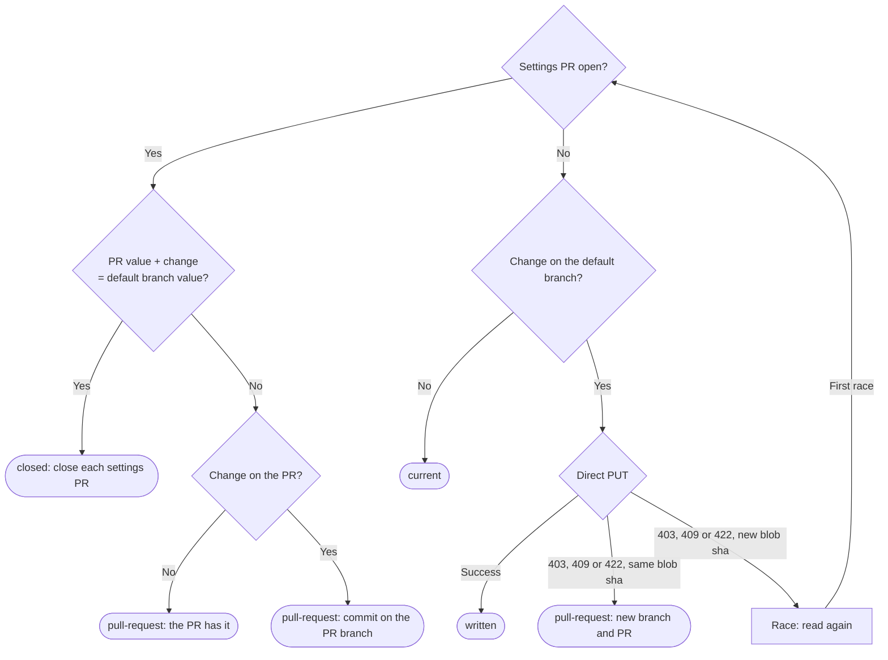

# Autopilot settings on GitHub

Own `src/autopilot-github.mjs`. Export `publishAutopilotSettings(input, ports)` and `checkAutopilotSettings(input, ports)`. Autopilot workers start from the default branch of the repository on GitHub and read `pdd.json` there. A mode, trust or untrust command saves the setting in this checkout ([Autopilot settings](autopilot.prompt.md)). Publish makes the same change on GitHub. Check says when GitHub has another setting, or when a settings PR is still open. Neither function changes the current branch, the index or the uncommitted files of the checkout: every GitHub change goes through the GitHub API.

**The one rule of Publish: a command changes only its own part of the GitHub value.** The checkout can be behind GitHub. A teammate can have changed the mode or the trust list there. So Publish never copies the local `autopilot` value to GitHub. It reads the GitHub value and applies only the change of the command to it. Every other key of `pdd.json`, and every other field of `autopilot`, keeps the GitHub value.

## Input and result

- `publishAutopilotSettings({cwd, action, mode, names, retry}, ports)`: action is `mode`, `trust` or `untrust`. mode is the named mode of a mode action (`off`, `observe` or `auto`). names are the names of a trust action, or the one name of an untrust action. retry is the command that the person can run again, for example `pdd autopilot auto`.
- `checkAutopilotSettings({cwd}, ports)`.

Both find the Git top-level folder of cwd and read the key `autopilot` of its `pdd.json` (the local value). Both return `{state, message}`. The message is empty or has one line for each result line below. Neither throws: an unexpected error is a result.

## Ports

- `github.repository()` returns `{repository, defaultBranch}`. The native port calls `resolveWorkflowRepository({cwd: root}, {execFile})` of [workflow GitHub](workflow-github.prompt.md): the `origin` remote and `gh repo view`, with the gh sign-in that pdd already uses. There are no new credentials.
- `github.request({method, path, body})` returns `{status, body}` for each HTTP answer of the GitHub REST API, also for an error status. It throws when there is no HTTP answer: gh is missing or not signed in, or GitHub cannot be reached. The native port runs `gh api --method METHOD PATH`. It sends a body as JSON on stdin (`--input -`), and it reads an error status from the `(HTTP NNN)` text of gh. A success is status 200.
- `execFile(file, args, {cwd, input})` runs `git` and `gh`. The native port gives each command 15 seconds.
- `shortId()` gives the branch suffix. Native: 8 random lowercase hex characters.

Tests inject `github`, or an `execFile` that answers for `gh`. They never call GitHub.

## The change of a command

The change applies to an `autopilot` value V (V can be missing). Names match ignoring case.

| Command | V is an object | V is missing | V is another JSON value |
| --- | --- | --- | --- |
| mode MODE | Set only `mode` to MODE | `{"mode": MODE, "trust": []}` | `{"mode": MODE, "trust": []}` |
| trust NAMES | Append to `trust` each name that it does not have yet, in the order of the command. A `trust` that is not a list counts as empty | `{"mode": "off", "trust": NAMES}` | Stop: `the autopilot value in pdd.json on GitHub is not an object; set a mode there first with pdd autopilot off, observe or auto` |
| untrust NAME | Remove each `trust` item that is NAME | No change | No change |

When nothing changes, there is nothing to write. The commit message says exactly what changed: `Set PDD Autopilot mode to MODE`, `Add NAMES to the PDD Autopilot trust list` (only the names that were added, joined with `, `) or `Remove NAME from the PDD Autopilot trust list`.

### The new file text

pdd edits the GitHub text of `pdd.json`; it does not write the file again from parsed JSON. Only the bytes of the changed value change, so the commit diff shows only that value. The indent, the key order, the number text and all other bytes stay.

- A changed field (`mode` or `trust`) or a replaced `autopilot` value takes the place of the old value text. When the GitHub value is missing, pdd adds the member at the end of its object, with the separator and the indent of the members that are already there.
- A new value has the style of its place. It is on several lines with the indent unit of the file (the indent of the first top-level member, else 2 spaces) when the old value was on several lines, or when the old value was a scalar or empty and its object is on several lines. Else it is on one line, with `, ` and `: ` when the old text or the member used them, else with `,` and `:`. New line breaks are CRLF when the file has a CRLF, else LF.
- An empty top-level object, or no file (a 404), gives 2-space JSON.
- When duplicate keys exist, change the last one, as JSON.parse reads it.
- The new text must parse to the GitHub configuration with only its `autopilot` value changed. If it does not, use that configuration as 2-space JSON with a final newline.

## Publish

1. When the input is not a valid command, or the local value is not an object (no file, invalid JSON, or a value that trust and untrust keep), return `skipped` with an empty message.
2. Get the repository and its default branch. Read `pdd.json` there: GET `repos/R/contents/pdd.json?ref=BRANCH`. A 404 means that there is no file: the configuration is `{}` and there is no blob sha. A 200 must be a base64 file with a sha, and its text must be a JSON object.
3. Find the open settings PRs: GET `repos/R/pulls?state=open&base=BRANCH&per_page=100&page=N`, at most 10 pages. A settings PR has a head branch that starts with `pdd/autopilot-settings-` in the same repository. The newest one (the highest number) is the settings PR. A failed list stops Publish: without it, pdd cannot know that no PR waits.
4. Follow the flow below.

The figure owns the routes. These rules own the reads, writes and lines:

- **PR value.** Read `pdd.json` on the head branch of the settings PR and apply the change to its `autopilot` value. The PR collects the pending changes, so the next command builds on it, not on the default branch.
- **closed.** The new PR value is the same JSON value as the default-branch value (key order does not count): the PR has nothing left to change. For each open settings PR, post a comment (`POST repos/R/issues/N/comments`: `pdd closed this PR: BRANCH already has these Autopilot settings.`) and close it (`PATCH repos/R/pulls/N` with `state: closed`). A failed close stops Publish. Line: `pdd closed PR_URL, because BRANCH already has this setting.` (more URLs joined with `, `).
- **Older settings PRs.** When the newest PR stays, close each older open settings PR in the same way, with the comment `pdd closed this PR: PR_URL has the newest Autopilot settings.`
- **The PR has it.** No change on the PR branch: write nothing. Line: `The open PR PR_URL already has this setting. Merge it before Autopilot workers use WHAT.`
- **Commit on the PR branch.** PUT the new text on the head branch with its blob sha and the commit message. Then PATCH the PR title and body to match the new value (a failure of this PATCH does not change the result). Line: `pdd updated the open PR PR_URL. Merge it before Autopilot workers use WHAT.`
- **current.** No settings PR and no change on the default branch. Line: `pdd.json on GitHub is already up to date.` Never print this line while a settings PR is open.
- **written.** PUT `repos/R/contents/pdd.json` with `{message, content, branch, sha}`: content in base64, branch the default branch, sha the blob sha from step 2 (leave it out when there was no file). This is one commit that changes only `pdd.json`. Lines: `Updated pdd.json on GitHub (BRANCH): COMMIT_URL`, then `pdd.json on GitHub is updated. To update your local copy, run git restore pdd.json, then git pull.` The restore step is needed, because the local write leaves `pdd.json` changed in the checkout and `git pull` stops on it. pdd never pulls or changes the branch itself.
- **Race or refusal.** After a 403, 409 or 422 from a PUT, read `pdd.json` on that branch again. A new blob sha (or a file that now exists or is gone) means that another change came between the read and the write: start again from step 2 once. A second race returns `not-updated` with `pdd.json on BRANCH changed again while pdd wrote it`. The same blob sha means that the branch itself refuses a direct change: on the default branch, go to the new PR; on a PR branch, stop with `GitHub refused the change on BRANCH (HTTP NNN)`. Another status stops with `GitHub refused the change (HTTP NNN)`.
- **New branch and PR.** Read the head of the default branch (GET `repos/R/git/ref/heads/BRANCH`) and make the branch `pdd/autopilot-settings-ID` there (POST `repos/R/git/refs`). A 403 there stops with `you cannot push to R (HTTP 403)`; another refusal stops with `BRANCH does not accept a direct change, and GitHub refused the branch NAME (HTTP NNN)`. Read `pdd.json` on the new branch, apply the change and PUT it there with its blob sha. Open a PR from the new branch to the default branch (POST `repos/R/pulls`). Line: `BRANCH does not accept a direct change, so pdd opened PR_URL. Merge it before Autopilot workers use WHAT.` When the PR did not open, REASON names the branch.
- **PR title and body.** The title is `Turn on PDD Autopilot` when the new mode is `observe` or `auto` and the default-branch mode is `off` (a missing or invalid mode counts as `off`), else `Update PDD Autopilot settings`. The body shows the new `autopilot` value as JSON and says that workers use it only after the merge.
- WHAT is `the new mode` for a mode action, else `the new trust list`.

After the line of `current`, `written` or `closed`, compare the local value with the default-branch value; after a `pull-request` line, compare it with the PR value. They differ when the effective mode (`off`, `observe` or `auto`; a missing or invalid mode is `off`) or the trust names (case and order do not count) differ. Then add one line before the `git restore` line: `This checkout has other Autopilot settings (PLACE: MODE, trust NAMES; this checkout: MODE, trust NAMES).` PLACE is `GitHub` or `the PR`. NAMES is the names joined with `, `, or `(none)`.

Each other failure returns `not-updated` with `pdd.json on GitHub was not updated: REASON. This checkout has the new setting. To retry, run RETRY.` REASON is short and has no token and no local path, for example `GitHub could not be reached or gh is not signed in`, `gh is missing or did not answer in time`, `this repository has no origin remote`, `origin is not a github.com repository` or `GitHub refused the change (HTTP 404)`.

The caller keeps the local write and exit code 0 in each case.

## Check

Check reads the local value (no file counts as `{}`), the default-branch `pdd.json` as in Publish (a 404 counts as `{}`) and the newest open settings PR (a failed list counts as no PR). The settings differ as defined above. When they are the same and no settings PR is open, return `same` with an empty message. Else return `different` with one line that starts with `Warning: ` and has these parts, in this order:

1. When they differ: `pdd.json on GitHub (BRANCH) has other Autopilot settings (GitHub: MODE, trust NAMES; this checkout: MODE, trust NAMES). Autopilot on this machine uses this checkout's settings (and this machine's --mode and --label, when set); other machines and people read the GitHub copy.` The core engine reads the checkout's `pdd.json`, so the line never says that Autopilot uses the GitHub copy.
2. When a settings PR is open: `The settings PR PR_URL is open: the GitHub copy changes only after the merge.`
3. When they differ: `To put this checkout's settings on GitHub, run COMMANDS.` COMMANDS are joined with ` and `: `pdd autopilot LOCAL_MODE` when the modes differ, `pdd autopilot trust NAMES` for the local names that GitHub does not have, and `pdd autopilot untrust NAME` for each GitHub name that the checkout does not have.

When the local value or the default-branch file cannot be read, return `unknown` with an empty message. Check never writes.

The native gh runner records each `gh` call in the GitHub call ledger of the repository that the call names, through `nativeGithubCounter` of [GitHub calls](github-calls.prompt.md#ledger), with the purpose `setup`. Counting never changes a call or its result; an injected `execFile` is not wrapped.

## Dependencies

- [GitHub calls](github-calls.prompt.md): native generation and verification context for counting `gh` calls.

- [Workflow GitHub](workflow-github.prompt.md): required generation context for `resolveWorkflowRepository` and its `execFile` port.
- [Autopilot settings](autopilot.prompt.md): owns the local `pdd.json` shape and its writes. The change table above follows its rules for the local write.
- Navigation only: the [CLI](pdd-cli.prompt.md) calls Publish after the mode, trust and untrust commands, and Check after `pdd autopilot start` and `pdd autopilot status`.
