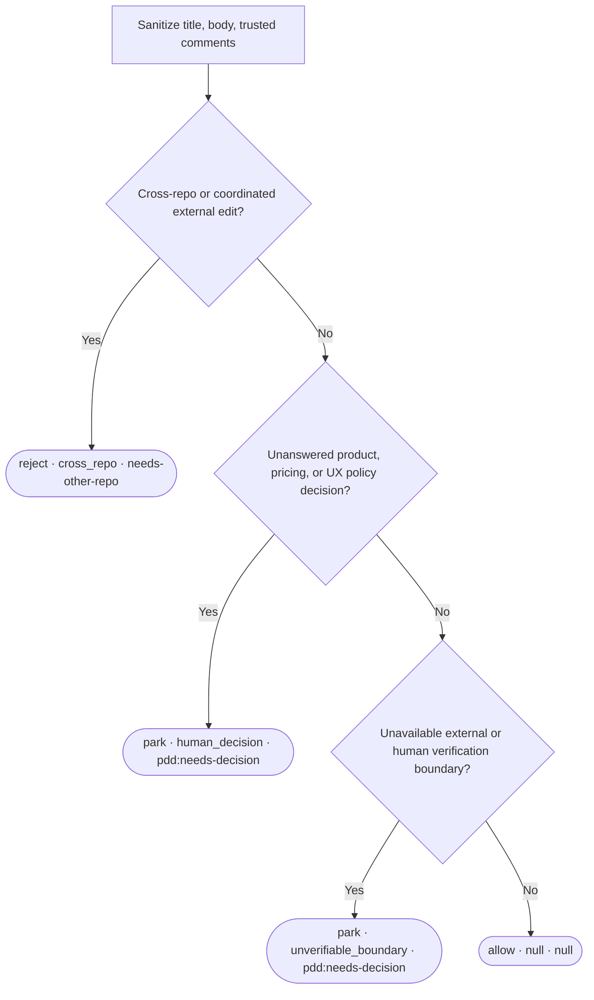

# Autopilot pre-flight intake classifier

Own `src/autopilot-intake-preflight.mjs`. Classify open GitHub issues deterministically before Autopilot claims them or spends build tokens, and roll up recorded pre-flight skip reasons with Classifier Conversion for `pdd metrics`. Perform no filesystem, network, process, AI, or clock I/O, and never mutate caller inputs.

## Domain decisions

- **Zero-token pre-flight boundary (`#3534`, building on `#3500`):** Evaluate every candidate issue from sanitized issue text, trusted comments, optional `repoFiles`, optional `decisionNote`, and optional `workerCapabilities` before claiming a slot, allocating a worktree, or starting an AI build.
- **Text sanitization (`sanitizeIssueText`):** Before matching pre-flight signals in an issue body or comment, strip HTML comments (`<!-- ... -->`), fenced Markdown code blocks (`` ``` `` or `~~~` blocks), and Markdown blockquote lines (optional leading spaces followed by `>`). Pasted error logs, stack traces, and quoted examples inside stripped blocks never trigger pre-flight skips. Strip ASCII/C1 control characters from every returned `reason` and `question` string (single-line plain text, at most 300 characters).
- **Strict category precedence:** Evaluate categories in fixed order so an issue with multiple blockers always receives one deterministic primary `reasonCode`:



- **Category 1 — `cross_repo` (`decision: "reject"`, `intakeClass: "elsewhere"`, `label: "needs-other-repo"`):**
  - Known sibling repositories/services when absent from `repoFiles` (and not equal to `repository`): `pdd_cloud` (alias `pdd-cloud`), `pdd-workflow` (alias `pdd_workflow`), `prompt-runtime`, `runtime-client` (alias `packages/runtime-client`), and `extensions/github_pdd_app` (alias `github_pdd_app`). Also recognize any explicit foreign `OWNER/REPO` slug or GitHub `blob`/`tree` URL whose `owner/repo` differs case-insensitively from `repository`.
  - Canonical `targetRepo`: when named as an explicit `OWNER/REPO` slug or GitHub URL, return lowercase `"owner/repo"`; when named by bare sibling name or sibling root path without an owner prefix, return the canonical short name (`"pdd_cloud"`, `"pdd-workflow"`, `"prompt-runtime"`, `"runtime-client"`, `"extensions/github_pdd_app"`); when an unnamed external service requires edits or deployment, return `"external-service"`.
  - Triggers when either:
    1. **Foreign-only target:** Leading title `[REPOSITORY]` / `REPOSITORY:` prefix or standalone `Repo:` / `Repository:` / `Target repo:` / `Target repository:` / `Service:` / `Target service:` / `File:` / `Files:` field naming another repository, a foreign GitHub `blob`/`tree` URL with no local code paths, an absent foreign sibling root path (`pdd_cloud/...`, `pdd-workflow/...`, `pdd_workflow/...`, `prompt-runtime/...`, `runtime-client/...`, `packages/runtime-client/...`, `extensions/github_pdd_app/...`, `github_pdd_app/...`), or explicit sibling framing with zero local targets; OR
    2. **Coordinated multi-repository edit:** Even when local files or the current `repository` are also referenced, the sanitized text explicitly requires coordinated edits, paired PRs, or deployments in another repository or external service — evidenced by (a) an absent foreign sibling root path or foreign `blob`/`tree` URL cited as files to edit alongside local paths; (b) an explicit foreign `Repository:` / `Service:` field alongside local targets; or (c) explicit coordinated-change phrasing paired with a foreign repository or external service (such as requiring changes in both repositories, updating `pdd_cloud` or `pdd-workflow` alongside `pdd`, or requiring a paired PR/deploy in an external service).
  - **False-positive guards:** Passive mentions of calling, mocking, documenting, or handling HTTP/CLI errors from another repository or external service without editing it stay `allow`. Missing **local-root greenfield paths** (under an existing local top-level directory present in `repoFiles` such as `src/`, `prompts/`, `test/`, `tests/`, `bin/`, `scripts/`, `docs/`, or `user_stories/`) never count as foreign paths.
  - Set `question: null`, crisp single-line `reason`, and `signals` to one or more of `["repo_header", "foreign_url", "foreign_root_path", "sibling_service", "coordinated_multi_repo"]`.
- **Category 2 — `human_decision` (`decision: "park"`, `intakeClass: "person"`, `label: "pdd:needs-decision"`):**
  - Triggers when sanitized issue title/body (or latest unresolved trusted comment) poses an **unanswered** product, pricing, billing/tier, or UX policy decision that only a person can answer — evidenced by explicit unresolved markers (`Open question:`, `Needs decision:`, `Decision needed:`, `Product decision:`, `Pricing decision:`, `UX decision:`, `Question for <person/team>:`) or explicit unanswered product/pricing/UX option prompts (`Should we ... or ...?`, `Options: (A) ... (B) ...` choosing pricing, tier limits, product direction, or user-facing UX policy).
  - **Trusted resolution override:** Do not park when a trusted comment (`trusted !== false`) posted after the question clearly settles or approves the choice (for example `"Decision: ..."`, `"Approved: ..."`, `"Confirmed: ..."`, `"Go with ..."`), when `decisionNote` is a non-empty string, or when the body itself records a settled decision (`"Decision:"`, `"Resolved:"`, `"Locked-in:"`) with no remaining open product/pricing/UX question. Ignore untrusted comments (`trusted === false`) completely: they can neither trigger nor resolve a decision.
  - **Engineering guard:** Normal engineering bugs, refactors, rhetorical problem statements ("Why does X crash? Fix it to exit 1."), or missing file-level scope/reproduction without a product, pricing, or UX policy question stay `allow`.
  - Set `targetRepo: null`, crisp single-line `reason`, one concise `question`, and `signals` to one or more of `["open_product_question", "pricing_policy_choice", "ux_policy_choice"]`.
- **Category 3 — `unverifiable_boundary` (`decision: "park"`, `intakeClass: "person"`, `label: "pdd:needs-decision"`):**
  - Default `workerCapabilities` when omitted: `{ localTests: true, liveExternalServices: false, productionCredentials: false, humanManualQa: false, availableRecipes: [] }`.
  - Triggers when sanitized acceptance criteria or verification instructions require proving completion against an external or human-only boundary unavailable under `workerCapabilities` — including live third-party/production service, live payment/checkout, or live registry publish verification requiring secrets/2FA when `liveExternalServices` or `productionCredentials` is `false`; required manual human visual/QA sign-off or physical hardware/mobile device verification when `humanManualQa` is `false`; or a named external E2E verification recipe explicitly unavailable upfront (absent from `workerCapabilities.availableRecipes`).
  - **Local-boundary override:** Stay `allow` whenever the issue authorizes verification via local unit/integration tests, fake/mocked ports, dry-run fixtures, or PDD Runtime checks (`localTests === true`), or when `workerCapabilities.availableRecipes` includes the required recipe (case-insensitive).
  - Set `targetRepo: null`, crisp single-line `reason`, one concise `question` asking a person to authorize a runnable local/stubbed verification boundary or handle verification manually, and `signals` to one or more of `["unavailable_external_e2e", "missing_prod_credentials", "manual_human_qa_only"]`.
- **Crisp skip reasons and precision rollup (`summarizeIntakeFilterPrecision`):**
  - `PREFLIGHT_REASON_CODES` is `["cross_repo", "human_decision", "unverifiable_boundary"]`.
  - Deduplicate valid `skips` (positive integer `issue`, `reasonCode` in `PREFLIGHT_REASON_CODES`, normalized by lowercase `repo`) keeping the latest record per `(repoLower, issue)`. Count `skipped` and `byReasonCode: { cross_repo, human_decision, unverifiable_boundary }`.
  - Expand each valid run in `runs` (`issues` array of positive integers, else single positive integer `issue`) and deduplicate per `(repoLower, issue)` by winning status rank (`"merged"` / `"would-merge"` > `"running"` > `"needs-person"` > all other non-merged statuses).
  - Compute:
    - `taken`: count of deduplicated taken `(repoLower, issue)` entries;
    - `merged`: count of taken entries whose winning status is `"merged"` or `"would-merge"`;
    - `unmerged`: `taken - merged`;
    - `classifierConversionPct`: `taken === 0 ? null : Math.round((merged / taken) * 1000) / 10`;
    - `classifierConversionDisplay`: `taken === 0 ? "0/0 (n/a)" : "${merged}/${taken} (${classifierConversionPct.toFixed(1)}%)"`;
    - `skipSummary`: `skipped === 0 ? "Pre-flight skipped (0): none" : "Pre-flight skipped (${skipped}): "` followed by nonzero buckets in fixed order `cross_repo`, `human_decision`, `unverifiable_boundary` formatted as `"${count} ${code}"` joined by `" · "`.

## Public contract

- Export `PREFLIGHT_REASON_CODES`, `sanitizeIssueText(text)`, `classifyPreflightIssue(input)`, and `summarizeIntakeFilterPrecision(input)`.
- `classifyPreflightIssue({repository, issue, repoFiles?, decisionNote?, workerCapabilities?})`:
  - Input:
    - `repository`: string (`OWNER/REPO`, e.g. `"promptdriven/pdd"`).
    - `issue`: `{ number: integer, title: string, body: string, labels?: string[], comments?: Array<{ author: string, body: string, trusted?: boolean, at?: string }> }`.
    - `repoFiles` (optional): array of repository-relative existing file path strings.
    - `decisionNote` (optional): string or `null`.
    - `workerCapabilities` (optional): `{ localTests?: boolean, liveExternalServices?: boolean, productionCredentials?: boolean, humanManualQa?: boolean, availableRecipes?: string[] }`.
  - Output (all 8 keys always present):
    - `decision`: `"allow" | "reject" | "park"`.
    - `reasonCode`: `null | "cross_repo" | "human_decision" | "unverifiable_boundary"`.
    - `intakeClass`: `null | "elsewhere" | "person"`.
    - `label`: `null | "needs-other-repo" | "pdd:needs-decision"`.
    - `targetRepo`: string or `null`.
    - `reason`: crisp non-empty single-line string (`<= 300` chars) when `reject` or `park`, else `null`.
    - `question`: concise single-line question string (`<= 300` chars) when `park`, else `null`.
    - `signals`: array of signal code strings (`[]` when `allow`).
- `summarizeIntakeFilterPrecision({skips, runs})`:
  - Input:
    - `skips`: array of `{ repo: string, issue: integer, decision?: string, reasonCode: string, reason?: string, at?: string }`.
    - `runs`: array of `{ repo: string, issue?: integer, issues?: integer[], status: string }`.
  - Output (all 8 keys always present):
    - `skipped`: non-negative integer.
    - `byReasonCode`: `{ cross_repo: integer, human_decision: integer, unverifiable_boundary: integer }`.
    - `taken`: non-negative integer.
    - `merged`: non-negative integer.
    - `unmerged`: non-negative integer.
    - `classifierConversionPct`: number (`0` to `100`, 1 decimal place) or `null`.
    - `classifierConversionDisplay`: string (`"${merged}/${taken} (${pct.toFixed(1)}%)"` or `"0/0 (n/a)"`).
    - `skipSummary`: string (`"Pre-flight skipped (0): none"` or `"Pre-flight skipped (${skipped}): ..."`).

## Dependencies

None. This module is pure classification and metrics rollup.
