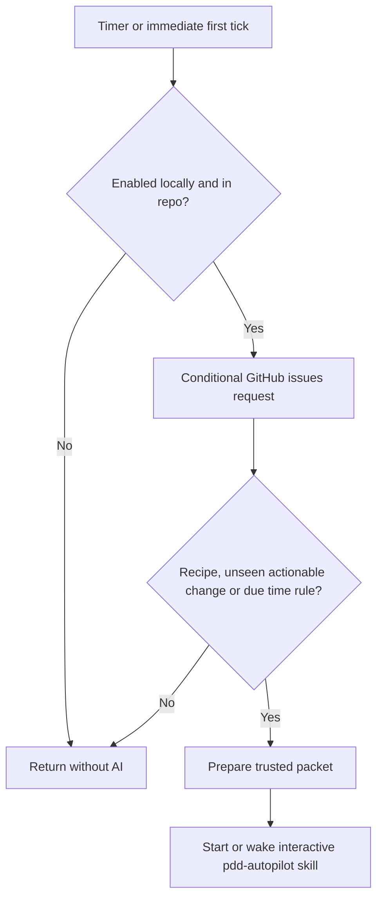
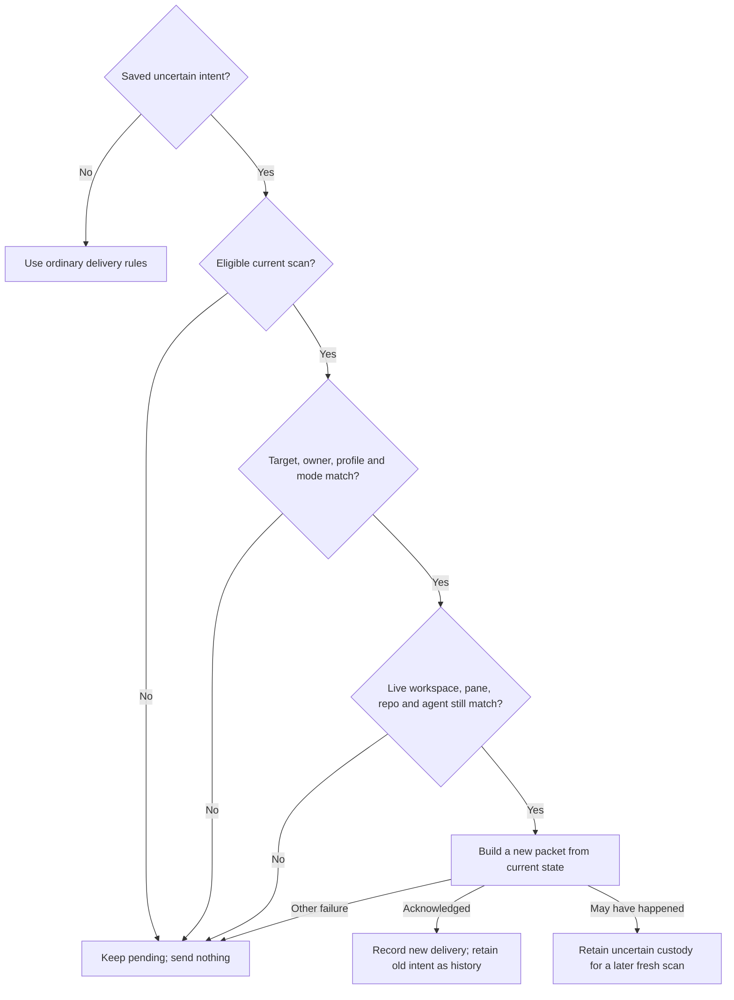

# Autopilot launcher

Bind the parking owner's checkProgress port to both fresh check-queue custody
and current live agent activity. A current working/blocked/unknown agent holds
working capacity and defers parking even when the workflow is stopped. Use the
parking owner's closing reasons in status and retry its held reservations.

Own `src/autopilot-launcher.mjs`. Export module functions `runAutopilotLauncher(input, ports)` and
`tickAutopilot(stateFile, ports)` and `requestAutopilotCompletion({cwd,env}, ports)`, and the pure
`autopilotLaunchFingerprint(state)` that returns the launch fingerprint below for a saved state. This launcher connects a repository to the
person's interactive coding agent in a dedicated Herdr session. It adds no
approval, merge, quota-reset or headless execution route of its own; with
`autopilot.engine: "core"` it hands each tick to the [core engine](autopilot-core.prompt.md),
which owns those for that engine. Its read-only base check refuses unsafe merge targets without performing a merge. Preserve existing
setup, workflow and interpreter behavior.

`runAutopilotLauncher` accepts command start, stop, status, add, release or report, cwd, packageRoot, env,
issues (argv issue references), and optional runs and checks text. Tests may inject `checkCapacityPorts` for the
shared queue machine/filesystem ports independently of the launcher process port. Return `{exitCode,message}`.
The CLI owns streams. Outside programs, timer installation, clock and state I/O
are injectable ports; native defaults implement these on macOS and Linux.

Catalog command `release` (`pdd autopilot release ISSUE`) releases this machine's own Autopilot claim on `ISSUE` through the shared `releaseRunClaim` / `releaseParkedClaim` path, while keeping the run folder, branch and PRs. The workflow runner owns the run lock, worker/check-custody guard, chat cleanup result and local allocation result. If another machine holds a live claim, the winner is unknown, or a supplied saved identity differs from the current winner, refuse or defer without removing labels. A local automatic run ends as cancelled, but its allocation and labels remain held while a worker/check is live or unknown, a chat is retained, or local release is not confirmed. Keep `claimRelease` pending until local allocation release and both remote label removals are confirmed. During each tick when GitHub budget permits, retry pending release through the same runner path and reuse the tick's claim observation and ETag cache. For cancelled runs without pending state, clean only when a fresh intake observes the exact saved claim comment and label-event identities. Never fall back to an observed claim with a missing saved identity, and never clean a claim while another non-ended local run for the issue exists on this machine. For active local runs whose claim expired or was lost, check suite/interpreter custody before recording handover. Queued, running or unavailable checks leave the run unchanged for a later tick. With checks clear, the runner may record the old run as handed over so it cannot resume or publish, while zero-grace cleanup retains a busy or unknown worker. That terminal record does not release ownership: a retained chat, live or unknown worker/check, replacement local run, or unconfirmed local allocation keeps the local allocation and GitHub labels held with `claimRelease` pending. Retry through the same guarded runner path. After an explicit release completes remotely with saved prior launcher state, re-enter the existing admission owner and reread current launcher state. If the fresh repository and control revision still equal the release invocation values, treat the admitted release publication as a control action: replace the opaque control revision and save that fresh state even when the invocation cache is absent or incomplete, or the latest cache is empty. This makes a scan that captured the former revision fail the existing scan guard, so it cannot later publish stale intake or parked fields. Prune a cache row in that save only when its coordinator, machine, comment and label-event tuple matches this machine's released tuple, or this machine's complete tuple observed before the release. A different or incomplete fresh cache entry, and a number-only parked reservation, stay for ordinary reconciliation. If the latest revision differs, make no cache or revision write: preserve that newer state, including STOP, a replacement cache and its control revision. Preserve unrelated current state. This final cache update never restores stale enabled, control-revision or other state after STOP or a newer control action. Clear pending state and remove the observed claim from intake only after local allocation release and remote cleanup both confirm success.

Workflow cleanup and pane admission use the injected workflowHerdr port, then the injected herdr port, with the native pdd-session transport only as fallback. This port is separate from coordinator transport. Before fresh intake, bind the runner's idle sweep to pane admission alongside finished cleanup; idle cleanup uses the existing parking and resume route.

## Waiting PR 1 gates

In auto mode, every tick and completion reconciliation handles saved waiting
PR 1 gates before dependency intake or dependency review delivery. Read this
checkout's runs with `listRuns`, filter to its repository, source checkout and
current automatic coordinator/machine, and call the workflow runner's
`advanceAutomaticPr1` boundary under the existing scan admission guard. Forward
injected process, filesystem, clock and workflow ports; adapt the launcher process
port to runner `execFile` when needed. This deterministic decision makes no AI
or interpreter call. A held, busy or failed run does not prevent another run or
remaining intake work. Preserve GitHub budget waits; perform this reconciliation
only when those waits permit it, before local parking and before intake. Budget
waits still permit local parking and stopped-chat maintenance but no PR 1
publication. Reconcile already parked approval waits through the same runner
boundary. When an inferred wait or incomplete parking reservation initially
prevents this boundary, reconsider that run once after local parking refreshes
its current blocker and cleanup facts, within the same tick and before intake.
Re-read the GitHub budget before this second pass. The runner still owns eligibility;
a held check, independent wait, or incomplete close never authorizes publication.
Refresh the local budget observation after native maintenance before
heartbeats and intake, so reads made during gate reconciliation or stopped-chat
maintenance count toward subsequent work. Observe and off modes never advance
gates.
The runner owns eligibility, full-pass evidence, custody, publication and hold
reasons. This caller supplies no approval words and no invented decisions.

## Stopped workflow chats

In auto mode, every tick and completion reconciliation inspects this checkout's saved
runs before GitHub budget waits. Use the existing `listRuns` reader and the runner's
`resumeStoppedRun({ref,cwd,packageRoot,coordinatorId,machine}, ports)` boundary.
Only this repository, source checkout and saved automatic coordinator/machine qualify.
Observe and off modes never resume workers. A failed observation holds that run;
other runs and tick work continue. Forward injected Herdr, clock and process ports;
when only the launcher's process port exists, adapt it to the runner's execFile port.
This native reconciliation makes no model or interpreter call. After intake recovers a
stranded claim and updates its local run custody, reconsider that run for stopped-chat
recovery and idle nudges in the same reconciliation. Keep the earlier pre-budget
recovery for runs already owned by this coordinator. Revisit only runs whose custody
was recovered, so other runs do not consume a second recovery or nudge allowance.

In that same reconciliation, call the runner's `nudgeIdleRun` for eligible saved
workers through the same injected ports and admission guard. The runner owns idle
evidence, timing, bounded delivery and stop guards. Forward each `stuck` result,
including a saved incident on a later tick, to the existing stuck alert service
with the issue, idle cause, three attempted nudges and the need to inspect the
agent. Keep retrying the handoff after failure or restart. The alert service owns
retries for known unsent failures and deduplication of delivered or unconfirmed
incidents; do not bypass it or send an update for a repeated incident.

The runner owns eligibility, recovery, request visibility and the per-area limit.
On its `stuck` result, send a `stuck` alert through the existing alert service with
issue number, cause, tried and need fields. Its incident deduplication owns one alert
for this stop, including repeated ticks. Keep the stopped reason in workflow status.
Never acquire a second claim, start another run or approve a gate to recover a chat.

## Native Codex startup

For a selected Codex launcher, apply invocation-only config overrides that trust
the selected repository cwd and set `check_for_update_on_startup=false`. These
prevent folder-trust and update dialogs from holding the automated launch.
Preserve the configured executable, environment/profile, model and effort, native
interactive/full-access behavior and first-message content. For Gemini and agy, start their default interactive mode without an initial prompt operand, then deliver the full first message exactly once through the guarded native chat; their prompt-interactive option executes its operand and must not create a separate bootstrap turn. Encode cwd as one exact
project key and shell-quote arguments so spaces, quotes, backslashes and shell
syntax stay literal. The project key and each Codex string value are TOML basic
strings from the shared encoder `tomlString` (`src/toml-string.mjs`), so a
control character such as DEL stays valid. Do not write agent config or saved trust, or apply these
Codex settings to another provider. Timer and later delivery behavior stay unchanged.

The commands that the coordinator Codex chat runs must receive the Autopilot
context under any Codex `shell_environment_policy`. Codex builds each command
environment from that policy, and `inherit = "core"` or `"none"` removes the
process value. So also pass the invocation-only override
`shell_environment_policy.set.PDD_AUTOPILOT_CONTEXT` with the same JSON text as
the process `PDD_AUTOPILOT_CONTEXT`, shell-quoted like the other arguments. When
the saved state has an explicit `CODEX_HOME`, also pass
`shell_environment_policy.set.CODEX_HOME` with that same path, so a
`pdd workflow run` from the chat keeps the coordinator's Codex profile; without
one, set no `CODEX_HOME`. Codex applies `set` after `inherit`; the profile's other
policy keys and `set` entries stay in effect. Set Herdr pane and socket values
only when the launcher knows both exact values, because coordinator recovery
reads the pane id only together with the socket path. The launcher does not know the pane
shell's socket path, so it sets neither. Limit: a profile `include_only` list
that omits one of these names still removes it, because Codex applies
`include_only` last. Do not change the profile to work around this.

## Start and stop

Resolve the Git root, repository identity and package version before starting.
Outside a Git repository, start, stop, status and add return exit code 1 with
exactly `This folder is not a Git repository. cd into the repo you want Autopilot
to work on, then run the command again.` and change nothing. Report another Git
failure as a Git read failure; a sign-in message is only for a real sign-in failure.
Git translates its messages. So run each Git call whose error text pdd reads (this
Git root lookup and the one in `withAutopilotModeLock`) with `LC_ALL=C` and
`LANG=C`, and keep the rest of the environment. Then a Git that prints German or
another language gives the same result.
Check gh sign-in, Herdr availability and installed agent sign-ins, without making
an AI request. Prefer the current agent family when signed in, then Codex,
Claude, agy and Gemini. Use configured local launchers from agent-config for the
supported families, preserving their environment. For Gemini, a version alone
is not sign-in evidence: inspect its existing OAuth credential presence locally;
never display credential bytes. For agy delegate to [workflow readiness](workflow-agents.prompt.md) with requested
agent agy and the selected launcher environment. Its non-model `agy models`
probe establishes sign-in; a generic agent listing does not.
Missing dependencies produce a single actionable line; no question or installer.
Check the pdd version from the invoked package and warn about PATH shadowing.

### Workflow readiness

A coordinator can only start issue work if `pdd workflow run` can make an issue
worktree in this checkout. So check this first, read-only. Call the
[worktree allocator](workflow-worktree.prompt.md#verified-repository-parent)
export `lookupRepositoryParent({cwd,repository,commonDir})` with the checkout,
its canonical Git common directory and the Autopilot repository, through the
launcher's process port. That export alone decides: it applies the allocator's
own identity checks, and the allocator owns which Git layouts and origins it
supports. The launcher has no origin or layout rule of its own, so a checkout
that the allocator accepts is never refused. Ready means workflows can start
here. The check makes no AI call, no GitHub call, no allocation record, no issue
claim and no worktree. An `allocationCheck({cwd,repository})` port can replace it
and returns `{state:"ready"|"refused",message}`.

Only after a refusal, name the cause from local Git reads, in this order: Git
could not be read (for example a timeout), with the next step to retry; no
`origin` remote; an `origin` that is not a GitHub repository address; an `origin`
that names another repository than the Autopilot repository; else a Git layout
that pdd cannot verify. Read the origin's repository with the
[allocator's](workflow-worktree.prompt.md) `githubOriginRepository`, so both
accept the same origins. Never print the origin URL. Except for a Git read
failure, end with the next step: run Autopilot from a normal clone of the
repository.

- Start runs the check after it knows the repository and before it checks
  sign-ins, opens a workspace, launches an agent or changes the timer. A refusal
  returns exit code 1 with one line that names the folder, the cause and the next
  step. It enables nothing, claims nothing and leaves every timer as it was,
  including the timers of other checkouts.
- A tick runs the check only when it is about to offer fresh work: an eligible
  issue without a live claim and without a hold label (`pdd:stuck`,
  `pdd:code-pending`). On a refusal, the tick offers no fresh work and warns
  with the folder and the cause. It does not mark those issues seen, so a later
  tick offers them when workflows can start. Other deliveries stay as they are:
  the start-up recipe, dependency review, time rules, the heartbeats of its own
  claims, and reviews and trusted comments on claimed or held issues.
- Status runs the check with the saved repository, or else the repository that
  `origin` names, and makes no GitHub call. On a refusal it adds the line
  `Workflows cannot start in this folder: CAUSE NEXT STEP` right after its first line.

A successful start prints `Autopilot started for OWNER/NAME in FOLDER.`, where
FOLDER is the Git root that Autopilot works in, then the agent, package version,
next tick and the Herdr attach command.

Read settings through [Autopilot settings](autopilot.prompt.md), calling its
module function `runAutopilot({action: "setup", interactive: false, inRepo: true},
ports)` with the repo cwd and the launcher's process adapter. Use its returned
mode and explicit trust names; do not parse or normalize pdd.json here. This read
asks no questions and writes nothing. Return a settings read failure without
starting a timer or agent. Off starts neither; retain its invalid-setting notice
in the actionable off message. Both active modes use the same launcher; the
[Autopilot skill](../../skills/pdd-autopilot/SKILL.md) owns later gates.

For `start --resume-custody FILE`, read a bounded original-owner projection `{repository,sourceRoot,coordinatorId,machine,activation,paneId,workspaceId,agent:{id,kind},home,definitionHome,configHome,launchStartedAt}` from the operator's file. The current invocation's `--runs` controls capacity; omission uses the machine default. The projection is not a whole-state import.

For this explicit operator recovery, check the source checkout and repository and use the existing admission boundary. Recheck the original pane/workspace/agent and repository with existing native target and repository observations, and verify the saved profile through the existing readiness path. The owner-verified bounded projection supplies the original launch/profile evidence. Do not add a native process-inspection system, require `PDD_AUTOPILOT_CONTEXT`, a PID or a missing native session UUID. A missing or mismatched target, profile readiness, or required current claim for an involved run leaves recovery blocked without effects.

Use the canonical checkout's existing `listRuns` and shared owners reader to identify applicable saved automatic run origins and current trusted winning claims. For each involved existing automatic run, require original repository, coordinator, machine and its saved claim tuple to match current facts. Do not require an original owned worker to exist when the coordinator had only semantic work. Never edit worker `automaticOrigin`, add or transfer a claim or label, equate the replacement local owner to the original, or bypass continuation checks. Preserve current unknown history, compatible pending custody and unrelated state; if pending custody cannot be preserved for this target, report a block rather than replay or discard it.

After these checks and rechecking the current control revision under admission ownership, apply only the original coordinator/profile/target projection as part of the actual explicit start. Preserve current history and unrelated state, use the invoked package and current mode, then release ownership before fresh reconciliation through existing tick/transport guards. A later STOP or start wins. Do not restore an entire archival state, previous package, gate decision or payload. This operator intervention is not proof of an unattended new cycle, a gate approval or a checker verdict.

If an explicit start finds an active scan holding the tick lock, arrange one detached current-state follow-up after that scan releases the lock. Wait outside admission and tick locks; do not clear the lock or replay an old payload. Before the follow-up, verify the same enabled start and control, repository and coordinator identity, then use the existing guarded scan. A later stop or start supersedes the pending follow-up. A busy lock is not completed work.

Start persists a repo/machine state outside the checkout, installs a user timer
(every 30 minutes; every 10 minutes for the [core engine](#core-engine-switch)) and
runs the first tick immediately. Repeated start reuses the timer
and saved activation time. An explicit start rearms the existing one-shot worker completion bridge for saved current automatic chats belonging to this repository and coordinator; timer ticks do not recreate listeners, except for the fresh pane after a [coordinator relaunch](#coordinator-relaunch) or a [gone coordinator pane](#gone-coordinator-pane). Yield retains its current claim and ownership checks. If observation is unavailable, report the manual completion-evidence and yield fallback. In auto mode, on every fresh reconciliation, including ordinary timer ticks, explicit start, completion and capacity refill, reconsider currently graph-eligible, open, unassigned and unclaimed work even when an earlier packet was acknowledged and its trusted content is unchanged. Delivery alone is not worker admission; preserve trust, ownership, custody and waiting checks and make a fresh selection observation. In observe mode retain unchanged notification deduplication; in all modes keep it for work that is not currently ready and for empty scans. Each reconciliation considers all open eligible
backlog, regardless of creation or activation time.
Optional --runs and --checks are positive safe integers with no product maximum.
Save explicit `runs` and `checks` like other start options; omission selects the
machine default on a new start, retaining options with uncertain pending custody.
At every active tick, use the shared queue's machine capacity contract to refresh
`checkCapacity` before selecting work, without an AI call. Bind its shared snapshot
owner to this launcher state file. On stop, after disabling the timer, release only
this owner’s shared snapshot; preserve running tickets and other repositories’
snapshots. Shared snapshot expiry covers lost timers. Persist the snapshot
under the existing current-control guard. Default open-run admission uses its
`runs`; retain explicit `runs` as the stable coordinator identity. Thus machine
resize changes capacity without changing coordinator custody. Packet `runs` is
the effective cap and `checkCapacity` is the snapshot. Instruct the coordinator
to claim new issues only within that cap; the native start check enforces it.
Status reads the active shared admission capacity read-only and shows its
calculated and chosen check and run counts, plus `check slots: B busy of S, W waiting, cores per check C`.
Show this repository's saved check and run overrides separately, labelled as
repository overrides (automatic when omitted). They do not replace the shared
status limits. If capacity is unavailable, show its cause and do not admit work at that tick.
Persist only the selected launcher identity/config-folder
paths, including the HOME used to load local launcher definitions, not credentials or the whole environment. A named user timer runs the
Node script with absolute paths and the launcher's PATH and agent config paths.
Linux uses a systemd user timer whose oneshot service sets `KillMode=process`,
so a Herdr server started by the tick survives its exit. macOS uses a LaunchAgent.
On Linux, check user-session lingering without changing it; when it is off or
cannot be checked, warn how `loginctl enable-linger` keeps the timer after logout. No controller process
or polling loop remains running between ticks. Timer failure is actionable and
does not leave status claiming it is running.

Executing this module with the ordinary timer state-file operand dispatches
`tickAutopilot` for that file. A rejected tick writes one plain `Autopilot:` error
line to stderr and sets exit code 1. Offline process replays execute the generated
Node/module/state command itself, with a child preload supplying controlled
machine and account dependency observations. Preserve packet coalescing and
restart deduplication; importing and calling the tick export alone does not
verify timer dispatch. Do not add a production test mode or read live resources
for this coverage.

On explicit start with a changed invoked package root, leave prior custody intact and schedule a fresh current-state wake to deliver the new package instruction even when no work is eligible; use the existing guarded recovery and do not replay unknown payloads. Dependency analysis instructions also begin with this binding. On a successful explicit `pdd autopilot start`, persist the actual operator action, repository and current active mode for subsequent coordinator work and dependency packets. When the current mode matches that recorded action, identify it as an operator command, not a person’s quoted reply or checker approval. In auto mode explain that it authorizes ordinary eligible work and automatic merge under the repository’s review, testing, strict approval and other rules; observe mode retains its own limits. A timer or configuration read alone must not invent a start action. If a saved installation lacks this context, the next explicit start requests the existing guarded fresh current-state wake even without eligible work; retain unknown custody and do not replay it. Retain the actual start action across mode changes; apply it only when its repository and mode match the current active context. Observe and off do not authorize automatic merge. Record actual operator action through existing supported approval routes where applicable; never manufacture a later person reply.

The coordinator instruction must first explicitly read and follow the absolute `skills/pdd-autopilot/SKILL.md` in the invoked package, including its relative supporting files; do not use a name-only invocation that can select an older installed copy.

Use a dedicated Herdr session `pdd-autopilot`, isolated from the default session.
Open its repo workspace at start; launch the interactive agent only for work.
Persist the owned pane and native launch intent. Inject `PDD_AUTOPILOT_CONTEXT`
into that exact empty native command along with the saved profile environment.

**Start in the repository.** The native launch line starts with
`cd <shell-quoted repository Git root> && `, then the `env` command. A new Herdr pane runs the person's
shell startup files, and a `cd` there (for example in `~/.zshrc`) can move the shell to another folder
before the launcher types the line. The `cd` makes the agent start in the repository anyway, as in the
[area chat](workflow-chat.prompt.md). If the `cd` fails, the shell does not start the agent, and the work
stays pending. No check reads the pane's live folder (Herdr `cwd` and `foreground_cwd`) before that
launch. After it, Herdr shows the repository as the live folder of the pane and of its agent. So status
and uncertain-send recovery still compare that folder with the saved repository path: a workspace that
`workspace create` made has no Herdr Git identity, and the folder ties the pane to this repository. The
[relaunch close](#coordinator-relaunch) does not compare it when the owner launch saved a `terminal_id`,
because it can meet a chat that an older launch started in the shell startup folder. Without a saved
`terminal_id`, the relaunch close compares the folder too. Run each `gh repo view` repository check in the saved
repository path, never in the pane's live folder.

Reuse the pane only when its owner launch binding matches the current coordinator
envelope, including optional runs, and the selected agent identity, saved HOME,
launcher-definition HOME and selected family config-folder path that determine
the native launch. Persist only those safe binding values, the launch
fingerprint in [Coordinator relaunch](#coordinator-relaunch) and the terminal
identity in [Gone coordinator pane](#gone-coordinator-pane); an absent legacy
profile binding does not match. Leave an old live pane with an absent or
different binding untouched: never prompt, interrupt, kill or close it. Allocate
a distinct explicitly owned pane through the native launch route,
preserving queued work. Immediately before guarded submission, recheck the same
pane, workspace and owner launch, and any observable `agent_session`. Launch
acknowledgement establishes transport acceptance, not model uptake. A confirmed
launch rejection permits retry through the existing route; an uncertain launch
or submission stays pending without blind resend. If
`agent_session` is unavailable, pane occupancy alone is not native process or
environment attestation. The narrow uncertain-send recovery below may use the
same saved pane only when its owner launch/profile, idle/done status and readable
screen still match. If the saved pane [is gone](#gone-coordinator-pane),
recreate the repo workspace/pane and preserve the queued work, except during that recovery. Recreated native owners use
saved HOME and selected config-folder bindings. Reload commands and non-profile
environment overrides from the saved launcher-definition HOME, never a later
caller HOME, and only within the saved agent family. If the named definition now
selects another family, launch no replacement, retain pending work and report that
`pdd autopilot start` must select it again. On ordinary start of an existing
coordinator, verify and retain the saved family, identity, definition HOME, HOME
and config-folder binding; inherited caller profile variables do not request an
account change. If that binding or its sign-in cannot be verified, report the
problem without replacing coordinator identity, profile, claims or custody. First
start retains normal discovery. Explicit configuration choices remain subject to
the existing supported selection rules. Saved HOME and config-folder values override reloaded and caller values;
an absent saved config variable is unset in the child even if the pane or
reloaded definition supplies it. Preserve other configured environment values
and provider behavior. Never send interrupt/kill/close to stop:
stop first saves this repo as disabled so queued ticks cannot act even if timer cleanup fails, then disables its timer and removes its persistent
timer definition, leaving the current step to
finish. Stop checks and removes the owned timer even if saved installation state
is absent or false, including after a failed start. Repeated stop is harmless. Status reads local state and timer activity;
show enabled/disabled, timer activity, Herdr availability, coordinator state,
repo, the folder Autopilot works in, agent, and next tick (or none), without waking AI or querying GitHub.
When the [GitHub call ledgers](#github-budget) on this machine have a call in the
last hour, status adds one line, after any alert line: `githubStatusLine` of
[GitHub calls](github-calls.prompt.md#status-line) with this repository's usage,
the machine usage and the budget with the settings' `github` value. It reads the
local ledgers only; an error adds nothing.
Whenever Herdr is available, inspect the saved coordinator with the existing
`agent get` operation, including when the timer is inactive. Confirm that its pane,
workspace, repository path, provider and any saved terminal identity match saved local state. Report a missing,
unreadable or mismatched coordinator as unavailable; a live Herdr server alone
does not mean this repo's coordinator is running. For a matching coordinator,
report its actual `working`, `starting`, `idle`, `blocked` or `done` state; idle is healthy.
While a relaunch for the saved owner launch is pending, add one line that starts
with `Coordinator relaunch pending after upgrade`. While a
[held relaunch](#relaunch-once-per-fingerprint) mark matches the saved owner
launch, add one line that starts with `Coordinator relaunch held`.
Status never repairs, replaces or wakes a coordinator. Report unavailable Herdr
separately instead of claiming healthy running state when its server is absent.

`status --all` works from any folder, also outside a Git repository. It reads
each saved launcher state on this machine and prints one line for each:
repository, folder, mode from that folder's settings, enabled or disabled, timer
active or inactive, and coordinator state as above. Without saved state it prints
`No Autopilot on this machine.` It reads local files, timer status and Herdr
only: no Git root of the caller, no GitHub call, no AI and no change.

Each line is independent: a missing or broken folder or state changes no other
line. The timer, Herdr server and coordinator reads run from the caller's folder,
never from a saved folder, so a deleted folder still shows its true timer and
coordinator. Read the mode only when the saved folder exists and is its Git root;
else show `unknown` with a short reason: `unknown (no folder saved)`,
`unknown (folder missing)`, `unknown (not a Git repository)` or
`unknown (settings unreadable)`. A timer that
cannot be read shows `timer unknown`. A state file that is not a JSON object
prints `FILE: saved state unreadable`, and it counts as a line.

Concurrent ticks for one local state serialize with a local
lock; independent machines have separate state. A lock blocks only for a valid
live owner. Empty, malformed and dead-owner locks are reclaimed. Publish the
owner PID atomically so another tick never sees an unfinished new lock. Reload
state after acquiring it, before settings, cooldown or delivery decisions; a tick
must not reuse a snapshot read before another tick completed.
The existing tick lock serializes scans only. Keep slow discovery outside the
existing admission boundary. Start, stop and mode controls serialize accepted
configuration and timer effects on that admission boundary. Each successful
control publication changes a private opaque revision, including stop/start and
mode off/on; unsuccessful controls publish no revision or proposed state. A scan
captures the accepted revision and, before any new effect or state publication,
rechecks current enabled mode, coordinator, machine, activation, profile, cap and
revision under the same admission boundary. An old scan cannot publish, submit or
start work after a control change. Merge only the scan's intended fields into the
fresh accepted state, including the owner-launch marker before a new pane launch; never save the stale scan state over a later control. Preserve current control fields and uncertain custody. An
effect already admitted may finish. Do not hold admission across discovery,
provider reads or chat readiness. Hold it through each single scan-owned Herdr server start, workspace creation, launch or prompt submission, then release; an already admitted effect may finish. The existing automatic workflow admission still
holds it through its durable starting record. Persist accepted state before a
successful control result. Timer failures can leave partial OS effects; report
failure without claiming rollback. Manual work and current admitted work remain
usable. When the lock is contended, show a waiting notice once and wait
up to 5 seconds, checking at 100-millisecond intervals using elapsed time. On
timeout return a clear nonzero error without config, timer or workspace changes
and without delayed application. The deadline covers only lock acquisition; once
acquired, await the actual save and timer effects and report their result.

## Coordinator relaunch

A running chat keeps the launch settings that it started with. A later package
or launch argument does not reach it. So record a launch fingerprint in the
owner launch at each native launch: the SHA-256 of the resolved invoked package
root, its `package.json` version, the provider family, the `cd` that
[starts the launch line](#start-in-the-repository) and the provider arguments
that this package builds, exactly as the launch builds them: the TOML project key
and, when the saved state has an explicit `CODEX_HOME`, its `set` override. Put a
fixed placeholder for the coordinator context value in those arguments; the
coordinator envelope binds that value. The saved state, not the caller, gives
`CODEX_HOME`, so it is the same on each tick. Do not put
the process environment, the configured executable or reloaded definition
values in the fingerprint. They can differ between an explicit start and a
timer tick, and a difference would relaunch on ordinary ticks. Store only the
digest.

A relaunch is due when the owner launch binding above matches, the saved
fingerprint is absent or differs from the current one, no delivery or
reconciliation intent is saved, and the reloaded definition keeps the saved
family. An absent fingerprint means that an older package launched the chat.
A custody projection has no fingerprint, so an adopted chat also relaunches at
its next idle moment.
When a relaunch is due, every tick and explicit start considers it, also without
new work. The fresh chat gets the start-up recipe first.

- If Herdr reports the chat as `working`, `starting`, `blocked` or another
  status that is not `idle` or `done`, send nothing and close nothing. Keep the
  work pending. Save a relaunch-pending mark with the saved pane and launch
  start time; status shows it until the relaunch is done.
- If the chat is `idle` or `done`, end it with Herdr `pane close` for the saved
  coordinator pane only. Hold admission for the close. In that hold, first
  recheck that the saved state is enabled with the same pane, workspace and
  owner launch and no intent, and that Herdr reports the same pane, workspace,
  provider, saved `terminal_id` and `agent_session` as `idle` or `done`. When
  the owner launch saved a `terminal_id`, that match is the proof of the chat:
  do not compare the chat's live folder, because a chat that an older launch
  started without the `cd` runs in the shell startup folder, and this relaunch
  replaces it. When the owner launch saved no `terminal_id`, Herdr must also
  report the saved repository path as the chat's folder (`cwd`): then only the
  folder ties the pane to this repository in the shared session, and a pane of
  another repository stays open. If
  Herdr reports another `terminal_id`, the saved pane [is gone](#gone-coordinator-pane): close nothing and forget it in the same
  hold. After the close, `pane get` must report `pane_not_found`. Then, in the
  same hold, add the current fingerprint to the relaunch record below, remove
  the saved pane, workspace, owner launch and the pending and held marks, and
  mark the recipe as not delivered. If a check fails before the close, close
  nothing, keep the work pending and retry on a later tick. If Herdr or the
  save fails, or Autopilot stops, after the close, the saved pane is gone and a
  later tick, or a start after a stop, replaces it.
- Then open a fresh repo workspace and pane through the existing route, rearm
  saved worker completion for the fresh pane with the same filter as an
  explicit start, and launch with the current arguments. Deliver pending work as
  usual.

A relaunch keeps the coordinator identity, machine, activation and runs cap,
so claims, saved runs, progress, queued work and history do not change. Never
relaunch during uncertain-send recovery. Never close another pane, workspace or
process. Stop still only disables the timer.

**Relaunch once per fingerprint.** For each relaunch, save the current
fingerprint, which the fresh chat gets, in a relaunch record of the 8 most
recent. If a due relaunch would use a fingerprint that the record already has,
the fingerprint is not stable, for example when starts from two installs alternate. Do not
relaunch again: the current chat stays and gets work as usual. Save a held mark
with the saved pane, launch start time and that fingerprint, warn once, and
remove the pending mark. Status shows the held line while the mark matches the
saved owner launch. When no relaunch is due, remove the held mark. A replaced
gone pane is not a relaunch, so a person can close the coordinator pane in
Herdr to get a fresh chat with the current settings.

### Gone coordinator pane

Just before each native launch, read the pane with Herdr `pane get` and save
its `terminal_id` in the owner launch. Herdr gives each terminal a new
`terminal_id`. After a Herdr server restart, a pane ID can name another
terminal, for example a restored empty pane or a chat that a person started. If
`pane get` reports `pane_not_found` there, launch nothing and replace the pane on
a later tick.

The saved coordinator pane is gone when one of these is true:

- `agent get` reports `pane_not_found`, or Herdr is not running.
- `agent get` reports `agent_not_found` and `pane get` reports
  `pane_not_found`. Herdr also gives `agent_not_found` for a closed pane, so
  `agent get` alone does not tell a closed pane from a pane without a chat.
- Herdr reports a `terminal_id` for the saved pane that differs from the one in
  its owner launch. A missing value on either side does not show a difference,
  so an owner launch from an older package uses only the rules above.

Outside uncertain-send recovery, never close, prompt or launch into a gone
pane: a pane that now has its ID is not ours. In one admission hold, check
that the saved state still names the same pane and owner launch and has no
intent. Then remove the saved pane, workspace, owner launch and the pending and
held marks, and mark the recipe as not delivered. Keep the coordinator
identity, machine, activation, runs cap and relaunch record. Keep the profile
binding of each owner launch, also after it is forgotten, as the last launched
profile; an ordinary start verifies the saved profile against the owner launch
or, when none is saved, that last launched profile. Then open a fresh
pane, rearm saved worker completion for it and launch as after a relaunch. A
plain tick and an explicit start both do this when they wake the coordinator.
So a failure or a stop after a relaunch close or after this forget step, a pane
that a person closed and a Herdr server restart recover on the next tick, or
after a stop on the next start. If the pane has
the saved terminal but no chat, keep the work pending without a second launch:
the launched chat may still be starting.

## GitHub budget

Autopilot uses the person's own `gh` sign-in, so its GitHub calls use the
person's limit. Each `gh` call of the launcher goes through `countGithubCalls` of
[GitHub calls](github-calls.prompt.md) into this repository's ledger on this
machine, once the repository is known. `ROOT` is the folder of the launcher state
file (the state root), so the ledgers sit in `ROOT/github/` beside the state.
The tick names the purpose: the dependency intake `dependencies` (its claim
checks name `claims`), heartbeats `claims`, the issue list `issues`; other calls
take the purpose of their arguments. The intake also gets the ETag cache of this
repository as its `githubCache` port, saved after the intake ([conditional
reads](issue-dependencies-github.prompt.md#conditional-reads)), the
[saved dependency snapshot](issue-dependencies-github.prompt.md#saved-dependency-snapshot)
of this repository in `ROOT` as `snapshotStore`, the tick clock as `now`, and a
[floor guard](github-calls.prompt.md#floor-guard) as `githubFloor`, with the
settings' floor and the ledgers of this machine. The tick's own comment, PR and
permission reads use the same ETag cache (a full last page is read without its
ETag), saved again at the end of the tick. At the end of each tick, after the
state save, `compact` keeps the ledger to its last 2 hours.

The floor guard also covers the launcher's non-safety comment, PR and review
reads after intake, and every issue-index page, including the first page after
heartbeats. If admission stops pagination, retain the previous complete index,
pages and refresh watermark; return unknown and wait without publishing a partial
index as complete. Every reply updates the guard. Hold-label index reads and
permission checks stay live. Crossing the floor during intake does not permit
new work delivery from an incomplete observation.

After the settings read and the existing rate-limit wait, and before the
intake, the tick computes `githubBudget` from the entries of all ledgers on this
machine and the settings' `github` value:

- `reserve`: the tick sends only the heartbeats of its own live claims and
  returns `unknown` with `GitHub limit low: R REST calls left, below the floor of F;
  Autopilot waits until ISO, except the heartbeats of this machine's claims.`
  (`GraphQL points` for the GraphQL resource). It makes no other GitHub call: no
  intake, no issue list, no wake. It does not save a rate-limit wait (`retryAt`),
  so each tick until `resetAt` computes the budget again and sends the
  heartbeats again. The claims are the saved `claims` of the last intake, with
  the filters of the `low` case below. A heartbeat is 2 REST calls (a read and an
  edit); when the newest `core` remaining is known and less than 2 for each of
  these claims, the tick sends none. Why: one reserve window ends at the reset,
  within 1 hour, but reserve can come back after each reset when other use on
  the same login empties the limit. Without heartbeats a claim would then expire
  after 4 hours while its chat still works.
- `low`: when the last intake result was saved less than 60 minutes ago, the
  tick does not run the intake. It uses the saved `eligible` list and `claims`
  and warns once per tick with the used and allowed calls and the time of the next
  re-sync. Heartbeats of own live claims keep their priority; a saved claim whose
  `lastSeen` is 4 hours old or more gets no heartbeat, because expiry is final.
  After 60 minutes the intake runs once again. The issue list and the trusted
  work selection stay as usual.
- `normal`: as before.

After each intake the tick saves `{at, eligible, claims}` (when `eligible` is a
list), and a successful heartbeat updates the saved claim's `lastSeen`. These
are local facts for the next tick; they are not a GitHub observation. The
60-minute interval is a constant. The floor default is 1,000. Only the tick uses
the share. Native dependency observations outside the tick follow the shared
[floor guard](github-calls.prompt.md#floor-guard), including prepare, complete
and automatic start. A stopped completion is kept for the next tick after the
reset. Safety reads, including the workflow start's live subject and claim
checks, continue below the floor. The coordinator and worker chats never wait
for this budget.

## Tick and the skill boundary

All providers use a user timer that checks for work before waking the agent.
This also applies to Claude: an empty tick must make no AI call.

Each tick makes one conditional issues-list query with its saved ETag, following
pagination only when GitHub supplies another page (never truncate a queue). Cache
and revalidate each page separately, so a close on a later page is seen even
when the first page is unchanged. A full read lists the open issues
(`state=open&sort=updated&direction=desc&per_page=100`). An update moves an issue
to the first page of this order, so every page of a long list changes. So when
the last full read had more than one page, and for 6 hours after it, the tick
reads only what changed: `state=all&sort=updated&direction=desc&since=T&per_page=100`,
where `T` is the newest `updated_at` of that full read. It applies each row to the
cached open list: an open row replaces or adds its issue or PR, any other row
leaves the list. The list stays in update order, newest first. `T` stays the
same until the next full read, so the same URL with its ETag gets a 304 when
nothing changed since the last tick. With one page, without a saved `T` or
cached list, or after 6 hours, the tick makes a full read. A deleted or moved
issue leaves the list at the next full read. The issue list needs no
[full-last-page](github-calls.prompt.md#full-last-page) rule: in update order,
newest first, a new or changed issue changes the first page, and a changed page
gives a fresh next page.
HTTP 304 reuses metadata, not a model turn. On changed candidates only, fetch
comments needed to identify trusted consent and filter their text. When the
saved dependency snapshot (as the intake of this tick left it) has a read of the
issue with the same change facts (`issueRowVersion`) as the tick's row and the
same comment count, its comments are the current answer: the intake read them in
this tick, or a completion read them just before. HTTP 429 is
a rate limit; HTTP 403 counts only when the remaining allowance is zero or its
body says rate limit. Save its reset time; intervening timer firings do not retry.
An ordinary forbidden response has no rate-limit cooldown. Candidate-specific
lookup failures warn through an injected warning port (stderr by default,
visible in timer logs) and defer that issue, while unrelated work continues.

Every open issue can be considered, regardless of creation time, activation time,
or `pdd:autopilot` label. For fresh work, include an issue only when the current
dependency intake lists its URL in `eligible`. Compare the GitHub `html_url` and
each `eligible` key by the pure model's canonical issue identity (`issueKey`), not
as exact strings. Owner and repository names ignore letter case: GitHub spells
`html_url` with the owner's capitals, and the graph stores lowercase keys. An
owner such as `Serhan-Asad` works like a lowercase owner. A value that is not a
GitHub issue URL compares as its exact string. A missing, false or unavailable
eligibility result waits. The shared graph owns current dependency readiness,
trust, GitHub Assignees and claim checks; missing assignment data does not prove
that an issue is unassigned. A related PR or saved run alone does not exclude an
otherwise eligible issue. `add` accepts numbers and references to this repository
only, comparing repository names ignoring case. Validate every reference before
any label mutation; a foreign reference returns exit 2 with one clear line and
labels nothing. Create the label if absent and apply it to all named issues,
including old ones; never change issue bodies. Ignore closed issues and treat PRs
as related state rather than new issues.

An issue in the current eligibility result is fresh work, including an old issue
first seen after activation. Save a fingerprint of the trusted issue
text/comments and related PR state successfully delivered to the agent. An
unchanged fingerprint, including after HTTP 304, sends no prompt. Stranger
comments and acknowledgement text do not change the trusted fingerprint. First
observations of stuck, code-pending or claimed issues establish a quiet baseline.
A first-seen eligible issue with an open PR remains fresh work in both modes. In
observe mode, an open PR must not create a human-review wait from a prior offer,
prior eligibility, or PR/run history. An existing owned workflow may wait for
review while its current `pdd:working` claim remains; a claim blocks fresh work
and stays available to claim monitoring. The workflow start boundary verifies
claim ownership before any continuation or resume. A later trusted change,
related PR transition or becoming eligible again can wake the skill once.
Removing one waiting reason or changing mode is not eligibility while another
waiting reason remains.
Include an `eligible` boolean from the current intake result on every issue item.
An `eligible: false` item is monitoring context, never fresh work. Keep claimed
issues marked `claimed: true`, never present them as unclaimed.

For full-suite progress, load the required
[shared queue contract](test-suite-queue.prompt.md). Read suite intervals for each
active run's worktree. Subtract their union from inactivity since the run record's
mtime. While waiting or executing, offer no stuck-run or idle-claim rule for that
run. An unavailable queue observation retains the valid run progress, warns with
its cause, and withholds both inactivity rules without emitting a suite-failed
rule. Retry observation on later ticks. After success, only elapsed time outside
those intervals counts. A failed,
timed out or interrupted suite produces one `suite-failed` time rule per ticket
completion (keyed by run and ticket, including equal completion times) with its exact queue reason, requesting the `test-suite` alert and
failure diagnosis. It does not produce `stuck-run` or `idle-claim`. Completion is
validation activity for the claim idle rule. Preserve the existing progress port;
optional `suite` carries the queue public status. The coordinator instruction
requires full-suite validation through the absolute invoked CLI's
`workflow suite --command COMMAND`, using the repository's actual test command.
Preserve both `PDD_SUITE_QUEUE` and `PDD_VM_SUITE_LOCK` in saved environment,
user timer definitions and coordinator launches. Use the shared queue contract's
selector precedence. Forward selected values to Codex command environments with
invocation-only `shell_environment_policy.set` overrides, so workflow launches
inherit them even when the profile restricts environment inheritance. Include
these overrides in the launch fingerprint. Do not depend on the Herdr server's
environment for queue selection: unset missing selectors in the native child.
Use the same queue command for full builds. The queue limits heavy validation;
the capacity-derived open-run cap bounds issue workers separately.

Elapsed time can also offer work without a GitHub change or an AI call in the
tick. Use the clock and local run-progress reader as injectable ports. Read this
repository's active PDD run records in the Git common directory's
`pdd/runs/*/status.json`; use finite saved `progressAt` when present, otherwise the file's last modification time. The run storage contract owns preservation of that progress timestamp during cost observations.
At 60 minutes without a change, offer one line naming the run number and asking
the skill to follow its `pdd:stuck` rule. Completed and cancelled runs are over;
missing or unreadable records supply no progress fact.

For an eligible trusted issue with a live `pdd:working` claim, use the latest issue update or
comment creation/edit time already returned and cached by the tick as claim
activity. A heartbeat edit is not activity: for a claim comment with `lastSeen`,
use its creation time. GitHub moves the issue update time to the time of a comment
edit, so with such a comment, use the issue update time only when it is more than
5 seconds later than that comment's newest edit time. The tick sends heartbeats
before it reads the issues, so with such a comment a change only on the issue
(such as a label or a PR link) is hidden by the next heartbeat and is not activity;
comments and comment edits still are. Without such a comment, the issue update time
(a label change too) is activity. At 60 minutes, representing the skill's
"about 1 hour", offer one line naming the issue number and asking the skill to
review stalled work under its claim rule. This is an observation only: idle age
does not authorize takeover, release the `pdd:working` claim, or make the issue fresh
work. Only the [claim expiry](#claim-heartbeat-and-expiry) makes a claim available. Do not
fetch label events or make another query to measure age; an absent or unreadable
activity time cannot be due. Revalidate trust before delivering a due claim,
even when the cached source is unchanged; stranger text never enters a timed
packet.

Persist each successfully delivered time event by rule, run/issue number and
last activity time. Unchanged overdue events stay quiet, including after a
restart; a new activity time can become due again. Coalesce due reasons with
trusted work in the packet's `timeRules` array, with one actionable `reason`
line per event. Busy or failed delivery consumes no event; reassess current
facts when idle so refreshed or ended events are not delivered stale. Neither
timer marks, terminates or takes over a run itself; the skill owns those actions.
The two 60-minute thresholds are constants, not settings, caps or hard stops.

### Claim heartbeat and expiry

The saved `coordinatorId` is the stable owner of this machine's Autopilot for
this repository. Keep it across starts, profile binding changes, crashes and
replacement coordinator panes. A chat change does not transfer claim ownership.
Keep the coordinator envelope and native pane/profile guards unchanged.

Before ordinary heartbeats, recover stranded claims from earlier coordinators
through the GitHub reader's `recoverCoordinatorClaim`. Select only unfinished
local runs from `listRuns` with this repository, source checkout and machine,
a present run folder and worktree, and an admitted `automaticOrigin` claim tuple.
Require the observed winning claim's comment and label event to match that tuple.
Never recover a run of another machine, checkout or repository, or a completed or
cancelled run. Do not recover a claim stuck for 4 hours or past the takeover ceiling.
Under scan admission and the existing run lock, reread the saved run, recover its
claim, then update only `automaticOrigin.coordinatorId` through `updateRun` in the
same guarded action. Preserve finished steps, files and other custody. A failure
warns and leaves publication subject to its ordinary live ownership check. A retry
after a remote edit must finish local custody using the reader's recovery proof.
A successful recovery replaces the intake claim with the fresh returned claim,
so heartbeats resume and `workflow done` can publish under its existing checks.

Each tick keeps claims current without an AI call. Use the `claims` that the
dependency intake returns; ordinary heartbeats add no other GitHub claim scan. For each active
claim of this coordinator and machine, call the GitHub reader's
[`refreshClaimHeartbeat`](issue-dependencies-github.prompt.md#claims-heartbeat-and-expiry)
with the current clock time, under the scan's admission guard. The tick, not the
AI, writes the `lastSeen` time: the first heartbeat sets the existing value (the
`"lastSeen": ""` marker of a new claim record), or adds the member when it is
missing. A failed
heartbeat warns and the tick continues. Never refresh another owner's claim or an expired
claim, including an own one, except for the bounded coordinator-change recovery
above. Other expired claims follow the skill's takeover rule.

In `off` mode the tick stops before the heartbeat. This machine then releases
nothing, but its claims get no `lastSeen` and expire after 4 hours, as on a stopped
machine.

After the existing saved-run cleanup, an expired claim of this coordinator with
no saved local run can take the same guarded release path. Read complete native
owners/custody facts first. Release only when that read has `runsKnown: true`,
has no run or allocation for the issue, and returns the same expired claim era
(coordinator, machine, comment and label-event identities). A missing or
unreadable owners read, worker, check, allocation, replacement era or incomplete
identity keeps both labels. The shared release rechecks that exact era before
each remote label deletion. This is cleanup, not new-work admission.

An own claim whose issue has had `pdd:stuck` for 4 hours (`stuckSince`) is not
refreshed again, so it expires 4 hours later unless the issue leaves `pdd:stuck`.
For it, offer one `stuck-claim` time rule, once per stuck time, that asks the
skill to retry with a changed approach or ask in the configured alert channel,
without another alert when the cause and required decision are unchanged.
After a ceiling (the claim is `takeoverLimited`, or this checkout's run of the
issue is `stuck` with a saved `repairLimit` or `integrationLimit` from the
[runner's budget policy](workflow-runner.prompt.md#autopilot-repair-ceiling)), the rule instead says which limit
was reached and asks for no retry, no removal of `pdd:stuck` and no new comment:
send the one `stuck` alert only if this stop has none yet. After the takeover
limit, a person removes `pdd:stuck` and `pdd:working` to let Autopilot try again.
After the repair or base integration limit, the rule gives the way out: to let Autopilot try again, a
person removes `pdd:stuck` and `pdd:working`, then runs `pdd workflow cancel N`
in the checkout that holds the stuck run; the next tick starts a new run with a
fresh repair count. When both limits hold, the rule names both and gives the
repair-limit way out.

An expired claim (`expired: true`) does not hold its issue: `pdd:working` alone
is then not a waiting reason, and a currently eligible issue is fresh work. Its
item keeps `claimed: true` and adds `expiredClaim: {lastSeen}`; its selection
reason is `expired-claim`. A live claim of any owner stays a hold. The idle-claim
rule does not apply to an expired claim. In the trusted view and fingerprint,
show a claim comment with `lastSeen` through `withoutClaimHeartbeat` and with its
creation time, so that a heartbeat alone is not new work. The 4-hour stuck time
and the claim expiry times are constants, not settings.

### Per-issue ceilings

Two more time rules use the same claims, delivery and persistence. Each is sent
once per issue, only for an issue that is open in the cached list (a merge closes
it), and does not touch other issues. `self` is this coordinator and machine:

- `long-running`: for an own active claim whose `claimedAt` is 24 hours old, while
  the issue has no `pdd:stuck` and the claim has no `longRunningAlertedAt`, ask
  the skill to send one informational alert for that issue and keep working. It
  is information, not a stop: heartbeats and work continue. After the delivery,
  write the time to the own claim comment through
  [`recordLongRunningAlert`](issue-dependencies-github.prompt.md#claims-heartbeat-and-expiry),
  under the scan's admission guard; a failure warns. The claim chain then carries
  it, so no other machine sends the alert again after a takeover.
- `takeover-limit`: for a claim that is
  [`takeoverLimited`](issue-dependencies-github.prompt.md#takeovers) for `self`,
  while the issue has no `pdd:stuck`, ask the skill not to take it over again and
  to take the stuck path (`pdd:stuck`, one comment with the cause, one `stuck`
  alert), keeping its claim and progress, to read the issue again first and skip
  it if it already has `pdd:stuck`, and say that a person removes `pdd:stuck` to
  reset the count. Only one coordinator gets it: the owner of a live claim, else
  the claim's `previousOwner`; any coordinator when GitHub shows no such owner.
  Such a claim is not in the expired-claim set: `pdd:working` stays a hold, the
  item has no `expiredClaim`, its selection reasons add `takeover-limit`, and the
  idle-claim rule does not apply when it is expired. A change of that reason
  alone updates the saved selection. An own expired claim is not limited for
  `self`: it is offered with `expiredClaim`, because taking it back is a
  re-claim.

The 24 hours is a constant, not a setting.

### Environment validation retries

Persist the nonsecret PDD_SUITE_QUEUE and PDD_VM_SUITE_LOCK path overrides with
the launcher environment, so later timer ticks observe the selected shared queue.
Read this coordinator and machine's automatic environment-stuck runs from local
run records, with a `readEnvironmentWaits(state,p)` port. Use the shared
`environmentRecovery` contract, preserving interpreter and work handling. Keep
these runs out of generic stuck-claim and no-progress time rules. While a retry
budget remains, retain own live claim heartbeats even beyond four hours stuck.
On each tick, offer an `environment-ready` time rule only after nextAt and healthy
host admission (`environmentHealthy` port with native default). Its `number`,
`step`, `attempt`, `limit` (3) and `nextAt` name the failed target and due time;
its reason tells the coordinator to deliver the exact shared wake tag with
`pdd workflow changes N`, oldest first as worker room allows. Rerun only that
validation step with its original command and evidence. No whole-run restart,
new approval, blind external resend, usage-limit change or person question.
Pass the checkout cwd to the retry check. Its native default reuses this tick's
`health.resource.resources` through `machineResources`, without probing the host
again. Retain the injected retry ports and the dependency's retry-only checks.
Use existing delivery/timeSeen custody per wake tag and 30-minute offer interval;
reoffer an undelivered current park on a later interval, without replaying uncertain
transport custody. Only worker delivery spends
the attempt. At three failed retries, leave the run stuck and call the existing
alert module with one per-issue `stuck` incident naming the environment cause,
three attempts and the failed step. Use its delivered/unconfirmed suppression
and failed-delivery retry rules. Send no early per-issue alert and no duplicate
stuck-claim rule. Other work continues. Expose pending retry details in workflow
status via its owner; do not run tests or mutate run records from a tick.

### Person retry signals

Removing `pdd:stuck` from an observed issue is new work at the next tick even if
`pdd:working` remains and all trusted text is unchanged. Retain the observed stuck
label separately from the trusted text digest; for older records without that
flag, use the saved `pdd:stuck` selection reason as the prior observation. Also offer a new or edited trusted
comment that satisfies the workflow runner's `isRetryRequest`, including on an
initial held-issue baseline when the comment was posted or edited since activation.
Ignore outsider retry text and already-observed retry comments. Use the existing
trusted-comment work packet, source cache, guarded coordinator delivery and seen
acknowledgement; perform no AI interpretation or run mutation in the tick.

A retry item adds `retry: {source, text}`: source is `comment` or
`stuck-label-removed`; text is the trusted person's original comment or a request
to retry the failed step from retained evidence for label removal. Retry delivery
is continuation work even without graph eligibility or after all hold labels are
removed. It is never a fresh workflow start. A busy or failed delivery keeps the
signal pending; a confirmed coordinator delivery consumes it once. Tell the
coordinator to pass its exact retry text through `pdd workflow changes N` as room
allows and resume the failed step using existing evidence. Never restart completed
work, approve a gate, answer a question or bypass a repair ceiling. The runner
owns continuation checks and the worker delivery effect.

### Interpreter outage (#3039)

A worker whose `pdd test` has no verdict for an interpreter cause parks its own run
with `pdd workflow park --interpreter` ([workflow runner](workflow-runner.prompt.md)):
state `paused` with `runtimeWait {at, reason, batch, cause}`. The tick reads these
waits from the same local run records as run progress (an injectable
`readRuntimeWaits` port) and sorts them oldest first. It never parks, wakes or
changes a run itself; it adds time rules for the coordinator, which wakes a run
with `pdd workflow changes N` under the existing room and delivery rules.

When no run waits and no outage or interpreter access problem is open, the tick
makes no health check. Else it makes one free health check,
[`checkRuntimeHealth`](runtime-client.prompt.md#free-interpreter-health-check)
(an injectable `runtimeHealth` port): `healthy`, `unavailable` (down) or
`access` (an answer that is neither: a sign-in or setup problem with a `fix`).

Every wake (`retry`, `probe` or `recovered`) is remembered for its run with the
run's progress mark (area and number of done steps) and the wait's `at`, for 24
hours; a recovery does not clear it. A wake is **used** when the same run later
waits again at the same mark, unless that later wait was first seen while
The interpreter was down (then the outage explains it). So each run resends at most once
per wait, and every path ends in a wake or in the stuck rule:

| Facts | Decision |
| --- | --- |
| Health `access` | Send one `interpreter-access` alert for this repository and machine that names the detail and the fix (`gh auth status`, `PDD_RUNTIME_URL`); other waiting issues join it. Wake nothing. A run that has waited 4 hours since its `at` or since the problem began (the later one) gets a `runtime-stuck` rule. The first later `healthy` answer sends one recovery (`"kind":"interpreter-access"`); a down answer does not end it |
| No open outage, health `unavailable`, a run waits | Open one outage. Send one `interpreter` alert for the oldest waiting issue; other waiting issues join it and send nothing |
| Open outage, health not `healthy` | Wake nothing. Call the alert again for its first issue (a repeat sends nothing unless the last send failed) and for each newly waiting issue |
| Open outage, health `healthy` | Wake one test run (`probe`): the oldest waiting run that has not used its wake and has not been the test in this outage, preferring one whose cause is not `unknown`. The test passes only with proof: a new `pdd test` row of that run that passed or failed and ended at or after the wake was offered (an injectable `readRuntimeProbe` port). Then send one recovery (`recovered`, `"kind":"interpreter"`), close the outage and offer the other waiting runs, oldest first. A test run that waits again, ends or goes stuck with no such verdict failed, and so does one with no verdict 60 minutes after its wake was offered, also when the wake was never delivered and the run still waits: take the next candidate. With no candidate left, close the outage with one recovery that does not say the interpreter is back |
| Health `healthy`, a run used its wake | A `runtime-stuck` rule, also during an open outage; it is never the test |
| No open outage, health `healthy` | Waits from one or many issues are no outage: offer each run one `retry` |

Add a waiting issue to an incident's saved issue list only after the alert owner
confirms delivery with exit code 0. A failed or thrown delivery stays eligible
for the existing incident retry route.

An offered wake is a `runtime-ready` time rule with one reason line: the run
number, why it wakes (`one retry`, `the test` or the interpreter back), and the exact
text for `pdd workflow changes N`. That text starts with
`Interpreter wake for the park at ISO.` (the wait's `at`), so pdd delivers it at most
once per park. It tells the worker to run `pdd test --read BATCH` first, to resend
only a check that surely gave no verdict (`pdd test --retry BATCH` only when pdd
names it, for busy or held checks; the Story's check once with
`pdd test STORY --max-calls N` for another not run check or an AI-service
refusal, because `--retry` sends nothing for a not run check that pdd already
posted; the check once when no result was saved), never an unknown outcome or a
failed check, and to keep `--max-calls`. For cause `unknown` the text has no
resend command, only the Story's check once when the read now shows not run
(nothing was sent); else the stuck rule. Each rule is a
time event keyed by run and `at:kind`: delivered once, offered again on a
completion tick (a freed slot) while the run still waits. Persist the outage,
access problem and wakes in the launcher state as `runtime`. While an outage or
access problem is open, the packet has `runtime: {state, since, note}` with
state `unavailable`, `testing` or `access`; the note says to keep other work
moving and that new issues may start and park only at their interpreter check, and
for `access` names the fix and the 4-hour limit for ordinary waits. Its note explicitly keeps lost-verdict waits parked for a person decision, matching the alert and native wake rules. Send alerts through
[Autopilot alerts](autopilot-alerts.prompt.md) `runAutopilotAlerts` with this
repository and the state root of this launcher (an injectable `sendAlert` port,
or `alertPorts` for its HTTP); an alert failure never stops the tick.

Use same-repository closing references in PR bodies to associate PRs with issues.
Resolve trusted related PR metadata on change (state, draft, merge and head),
including when a PR leaves the open list. Fetch PR discussion comments on changed
comment metadata and include only trusted comments (with identity/edit metadata)
in the packet and fingerprint; outsider comments alone must not wake AI. Never
forward untrusted PR text. Cache details so unchanged ticks need no PR-detail query.

Check submitted reviews for known related PRs on each tick, including when the
issues list returns HTTP 304 and the issue and PR head are unchanged. Use
conditional requests and revalidate each review page, following GitHub's next
page links without truncation. A saved
[full last page](github-calls.prompt.md#full-last-page) (100 reviews and no next
page) is read without its ETag: reviews come in ascending order, so that page
keeps its ETag when review 101 arrives on a new page. A new trusted submission, identified by PR number
and GitHub review ID, is unseen work and wakes the idle agent once. Include its
identity, trusted author, submission metadata, state and body in the packet and
fingerprint; unchanged repeats stay quiet. Reviews use the same trust and pending
delivery rules as other trusted work.

Revalidate cached PR commenters and reviewers against current explicit trust and
write access before delivery; revocation must not allow previously trusted text
into a new packet. Cached data is not cached authority. Compare the previous and
current trusted views under current authority, so revocation alone, or revocation
plus an outsider comment or review, never becomes new work. If the cached issue,
comment, PR and review source state and mode are unchanged, return quietly before
permission lookups, except when the canonical shared model reports a transition
into eligibility. Offer that readiness change through the existing guarded delivery
even after HTTP 304; retain it through busy, dialog or uncertain transport until
acknowledged. Keep trust, activation, mode, current owner and cap checks, and do
not reanalyze an unchanged completed review. An offer is not a workflow start.
Revalidate authority when there is an actual source change or readiness change to
deliver. A PR waiting for a person in observe mode is quiet until its relevant
trusted state changes.

Persist the original launch time before dispatch and use the existing bounded
startup window and injected clock. Launch an empty native owner once when a pane
needs an agent; launch acceptance
is neither packet submission nor uptake and consumes no recipe or fingerprint.
In the same tick, continue bounded readiness and guarded delivery for that original
owner within the shared startup window; do not defer its first packet solely to
the next periodic tick. If readiness or safe delivery cannot be established, keep
the work pending and report a plain reason by the end of that window.
The public module function `tickAutopilot(stateFile, ports)` rejects with the actual transport error when a delivery submission fails, after recording its failed or uncertain custody and metrics. Guard refusals before transport leave work pending without an artificial error. The immediate START and completion paths retain their structured outcomes.

For the exact saved coordinator in the dedicated session, use [area-chat delivery](workflow-chat.prompt.md#message-delivery)
and its guarded ordered submission. The launcher retains its stricter rule:
submit only when that coordinator is idle or done, never working, blocked or
unknown. Validate the original target and durable submission intent immediately
before transport; a replaced target cannot receive the old packet.

Keep recipe, issue, timer and review work pending until safe submission is
acknowledged. A dialog, unreadable screen, failed launch or confirmed rejection
consumes no delivery fingerprint. If submission may have happened, retain
uncertain custody: do not blindly resend or invent an acknowledgement. An
acknowledgement establishes submission, not agent uptake or completed work. Coalesce pending
changes and preserve them across workspace or pane recreation. The skill owns
cross-machine claims and takeover (pdd:working plus one comment), room scheduling and running
issue progress; launcher polling must not repeatedly prompt that owner about the
same work.

### Reconcile uncertain custody from current state

An eligible `pdd autopilot start`, timer tick or completion wake may make a fresh reconciliation for saved uncertain delivery or reconciliation custody. Read current state again even when its semantic fingerprint is unchanged; a matching fingerprint alone does not establish that the earlier request was received. Existing claim and live-run guards still prevent duplicate implementation.

A confirmed definitely-unsent rejection may retry within the same delivery invocation using only its own unchanged committed intent. Uncertain submission never permits that retry. An explicit start may accept a changed cap and timer while preserving pending custody, even if its target is malformed or mismatched; defer delivery without creating a replacement. A guard refusal before transport leaves the old intent pending. A later eligible scan may check it again. A confirmed rejection stays retryable under ordinary delivery rules. Record the new reconciliation intent under existing admission and workflow ownership checks before transport. Add no new lock or recovery framework.

The intent's pane and workspace must match the current saved target. The saved owner launch must match the current coordinator envelope and profile binding, except that its historical runs value may differ from the current cap. Do not rewrite that historical launch binding. Current admission uses the saved current cap and revision. Keep the launcher enabled and its current active mode unchanged through every existing guard to final submission. A stop or mode change during recovery sends nothing. Legacy intents do not record the earlier mode; the current scan must use a current active mode and the current check must stay stable before submission. Keep the earlier mode and session recorded as `unknown`; do not infer them from the new start.

Inspect only that saved target. With an uncertain intent, this rule overrides normal missing-pane recovery. If its saved pane or workspace is absent or mismatched, retain the original identifiers and send nothing. Never create, replace, focus, close or interrupt a target for recovery.

Before recovery, inspect the live workspace, pane and agent. Their IDs, repository path and provider must match the saved target and selected launcher. If the owner launch saved a `terminal_id`, Herdr must report the same `terminal_id` for the saved pane; another terminal sends nothing. Check the GitHub repository against the saved repository before delivery, with `gh repo view` in the saved repository path. Perform live identity, repository and readiness reads outside admission, immediately before the final guard. Under the guard recheck current saved control and submit one prompt. Remote identity can change after observation; do not claim atomic remote attestation. A missing or mismatched current identity sends nothing.

Herdr must report the owned agent as `idle` or `done`. A `working`, `blocked`, `unknown` or missing status, an absent agent, or any failed or unreadable inspection sends nothing. If Herdr reports an `agent_session`, it must stay unchanged through the final guard; a changed or unreadable target sends nothing. Herdr may omit the session ID for a saved, finished agent. In that case, do not refuse on absence alone when the live workspace, pane, repo path and provider still match. `done` permits only a new packet. It does not acknowledge the old submission.

Build the new packet from the ordinary fresh current-state reconciliation. Never restore or resubmit the old packet. Keep the old uncertain intent as history, with its unrecorded earlier mode and session explicitly marked `unknown`. Record the new intent separately before transport. Retain exact payload digest separately from semantic identity: use the dependency intake pending fingerprint for dependency work, and existing issue fingerprints, time event identities and recipe state for ordinary work. An unknown semantic identity stays conservatively held. If transport may have happened, retain the new uncertain intent across process restarts. A later eligible scan may build a new packet from freshly read current state, including when its semantic identity is unchanged; never blindly repeat an old packet. Preserve each historical intent according to its original delivery or reconciliation custody. A confirmed rejection remains retryable. This recovery does not edit issue labels or release claims; the skill remains the claim owner.

A trusted author/commenter is the repo owner, appears in configured trusted
names, or has write/maintain/admin permission confirmed by GitHub. Association
alone does not establish write permission. Resolve needed permissions without AI;
a failed or unavailable lookup defers that candidate without replying or
forwarding that person's text. A rate-limit response defers the whole tick until
reset; do not follow it with more GitHub calls. This trust test applies to
comments too. An outsider issue waits until a trusted person comments. Before
that, send the literal non-AI reply "thanks, a maintainer will look" once,
identified by its exact static body and pdd HTML marker from a trusted author;
that acknowledgement never counts as consent. A stranger copying the marker
cannot suppress the reply or establish consent.
Forward only trusted people's title/body/comment text; outsider metadata may
include the issue number and URL but never its title, body or comments. A trusted
comment admits an outsider issue without admitting the outsider's text. Stored
poll metadata stays local; model input is a separately filtered packet. Recheck
comments on updated issues, including after a conditional cache hit if needed.

On the first launch, request bounded repository, account, agent and CLI readiness before dependency analysis and issue selection. Run only an explicitly documented bounded startup recipe; do not infer a general test script, invent or write a recipe, or run the full application suite before scheduling. Selected issue workers follow their normal reproduction and testing workflows. Persist the installed package root and point each
agent request to its bundled [Autopilot skill](../../skills/pdd-autopilot/SKILL.md),
with a JSON packet containing repository, activation time, optional runs, trusted
issues and the recipe-first flag. Include `workflow` metadata: `pddBin` is this package root's absolute
`bin/pdd.mjs`, `agent` is the selected family, `home` its selected HOME, and
`configHome` is that family's config variable and saved path (`{variable,path}`),
or null for a family without one. A missing or empty saved path is null and the
variable must be unset. Read bindings from the saved selected launcher environment,
including configured overrides, not a later caller; include no credentials, other
environment values or other families' paths. Use the bundled PDD command and
explicitly selected HOME/profile for the coordinator and supported normal issue
handoff, including new chats. The handoff step binds workflow commands; metadata
alone does not prove propagation into issue chats. Preserve the saved family. Start or reuse the normal PDD workflow
before issue edits or delegation, leaving its worktree, stages and gates to PDD. State that further issue/comment reads must
use the same trust boundary. Follow that skill for bounded readiness, room
scheduling, cross-machine claims, per-prompt concurrency and stuck runs; keep
these rules with their skill owner rather than copying them into the launcher.
The skill delegates review and merge work to pdd-check and pdd-merge. No fixed
count, time-based run termination or new refusal is introduced by the launcher.

## Current work packet carrier

For each current-work wake, preserve the complete generated UTF-8 work message,
including any fresh reconciliation prefix, in a private immutable work artifact;
do not truncate, reserialize, log, place it in a native argument or environment,
or fall back to inline delivery. Its digest is integrity, not freshness or start
authority. Preserve trusted-text filtering, semantic fingerprints and the digest
of the complete work message, and all existing uncertain custody and deduplication
rules. This does not classify, acknowledge or replay an earlier intent.

Use the dependency artifact rules below for owner-controlled path, permissions,
exclusive publication, no-follow and identity checks, exact-byte readback,
failure, retry and retention, applied to this work artifact separately. The
request JSON validation and dependency-specific metadata do not apply. Bound the
entire native argument to 16384 UTF-8 bytes; if it exceeds that limit leave work
pending without artifact creation or submission. The argument names this as a
current-work artifact, supplies its absolute path and SHA-256, and gives this
instruction: "Read the complete artifact once as bytes; verify its SHA-256
against the stated digest before decoding UTF-8 and following those same bytes as
the work message. If the artifact is missing, unreadable, invalid UTF-8 or does
not match, leave the work pending; do not substitute another packet. This artifact
does not grant authority to start work; apply current mode, trust, ownership,
graph and admission checks." No new native transport, PDD read command or public
resource is required. Preserve the selected environment and profile.

Reserve the path and construct the bounded instruction after the existing idle
check, without creating the artifact. In the existing beforeSubmit callback,
after enabled, target, owner/profile, session and readiness checks, create and
verify the artifact outside the admission lock. On the existing confirmed-absent
retry, reuse and reverify that same artifact there. After file I/O recheck state,
target, session and both launch budgets; under the existing admission guard
record the intent only if current controls still match. The guarded actual native
submit remains one operation under its existing admission lock, with the current
revision, owner and cap checks. Never hold that lock over artifact I/O. A denied
guard leaves work pending; retain or remove artifacts only under the dependency
artifact's existing proof and retention rules.

## Dependency review and automatic-start context

After an actual dependency completion, if its fresh reconciliation has current work to deliver but the matching coordinator is busy, arm one detached native wait for that coordinator pane to become idle or done. The completion tick, the tick after that wait and the tick after a worker yield are `completion` reconciliations: within 10 minutes of the last full observation they deliver the next request from the saved dependency snapshot and read no dependency issue list ([one reconciliation path](issue-dependencies-intake.prompt.md#one-reconciliation-path)). After the wait, verify the saved enabled coordinator, repository, pane, workspace and control identity and run the existing fresh completion reconciliation outside its locks. It must not replay a saved payload or arm on a tick-lock conflict; mode, trust, custody and stop guards still apply. A failed or unavailable wait leaves reconciliation pending.

A first semantic request may combine the startup readiness instruction and current dependency artifact in one guarded wake. Require bounded readiness before analysis and mark the recipe delivered only after confirmed delivery; busy or uncertain delivery remains pending. For a semantic `pending.deliver({repository,requestJson})` wake, preserve the
exact UTF-8 bytes of `requestJson` in a private local request artifact. Do not
parse and reserialize, wrap, truncate, replace, log, or put those bytes in the
environment or a native argument. Parse only to validate the request and bind
its opaque `id` and repository; compare the request, snapshot and selected GitHub
OWNER/REPO names by their canonical case-insensitive identity, validating their
format first. Calculate SHA-256 over the exact bytes. The
existing intake fingerprint remains the coalescing and delivery authority and
advances only on the existing confirmed-delivered result. The digest establishes
integrity, not freshness or authority. GitHub saved reviews remain durable; the
artifact is replaceable local cache.

Use a unique immutable artifact name under a private directory owned by the
existing launcher state owner; neither request ID nor repository is a path
component. Require owner-controlled directory mode 0700 and regular file mode
0600, including when a directory already exists and under any umask. Reject
unsafe ownership, permissions, symlinks and name collisions without following
or overwriting them. Write a unique temporary file and atomically publish the
complete file exclusively; verify the published bytes and identity before use.
The native reader opens the final component without following symlinks and
checks the opened file's ownership, mode, bytes and published identity again on
retry.
Clean temporary files after failed creation. Create or publish failure, unsafe
path, readback failure, invalid request or mismatch leaves work pending and
submits no artifact instruction. Use a locally injected artifact/filesystem port
with native default for these operations; do not change intake's pending port or
add a public command, resource, receiver or transport.

Keep the existing guarded wake and selected environment/profile. The lazy packet
factory may reserve a unique absolute path and construct bounded metadata after
the existing idle check, but must not create an artifact there. Create and verify
the artifact once in the existing final `beforeSubmit` path, after its enabled,
target, owner/profile, session and readiness checks and before recording intent
and submitting. On `beforeSubmit` reentry after the existing confirmed
`agent_not_found` retry, reuse the same immutable artifact for that wake and
reverify its bytes and identity; never create a second artifact for that wake.
After all file I/O and readback, recheck the existing current state, native
session and `withinLaunch` wall-clock and elapsed startup budget immediately
before recording intent. If any guard fails, leave pending without submission.
Initial stopped, busy, blocked, coalesced and other denied paths create no
artifact; a later guard denial may remove the created artifact only when the
existing boundary proves submission was never possible. If state or target
changes before submission, leave work pending;
never redirect the packet. The single native prompt argument gives the absolute
path, SHA-256, request ID and repository, and tells the coordinator to read and
verify the artifact before analysis. When intake's pending JSON marks the send as a
[repeated delivery](issue-dependencies-intake.prompt.md#repeated-delivery)
(`redelivery`), the argument also says "Repeated request N of CAP" with the last
reason and at most 5 row keys, each cut to one plain line, and tells the coordinator
to follow the dependency review step for that reason. Never send a repeated request while an
earlier submission has uncertain custody (a saved delivery or reconciliation
intent): warn and reply busy, so intake does not count it. The semantic identity of
a repeated send also names its attempt. Bound and check the complete UTF-8 argument,
including the ordinary coordinator instruction and path, to at most 16384 bytes;
if it exceeds that bound, leave pending without creating or submitting an
artifact. Do not fall back to the original JSON. Preserve the final delivery
intent and existing readiness, admission, cap, stop and uncertain-custody rules.

Never remove a published artifact on acknowledgement, uncertain submission,
stop, restart or owner change: acknowledgement does not establish uptake.
Retain immutable artifacts through potential in-flight use, including crash
windows where submission cannot be ruled out. A just-created artifact may be
removed only if the existing delivery boundary proves this attempt could not
have submitted it and no other active delivery references it. Otherwise retain
it until explicit known-safe user cleanup; automated cleanup is outside this
contract. In particular, do not clear, classify, recover or resend any existing
uncertain intent as a consequence of this change.

At startup/restart, tick, accepted event, completion and explicit refresh, use the
same `reconcileDependencyIntake({cwd,repository,trigger,mode},ports)` production
boundary before selecting new issue work. Unless a clock is injected, supply the
launcher clock as its `clock` port, so its repeated-delivery wait follows the tick time. It recovers saved effects and returns
queued/eligible/skipped/pending; it starts nothing. Keep existing conditional
polling, recipe-first behavior, idle delivery, activation, trust, profiles, family
choice and normal workflow handoff. Both observe and auto can work; Off starts no
new automatic work. A graph read, including background refresh, never invokes this route, AI or GitHub writes.

Native module function `requestAutopilotCompletion({cwd,env}, ports = {})`
resolves the existing launcher state for cwd using the same Git-root and state
identity as launcher controls, without creating or starting a launcher. Return
`{state:"reconciled"|"inactive"|"busy"|"unknown"}`. Missing or stopped state and
Off return inactive; a held tick/control lock returns busy; resolution, settings
or execution failure returns unknown. A rate-limit deferral before reconciliation
is unknown, not reconciled. Reconciled means the completion-triggered
reconciliation actually ran, not that delivery or work started. Under the same
state/control lock ordering, reread enabled state and settings after acquisition;
never revive a stopped launcher. Run the existing tick scheduling path with
trigger `completion`, its current cwd, repository, mode and pending carrier.
Pass the supplied current `env` through to the existing tick ports so tick-time
settings and reconciliation use the same profile as state resolution; preserve
the other injected ports and native defaults.
Fresh canonical readiness precedes ordinary selection and wake. Keep recipe-first,
owner, cap, lazy packet, busy/dialog and uncertain-delivery safeguards. Do not
recursively request completion while reconciling. A busy or unknown result is not
a promise of later handling; the independent 30-minute tick remains fallback.
Use the existing launcher ports and native defaults, including state, Git, settings,
reconcile and wake boundaries; injected substitutes reach this same path.

## No-AI machine and account health

Share one `machineResources({cwd})` observation between health, check capacity and
validation retry in each tick. Native reads include the check affinity profile.
Observe health before configuring capacity, then pass its resources to the queue.
Pass the chosen check count as `suiteLimit` to validation retry preflight.
Injected legacy machineHealth/checkCapacityPorts remain supported.

Every enabled tick reads `machineHealth` (native environment module default) and,
for Codex, `codexLimits` (native limits module default), before any GitHub
rate-limit or budget early exit. Pass the saved selected command and profile:
resolve definition env, then pin saved HOME and CODEX_HOME; remove ambient
CODEX_HOME when the saved profile has none. Non-Codex usage is not applicable.
Persist `health:{at,paused,resource,usage,incidents,recoveryPending}` where at is
an epoch millisecond observation time, paused is boolean, resource is machineHealth's
result, usage is the normalized limits result (or state not-applicable with null
metrics), incidents maps resource/usage-limit to the issue number that owns its
open machine incident, and recoveryPending is a timestamp or null. Never persist
raw account replies or subprocess diagnostics.
Unknown readings pause admissions. They do not claim a quota reset or recovery.
Use existing alerts for one incident per repository and machine: resource for
low/unknown machine readings, usage-limit for limited/unknown Codex readings.
Use an existing run/claim or observed issue number; if none exists, retain health
and open the alert when an issue exists. Join other affected issues via that
same incident, retry failed delivery through the existing alert store. Include
safe cause and known reset ISO time, ask only to wait for the ordinary reset or
free resources. Never suggest a reset purchase, credits or account logout.
Recover each kind only on a positively healthy reading, using kind-scoped
recovered alerts. When all blockers clear retain a recoveryPending timestamp
until the existing guarded wake confirms delivery; wake even without fresh work.

Keep dependency/progress reads and own claim heartbeats active while paused.
Do not deliver dependency review prompts, environment/runtime retry wakes or
ordinary coordinator work until healthy. Do not mark withheld work delivered.
No run records, claims, heartbeats, gates or progress are erased by health.
Save the latest hold under the shared admission lock before selection; automatic
start admission reads it independently, including from an already working chat.
Status and status --all append the saved Health line with observation time,
paused/healthy, memory/disk cause and Codex usage/reset when known. Missing
observations or malformed saved health show unknown without failing status.
Status makes no new account or machine probe.

When the existing GitHub budget permits reads, a tick also invokes
`cleanupWorktrees` with the repository and cwd, defaulting to the cleanup
dependency. GitHub deferrals skip cleanup, never health. Cleanup failure cannot
skip health or heartbeats.

## Native attention digest

On each enabled, non-off tick, before GitHub budget and retry early exits, read
`automaticAttention({repo: state.repo, machine: state.machine}, {env: p.env})`
from the workflow runner (injectable `readAttention(state, p)`). Call
`runAutopilotAlerts` with action `digest`, `cwd`, `env`, and these `attention`
rows, using this launcher's state root, stable machine, repository, clock and
`alertPorts`. A `sendDigest(input, ports)` port can replace the call. This is
native work: no AI wake, GitHub read or write, approval, workflow park or claim
change. The alerts module owns cadence, aggregation and delivery. A digest read,
send or save failure never stops the tick. Repeated 4-hour stuck rules explicitly
say to send nothing when the cause and required decision are unchanged; elapsed
time and another review are not new facts. Preserve retry and claim expiry rules.

## Finished chat maintenance

Each enabled tick sweeps safely finished workflow chats using runner tidyRuns
before intake, with a 5000 ms elapsed budget between candidates. Skip busy runs and report cleanup failures without failing issues.
Before starting fresh work, a full pane budget is a `panes` capacity hold. Tell
the coordinator it waits for Herdr session pdd capacity and retry next tick.
A chat with the durable chat-owner `closed` mark was intentionally stopped:
automatic stopped-chat recovery must never resume it. Explicit open is the only
route that can remove the mark after success.

For `status`, include the local [issue cost report](cost-ledger.prompt.md) for normal and automatic runs in the selected repository; `--all` includes indexed repositories. Refresh numeric cost checkpoints through `updateRunCosts`, preserving the workflow progress timestamp, sequence and completion journal. Before refreshing a selected cost record, verify its runId and startedAt under run ownership. Archived attempts can retain a former runDir now owned by a new attempt: retain their saved cost snapshot and never substitute or update that new attempt. Measurement failure must not fail status. `status --json` returns only the versioned cost report and skips timer, Herdr, settings-on-GitHub and workflow readiness probes. It works without a saved launcher. Human status appends `costStatusLines`; neither status form fetches CI durations.

This module has native Node integration tests against the settings module and
bundled skill. Timer services, real sign-ins and cross-machine skill execution
need live verification; syntax-only checks do not prove those effects.

Give each offered issue a durable decision token tied to its repository and issue, and include it in the trusted work packet for explicit workflow invocation. Delivery is an offer, never a confirmed start. Do not alter selection or custody rules.

Save a complete selector snapshot of observed open issues with known scope and reasons, and unknown readiness where unavailable. Atomically publish the full snapshot after its decision records are durable. Offers do not establish worker launch. If capture or delivery fails, retain retry facts and a durable coverage-gap observation where storage permits, without changing wake or custody behavior.

Record each actual wake delivery attempt and its confirmed delivery, uncertain or failed result against each offered decision ID. An offer or coordinator tick is not a worker start. Save the selection snapshot even when its membership is empty. Metrics capture must not change delivery or custody behavior.

Classify known trusted unblocked selector facts as ready even on unchanged ticks; unavailable facts remain unknown. Retain each actual launch attempt and outcome in the existing decision outbox before best-effort delivery, using stable identities for idempotent replay. A busy agent or failed setup before delivery is not an attempt.

Each measurement callback is independently best effort outside the native delivery try/catch. A failed attempted callback cannot suppress delivery; a failed confirmed callback cannot change a successful send into an uncertain result. Throwing warning callbacks must not escape telemetry. Preserve timeRules in messages and time-only wakes, pendingTimes/timeSeen, idle-claim processing and review-inclusive source digests. Decision IDs from an incomplete snapshot cannot establish verified origin. Metrics filesystem and append/gap operations admit controlled injected ports; defaults remain native.

Telemetry repository discovery uses the same injected native process port as the existing launcher; a separate real process must not escape a controlled caller. A metricsContext port may supply the same repository/common-directory observation for controlled verification.

Pass the already observed common directory to the store commonDir port; telemetry must not rediscover it through an un-injected process.

## Park blocked runs and backfill (#3091)

Use [parking policy](autopilot-parking.prompt.md) as required generation/runtime/testing context. Classify all saved stopped states using the parking owner, including records without runtimeWait. Read native saved check evidence through readRunResults for finished approve-pr checks with no verdict. Re-evaluate that evidence for an existing park when the current blocker is a generic approve-pr gate without an independent question. A replacement finished no-verdict check must refine the park to interpreter and bind its wait to the current gate and batch, preserving park age, native session, claim and approval state. An explicit blockedOn of any kind, including person, and independent questions keep precedence; cached interpreter evidence from an older gate or check is not current evidence. Re-read inferred saved-check evidence on every parking reconciliation, including an unchanged approval gate. Pass interpreterCheck with the completed step and the saved result batch, at and states (null result when absent or unreadable), alongside interpreterBatch, to the workflow park boundary. Explicit runtimeWait and saved interpreter causes keep their existing precedence and identity rules. A still-parked matching interpreter probe remains pending while it awaits worker room; it is not a failed test merely because its original workflow state is stuck. Feed inferred interpreter waits into the same pattern and wake rules; keep their saved park timestamp and unknown-read safety. Installed fix evidence comes from WORKFLOW_CAPABILITIES of the invoked workflow module (or injected installedPddCapabilities), or a successful ancestor check in the installed package. Before stopped-chat recovery, including a tick deferred by the GitHub budget, reconcile this coordinator's blocked workers through that policy. Read the runner's durable parked-reply evidence for person readiness; an ordinary reply stays closed until this same capacity and oldest-first wake pass admits it. Before offering fresh work, gather readiness across blocker kinds and perform one oldest-first wake pass. Never let a younger local blocker take capacity before an older ready interpreter/environment wait. On GitHub budget deferrals, preserve local wakes without GitHub reads. Before any such local wake can take capacity, gather interpreter/environment readiness too and admit those ready waits together in age order. With no ready local wake, retain the ordinary full-tick interpreter observation timing. Remove native-consumed runtime-ready rules from the coordinator packet. Preserve the interpreter retry and saved-batch safety rules. A single no-verdict does not put intake in test mode: retain observed wait identities across ticks; three consecutive new no-verdict observations open test mode (a known same-step repeat after its used issue retry retains the existing stuck route and is not a new shared-service observation), a saved verdict resets it at its completion time, excluding older or equal no-verdict waits even when both are first observed in one tick; retain that cutoff across ticks. When discovering native verdicts, skip saved run rows without a nonblank string root: they provide no attributable verdict and must not stop digest, progress or time-rule processing. Discover verdicts from the last saved verdict completion time, or from the start when no verdict is saved; a scan time never excludes a first result that becomes visible later. Apply this boundary to native and injected readers. A verdict discovered on a later tick must retain all already observed failures after its completion time; recompute their count from retained event times rather than discard their count while keeping deduplication. Exactly one interpreter run is admitted as a test until its verdict. A health outage still prevents unsafe sends; test mode gates interpreter work, not ordinary code/native work.

When supplying workflow parking ports, set `autopilotStateFile` to this coordinator's actual saved state file. The runner uses it for a fresh authority read at each native close boundary, including after asynchronous Herdr inspection. Preserve the runner's source, repository, coordinator, machine and enabled-state checks.

Packet `parking` is `{working,parked,blockers,wakePending,limit}`; blockers maps display names to counts, and wakePending lists ready run numbers awaiting capacity in oldest-first order. Include the same local counts and interpreter test-mode streak in status without GitHub calls. Attempt ready wakes oldest-first before fresh selection. A remaining wakePending entry records an unresumed wake; it does not by itself defer an unrelated fresh issue. Defer that issue only when working capacity is unknown or the confirmed working count is at the limit. A failed resume, unknown custody, or wake reservation remains in working and can therefore consume the cap. Issues in a saved #3053 group with a parked member go to its existing run via the request journal; do not offer a second run. Do not restrict different issues merely because their files overlap. Existing check slots, pane budget, area PR, daily cost, account, trust and ownership gates still apply. A parked run's claim receives heartbeats until release; the four-hour stuck rule must not expire it. Save parking/interpreter observations on all tick exit paths. No AI call in this tick work.

## Lost-verdict decision after recovery (#3097)

When the free health read is healthy, gather all current unknown-outcome waits into one lost-verdict decision alert. List run numbers, batch identifiers and saved earlier call costs in compact rows (unknown remains unknown). For a recorded resend of the current wait batch, follow its saved newBatch and later recorded replacements as the current recovery batch, with cycle protection. A verdict receipt is ready for an ordinary capacity-limited read-only wake; tell the worker to read that batch and continue from its verdict without sending another check. A new no-verdict receipt remains unknown and needs a separate decision. A sending or uncertain resend without a new receipt remains held, never an automatic wake. Native waits include cost read with workflow-results savedLostCheck; injected waits may supply cost or omit it. Ask for one decision for the group using `pdd workflow resend N... --said -`. Ordinary auto setup/start does not authorize this paid resend. Send no check from the tick.

Persist runtime.lostDecision with the sorted number/batch identities so unchanged ticks and restarts ask only once for that group. Send one alert (kind decision, attached to the oldest run, update true) for the complete group; a failed alert remains retryable. During unavailable/access health ask nothing. Select the interpreter-access incident's first run from all current waits, including lost-verdict waits. Attach later waits to that incident even when all waits have lost verdicts; repair a saved access incident with no first run when a current wait exists. A lost-verdict wait remains parked: exclude it from retry/probe/recovered wakes and repeated-wake stuck escalation. Ordinary known-unsent/service recovery retains its current rules. Never carry a resend authorization from an earlier batch into a new no-verdict batch. Keep the decision identity while other runtime state changes, and clear it only when no lost waits remain.

## Route question ledger

Before parking reconciliation, collect this coordinator's route gaps through the parking owner's routeQuestionFor/collectRouteQuestions into state.routeQuestions, saved by scanGuard even on local/budget-deferred ticks. This is the single record and count location. Once a kind has at least two distinct records, on an auto tick with GitHub work allowed create one issue in promptdriven/pdd through injected createRouteIssue({kind,title,body}) or native GitHub POST. Include kind, count, run/step/question records and a stable marker for the group. Save issue creating before the external effect; save opened with its confirmed URL, or unknown on failure/uncertain reply. Never blindly repeat a creating/unknown/opened attempt, including after restart. A refused reservation makes no external effect. Do not create issues in observe mode or local/budget-deferred maintenance. No model calls. The native adapter uses structured argument values, the existing GitHub budget and guarded mutation ports. JSON status includes routeQuestions, an array of {repository,cwd,records,groups} from matching saved coordinator ledgers (all ledgers for --all); records/groups retain the parking owner schema. Status reads local state only. Reuse pdd installed-fix wake checks for pdd-route and send a notice naming the fix; worker capacity, custody and independent questions follow the parking owner.

## Post-merge audits

Dispatch `audit` with RUN and PR through the audit owner. Resolve the saved run
without requiring a live coordinator or issue claim (the merge can close both).
On auto ticks with audit enabled, offer pendingAudits for saved automatic runs as
`post-merge-audit` time rules naming RUN and PR, even for completed runs and closed
issues. Match repository, source checkout and machine independently of the
origin coordinator ID. Completed runs need no worker custody recovery or live
claim. Include both absent audits and saved verdicts with unsent follow-ups;
retain the audit owner's shared reservations and disable policy. The coordinator runs `pdd autopilot audit RUN PR`. Ticks make no model
calls. Discover saved audit runs through the same injected counted process executor
as the rest of the tick, including local Git reads. Discovery must not fall back
to an ambient child process when only the launcher run port is supplied. Keep
GitHub reads within the existing budget and ledger. Pass injected filesystem
ports to discovery. Collect its per-PR holds
as `state.auditHolds`, an array of `{number,pr,cause}` where `number` is the run
number, `pr` is the PR number and `cause` is the audit owner's named cause.
Persist this observation with tick state. Local status and status --all show
each held run number, PR number and cause. JSON status adds `auditHolds`, an
array of `{repository,cwd,holds}` for matching saved ledgers with nonempty holds;
`repository` and `cwd` identify the saved repository and checkout, and `holds`
is that ledger's `state.auditHolds` array. With --all include all ledgers;
otherwise match the requested cwd. Preserve the other status fields.
Replace the holds on the next audit scan, clearing repaired or disabled holds.
A held audit has no post-merge-audit time rule. Route each invalid-evidence hold
through auditMerge with the same run and PR and auditHoldOnly set, so the audit owner can send its
missing-recommendation decision alert under shared custody. Keep the hold even
when that alert succeeds; no auditor is launched for invalid evidence. Its evidence failure never aborts
issue selection, other audit offers or coordinator delivery.
Load [audit policy](autopilot-audit.prompt.md) as required context.

## Reclamation before admission (#3123)

Before allocating a missing coordinator workspace, request one pane through the same bounded finished/idle workflow sweeps used for worker admission. Reconcile same-repository, same-folder, same-machine older coordinator runs through live stable-claim recovery before final pane admission and worker filtering. Claim recovery failure is retried; proven transfer uses the workflow owner's normal handover path. Pane-budget reclamation can also reclaim blocked runs of another repository through that repository's enabled owner and guarded claim recovery. It never assigns those runs to the requesting repository. Retained pane reasons appear in the pane hold warning.

## First-start diagnostics (#3125)

Dispatch doctor to [the doctor owner](autopilot-doctor.prompt.md), required native
generation and verification context. Start first retains the existing Git-folder validation in the C locale: an invalid
location returns the existing repository error without other probes. For valid
repository invocations, before any start state write, admission lock,
timer change, workspace allocation, claim or GitHub mutation, run that same doctor
with the selected invocation environment and injected ports. Read only the saved
state first to resolve the same verified profile binding used by restart; a
signed-out unrelated caller must not block a healthy saved coordinator. For
--resume-custody, validate the projection shape and repository identity read-only
and use its original profile for preflight. Doctor uses that saved profile too
when invoked in the same checkout. No directory or lock is created by resolution.
Share agent selection with the doctor owner; definition overrides apply to all
checks and repair commands. After a pass, use that invocation environment for
startup checks too. Keep state-file lookup and definitionHome tied to the caller
home that selected the configuration. Revalidate saved profile/custody under existing start
guards before effects. On a required failure return the complete multi-line report
unchanged. Doctor bypasses launcher writes and the GitHub ledger. Successful start retains existing readiness, saved
profile/custody, base, admission and delegation checks. A doctor pass alone grants
no approval or merge authority. Supply the same read-only coordinatorHealth used
by launcher status, bound to the saved target and `pdd-autopilot` session. Saved
targets need no immediate workflow allocation; unavailable target evidence defers
to guarded recovery. Supply the saved coordinator pane identity. The doctor
owner defines prerequisite failures and advisory capacity. Do not predict cleanup
candidates in preflight: native guarded cleanup can reclaim finished run shells
as well as chats. Leave actual reclamation and capacity admission to start.
Never run tidy, parking, claim recovery or a lock acquisition during doctor.
Keep the workflow Herdr binding for delegated workflow gate advancement and
stopped-worker recovery and parking. The coordinator binding belongs to `pdd-autopilot`;
workflow operations belong to `pdd`, including when both ports are injected.

## Binding hold (#3135)

Treat the binding blocker as a manual repair hold. Its clearing observation is
the existing durably queued reply/retry for this parked wait, as for unknown.
Interpreter availability alone cannot clear it. At a completed check's automatic
approve-pr gate, inspect the current saved result before inferring interpreter
unavailability. A binding-missing/missing-binding reason or refusal, or matched
missing-binding compatibility state, parks as binding. Preserve independent
person questions and explicit blockers.

## Core engine switch

`autopilot.engine` in the checkout's `pdd.json` selects the engine; the
[core owner](autopilot-core.prompt.md) reads it with `autopilotEngine`, and any
value other than `core` (or an unreadable file) is the full engine. The default
stays `full`. The full engine below is unchanged; this section only adds a branch.

- Engine source: `state.engine` (`core` or `full`), saved by `start --engine`, wins
  over `pdd.json`; a start without `--engine` keeps the saved value. `start --label
  NAME` saves `state.label`, which replaces the core's `label` setting. `start --mode
  auto|observe|off` saves `state.mode`, which replaces the core's `mode` (the tick,
  the start's off check and status, which names the source `this machine`); it never
  writes `pdd.json` (unlike `pdd autopilot observe`). `start --report file|draft|off`
  saves `state.report` the same way: it replaces the core's `report` in the tick and
  status (`reports MODE (this machine)`). `start --intake off|shadow` saves
  `state.intake`; the core tick gets `intake` from it (`intakeMode` of the
  [intake cards](autopilot-intake.prompt.md); off when none is saved), so a later
  start without `--intake` keeps it and pdd.json never sets it. Another `--intake`
  value returns exit code 2 with `Use --intake off or --intake shadow.` A core tick
  whose mode is off, and `pdd autopilot stop`, call `stopCardJobs` of the intake
  cards on the core state folder (with the core's jobs port when one is given). With an
  effective engine that is not core, `--mode`, `--report` or `--intake` is refused
  before any change. A core start whose machine mode
  is `off` saves the state as disabled with mode off, stops the timer and returns exit
  0 with `Autopilot core is off on this machine for REPO: mode off is saved and the
  timer is stopped. To turn it on, run pdd autopilot start --engine core --mode auto or
  --mode observe.` (a timer stop failure is named; the ticks do nothing while off). Other values of `--engine` or
  `--mode`, or a blank label, return exit code 2 before any effect. Doctor gets
  the effective engine as `engine` in its input.
- Tick: after the tick lock and the coordinator identity are settled, and before any
  workflow cleanup, a core engine runs the core tick and returns its result. A
  completion request returns `inactive` with no work. The core tick selects the
  automatic base, computes the machine GitHub budget, and calls `tickCore` with this
  launcher's counted `gh` and `git` process port, its issue list (`queryIssues` with
  the saved ETag pages), its trust rule for authors (`trusted`, with the core trust
  list), the read-only Codex limits as `agentReady` (only `limited` holds intake),
  the package version, an `alert` port that sends one alert of the given kind for the issue
through this machine's alert destination with the core's cause, tried and need (and `--update` when the core asks), `ROOT` = the state file path without `.json` plus `-core`,
  and the machine report folder `core-reports` beside the state files. Tests may
  replace core ports with `ports.corePorts`. Afterwards, under the admission lock and
  only while still enabled, save the issue-list cache, base fields, `nextTick` and
  `core: {at, message}`.
- Start: a core start whose `autopilot.quietMinutes` is below 2 times the core timer
  (20) refuses before any change: `Autopilot did not start: autopilot.quietMinutes is
  N; it must be at least 20 (2 times the 10-minute core timer). Nothing was started or
  claimed.` The core tick gets `tickMinutes` (the installed timer interval).
- Start: a core engine skips the workflow-readiness check, the Herdr check and the
  coordinator workspace; it still checks sign-ins, the agent, the base and the
  timer, saves the agent profile and runs the first tick. With no coordinator launch,
  the start also saves `launchProfile` from the profile binding, so that a later
  start verifies the saved profile; a core state saved without one selects the agent
  again instead of refusing. Each core start saves `startedAt` (ISO time): in auto
  mode it is the operator action that approves the jobs' prompt changes. Its message names
  `pdd autopilot status` instead of the Herdr session.
- Timer: the core tick makes no AI call and each job phase needs a tick, so the core
  engine's timer fires every 10 minutes; the full engine's fires every 30. Start writes
  the effective engine's interval into the timer (`StartInterval`, or `OnActiveSec`
  and `OnUnitActiveSec`, and the unit description) and, after the timer starts, saves
  it as `timerMinutes`. So a start that switches the engine rewrites the interval. A
  core tick saves `nextTick` as now plus `timerMinutes` (30 when absent, as an older
  pdd installed). Both status texts show `timer active, every N minutes` with the
  installed interval; when it differs from the effective engine's, they add `(run pdd
  autopilot start to use M minutes for the ENGINE engine)`.
- Status (without `--all` or `--json`): a core engine shows the enabled and timer
  line, `coreStatus` from local files, and the last tick message. No Herdr read.
- Report: catalog command `report` lists the machine's local report drafts
  (`FINGERPRINT: title; seen N time(s), last TIME`, or `No local Autopilot report
  drafts.`); `report send FINGERPRINT` sends one through `sendReportDraft` of the
  [report owner](autopilot-reports.prompt.md) with the counted `gh` port. It needs
  no repository. Other operands return exit code 2 with the usage line.
- Intake: catalog command `intake` resolves this repository's state file like status
  (no admission lock), reads the cards with `readIntake` of the
  [intake cards](autopilot-intake.prompt.md) from the core state folder and returns
  exit 0 with `Intake: MODE on this machine.` and `intakeText`, or with `--json` the
  JSON of `{repository, intake, day, cards, running, wouldPick, diff}`. No AI call
  and no GitHub call.

## Dependencies

- [Workflow result evidence](workflow-results.prompt.md): required generation/runtime/testing context for verdict timestamps and the native saved-batch evidence boundary.

- [Parking policy](autopilot-parking.prompt.md): required generation/runtime/testing context for resource-free parking, blocker shapes, wake precedence and age/count safety limits.

- [Shared full-suite queue](test-suite-queue.prompt.md): required execution, status and paused inactivity contract.

- [Codex limits](codex-limits.prompt.md) and [worktree cleanup](autopilot-cleanup.prompt.md): required native generation and verification context for read-only usage and safe ended-run removal.

- [Environment recovery](autopilot-environment.prompt.md): required native generation and verification context for classification, retry records and host admission.

- [Cost ledger](cost-ledger.prompt.md): required native generation and verification context for local cost capture and reports.

- [Sort integration](issue-sort-github.prompt.md): required native generation and verification context for the group lifecycle. Recompute the current machine GitHub budget at each intake effect boundary; low or reserve defers the remaining sort stream. Save group summaries from intake and display size, cause and umbrella in status without a GitHub read.

- [Automatic base](autopilot-base.prompt.md): required native generation and verification context for automatic base selection and merge safety.

- [Autopilot core](autopilot-core.prompt.md) and [Autopilot reports](autopilot-reports.prompt.md): required native generation and verification context for the engine switch, the core tick, core status and the report command.

- [Metrics store](metrics-store.prompt.md), [run records](workflow-runs.prompt.md) and [metrics gaps](metrics-gap.prompt.md): required native generation/verification context for observational selector/launch storage, run discovery and guarded custody updates.

- [Workflow runner](workflow-runner.prompt.md): required native generation and verification context for the existing shared admission lock, run mutation lock, automatic PR 1 full-pass gate and stopped-chat recovery boundary.

- [GitHub dependency reader](issue-dependencies-github.prompt.md#coordinator-recovery): required native generation and verification context for guarded claim recovery and its current-claim proof.
- [Dependency intake](issue-dependencies-intake.prompt.md): required generation, runtime and verification context for reconciliation and structured coordinator context. The [pure model](issue-dependencies.prompt.md) owns review and readiness, and its `issueKey` is the canonical issue identity for matching `eligible` keys.

- [Autopilot settings](autopilot.prompt.md): required native generation and
  verification context for read-only settings resolution and notices.
- [Autopilot skill](../../skills/pdd-autopilot/SKILL.md): required authoring,
  generation and verification context, loaded by the interactive agent at the
  bundled package path for recipe, room, claim and stuck-run behavior. Its
  references to pdd-check and pdd-merge own their downstream work.

- [Worktree allocator](workflow-worktree.prompt.md): required native generation and verification context for workflow readiness: `lookupRepositoryParent` decides, and `githubOriginRepository` reads the origin's repository for a refusal cause.
- [Herdr workspace identity](workflow-herdr-layout.prompt.md): required native generation and verification context for comparing the saved checkout and live pane paths.
- [Area-chat delivery](workflow-chat.prompt.md#message-delivery): required authoring, native generation and verification context for shared readiness and ordered submission.
- [Agent configuration](agent-config.prompt.md): required native generation and
  verification context for existing configured launcher identities/environment.
- [Workflow readiness](workflow-agents.prompt.md): required native generation
  and verification context for the shared agy readiness probe.
- [Agent adapters](agent-adapters.prompt.md): required native generation and
  verification context for non-model process execution and auth-status parsing.
- [PATH diagnostics](path-diagnostic.prompt.md): required native generation and
  verification context for the optional version shadowing warning.
- [GitHub calls](github-calls.prompt.md): required native generation and
  verification context for the call ledger, the budget, the status line and the
  ETag cache.
- [Autopilot alerts](autopilot-alerts.prompt.md#status-line): required native
  generation and verification context for status. When `alertStatusLine` with the
  saved repository and state root returns a line, status adds it on a second line.
  It reads local files only; an error adds nothing.
## One automatic base

Use [automatic base selection](autopilot-base.prompt.md) for automatic runs. Each explicit start refreshes saved state.defaultBranch from one repository metadata read including defaultBranchRef, even when a default is already saved or Autopilot is already enabled. A failed read refuses startup rather than using the saved default. An old saved state without a default gets one metadata read on its next tick. Never add a metadata read per ordinary tick. Select state.baseBranch from the local config and this cached default at start and tick. Start, status and status --all show the selected base; status reads saved values only and makes no GitHub call for it. Include baseBranch in each work packet and tell the coordinator to use it for automatic starts, never to derive a base from documents. A changed selection at start or tick must be delivered even when issues are unchanged, so a repository default changed between starts reaches the coordinator and agrees with the base selected by a new automatic workflow run.

Catalog command `check-base` receives issues `[RUN, PR]`. Resolve the saved run with resolveRun, then call checkAutopilotBase with the saved run and PR through this launcher's counted process port. Return its result unchanged. This read-only command does not require a running coordinator, timer or agent. It supplies the pre-merge guard and post-merge base audit.
