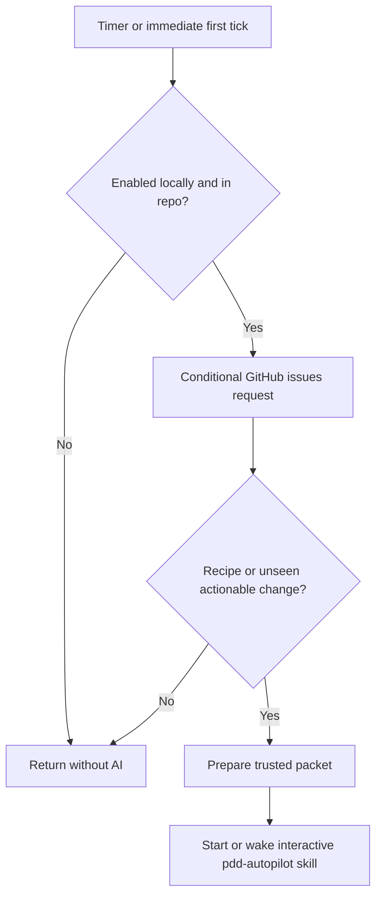

# Autopilot launcher

Own `src/autopilot-launcher.mjs`. Export module functions `runAutopilotLauncher(input, ports)` and
`tickAutopilot(stateFile, ports)`. This launcher connects a repository to the
person's interactive coding agent in a dedicated Herdr session. It adds no
approval, merge, quota-reset or headless execution route. Preserve existing
setup, workflow and interpreter behavior.

`runAutopilotLauncher` accepts command start, stop, status or add, cwd, packageRoot, env,
issues (argv issue references), and optional runs text. Return `{exitCode,message}`.
The CLI owns streams. Outside programs, timer installation, clock and state I/O
are injectable ports; native defaults implement these on macOS and Linux.

## Native Codex startup

For a selected Codex launcher, apply invocation-only config overrides that trust
the selected repository cwd and set `check_for_update_on_startup=false`. These
prevent folder-trust and update dialogs from holding the automated launch.
Preserve the configured executable, environment/profile, model and effort, native
interactive/full-access flags and first-message content. Encode cwd as one exact
project key and shell-quote arguments so spaces, quotes, backslashes and shell
syntax stay literal. Do not write agent config or saved trust, or apply these
Codex settings to another provider. Timer and later delivery behavior stay unchanged.

## Start and stop

Resolve the Git root, repository identity and package version before starting.
Check gh sign-in, Herdr availability and installed agent sign-ins, without making
an AI request. Prefer the current agent family when signed in, then Codex,
Claude, agy and Gemini. Use configured local launchers from agent-config for the
supported families, preserving their environment. For Gemini, a version alone
is not sign-in evidence: inspect its existing OAuth credential presence locally;
never display credential bytes. For agy delegate to [workflow readiness](workflow-agents.prompt.md) with requested
agent agy and the selected launcher environment. Its non-model `agy models`
probe establishes sign-in; a generic agent listing does not.
Missing dependencies produce a single actionable line; no question or installer.
Check the pdd version from the invoked package and warn about PATH shadowing.

Read settings through [Autopilot settings](autopilot.prompt.md), calling its
module function `runAutopilot({action: "setup", interactive: false, inRepo: true},
ports)` with the repo cwd and the launcher's process adapter. Use its returned
mode and explicit trust names; do not parse or normalize pdd.json here. This read
asks no questions and writes nothing. Return a settings read failure without
starting a timer or agent. Off starts neither; retain its invalid-setting notice
in the actionable off message. Both active modes use the same launcher; the
[Autopilot skill](../../skills/pdd-autopilot/SKILL.md) owns later gates.

Start persists a repo/machine state outside the checkout, installs a 30-minute
user timer and runs the first tick immediately. Repeated start reuses the timer
and saved activation time; stopping/restarting does not admit old backlog.
Optional --runs is a positive safe integer with no product maximum. Omission
means no fixed cap. Persist only the selected launcher identity/config-folder
paths, not credentials or the whole environment. A named user timer runs the
Node script with absolute paths and the launcher's PATH and agent config paths.
Linux uses a systemd user timer whose oneshot service sets `KillMode=process`,
so a Herdr server started by the tick survives its exit. macOS uses a LaunchAgent.
On Linux, check user-session lingering without changing it; when it is off or
cannot be checked, warn how `loginctl enable-linger` keeps the timer after logout. No controller process
or polling loop remains running between ticks. Timer failure is actionable and
does not leave status claiming it is running.

Use a dedicated Herdr session `pdd-autopilot`, isolated from the default session.
Open its repo workspace at start; launch the interactive agent only for work.
Reuse its saved pane for later prompts; if it no longer exists, recreate the
repo workspace/pane and preserve the queued work. Never send interrupt/kill/close to stop:
stop disables this repo's timer and queued ticks and removes its persistent
timer definition, leaving the current step to
finish. Repeated stop is harmless. Status reads local state and timer activity;
show repo, agent, running/stopped, and next tick (or none), without waking AI or
querying GitHub. Report unavailable Herdr separately instead of claiming healthy
running state when its server is absent. Concurrent ticks for one local state serialize with a local
lock; independent machines have separate state. A lock blocks only for a valid
live owner. Empty, malformed and dead-owner locks are reclaimed. Publish the
owner PID atomically so another tick never sees an unfinished new lock. Reload
state after acquiring it, before settings, cooldown or delivery decisions; a tick
must not reuse a snapshot read before another tick completed.

## Tick and the skill boundary

All providers use a user timer that checks for work before waking the agent.
This also applies to Claude: an empty tick must make no AI call.

Each tick makes one conditional issues-list query with its saved ETag, following
pagination only when GitHub supplies another page (never truncate a queue). Cache
and revalidate each page separately, so a close on a later page is seen even
when the first page is unchanged.
HTTP 304 reuses metadata, not a model turn. On changed candidates only, fetch
comments needed to identify trusted consent and filter their text. HTTP 429 is
a rate limit; HTTP 403 counts only when the remaining allowance is zero or its
body says rate limit. Save its reset time; intervening timer firings do not retry.
An ordinary forbidden response has no rate-limit cooldown. Candidate-specific
lookup failures warn through an injected warning port (stderr by default,
visible in timer logs) and defer that issue, while unrelated work continues.

Only issues created at/after the original activation time, or explicitly labeled
`pdd:autopilot`, can start. `add` accepts numbers and references to this repository
only, comparing repository names ignoring case. Validate every reference before
any label mutation; a foreign reference returns exit 2 with one clear line and
labels nothing. Create the label if absent and apply it to all named issues,
including old ones; never change issue bodies. Ignore closed issues and treat PRs
as related state rather than new issues.

An open issue alone is not a reason to wake AI. Save a fingerprint of the trusted
issue text/comments and related PR state successfully delivered to the agent.
An unchanged fingerprint, including after HTTP 304, sends no prompt. Stranger
comments and acknowledgement text do not change the trusted fingerprint. First
observations of stuck, code-pending, claimed or observe-mode issues with an open
PR establish a quiet baseline: they have no new work. A later trusted change,
a related PR transition or becoming eligible again can wake the skill once.
Removing one waiting reason or changing mode is not eligibility while another
waiting reason remains.
Keep claimed issues marked `claimed: true`, never present them as unclaimed.

Use same-repository closing references in PR bodies to associate PRs with issues.
Resolve trusted related PR metadata on change (state, draft, merge and head),
including when a PR leaves the open list. Fetch PR discussion comments on changed
comment metadata and include only trusted comments (with identity/edit metadata)
in the packet and fingerprint; outsider comments alone must not wake AI. Never
forward untrusted PR text. Cache details so unchanged ticks need no detail query.
Revalidate cached PR commenters against current explicit trust and write access
before delivery; revocation must not allow previously trusted text into a new
packet. Cached data is not cached authority. Compare the previous and current
trusted views under current authority, so revocation alone, or revocation plus
an outsider comment, never becomes new work. If the cached issue/comment/PR
source state and mode are unchanged, return quietly before permission lookups;
revalidate authority when there is an actual source change to assess or deliver. A PR waiting for a person in
observe mode is quiet until its relevant trusted state changes.

Only a successful idle-agent delivery records the fingerprint. A failed or
busy delivery remains pending. Never submit to a working, blocked or unknown
agent; wait for idle/done on a later tick and coalesce pending changes. First
recipe delivery obeys the same busy rule. The skill owns cross-machine claims
(pdd:working plus one comment), room scheduling and running issue progress;
launcher polling must not repeatedly prompt that owner about the same work.

A trusted author/commenter is the repo owner, appears in configured trusted
names, or has write/maintain/admin permission confirmed by GitHub. Association
alone does not establish write permission. Resolve needed permissions without AI;
a failed or unavailable lookup defers that candidate without replying or
forwarding that person's text. A rate-limit response defers the whole tick until
reset; do not follow it with more GitHub calls. This trust test applies to
comments too. An outsider issue waits until a trusted person comments. Before
that, send the literal non-AI reply "thanks, a maintainer will look" once,
identified by its exact static body and pdd HTML marker from a trusted author;
that acknowledgement never counts as consent. A stranger copying the marker
cannot suppress the reply or establish consent.
Forward only trusted people's title/body/comment text; outsider metadata may
include the issue number and URL but never its title, body or comments. A trusted
comment admits an outsider issue without admitting the outsider's text. Stored
poll metadata stays local; model input is a separately filtered packet. Recheck
comments on updated issues, including after a conditional cache hit if needed.

The first task on the first launch is the repo's start-up recipe, before
issues, even on an empty repo. Persist the installed package root and point each
agent request to its bundled [Autopilot skill](../../skills/pdd-autopilot/SKILL.md),
with a JSON packet containing repository, activation time, optional runs, trusted
issues and the recipe-first flag. State that further issue/comment reads must
use the same trust boundary. Follow that skill for recipe execution, room
scheduling, cross-machine claims, per-prompt concurrency and stuck runs; keep
these rules with their skill owner rather than copying them into the launcher.
The skill delegates review and merge work to pdd-check and pdd-merge. No fixed
count, time-based run termination or new refusal is introduced by the launcher.

## Dependencies

- [Autopilot settings](autopilot.prompt.md): required native generation and
  verification context for read-only settings resolution and notices.
- [Autopilot skill](../../skills/pdd-autopilot/SKILL.md): required authoring,
  generation and verification context, loaded by the interactive agent at the
  bundled package path for recipe, room, claim and stuck-run behavior. Its
  references to pdd-check and pdd-merge own their downstream work.

- [Agent configuration](agent-config.prompt.md): required native generation and
  verification context for existing configured launcher identities/environment.
- [Workflow readiness](workflow-agents.prompt.md): required native generation
  and verification context for the shared agy readiness probe.
- [Agent adapters](agent-adapters.prompt.md): required native generation and
  verification context for non-model process execution and auth-status parsing.
- [PATH diagnostics](path-diagnostic.prompt.md): required native generation and
  verification context for the optional version shadowing warning.

This module has native Node integration tests against the settings module and
bundled skill. Timer services, real sign-ins and cross-machine skill execution
need live verification; syntax-only checks do not prove those effects.
