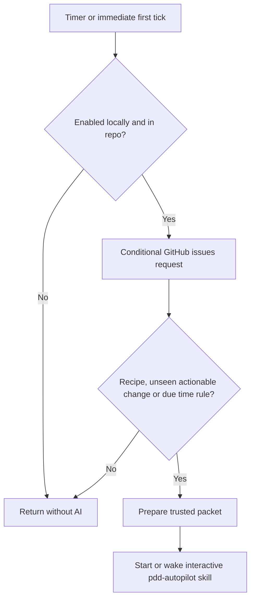
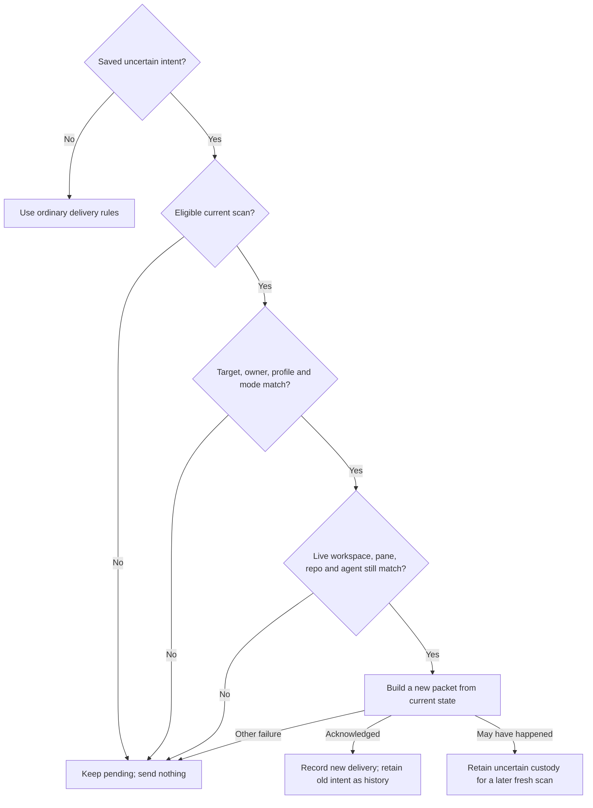

# Autopilot launcher

Own `src/autopilot-launcher.mjs`. Export module functions `runAutopilotLauncher(input, ports)` and
`tickAutopilot(stateFile, ports)` and `requestAutopilotCompletion({cwd,env}, ports)`, and the pure
`autopilotLaunchFingerprint(state)` that returns the launch fingerprint below for a saved state. This launcher connects a repository to the
person's interactive coding agent in a dedicated Herdr session. It adds no
approval, merge, quota-reset or headless execution route. Preserve existing
setup, workflow and interpreter behavior.

`runAutopilotLauncher` accepts command start, stop, status or add, cwd, packageRoot, env,
issues (argv issue references), and optional runs text. Return `{exitCode,message}`.
The CLI owns streams. Outside programs, timer installation, clock and state I/O
are injectable ports; native defaults implement these on macOS and Linux.

## Native Codex startup

For a selected Codex launcher, apply invocation-only config overrides that trust
the selected repository cwd and set `check_for_update_on_startup=false`. These
prevent folder-trust and update dialogs from holding the automated launch.
Preserve the configured executable, environment/profile, model and effort, native
interactive/full-access behavior and first-message content. For Gemini and agy, start their default interactive mode without an initial prompt operand, then deliver the full first message exactly once through the guarded native chat; their prompt-interactive option executes its operand and must not create a separate bootstrap turn. Encode cwd as one exact
project key and shell-quote arguments so spaces, quotes, backslashes and shell
syntax stay literal. Do not write agent config or saved trust, or apply these
Codex settings to another provider. Timer and later delivery behavior stay unchanged.

The commands that the coordinator Codex chat runs must receive the Autopilot
context under any Codex `shell_environment_policy`. Codex builds each command
environment from that policy, and `inherit = "core"` or `"none"` removes the
process value. So also pass the invocation-only override
`shell_environment_policy.set.PDD_AUTOPILOT_CONTEXT` with the same JSON text as
the process `PDD_AUTOPILOT_CONTEXT`, as one TOML basic string, shell-quoted like
the other arguments. Codex applies `set` after `inherit`; the profile's other
policy keys and `set` entries stay in effect. Set Herdr pane and socket values
only when the launcher knows both exact values, because coordinator recovery
reads the pane id only together with the socket path. The launcher does not know the pane
shell's socket path, so it sets neither. Limit: a profile `include_only` list
that omits `PDD_AUTOPILOT_CONTEXT` still removes it, because Codex applies
`include_only` last. Do not change the profile to work around this.

## Start and stop

Resolve the Git root, repository identity and package version before starting.
Check gh sign-in, Herdr availability and installed agent sign-ins, without making
an AI request. Prefer the current agent family when signed in, then Codex,
Claude, agy and Gemini. Use configured local launchers from agent-config for the
supported families, preserving their environment. For Gemini, a version alone
is not sign-in evidence: inspect its existing OAuth credential presence locally;
never display credential bytes. For agy delegate to [workflow readiness](workflow-agents.prompt.md) with requested
agent agy and the selected launcher environment. Its non-model `agy models`
probe establishes sign-in; a generic agent listing does not.
Missing dependencies produce a single actionable line; no question or installer.
Check the pdd version from the invoked package and warn about PATH shadowing.

Read settings through [Autopilot settings](autopilot.prompt.md), calling its
module function `runAutopilot({action: "setup", interactive: false, inRepo: true},
ports)` with the repo cwd and the launcher's process adapter. Use its returned
mode and explicit trust names; do not parse or normalize pdd.json here. This read
asks no questions and writes nothing. Return a settings read failure without
starting a timer or agent. Off starts neither; retain its invalid-setting notice
in the actionable off message. Both active modes use the same launcher; the
[Autopilot skill](../../skills/pdd-autopilot/SKILL.md) owns later gates.

For `start --resume-custody FILE`, read a bounded original-owner projection `{repository,sourceRoot,coordinatorId,machine,activation,paneId,workspaceId,agent:{id,kind},home,definitionHome,configHome,launchStartedAt}` from the operator's file. The current invocation's `--runs` controls capacity; omission is uncapped. The projection is not a whole-state import.

For this explicit operator recovery, check the source checkout and repository and use the existing admission boundary. Recheck the original pane/workspace/agent and repository with existing native target and repository observations, and verify the saved profile through the existing readiness path. The owner-verified bounded projection supplies the original launch/profile evidence. Do not add a native process-inspection system, require `PDD_AUTOPILOT_CONTEXT`, a PID or a missing native session UUID. A missing or mismatched target, profile readiness, or required current claim for an involved run leaves recovery blocked without effects.

Use the canonical checkout's existing `listRuns` and shared owners reader to identify applicable saved automatic run origins and current trusted winning claims. For each involved existing automatic run, require original repository, coordinator, machine and its saved claim tuple to match current facts. Do not require an original owned worker to exist when the coordinator had only semantic work. Never edit worker `automaticOrigin`, add or transfer a claim or label, equate the replacement local owner to the original, or bypass continuation checks. Preserve current unknown history, compatible pending custody and unrelated state; if pending custody cannot be preserved for this target, report a block rather than replay or discard it.

After these checks and rechecking the current control revision under admission ownership, apply only the original coordinator/profile/target projection as part of the actual explicit start. Preserve current history and unrelated state, use the invoked package and current mode, then release ownership before fresh reconciliation through existing tick/transport guards. A later STOP or start wins. Do not restore an entire archival state, previous package, gate decision or payload. This operator intervention is not proof of an unattended new cycle, a gate approval or a checker verdict.

If an explicit start finds an active scan holding the tick lock, arrange one detached current-state follow-up after that scan releases the lock. Wait outside admission and tick locks; do not clear the lock or replay an old payload. Before the follow-up, verify the same enabled start and control, repository and coordinator identity, then use the existing guarded scan. A later stop or start supersedes the pending follow-up. A busy lock is not completed work.

Start persists a repo/machine state outside the checkout, installs a 30-minute
user timer and runs the first tick immediately. Repeated start reuses the timer
and saved activation time. An explicit start rearms the existing one-shot worker completion bridge for saved current automatic chats belonging to this repository and coordinator; timer ticks do not recreate listeners, except for the fresh pane after a [coordinator relaunch](#coordinator-relaunch) or a [gone coordinator pane](#gone-coordinator-pane). Yield retains its current claim and ownership checks. If observation is unavailable, report the manual completion-evidence and yield fallback. In auto mode, on every fresh reconciliation, including ordinary timer ticks, explicit start, completion and capacity refill, reconsider currently graph-eligible, open, unassigned and unclaimed work even when an earlier packet was acknowledged and its trusted content is unchanged. Delivery alone is not worker admission; preserve trust, ownership, custody and waiting checks and make a fresh selection observation. In observe mode retain unchanged notification deduplication; in all modes keep it for work that is not currently ready and for empty scans. Each reconciliation considers all open eligible
backlog, regardless of creation or activation time.
Optional --runs is a positive safe integer with no product maximum. Omission
means no fixed cap. Persist only the selected launcher identity/config-folder
paths, including the HOME used to load local launcher definitions, not credentials or the whole environment. A named user timer runs the
Node script with absolute paths and the launcher's PATH and agent config paths.
Linux uses a systemd user timer whose oneshot service sets `KillMode=process`,
so a Herdr server started by the tick survives its exit. macOS uses a LaunchAgent.
On Linux, check user-session lingering without changing it; when it is off or
cannot be checked, warn how `loginctl enable-linger` keeps the timer after logout. No controller process
or polling loop remains running between ticks. Timer failure is actionable and
does not leave status claiming it is running.

On explicit start with a changed invoked package root, leave prior custody intact and schedule a fresh current-state wake to deliver the new package instruction even when no work is eligible; use the existing guarded recovery and do not replay unknown payloads. Dependency analysis instructions also begin with this binding. On a successful explicit `pdd autopilot start`, persist the actual operator action, repository and current active mode for subsequent coordinator work and dependency packets. When the current mode matches that recorded action, identify it as an operator command, not a person’s quoted reply or checker approval. In auto mode explain that it authorizes ordinary eligible work and automatic merge under the repository’s review, testing, strict approval and other rules; observe mode retains its own limits. A timer or configuration read alone must not invent a start action. If a saved installation lacks this context, the next explicit start requests the existing guarded fresh current-state wake even without eligible work; retain unknown custody and do not replay it. Retain the actual start action across mode changes; apply it only when its repository and mode match the current active context. Observe and off do not authorize automatic merge. Record actual operator action through existing supported approval routes where applicable; never manufacture a later person reply.

The coordinator instruction must first explicitly read and follow the absolute `skills/pdd-autopilot/SKILL.md` in the invoked package, including its relative supporting files; do not use a name-only invocation that can select an older installed copy.

Use a dedicated Herdr session `pdd-autopilot`, isolated from the default session.
Open its repo workspace at start; launch the interactive agent only for work.
Persist the owned pane and native launch intent. Inject `PDD_AUTOPILOT_CONTEXT`
into that exact empty native command along with the saved profile environment.
Reuse the pane only when its owner launch binding matches the current coordinator
envelope, including optional runs, and the selected agent identity, saved HOME,
launcher-definition HOME and selected family config-folder path that determine
the native launch. Persist only those safe binding values, the launch
fingerprint in [Coordinator relaunch](#coordinator-relaunch) and the terminal
identity in [Gone coordinator pane](#gone-coordinator-pane); an absent legacy
profile binding does not match. Leave an old live pane with an absent or
different binding untouched: never prompt, interrupt, kill or close it. Allocate
a distinct explicitly owned pane and coordinator through the native launch route,
preserving queued work. Immediately before guarded submission, recheck the same
pane, workspace and owner launch, and any observable `agent_session`. Launch
acknowledgement establishes transport acceptance, not model uptake. A confirmed
launch rejection permits retry through the existing route; an uncertain launch
or submission stays pending without blind resend. If
`agent_session` is unavailable, pane occupancy alone is not native process or
environment attestation. The narrow uncertain-send recovery below may use the
same saved pane only when its owner launch/profile, idle/done status and readable
screen still match. If the saved pane [is gone](#gone-coordinator-pane),
recreate the repo workspace/pane and preserve the queued work, except during that recovery. Recreated native owners use
saved HOME and selected config-folder bindings. Reload commands and non-profile
environment overrides from the saved launcher-definition HOME, never a later
caller HOME, and only within the saved agent family. If the named definition now
selects another family, launch no replacement, retain pending work and report that
`pdd autopilot start` must select it again. On ordinary start of an existing
coordinator, verify and retain the saved family, identity, definition HOME, HOME
and config-folder binding; inherited caller profile variables do not request an
account change. If that binding or its sign-in cannot be verified, report the
problem without replacing coordinator identity, profile, claims or custody. First
start retains normal discovery. Explicit configuration choices remain subject to
the existing supported selection rules. Saved HOME and config-folder values override reloaded and caller values;
an absent saved config variable is unset in the child even if the pane or
reloaded definition supplies it. Preserve other configured environment values
and provider behavior. Never send interrupt/kill/close to stop:
stop first saves this repo as disabled so queued ticks cannot act even if timer cleanup fails, then disables its timer and removes its persistent
timer definition, leaving the current step to
finish. Stop checks and removes the owned timer even if saved installation state
is absent or false, including after a failed start. Repeated stop is harmless. Status reads local state and timer activity;
show enabled/disabled, timer activity, Herdr availability, coordinator state,
repo, agent, and next tick (or none), without waking AI or querying GitHub.
Whenever Herdr is available, inspect the saved coordinator with the existing
`agent get` operation, including when the timer is inactive. Confirm that its pane,
workspace, repository path, provider and any saved terminal identity match saved local state. Report a missing,
unreadable or mismatched coordinator as unavailable; a live Herdr server alone
does not mean this repo's coordinator is running. For a matching coordinator,
report its actual `working`, `starting`, `idle`, `blocked` or `done` state; idle is healthy.
While a relaunch for the saved owner launch is pending, add one line that starts
with `Coordinator relaunch pending after upgrade`. While a
[held relaunch](#relaunch-once-per-fingerprint) mark matches the saved owner
launch, add one line that starts with `Coordinator relaunch held`.
Status never repairs, replaces or wakes a coordinator. Report unavailable Herdr
separately instead of claiming healthy running state when its server is absent.
Concurrent ticks for one local state serialize with a local
lock; independent machines have separate state. A lock blocks only for a valid
live owner. Empty, malformed and dead-owner locks are reclaimed. Publish the
owner PID atomically so another tick never sees an unfinished new lock. Reload
state after acquiring it, before settings, cooldown or delivery decisions; a tick
must not reuse a snapshot read before another tick completed.
The existing tick lock serializes scans only. Keep slow discovery outside the
existing admission boundary. Start, stop and mode controls serialize accepted
configuration and timer effects on that admission boundary. Each successful
control publication changes a private opaque revision, including stop/start and
mode off/on; unsuccessful controls publish no revision or proposed state. A scan
captures the accepted revision and, before any new effect or state publication,
rechecks current enabled mode, coordinator, machine, activation, profile, cap and
revision under the same admission boundary. An old scan cannot publish, submit or
start work after a control change. Merge only the scan's intended fields into the
fresh accepted state, including the owner-launch marker before a new pane launch; never save the stale scan state over a later control. Preserve current control fields and uncertain custody. An
effect already admitted may finish. Do not hold admission across discovery,
provider reads or chat readiness. Hold it through each single scan-owned Herdr server start, workspace creation, launch or prompt submission, then release; an already admitted effect may finish. The existing automatic workflow admission still
holds it through its durable starting record. Persist accepted state before a
successful control result. Timer failures can leave partial OS effects; report
failure without claiming rollback. Manual work and current admitted work remain
usable. When the lock is contended, show a waiting notice once and wait
up to 5 seconds, checking at 100-millisecond intervals using elapsed time. On
timeout return a clear nonzero error without config, timer or workspace changes
and without delayed application. The deadline covers only lock acquisition; once
acquired, await the actual save and timer effects and report their result.

## Coordinator relaunch

A running chat keeps the launch settings that it started with. A later package
or launch argument does not reach it. So record a launch fingerprint in the
owner launch at each native launch: the SHA-256 of the resolved invoked package
root, its `package.json` version, the provider family and the provider arguments
that this package builds. Put a fixed placeholder for the coordinator context
value in those arguments; the coordinator envelope binds that value. Do not put
the process environment, the configured executable or reloaded definition
values in the fingerprint. They can differ between an explicit start and a
timer tick, and a difference would relaunch on ordinary ticks. Store only the
digest.

A relaunch is due when the owner launch binding above matches, the saved
fingerprint is absent or differs from the current one, no delivery or
reconciliation intent is saved, and the reloaded definition keeps the saved
family. An absent fingerprint means that an older package launched the chat.
A custody projection has no fingerprint, so an adopted chat also relaunches at
its next idle moment.
When a relaunch is due, every tick and explicit start considers it, also without
new work. The fresh chat gets the start-up recipe first.

- If Herdr reports the chat as `working`, `starting`, `blocked` or another
  status that is not `idle` or `done`, send nothing and close nothing. Keep the
  work pending. Save a relaunch-pending mark with the saved pane and launch
  start time; status shows it until the relaunch is done.
- If the chat is `idle` or `done`, end it with Herdr `pane close` for the saved
  coordinator pane only. Hold admission for the close. In that hold, first
  recheck that the saved state is enabled with the same pane, workspace and
  owner launch and no intent, and that Herdr reports the same pane, workspace,
  provider, repository path, saved `terminal_id` and `agent_session` as `idle`
  or `done`. If Herdr reports another `terminal_id`, the saved pane
  [is gone](#gone-coordinator-pane): close nothing and forget it in the same
  hold. After the close, `pane get` must report `pane_not_found`. Then, in the
  same hold, add the current fingerprint to the relaunch record below, remove
  the saved pane, workspace, owner launch and the pending and held marks, and
  mark the recipe as not delivered. If a check fails before the close, close
  nothing, keep the work pending and retry on a later tick. If Herdr or the
  save fails, or Autopilot stops, after the close, the saved pane is gone and a
  later tick, or a start after a stop, replaces it.
- Then open a fresh repo workspace and pane through the existing route, rearm
  saved worker completion for the fresh pane with the same filter as an
  explicit start, and launch with the current arguments. Deliver pending work as
  usual.

A relaunch keeps the coordinator identity, machine, activation and runs cap,
so claims, saved runs, progress, queued work and history do not change. Never
relaunch during uncertain-send recovery. Never close another pane, workspace or
process. Stop still only disables the timer.

**Relaunch once per fingerprint.** For each relaunch, save the current
fingerprint, which the fresh chat gets, in a relaunch record of the 8 most
recent. If a due relaunch would use a fingerprint that the record already has,
the fingerprint is not stable, for example when starts from two installs alternate. Do not
relaunch again: the current chat stays and gets work as usual. Save a held mark
with the saved pane, launch start time and that fingerprint, warn once, and
remove the pending mark. Status shows the held line while the mark matches the
saved owner launch. When no relaunch is due, remove the held mark. A replaced
gone pane is not a relaunch, so a person can close the coordinator pane in
Herdr to get a fresh chat with the current settings.

### Gone coordinator pane

Just before each native launch, read the pane with Herdr `pane get` and save
its `terminal_id` in the owner launch. Herdr gives each terminal a new
`terminal_id`. After a Herdr server restart, a pane ID can name another
terminal, for example a restored empty pane or a chat that a person started. If
`pane get` reports `pane_not_found` there, launch nothing and replace the pane on
a later tick.

The saved coordinator pane is gone when one of these is true:

- `agent get` reports `pane_not_found`, or Herdr is not running.
- `agent get` reports `agent_not_found` and `pane get` reports
  `pane_not_found`. Herdr also gives `agent_not_found` for a closed pane, so
  `agent get` alone does not tell a closed pane from a pane without a chat.
- Herdr reports a `terminal_id` for the saved pane that differs from the one in
  its owner launch. A missing value on either side does not show a difference,
  so an owner launch from an older package uses only the rules above.

Outside uncertain-send recovery, never close, prompt or launch into a gone
pane: a pane that now has its ID is not ours. In one admission hold, check
that the saved state still names the same pane and owner launch and has no
intent. Then remove the saved pane, workspace, owner launch and the pending and
held marks, and mark the recipe as not delivered. Keep the coordinator
identity, machine, activation, runs cap and relaunch record. Keep the profile
binding of each owner launch, also after it is forgotten, as the last launched
profile; an ordinary start verifies the saved profile against the owner launch
or, when none is saved, that last launched profile. Then open a fresh
pane, rearm saved worker completion for it and launch as after a relaunch. A
plain tick and an explicit start both do this when they wake the coordinator.
So a failure or a stop after a relaunch close or after this forget step, a pane
that a person closed and a Herdr server restart recover on the next tick, or
after a stop on the next start. If the pane has
the saved terminal but no chat, keep the work pending without a second launch:
the launched chat may still be starting.

## Tick and the skill boundary

All providers use a user timer that checks for work before waking the agent.
This also applies to Claude: an empty tick must make no AI call.

Each tick makes one conditional issues-list query with its saved ETag, following
pagination only when GitHub supplies another page (never truncate a queue). Cache
and revalidate each page separately, so a close on a later page is seen even
when the first page is unchanged.
HTTP 304 reuses metadata, not a model turn. On changed candidates only, fetch
comments needed to identify trusted consent and filter their text. HTTP 429 is
a rate limit; HTTP 403 counts only when the remaining allowance is zero or its
body says rate limit. Save its reset time; intervening timer firings do not retry.
An ordinary forbidden response has no rate-limit cooldown. Candidate-specific
lookup failures warn through an injected warning port (stderr by default,
visible in timer logs) and defer that issue, while unrelated work continues.

Every open issue can be considered, regardless of creation time, activation time,
or `pdd:autopilot` label. For fresh work, include an issue only when the current
dependency intake lists its URL in `eligible`. A missing, false or unavailable
eligibility result waits. The shared graph owns current dependency readiness,
trust, GitHub Assignees and claim checks; missing assignment data does not prove
that an issue is unassigned. A related PR or saved run alone does not exclude an
otherwise eligible issue. `add` accepts numbers and references to this repository
only, comparing repository names ignoring case. Validate every reference before
any label mutation; a foreign reference returns exit 2 with one clear line and
labels nothing. Create the label if absent and apply it to all named issues,
including old ones; never change issue bodies. Ignore closed issues and treat PRs
as related state rather than new issues.

An issue in the current eligibility result is fresh work, including an old issue
first seen after activation. Save a fingerprint of the trusted issue
text/comments and related PR state successfully delivered to the agent. An
unchanged fingerprint, including after HTTP 304, sends no prompt. Stranger
comments and acknowledgement text do not change the trusted fingerprint. First
observations of stuck, code-pending or claimed issues establish a quiet baseline.
A first-seen eligible issue with an open PR remains fresh work in both modes. In
observe mode, an open PR must not create a human-review wait from a prior offer,
prior eligibility, or PR/run history. An existing owned workflow may wait for
review while its current `pdd:working` claim remains; a claim blocks fresh work
and stays available to claim monitoring. The workflow start boundary verifies
claim ownership before any continuation or resume. A later trusted change,
related PR transition or becoming eligible again can wake the skill once.
Removing one waiting reason or changing mode is not eligibility while another
waiting reason remains.
Include an `eligible` boolean from the current intake result on every issue item.
An `eligible: false` item is monitoring context, never fresh work. Keep claimed
issues marked `claimed: true`, never present them as unclaimed.

Elapsed time can also offer work without a GitHub change or an AI call in the
tick. Use the clock and local run-progress reader as injectable ports. Read this
repository's active PDD run records in the Git common directory's
`pdd/runs/*/status.json`; the file's last modification time is its last change.
At 60 minutes without a change, offer one line naming the run number and asking
the skill to follow its `pdd:stuck` rule. Completed and cancelled runs are over;
missing or unreadable records supply no progress fact.

For an eligible trusted issue with `pdd:working`, use the latest issue update or
comment creation/edit time already returned and cached by the tick as claim
activity (including label refresh). At 60 minutes, representing the skill's
"about 1 hour", offer one line naming the issue number and asking the skill to
review stalled work under its claim rule. This is an observation only: age does
not authorize takeover, release the `pdd:working` claim, or make the issue fresh
work. Keep it claimed until the existing claim owner removes the label. Do not
fetch label events or make another query to measure age; an absent or unreadable
activity time cannot be due. Revalidate trust before delivering a due claim,
even when the cached source is unchanged; stranger text never enters a timed
packet.

Persist each successfully delivered time event by rule, run/issue number and
last activity time. Unchanged overdue events stay quiet, including after a
restart; a new activity time can become due again. Coalesce due reasons with
trusted work in the packet's `timeRules` array, with one actionable `reason`
line per event. Busy or failed delivery consumes no event; reassess current
facts when idle so refreshed or ended events are not delivered stale. Neither
timer marks, terminates or takes over a run itself; the skill owns those actions.
The two 60-minute thresholds are constants, not settings, caps or hard stops.

Use same-repository closing references in PR bodies to associate PRs with issues.
Resolve trusted related PR metadata on change (state, draft, merge and head),
including when a PR leaves the open list. Fetch PR discussion comments on changed
comment metadata and include only trusted comments (with identity/edit metadata)
in the packet and fingerprint; outsider comments alone must not wake AI. Never
forward untrusted PR text. Cache details so unchanged ticks need no PR-detail query.

Check submitted reviews for known related PRs on each tick, including when the
issues list returns HTTP 304 and the issue and PR head are unchanged. Use
conditional requests and revalidate each review page, following GitHub's next
page links without truncation. A new trusted submission, identified by PR number
and GitHub review ID, is unseen work and wakes the idle agent once. Include its
identity, trusted author, submission metadata, state and body in the packet and
fingerprint; unchanged repeats stay quiet. Reviews use the same trust and pending
delivery rules as other trusted work.

Revalidate cached PR commenters and reviewers against current explicit trust and
write access before delivery; revocation must not allow previously trusted text
into a new packet. Cached data is not cached authority. Compare the previous and
current trusted views under current authority, so revocation alone, or revocation
plus an outsider comment or review, never becomes new work. If the cached issue,
comment, PR and review source state and mode are unchanged, return quietly before
permission lookups, except when the canonical shared model reports a transition
into eligibility. Offer that readiness change through the existing guarded delivery
even after HTTP 304; retain it through busy, dialog or uncertain transport until
acknowledged. Keep trust, activation, mode, current owner and cap checks, and do
not reanalyze an unchanged completed review. An offer is not a workflow start.
Revalidate authority when there is an actual source change or readiness change to
deliver. A PR waiting for a person in observe mode is quiet until its relevant
trusted state changes.

Persist the original launch time before dispatch and use the existing bounded
startup window and injected clock. Launch an empty native owner once when a pane
needs an agent; launch acceptance
is neither packet submission nor uptake and consumes no recipe or fingerprint.
In the same tick, continue bounded readiness and guarded delivery for that original
owner within the shared startup window; do not defer its first packet solely to
the next periodic tick. If readiness or safe delivery cannot be established, keep
the work pending and report a plain reason by the end of that window.
The public module function `tickAutopilot(stateFile, ports)` rejects with the actual transport error when a delivery submission fails, after recording its failed or uncertain custody and metrics. Guard refusals before transport leave work pending without an artificial error. The immediate START and completion paths retain their structured outcomes.

For the exact saved coordinator in the dedicated session, use [area-chat delivery](workflow-chat.prompt.md#message-delivery)
and its guarded ordered submission. The launcher retains its stricter rule:
submit only when that coordinator is idle or done, never working, blocked or
unknown. Validate the original target and durable submission intent immediately
before transport; a replaced target cannot receive the old packet.

Keep recipe, issue, timer and review work pending until safe submission is
acknowledged. A dialog, unreadable screen, failed launch or confirmed rejection
consumes no delivery fingerprint. If submission may have happened, retain
uncertain custody: do not blindly resend or invent an acknowledgement. An
acknowledgement establishes submission, not agent uptake or completed work. Coalesce pending
changes and preserve them across workspace or pane recreation. The skill owns
cross-machine claims (pdd:working plus one comment), room scheduling and running
issue progress; launcher polling must not repeatedly prompt that owner about the
same work.

### Reconcile uncertain custody from current state

An eligible `pdd autopilot start`, timer tick or completion wake may make a fresh reconciliation for saved uncertain delivery or reconciliation custody. Read current state again even when its semantic fingerprint is unchanged; a matching fingerprint alone does not establish that the earlier request was received. Existing claim and live-run guards still prevent duplicate implementation.

A confirmed definitely-unsent rejection may retry within the same delivery invocation using only its own unchanged committed intent. Uncertain submission never permits that retry. An explicit start may accept a changed cap and timer while preserving pending custody, even if its target is malformed or mismatched; defer delivery without creating a replacement. A guard refusal before transport leaves the old intent pending. A later eligible scan may check it again. A confirmed rejection stays retryable under ordinary delivery rules. Record the new reconciliation intent under existing admission and workflow ownership checks before transport. Add no new lock or recovery framework.

The intent's pane and workspace must match the current saved target. The saved owner launch must match the current coordinator envelope and profile binding, except that its historical runs value may differ from the current cap. Do not rewrite that historical launch binding. Current admission uses the saved current cap and revision. Keep the launcher enabled and its current active mode unchanged through every existing guard to final submission. A stop or mode change during recovery sends nothing. Legacy intents do not record the earlier mode; the current scan must use a current active mode and the current check must stay stable before submission. Keep the earlier mode and session recorded as `unknown`; do not infer them from the new start.

Inspect only that saved target. With an uncertain intent, this rule overrides normal missing-pane recovery. If its saved pane or workspace is absent or mismatched, retain the original identifiers and send nothing. Never create, replace, focus, close or interrupt a target for recovery.

Before recovery, inspect the live workspace, pane and agent. Their IDs, repository path and provider must match the saved target and selected launcher. If the owner launch saved a `terminal_id`, Herdr must report the same `terminal_id` for the saved pane; another terminal sends nothing. Check the GitHub repository from that path against the saved repository before delivery. Perform live identity, repository and readiness reads outside admission, immediately before the final guard. Under the guard recheck current saved control and submit one prompt. Remote identity can change after observation; do not claim atomic remote attestation. A missing or mismatched current identity sends nothing.

Herdr must report the owned agent as `idle` or `done`. A `working`, `blocked`, `unknown` or missing status, an absent agent, or any failed or unreadable inspection sends nothing. If Herdr reports an `agent_session`, it must stay unchanged through the final guard; a changed or unreadable target sends nothing. Herdr may omit the session ID for a saved, finished agent. In that case, do not refuse on absence alone when the live workspace, pane, repo path and provider still match. `done` permits only a new packet. It does not acknowledge the old submission.

Build the new packet from the ordinary fresh current-state reconciliation. Never restore or resubmit the old packet. Keep the old uncertain intent as history, with its unrecorded earlier mode and session explicitly marked `unknown`. Record the new intent separately before transport. Retain exact payload digest separately from semantic identity: use the dependency intake pending fingerprint for dependency work, and existing issue fingerprints, time event identities and recipe state for ordinary work. An unknown semantic identity stays conservatively held. If transport may have happened, retain the new uncertain intent across process restarts. A later eligible scan may build a new packet from freshly read current state, including when its semantic identity is unchanged; never blindly repeat an old packet. Preserve each historical intent according to its original delivery or reconciliation custody. A confirmed rejection remains retryable. This recovery does not edit issue labels or release claims; the skill remains the claim owner.

A trusted author/commenter is the repo owner, appears in configured trusted
names, or has write/maintain/admin permission confirmed by GitHub. Association
alone does not establish write permission. Resolve needed permissions without AI;
a failed or unavailable lookup defers that candidate without replying or
forwarding that person's text. A rate-limit response defers the whole tick until
reset; do not follow it with more GitHub calls. This trust test applies to
comments too. An outsider issue waits until a trusted person comments. Before
that, send the literal non-AI reply "thanks, a maintainer will look" once,
identified by its exact static body and pdd HTML marker from a trusted author;
that acknowledgement never counts as consent. A stranger copying the marker
cannot suppress the reply or establish consent.
Forward only trusted people's title/body/comment text; outsider metadata may
include the issue number and URL but never its title, body or comments. A trusted
comment admits an outsider issue without admitting the outsider's text. Stored
poll metadata stays local; model input is a separately filtered packet. Recheck
comments on updated issues, including after a conditional cache hit if needed.

On the first launch, request bounded repository, account, agent and CLI readiness before dependency analysis and issue selection. Run only an explicitly documented bounded startup recipe; do not infer a general test script, invent or write a recipe, or run the full application suite before scheduling. Selected issue workers follow their normal reproduction and testing workflows. Persist the installed package root and point each
agent request to its bundled [Autopilot skill](../../skills/pdd-autopilot/SKILL.md),
with a JSON packet containing repository, activation time, optional runs, trusted
issues and the recipe-first flag. Include `workflow` metadata: `pddBin` is this package root's absolute
`bin/pdd.mjs`, `agent` is the selected family, `home` its selected HOME, and
`configHome` is that family's config variable and saved path (`{variable,path}`),
or null for a family without one. A missing or empty saved path is null and the
variable must be unset. Read bindings from the saved selected launcher environment,
including configured overrides, not a later caller; include no credentials, other
environment values or other families' paths. Use the bundled PDD command and
explicitly selected HOME/profile for the coordinator and supported normal issue
handoff, including new chats. The handoff step binds workflow commands; metadata
alone does not prove propagation into issue chats. Preserve the saved family. Start or reuse the normal PDD workflow
before issue edits or delegation, leaving its worktree, stages and gates to PDD. State that further issue/comment reads must
use the same trust boundary. Follow that skill for bounded readiness, room
scheduling, cross-machine claims, per-prompt concurrency and stuck runs; keep
these rules with their skill owner rather than copying them into the launcher.
The skill delegates review and merge work to pdd-check and pdd-merge. No fixed
count, time-based run termination or new refusal is introduced by the launcher.

## Current work packet carrier

For each current-work wake, preserve the complete generated UTF-8 work message,
including any fresh reconciliation prefix, in a private immutable work artifact;
do not truncate, reserialize, log, place it in a native argument or environment,
or fall back to inline delivery. Its digest is integrity, not freshness or start
authority. Preserve trusted-text filtering, semantic fingerprints and the digest
of the complete work message, and all existing uncertain custody and deduplication
rules. This does not classify, acknowledge or replay an earlier intent.

Use the dependency artifact rules below for owner-controlled path, permissions,
exclusive publication, no-follow and identity checks, exact-byte readback,
failure, retry and retention, applied to this work artifact separately. The
request JSON validation and dependency-specific metadata do not apply. Bound the
entire native argument to 16384 UTF-8 bytes; if it exceeds that limit leave work
pending without artifact creation or submission. The argument names this as a
current-work artifact, supplies its absolute path and SHA-256, and gives this
instruction: "Read the complete artifact once as bytes; verify its SHA-256
against the stated digest before decoding UTF-8 and following those same bytes as
the work message. If the artifact is missing, unreadable, invalid UTF-8 or does
not match, leave the work pending; do not substitute another packet. This artifact
does not grant authority to start work; apply current mode, trust, ownership,
graph and admission checks." No new native transport, PDD read command or public
resource is required. Preserve the selected environment and profile.

Reserve the path and construct the bounded instruction after the existing idle
check, without creating the artifact. In the existing beforeSubmit callback,
after enabled, target, owner/profile, session and readiness checks, create and
verify the artifact outside the admission lock. On the existing confirmed-absent
retry, reuse and reverify that same artifact there. After file I/O recheck state,
target, session and both launch budgets; under the existing admission guard
record the intent only if current controls still match. The guarded actual native
submit remains one operation under its existing admission lock, with the current
revision, owner and cap checks. Never hold that lock over artifact I/O. A denied
guard leaves work pending; retain or remove artifacts only under the dependency
artifact's existing proof and retention rules.

## Dependency review and automatic-start context

After an actual dependency completion, if its fresh reconciliation has current work to deliver but the matching coordinator is busy, arm one detached native wait for that coordinator pane to become idle or done. After the wait, verify the saved enabled coordinator, repository, pane, workspace and control identity and run the existing fresh completion reconciliation outside its locks. It must not replay a saved payload or arm on a tick-lock conflict; mode, trust, custody and stop guards still apply. A failed or unavailable wait leaves reconciliation pending.

A first semantic request may combine the startup readiness instruction and current dependency artifact in one guarded wake. Require bounded readiness before analysis and mark the recipe delivered only after confirmed delivery; busy or uncertain delivery remains pending. For a semantic `pending.deliver({repository,requestJson})` wake, preserve the
exact UTF-8 bytes of `requestJson` in a private local request artifact. Do not
parse and reserialize, wrap, truncate, replace, log, or put those bytes in the
environment or a native argument. Parse only to validate the request and bind
its opaque `id` and repository; compare the request, snapshot and selected GitHub
OWNER/REPO names by their canonical case-insensitive identity, validating their
format first. Calculate SHA-256 over the exact bytes. The
existing intake fingerprint remains the coalescing and delivery authority and
advances only on the existing confirmed-delivered result. The digest establishes
integrity, not freshness or authority. GitHub saved reviews remain durable; the
artifact is replaceable local cache.

Use a unique immutable artifact name under a private directory owned by the
existing launcher state owner; neither request ID nor repository is a path
component. Require owner-controlled directory mode 0700 and regular file mode
0600, including when a directory already exists and under any umask. Reject
unsafe ownership, permissions, symlinks and name collisions without following
or overwriting them. Write a unique temporary file and atomically publish the
complete file exclusively; verify the published bytes and identity before use.
The native reader opens the final component without following symlinks and
checks the opened file's ownership, mode, bytes and published identity again on
retry.
Clean temporary files after failed creation. Create or publish failure, unsafe
path, readback failure, invalid request or mismatch leaves work pending and
submits no artifact instruction. Use a locally injected artifact/filesystem port
with native default for these operations; do not change intake's pending port or
add a public command, resource, receiver or transport.

Keep the existing guarded wake and selected environment/profile. The lazy packet
factory may reserve a unique absolute path and construct bounded metadata after
the existing idle check, but must not create an artifact there. Create and verify
the artifact once in the existing final `beforeSubmit` path, after its enabled,
target, owner/profile, session and readiness checks and before recording intent
and submitting. On `beforeSubmit` reentry after the existing confirmed
`agent_not_found` retry, reuse the same immutable artifact for that wake and
reverify its bytes and identity; never create a second artifact for that wake.
After all file I/O and readback, recheck the existing current state, native
session and `withinLaunch` wall-clock and elapsed startup budget immediately
before recording intent. If any guard fails, leave pending without submission.
Initial stopped, busy, blocked, coalesced and other denied paths create no
artifact; a later guard denial may remove the created artifact only when the
existing boundary proves submission was never possible. If state or target
changes before submission, leave work pending;
never redirect the packet. The single native prompt argument gives the absolute
path, SHA-256, request ID and repository, and tells the coordinator to read and
verify the artifact before analysis. Bound and check the complete UTF-8 argument,
including the ordinary coordinator instruction and path, to at most 16384 bytes;
if it exceeds that bound, leave pending without creating or submitting an
artifact. Do not fall back to the original JSON. Preserve the final delivery
intent and existing readiness, admission, cap, stop and uncertain-custody rules.

Never remove a published artifact on acknowledgement, uncertain submission,
stop, restart or owner change: acknowledgement does not establish uptake.
Retain immutable artifacts through potential in-flight use, including crash
windows where submission cannot be ruled out. A just-created artifact may be
removed only if the existing delivery boundary proves this attempt could not
have submitted it and no other active delivery references it. Otherwise retain
it until explicit known-safe user cleanup; automated cleanup is outside this
contract. In particular, do not clear, classify, recover or resend any existing
uncertain intent as a consequence of this change.

At startup/restart, tick, accepted event, completion and explicit refresh, use the
same `reconcileDependencyIntake({cwd,repository,trigger,mode},ports)` production
boundary before selecting new issue work. It recovers saved effects and returns
queued/eligible/skipped/pending; it starts nothing. Keep existing conditional
polling, recipe-first behavior, idle delivery, activation, trust, profiles, family
choice and normal workflow handoff. Both observe and auto can work; Off starts no
new automatic work. A graph read, including background refresh, never invokes this route, AI or GitHub writes.

Native module function `requestAutopilotCompletion({cwd,env}, ports = {})`
resolves the existing launcher state for cwd using the same Git-root and state
identity as launcher controls, without creating or starting a launcher. Return
`{state:"reconciled"|"inactive"|"busy"|"unknown"}`. Missing or stopped state and
Off return inactive; a held tick/control lock returns busy; resolution, settings
or execution failure returns unknown. A rate-limit deferral before reconciliation
is unknown, not reconciled. Reconciled means the completion-triggered
reconciliation actually ran, not that delivery or work started. Under the same
state/control lock ordering, reread enabled state and settings after acquisition;
never revive a stopped launcher. Run the existing tick scheduling path with
trigger `completion`, its current cwd, repository, mode and pending carrier.
Pass the supplied current `env` through to the existing tick ports so tick-time
settings and reconciliation use the same profile as state resolution; preserve
the other injected ports and native defaults.
Fresh canonical readiness precedes ordinary selection and wake. Keep recipe-first,
owner, cap, lazy packet, busy/dialog and uncertain-delivery safeguards. Do not
recursively request completion while reconciling. A busy or unknown result is not
a promise of later handling; the independent 30-minute tick remains fallback.
Use the existing launcher ports and native defaults, including state, Git, settings,
reconcile and wake boundaries; injected substitutes reach this same path.

## Dependencies

- [Metrics store](metrics-store.prompt.md), [run records](workflow-runs.prompt.md) and [metrics gaps](metrics-gap.prompt.md): required native generation/verification context for observational selector/launch storage and identity.

- [Workflow runner](workflow-runner.prompt.md#current-autopilot-start-ownership): required native generation and verification context for the existing shared admission lock.
- [Dependency intake](issue-dependencies-intake.prompt.md): required generation, runtime and verification context for reconciliation and structured coordinator context. The [pure model](issue-dependencies.prompt.md) owns review and readiness.

- [Autopilot settings](autopilot.prompt.md): required native generation and
  verification context for read-only settings resolution and notices.
- [Autopilot skill](../../skills/pdd-autopilot/SKILL.md): required authoring,
  generation and verification context, loaded by the interactive agent at the
  bundled package path for recipe, room, claim and stuck-run behavior. Its
  references to pdd-check and pdd-merge own their downstream work.

- [Herdr workspace identity](workflow-herdr-layout.prompt.md): required native generation and verification context for comparing the saved checkout and live pane paths.
- [Area-chat delivery](workflow-chat.prompt.md#message-delivery): required authoring, native generation and verification context for shared readiness and ordered submission.
- [Agent configuration](agent-config.prompt.md): required native generation and
  verification context for existing configured launcher identities/environment.
- [Workflow readiness](workflow-agents.prompt.md): required native generation
  and verification context for the shared agy readiness probe.
- [Agent adapters](agent-adapters.prompt.md): required native generation and
  verification context for non-model process execution and auth-status parsing.
- [PATH diagnostics](path-diagnostic.prompt.md): required native generation and
  verification context for the optional version shadowing warning.

This module has native Node integration tests against the settings module and
bundled skill. Timer services, real sign-ins and cross-machine skill execution
need live verification; syntax-only checks do not prove those effects.

Give each offered issue a durable decision token tied to its repository and issue, and include it in the trusted work packet for explicit workflow invocation. Delivery is an offer, never a confirmed start. Do not alter selection or custody rules.

Save a complete selector snapshot of observed open issues with known scope and reasons, and unknown readiness where unavailable. Atomically publish the full snapshot after its decision records are durable. Offers do not establish worker launch. If capture or delivery fails, retain retry facts and a durable coverage-gap observation where storage permits, without changing wake or custody behavior.

Record each actual wake delivery attempt and its confirmed delivery, uncertain or failed result against each offered decision ID. An offer or coordinator tick is not a worker start. Save the selection snapshot even when its membership is empty. Metrics capture must not change delivery or custody behavior.

Classify known trusted unblocked selector facts as ready even on unchanged ticks; unavailable facts remain unknown. Retain each actual launch attempt and outcome in the existing decision outbox before best-effort delivery, using stable identities for idempotent replay. A busy agent or failed setup before delivery is not an attempt.

Each measurement callback is independently best effort outside the native delivery try/catch. A failed attempted callback cannot suppress delivery; a failed confirmed callback cannot change a successful send into an uncertain result. Throwing warning callbacks must not escape telemetry. Preserve timeRules in messages and time-only wakes, pendingTimes/timeSeen, idle-claim processing and review-inclusive source digests. Decision IDs from an incomplete snapshot cannot establish verified origin. Metrics filesystem and append/gap operations admit controlled injected ports; defaults remain native.

Telemetry repository discovery uses the same injected native process port as the existing launcher; a separate real process must not escape a controlled caller. A metricsContext port may supply the same repository/common-directory observation for controlled verification.

Pass the already observed common directory to the store commonDir port; telemetry must not rediscover it through an un-injected process.
