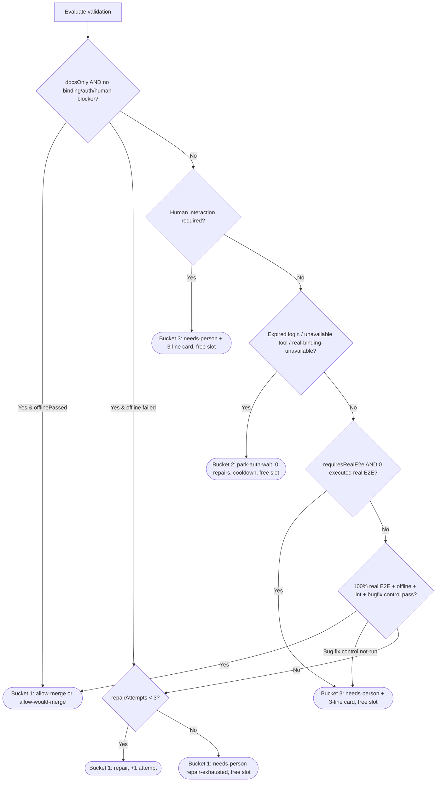

# Autopilot universal validator

Own `src/autopilot-validator.mjs` (public facade) together with its Layer-2 implementation modules `src/autopilot/validator/surfaces.mjs`, `src/autopilot/validator/policy.mjs`, `src/autopilot/validator/test-probes.mjs`, and `src/autopilot/validator/real-host-probes.mjs`, plus the companion Layer-2 gate modules `src/autopilot/gates/evidence-contract.mjs`, `src/autopilot/gates/typed-schemas.mjs`, and `src/autopilot/gates/test-env.mjs`. Provide the universal, repository-agnostic validation policy, polyglot real-host test probes (JS/TS, Python, Go, Rust), backside validation lint rules for repo hygiene lint, 4-check non-compensatory mechanical evidence contract, fence-hardened typed schema parser and keyed harness PR receipt stamper, and FD-safe `0600` post-review sandbox test-env gate. Works on any outside user repository without coupling to any internal repository and without loading rules from `origin/main`. Never calls GitHub, the PDD interpreter, or a model.

## Domain decisions

- **No silent skips — strict fail-closed in both `auto` and `observe` modes:** Never treat `real-binding-unavailable`, an expired login, an unreachable daemon, a missing secret, or missing real end-to-end execution as a local skip, pass, `merged`, or `would-merge`. Both `auto` and `observe` modes enforce the exact same validation gate: when validation does not pass 100%, `eligible` is `false` in both modes. Only when Bucket 1 passes 100% does `auto` return `"allow-merge"` and `observe` return `"allow-would-merge"`.
- **Surface detection (`detectChangedSurfaces`):** Classify each repository-relative path in `changedFiles` (case-insensitive) into zero or more surfaces:
  - `docs`: Markdown/text documentation (`*.md` excluding `*.prompt.md`, `*.txt`, `*.rst`, `LICENSE*`, `CHANGELOG*`, `docs/**`).
  - `cli`: CLI entrypoints or scripts (`bin/**`, `cli/**`, `cmd/**`, `scripts/**`, `*.sh`, or filenames containing `cli`).
  - `api-server`: servers, routers, API endpoints, HTTP/WS/GraphQL/gRPC handlers (`api/**`, `server/**`, `routes/**`, `handlers/**`, `controllers/**`, or filenames containing `server`, `router`, `api`, `http`, `ws`, `websocket`, `graphql`, `grpc`).
  - `database`: schemas, migrations, queries, DB adapters (`db/**`, `database/**`, `migrations/**`, `prisma/**`, `sql/**`, `*.sql`, or filenames containing `postgres`, `mysql`, `sqlite`, `mongo`, `redis`, `db`).
  - `web-ui`: frontend views, components, pages, styles, screens (`web/**`, `ui/**`, `frontend/**`, `pages/**`, `components/**`, `views/**`, `app/**`, `*.jsx`, `*.tsx`, `*.vue`, `*.svelte`, `*.html`, `*.css`, `*.ui.svg`).
  - `external-tool`: cloud, payment, container, auth, or external CLI/SDK integrations (`Dockerfile`, `docker-compose*`, or paths mentioning `gcloud`, `gcp`, `aws`, `azure`, `stripe`, `docker`, `kubernetes`, `k8s`, `oauth`, `auth`, `webhook`, `terraform`).
  - `os-boundary`: OS, process, sandbox, TTY/PTY, kernel, or device boundary modules (`os/**`, `sandbox/**`, `tty/**`, `pty/**`, `subprocess/**`, or filenames containing word-boundary tokens `sandbox`, `seatbelt`, `seccomp`, `landlock`, `bwrap`, `bubblewrap`, `chroot`, `cgroup`, `tty`, `pty`, `termios`, `ioctl`, `subprocess`, `child-process`, `child_process`, `spawn`, `posix`, `syscall`, `kernel`, `daemon`, `ipc`, `unix-socket`, `unix_socket`, `os-signal`, `os_signal`).
  - `native-only`: any changed production file matching optional `nativeOnlyFiles` (detected via owning `kind: native-only` `.prompt.md` YAML frontmatter or scoped `
` / `## Runtime interface` embedded declaration, `pdd-bindings.json`, `Generated from` / `Prompt:` header matching `file-owner.mjs` comment styles, or opening-sentence prose claim via `detectNativeOnlyModules`, with canonical repeated `./`/`//` normalization and case-consistent lookup).
  - `runtime-code`: any other production file (including source code, configs, build files, unknown extensions, or extensionless files) outside `docs` and non-production directories (`test/`, `tests/`, `__tests__/`, `spec/`, `fixtures/`, `examples/`, `prompts/`, `user_stories/`, `docs/`).
  - `runtimeSurfaces` is the sorted unique list of non-`docs` surfaces. `docsOnly` is `true` only when `changedFiles` is non-empty, `runtimeSurfaces` is empty, and every changed file is in `docs`. `requiresRealE2e` is `runtimeSurfaces.length > 0 || changedFiles.length === 0` (fail closed when changed files are empty/unknown).
  - `requiredProofKinds` maps detected `runtimeSurfaces` to sorted unique kinds: `cli` → `"subprocess-cli"`, `api-server` or `database` → `"local-server-or-db"`, `web-ui` → `"browser-playwright"`, `external-tool` → `"live-binding"`, `os-boundary` or `native-only` → `"real-host-smoke"`, and `runtime-code` (or empty `changedFiles`) → `"real-execution"` only when no more specific boundary surface is present. Also return sorted unique `nativeOnlyFiles` and `realHostBoundaryClasses` inferred strictly for `os-boundary`, `native-only`, or `cli` files (including `truncate`/`truncated`/`truncating`/`truncation` for `full-size-payload`).
- **Real end-to-end execution, `native-only` / OS-boundary real-host smoke, and bug-fix control:** When `requiresRealE2e` is `true`, unit mocks (`kind: "unit-mock"` or `mockOnly: true`) never satisfy the gate. Real execution requires at least one executed check (`executed: true`, `mockOnly !== true`) whose `kind` is in `["subprocess-cli", "local-server-or-db", "browser-playwright", "live-binding", "real-host-smoke", "real-execution"]`. Subprocess, FS, HTTP/server, DB (`new DatabaseSync(` for `node:sqlite`; `new Pool`/`new Client` only for non-SQLite DB imports), TTY (`new ReadStream`/`new WriteStream`/`isatty`/`pty.spawn`), and browser (imported browser package + authentic `launch`/`launchPersistentContext`/`newPage`/`newContext`/`connect`/`connectOverCDP` without leading `.` chains, or `@playwright/test` `page.goto` on a non-mocked/non-reassigned/non-property-stubbed fixture) primitives in test analysis must be genuinely imported (handling semicolon-free, multiline, `$`-prefixed, spaced member access, and CJS `{ orig: alias }` / ESM `{ orig as alias }` imports while skipping TypeScript `type` imports and string literals) or unshadowed built-ins like `fetch` (ignoring spaced member access `obj . fetch(...)` and JS/TS object/class method shorthands including inline object/union/intersection return types, continuing past `;` and newlines while nested inside `{...}`, `(...)`, `[...]`, or `<...>`, and access/abstract/declare modifiers), never module-mocked (`vi.mock`/`vi.doMock`/`jest.mock`/`jest.doMock`/`mock.module`), locally shadowed or reassigned (never mistaking arrow functions `=>` for assignments; catching ES2021 logical assignments `&&=`, `||=`, `??=` alongside `=` on global/bare `fetch`, namespace/receiver property or bracket stubs, imported bindings, and browser variables; skipping shadow rules only on exact single-binding classified `require(...)` spans; catching reassigned/shadowed imported namespaces and named aliases, comma-separated scalar/object/array destructuring, multiline `=` reassignments, EOL assignments, multiline destructured local variables, uninitialized `let`/`var`, `$`-suffixed class declarations, `globalThis`/`global`/`window`/bare `fetch =`, direct/multiline namespace/receiver property assignment stubbing such as `cp.spawnSync =`, `fs.statSync =`, `page.goto =`, `chromium.launchPersistentContext =`, `chromium.connectOverCDP =` with transitive browser-variable taint propagation, `vi.stubGlobal`, `Object.defineProperty`, or non-native/non-browser `import`/`require` bindings), spied/stubbed (`mock.method`/`vi.spyOn`/`jest.spyOn`/`sinon.stub`), or called on fake/shadowed/non-imported receivers; call arguments are inspected strictly within each call's balanced parentheses (supporting `$`-identifiers while skipping spaced member access and object property keys for device paths), same-line loops count only while unclosed at the call site (ignoring member `.for(`/`.while(` and closed inner blocks inside brace-less loops), header comment closers use linear string checks (supporting `*/`, `-->`, `--!>`, `"""`, `'''`), and `"".repeat(...)` (including across comments/newlines) counts `0` bytes. When `requiredProofKinds` includes `"real-host-smoke"` (or explicit `realHostClasses` are supplied), plain in-process `"real-execution"` checks without `liveLocal: true` / `--live-local` never satisfy the gate; when `os-boundary` is changed, unrelated surface checks (such as `"browser-playwright"`) do not satisfy `"real-host-smoke"` — require `"real-host-smoke"`, `"subprocess-cli"`, or `--live-local`. Checks tagged with `strictKind: true` satisfy only their own `kind` (plus `"real-execution"`), never substituting across sibling surfaces (while executed `strictKind: true` `"subprocess-cli"` checks still contribute their verified per-target `realHostClasses` once a `"real-host-smoke"` check has executed). When `offlinePassed === false` and an executed check failed (`exitCode !== 0 || failed > 0`), route to Bucket 1 (`repair` / `repair-exhausted`) rather than short-circuiting to Bucket 3 `needs-real-host-smoke`. Otherwise fail closed at Bucket 3 (`waitKind: "needs-real-host-smoke"`, `decision: "needs-person"`, `eligible: false`, 3-line `humanVerificationCard`) with actionable feedback naming the unexercised real-host boundary path and applicable real-host failure class whenever a `native-only` / `os-boundary` change lacks an executable non-mocked real-host check or fails a checked real-host failure class (requiring positive class satisfaction whenever explicit `realHostClasses` or check class metadata is present):
  1. `nested-sandbox`: real child-process execution invoking a sandbox binary/profile inside the host OS sandbox (not a mocked launch-prefix test, filename, or unrelated string).
  2. `host-tty-ownership`: real unmocked FS/TTY operation directly on `/dev/tty`, `/dev/ptmx`, `/dev/pts/...` or genuine `node:tty`/`node-pty` probe on the host kernel (not a mocked TTY helper, and not disqualified by an unrelated mock/spy).
  3. `multi-turn-cli-state`: multi-turn (`turns >= 2`) real CLI subprocess calls (via multiple calls, an enclosing loop, or a brace-scoped helper called multiple times) plus unmocked real FS state/isolation calls in code (not string literals or single-turn stubs).
  4. `full-size-payload`: realistic boundary payload strictly larger than `MIN_REALISTIC_PAYLOAD_BYTES = 4096` bytes (`> 4 KiB`) measured from unmasked code allocations/repeats or lexed inline string literals (immune to regex literals and string/comment spoofs).
  A 100% pass requires `offlinePassed: true`, empty `lintBlockingCodes`, every executed real E2E check having `exitCode === 0`, `passed > 0`, `failed === 0`, `skipped === 0`, and `mockOnly !== true`, every kind in `requiredProofKinds` covered by a passing executed real check (matching exact kind, an OS-compatible or non-mocked real-host check for `"real-host-smoke"` unless `strictKind: true` restricts a check to its own kind, a passing non-`strictKind` `"real-host-smoke"` check carrying subprocess evidence such as `turns >= 1`, `--live-local`, `nested-sandbox`, or `multi-turn-cli-state` for `"subprocess-cli"`, or any real check when `requiredProofKinds` is `["real-execution"]`), all required real-host boundary classes positively satisfied when checked, and when `isBugFix` is `true`, `bugFixBaseControl === "ran-and-failed-on-base"`.
- **Universal 3-Bucket outcome precedence:** Evaluate in exact priority order so environment/auth outages spend zero repair rounds and human-only or untested boundaries hard-stop in both modes:

- **Bucket 1 (Tool/login healthy & real E2E ran):**
  - 100% pass → `bucket: 1`, `decision: mode === "observe" ? "allow-would-merge" : "allow-merge"`, `waitKind: "none"`, `eligible: true`, `freeSlot: false`, `keepPr: false`, `repairRoundsToSpend: 0`, `repairAttemptsNext: repairAttempts`, `cooldownTool: null`, `resumeMode: "none"`, `checkCommand: null`, `proof` populated with sorted unique `surfaces`, executed `commands`, and their `exitCodes`, and `humanVerificationCard: []`.
  - Real code/E2E failure, missing required surface coverage among executed checks, blocking lint error, or `isBugFix: true` with `bugFixBaseControl === "passed-on-base"` → cap repairs cleanly at `MAX_VALIDATION_REPAIRS = 3`:
    - When `repairAttempts < 3`: `bucket: 1`, `decision: "repair"`, `waitKind: "none"`, `eligible: false`, `freeSlot: false`, `keepPr: true`, `repairRoundsToSpend: 1`, `repairAttemptsNext: repairAttempts + 1`, `cooldownTool: null`, `resumeMode: "none"`, `checkCommand: null`, `proof: {surfaces: [], commands: [], exitCodes: []}`, `humanVerificationCard: []`.
    - When `repairAttempts >= 3`: `bucket: 1`, `decision: "needs-person"`, `waitKind: "repair-exhausted"`, `eligible: false`, `freeSlot: true`, `keepPr: true`, `repairRoundsToSpend: 0`, `repairAttemptsNext: repairAttempts`, `cooldownTool: null`, `resumeMode: "none"`, `checkCommand: null`, `proof: {surfaces: [], commands: [], exitCodes: []}`, `humanVerificationCard: []`.
- **Bucket 2 (External tool or login expired / unavailable on runner):**
  - Trigger when `realBindingUnavailable` is `true` OR any diagnostic (case-insensitive) matches:
    - `gcloud`: `"reauthentication required"`, `"gcloud auth login"`, `"invalid_grant"`, `"do not currently have an active account"` → `cooldownTool: "gcloud"`, `checkCommand: "gcloud auth list --filter=status:ACTIVE --format='value(account)'"`.
    - `aws`: `"token has expired"`, `"expiredtoken"`, `"unable to locate credentials"`, `"sso session"`, `"aws sso login"` → `cooldownTool: "aws"`, `checkCommand: "aws sts get-caller-identity"`.
    - `docker`: `"cannot connect to the docker daemon"`, `"docker daemon is not running"`, `"is the docker daemon running"` → `cooldownTool: "docker"`, `checkCommand: "docker info"`.
    - Auth/secret failure: `"401 unauthorized"`, `"invalid api key"`, `"expired api key"`, `"missing env"`, `"secret not set"`, `"credentials not configured"` → `cooldownTool`: lowercased nonblank `toolHint` if supplied, else `"stripe"` if diagnostics mention `"stripe"`, else `"auth"`; `checkCommand`: nonblank `verifyCommand` if supplied, else `"env | grep -i token"`.
    - Service connection refused: `"connection refused"`, `"econnrefused"` → `cooldownTool`: lowercased nonblank `toolHint` if supplied, else `"postgres"` if diagnostics mention `"postgres"` or `"5432"`, else `"service"`; `checkCommand`: nonblank `verifyCommand` if supplied, else `"pg_isready"` (for `"postgres"`) or `"curl -sf http://127.0.0.1"`.
    - `real-binding-unavailable` (`realBindingUnavailable: true` or diagnostic contains `"real-binding-unavailable"`): `cooldownTool`: lowercased nonblank `toolHint` if supplied, else `"runtime-binding"`; `checkCommand`: nonblank `verifyCommand` if supplied, else `"pdd test --files"`.
  - Recognize as an environment/auth blocker, NEVER a code defect: `bucket: 2`, `decision: "park-auth-wait"`, `waitKind: "auth-environment"`, `eligible: false`, `freeSlot: true`, `keepPr: true`, `repairRoundsToSpend: 0`, `repairAttemptsNext: repairAttempts`, `resumeMode: "validate-only-same-head"`, `proof: {surfaces: [], commands: [], exitCodes: []}`, `humanVerificationCard: []`, and `message` as 1 concise sentence naming `cooldownTool` and `checkCommand`.
- **Bucket 3 (Needs human interaction, missing real-host smoke, OR zero runnable E2E):**
  - Trigger when `needsHumanInteraction` is `true` or diagnostics mention browser OAuth click, `2fa`, `mfa`, `captcha`, `live payment`, or `physical hardware` (`waitKind: "human-boundary"`), OR when a `native-only` / `os-boundary` / explicit `realHostClasses` change lacks an executable non-mocked real-host boundary check or fails to provide explicit evidence for any required real-host boundary failure class (`waitKind: "needs-real-host-smoke"`; never treat missing `realHostClasses`/`turns`/`payloadBytes` metadata as covered, and expose actually evidenced classes on `proof.realHostClasses`), OR when `requiresRealE2e` is `true` and zero real E2E checks executed (including mock-only tests) or `isBugFix` is `true` with `bugFixBaseControl === "not-run"` (`waitKind: "missing-e2e"`).
  - Hard-stop in BOTH `auto` and `observe` modes: `bucket: 3`, `decision: "needs-person"`, `eligible: false`, `freeSlot: true`, `keepPr: true`, `repairRoundsToSpend: 0`, `repairAttemptsNext: repairAttempts`, `cooldownTool: null`, `resumeMode: "none"`, `checkCommand: null`, `proof: {surfaces: [], commands: [], exitCodes: []}`, and `humanVerificationCard` containing **exact 3 nonblank lines**:
    1. `"Passed offline: <offlineSummary or 'none'>"`
    2. `"Unverified boundary: <humanBoundaryDetail or detected unverified surfaces / real-host classes>"`
    3. `"Verify command: <verifyCommand or a single concrete verification command>"`
- **Tool cooldown intake guard (`shouldClaimWithCooldowns`):** Normalize tool keys by trimming and lowercasing. If any tool in `issueRequiredTools` matches a `toolCooldowns` entry with `active: true`, return `{claimable: false, blockedByTool: <first matching normalized tool>, reason: "tool-cooldown"}`. Otherwise return `{claimable: true, blockedByTool: null, reason: null}` so freed workers immediately pick up unrelated issues.
- **Auto-resume without rebuilding (`planValidationResume`):**
  - If `currentPrHeadSha !== headSha`, refuse validate-only resume: `{action: "head-changed-abort", pr, headSha, rebuildCode: false, runValidationOnly: false, clearCooldown: false, targetTool: cooldownTool}`.
  - If `preflightExitCode === 0` or `userResumed === true`, resume validate-only at the exact saved commit head with zero code rebuild: `{action: "resume-validate-only", pr, headSha, rebuildCode: false, runValidationOnly: true, clearCooldown: true, targetTool: cooldownTool}`.
  - Otherwise keep parked: `{action: "stay-parked", pr, headSha, rebuildCode: false, runValidationOnly: false, clearCooldown: false, targetTool: cooldownTool}`.
- **Backside deterministic validation lint (`lintValidationCode`):**
  - `silent-validation-skip` (applies to `kind: "code"` and `kind: "test"`): flag code or tests that rewrite or excuse `real-binding-unavailable` as a local skip, pass, or non-blocker (such as `"local skip"`, `"not a defect or needs-person blocker"`, `localSkipRow`, or filtering `real-binding-unavailable` out of refusals) or unconditionally skip an E2E/validation test (`test.skip(`, `it.skip(`, `t.skip(`, Python `@pytest.mark.skip`, Go `t.Skip`, or Rust `#[ignore]` on validation/e2e tests).
  - `boundary-mock-only-test` (applies to `kind: "test"`): when the test targets a boundary surface (`cli`, `api-server`, `database`, `web-ui`, `external-tool`, `os-boundary`, or a `native-only` target in optional `nativeOnlyTargets`, detected from its path or imported production module paths), uses mocks/stubs/fakes, contains zero real execution or real-host device/TTY/subprocess/server/DB/browser/`--live-local` probes (with stub/shadow resistance across JS/TS, Python, Go, and Rust), AND `hasRealE2eCoverage` is `false`, emit `boundary-mock-only-test` (naming the unexercised `native-only` / `os-boundary` real-host smoke path when applicable). When `hasRealE2eCoverage` is `true` OR the test itself runs real end-to-end / real-host execution, do NOT emit `boundary-mock-only-test`.
  - Return `{ok: codes.length === 0, codes, warnings}` with `codes` sorted uniquely and each warning formatted `"Warning: validation lint: <path>:<line> [<code>] <detail>"`.
- **Open capability check (`checkCapabilityRequirements`):** Compare open `requiredCapabilities` against `availableCapabilities` (zero hardcoded model or capability tables); missing capabilities route to Bucket 2 (`missing_capability` / `auth-environment`) with zero repair rounds burned.
- **4-Check Non-Compensatory Mechanical Evidence Contract (`src/autopilot/gates/evidence-contract.mjs`):**
  - Check 1 (`checkAcCoverage`): Every frozen numbered AC maps to ALL of its harness-required passing test IDs (`source === "harness"`, never prose or agent self-declared `acIds`) and ALL of its required proved user paths.
  - Check 2 (`checkPathReceipts`): Every touched user path has a harness-written (`writtenBy === "harness"`) receipt bound to all 13 contract fields (`repo`, `acRevision`, `targetTip`, `candidateHead`, `integratedTree`, `trustedPolicyDigest`, `recipeDigest`, `testProfile`, `command`, `toolchain`, `capability`, `outcome`, `artifactDigest`). Validate receipts against `expectedBinding` even when `touchedPaths` is empty; reject stale/unbound `service_failure` receipts as `stale_evidence`; a current-head `failed` receipt blocks even when another receipt says `proved`, while an old-head receipt is superseded once a valid bound current-head `proved` receipt exists.
  - Check 3 (`checkTestOracle`): Zero unapproved missing/skipped/unknown/untrusted-source test IDs, un-spoofable independent `reportDiffVerdict` and `reportReadErrors` enforcement (immune to test-ID collisions), and strict-allowlist base-owned edited-test oracle (`status === "passed"`, or `"not-applicable"` strictly when zero test files changed; rows allow only `"pass"` or listed `"fail"`).
  - Check 4 (`checkProtectedPaths`, `isProtectedPath`): Canonicalize paths via `posix.normalize`, fail closed on traversal or invalid paths, and block unapproved edits to protected paths (`pdd.json`, `**/pdd.json`, `pdd-workspace.json`, `pdd-bindings.json`, `package.json`, `CODEOWNERS`, `.github/workflows/**`, `.github/actions/**`, `rules/lint/**`, `src/autopilot-core.mjs`, `src/autopilot-validator.mjs`, `src/autopilot/core/**`, `src/autopilot/gates/**`, `src/autopilot/validator/**`, gate/verify scripts including scripts referenced by merge-base `verify` recipes, and case-insensitive extra globs/regexes). `protected_path` outranks `service_failure`.
  - `#3151` code-bound formal proof rule (`FORMAL_PROOF_TIERS`, `classifyFormalProofTier`, `checkFormalProofBinding`): distinguish `proved_solver_code` vs `proved_spec_model`. A solver/formal proof satisfies code verification ONLY when it imports/executes production modules (covering any required `targetModules`) AND verifies a failing production-code mutation control (`"failed-on-mutation"` or `{ executed: true, failedOnMutation: true, mutatedProductionCode !== false }`). Spec-model-only proofs (`proved_spec_model`) NEVER satisfy code verification or prove path receipts (`holdReason: "insufficient_scope"`).
  - Cross-family closed-set gap check (`buildGapCheckInput`, `validateGapCheckOutput`): Input excludes PR title/body/comments; output accepts strictly `{missingPathIds, unprovedAcIds, flags}` with closed-set `flags` in `["UNMAPPED_CHANGE", "INSUFFICIENT_SCOPE"]` and zero numeric confidence/score fields. Missing/null gap check fails closed unless `requireGapCheck: false`; `service_failure` sets `burnRepairStrike: false`.
- **Strict typed schemas & keyed harness PR receipts (`src/autopilot/gates/typed-schemas.mjs`):**
  - Strict JSON schemas (`buildResultSchema`, `reviewResultSchema`, `gapCheckSchema`, `intakeCardSchema`, `buildCoreReviewSchema`), provider-strict wire normalizer (`toProviderStrictSchema` ensuring `additionalProperties: false`, all properties required, and stripping unsupported wire keywords), CLI flag builders (`buildCodexSchemaArgs`, `buildClaudeSchemaArgs`, `buildAgySchemaArgs`, `buildNativeSchemaArgs` supporting `codex`, `claude`, and `agy`), and 10-layer parser hardening (`sanitizeUntrustedText` with bounded CSI/OSC, `wrapWithSafeFence`, `enforceSizeAndDepthBounds`, `detectDuplicateJsonKeys`, `safeJsonParse` rejecting forbidden/bidi/control keys and sanitizing string values, `stripInjectionContainers` preserving ordinary `- ` bullets, `extractClosedJsonFences`, `detectConflictingVerdicts` including `missingPathIds`/`unprovedAcIds`, `validateAgainstSchema` supporting nullable union `type` arrays, and `unwrapStructuredEnvelope` refusing to flip an outer verdict via nested `structured_output`/`result`).
  - `formatHarnessPrReceipt` and `parseHarnessPrReceipt` require all 13 contract fields plus explicit valid `outcome`, redact fields prior to digesting, JSON-escape `<`/`>` so `-->` cannot close comment markers, support keyed HMAC-SHA256 verification with `timingSafeEqual`, and reject missing, empty, or multiple markers.
- **Live production evidence collector (`src/autopilot/core/live-evidence.mjs`):**
  - Export `runPolyglotBaseControl` (detecting JS `node:test`, Vitest, Pytest with per-file subprocess isolation for Python formal tests to prevent Z3 `main_ctx()` deadlocks, Go `go test -json`, and Rust `cargo test`) and `collectLiveEvidenceContract` wired live into Autopilot merge checks: reads merge-base `pdd.json` `verify.paths` and configured `verify.report` (entering compatibility advisory mode ONLY after establishing that the trusted base genuinely has no `verify.paths`, failing closed on unreadable checkouts, invalid base commit objects, or invalid `verify` schema; reading head reports from `suiteTree` first then `headTree`, base reports from `baseTree`, with `'auto'` format detection across JUnit/TAP/Go/Cargo), runs `runProve` injecting each recipe's own scoped `account:*` keys strictly by `(phase, recipeId)` via `ports.envForStep` and `buildPostReviewSandboxEnv` only when `reviewApproved: true` (never leaking credentials into `verify.test` or sibling recipes even when command strings match, and redacting `proveReasons` and `proveReceipt` summaries), runs G3 `diffTestReports` with distinct `baseMeta`/`headMeta` and un-spoofable independent `reportDiffVerdict` + `reportReadErrors` forwarding, runs `runBaseOwnedTestOracle`, enforces all 4 checks strictly when merge-base `verify.paths` is configured or `autopilot.strictEvidenceContract: true` (failing closed on `Failed`/`Not proved`, dirty or unknown-scope `pdd prove` receipts, unavailable `headTree`, diff enumeration errors before creating any path receipts, unreadable configured reports, unreadable changed Stories, or missing/partial/duplicated numbered Story frozen ACs regardless of `acNotApplicableReason`), enforces Check 4 protected paths unconditionally (`humanApprovedPaths = []`, merging `allTouchedFiles` deletions/renames plus trusted merge-base recipe scripts and parking PRs for manual human merge on GitHub), bounds Evidence Contract HOLD repairs cleanly via `maxRepairs`, and emits explicit advisory `Not proved` with zero forged `proved` receipts only when base policy is verified absent and `strictEvidenceContract` is not enabled.
- **FD-safe `0600` test-env loader & post-review sandbox guard (`src/autopilot/gates/test-env.mjs`):**
  - `loadAutopilotTestEnv` verifies parent directory via `lstatSync` (real dir, matching owner, `(mode & 0o022) === 0`), opens the file descriptor first with `O_RDONLY | O_NOFOLLOW | O_NONBLOCK`, inspects `fstatSync(fd)` (`isFile`, matching owner, `(mode & 0o177) === 0`, `<= 64 KiB`), reads strictly from the open FD, and registers only non-trivial secrets of length `>= 8` (`isRegistrableSecret`).
  - `probeMachineCapabilities` checks real TTY availability (`stdin.isTTY && stdout.isTTY`), browser/docker/simulator tools, and emits key names only (`account:<name>`, never secret values).
  - `buildPostReviewSandboxEnv` refuses injection unless `reviewApproved === true` and both `approvedHead` and `currentHead` are valid matching Git hex SHAs, filters `baseEnv` through a strict allowlist, and blocks runtime/loader/git/proxy/shell override keys from injected test-env files.

## Public contract

Export:

- `MAX_VALIDATION_REPAIRS = 3`, `MIN_REALISTIC_PAYLOAD_BYTES = 4096`, `REAL_HOST_FAILURE_CLASSES`, `MOCK_USAGE_RE`, `REAL_E2E_EXEC_RE`.
- `detectNativeOnlyModules({changedFiles, promptFiles, bindings, fileHeads})` → `{nativeOnlyPrompts, nativeOnlyModules, matches}`.
- `detectChangedSurfaces({changedFiles, nativeOnlyFiles?})` → `{surfaces, runtimeSurfaces, docsOnly, requiresRealE2e, requiredProofKinds, nativeOnlyFiles, realHostBoundaryClasses}`.
- `detectRealHostProbesInTest(testPath, text)` → `{hasRealHostSmoke, mockOnly, classes, maxDetectedPayloadBytes, detectedTurns, liveLocal}` (linear `O(N)` scan; zero ReDoS).
- `detectRealE2eKindsInTest(testPath, text)` → sorted array of executed real proof kinds (including `"real-host-smoke"` when real-host probes execute without skips).
- `inspectTestBoundaryTargets(testPath, text, {nativeOnlyTargets?}?)` → `{allTargets, boundaryTargets, boundarySurfaces}`.
- `checkCapabilityRequirements({requiredCapabilities, availableCapabilities})` → `{ok, missingCapabilities}`.
- `evaluateValidationOutcome({mode, changedFiles, nativeOnlyFiles?, promptFiles?, bindings?, fileHeads?, realHostClasses?, requiredCapabilities?, availableCapabilities?, isBugFix, offlinePassed, offlineSummary?, e2eChecks, bugFixBaseControl, diagnostics, realBindingUnavailable, needsHumanInteraction, humanBoundaryDetail?, verifyCommand?, toolHint?, lintBlockingCodes, repairAttempts})` → `{bucket, decision, waitKind, eligible, freeSlot, keepPr, repairRoundsToSpend, repairAttemptsNext, cooldownTool, resumeMode, checkCommand, message, proof, humanVerificationCard}`.
- `formatHumanVerificationCard({offlineSummary, unverifiedBoundary, verifyCommand})` → 3-element string array (`["Passed offline: …", "Unverified boundary: …", "Verify command: …"]`).
- `shouldClaimWithCooldowns({issueRequiredTools, toolCooldowns})` → `{claimable, blockedByTool, reason}`.
- `planValidationResume({pr, headSha, currentPrHeadSha, cooldownTool, preflightExitCode, userResumed})` → `{action, pr, headSha, rebuildCode, runValidationOnly, clearCooldown, targetTool}`.
- `lintValidationCode({path, kind, text, hasRealE2eCoverage, nativeOnlyTargets?})` → `{ok, codes, warnings}`.
- Companion Layer-2 gate exports from `src/autopilot/gates/{evidence-contract,typed-schemas,test-env}.mjs`: `evaluateEvidenceContract`, `checkAcCoverage`, `checkPathReceipts`, `checkTestOracle`, `checkProtectedPaths`, `isProtectedPath`, `buildGapCheckInput`, `validateGapCheckOutput`, `computeCanonicalDigest`, `TYPED_SCHEMAS`, `parseTypedOrLegacyOutput`, `safeJsonParse`, `unwrapStructuredEnvelope`, `buildNativeSchemaArgs`, `formatHarnessPrReceipt`, `parseHarnessPrReceipt`, `loadAutopilotTestEnv`, `probeMachineCapabilities`, `buildPostReviewSandboxEnv`, `summarizeTestEnvMetadata`.

## Failure and safety boundaries

- Treat malformed or missing E2E check fields (`executed !== true`, non-integer `exitCode`, `passed <= 0`, `failed > 0`, `skipped > 0`, or `kind === "unit-mock"`) as non-passing real E2E evidence (fail closed).
- Never allow `"auto"` or `"observe"` mode to return `eligible: true` when `requiresRealE2e` is `true` and real E2E did not run and pass 100%.
- Never load rules from `origin/main` or require an internal smoke repository.

## Dependencies

None. This is a pure universal policy module with zero native-only, network, or external repository dependencies; Autopilot core and repo hygiene lint depend on this contract.
