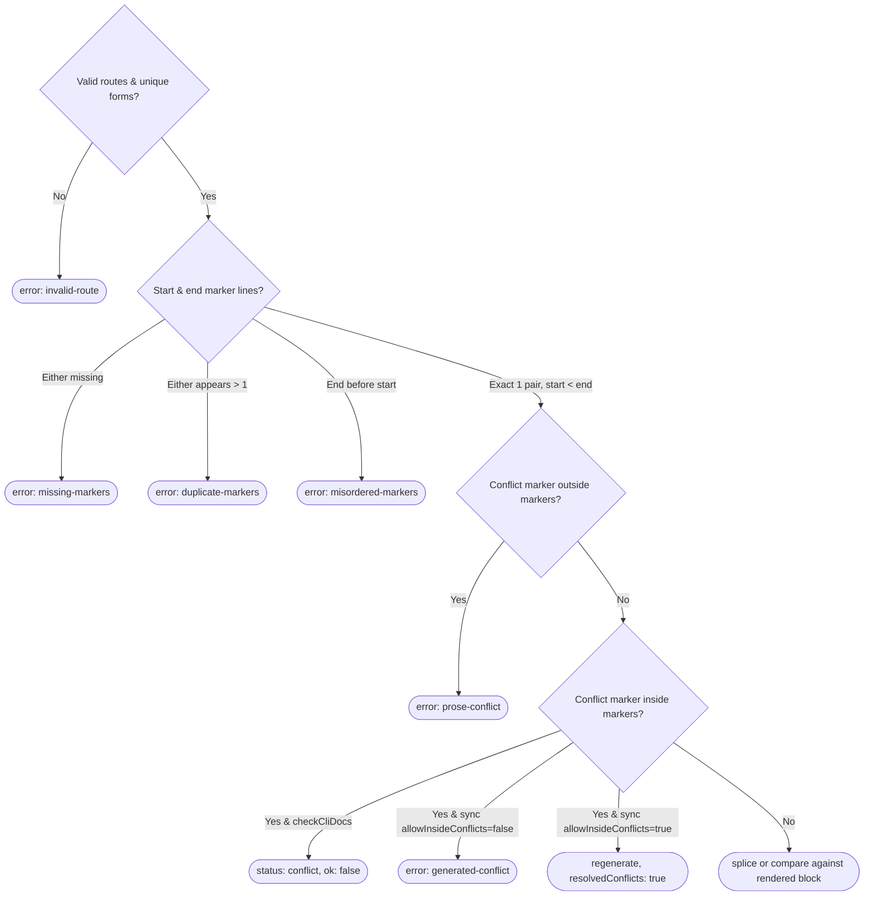

# CLI reference table generator and sync

Own `src/cli-docs-sync.mjs`. Deterministically render, splice, check, and conflict-resolve marker-delimited CLI command reference tables inside a Markdown CLI reference document from command-catalog route entries. Core operations are pure text transformations with no filesystem, Git, network, or interpreter calls.

## Domain decisions

- **Why generated marker blocks:** Hand-edited command tables in `docs/cli.md` are a primary source of parallel PR merge conflicts because every CLI command or flag change must keep the reference in sync with `pdd --help`. Rendering one table row per command inside explicit comment markers eliminates hand-edited table rows, keeps every byte of hand-authored prose and heading anchors outside the markers unchanged, and lets merge tooling regenerate table-only conflicts deterministically with zero AI calls.
- **Exact markers and notice line:**
  - `CLI_DOCS_START_MARKER`: `<!-- pdd:generated:cli-commands:start -->`
  - `CLI_DOCS_END_MARKER`: `<!-- pdd:generated:cli-commands:end -->`
  - `CLI_DOCS_NOTICE`: `<!-- Auto-generated from the command catalog; update via sync, not by hand. -->`
  - Match start and end markers only as complete lines, ignoring optional trailing spaces/tabs and `\r`.
- **Canonical group mapping and order (`CLI_DOCS_GROUP_ORDER`):**
  - Canonical order: `"Core PDD workflow"`, `"Cloud accounts"`, `"Workflows & product"`, `"Autopilot"`, `"Metrics, shell & help"`.
  - For each route `{id, group, forms}`, use trimmed `group` when `group` is a nonblank string; otherwise infer the group from `id`:
    - `accounts` or prefix `accounts.` -> `"Cloud accounts"`
    - `graph` or prefix `product.`, `workflow.`, `dependencies.` -> `"Workflows & product"`
    - `autopilot` or prefix `autopilot.` -> `"Autopilot"`
    - `metrics`, `completion`, `help`, `version`, or prefix `metrics.`, `version.` -> `"Metrics, shell & help"`
    - any other nonblank `id` -> `"Core PDD workflow"`
  - Emit only groups with at least one form: canonical groups first in canonical order, then any extra custom group titles in first-seen order. Preserve input route and form order within each group.
- **Route validation and one-line row formatting:**
  - `routes` must be an array. Each route must be an object with a nonblank string `id`, optional `group` (`string` or `null`), and array `forms`. Each item of `forms` must be an object with a nonblank trimmed string `form` containing no `\n`, `\r`, or backtick, and a string `description`. Duplicate trimmed `form` strings across `routes` are forbidden. Any violation raises error `invalid-route`.
  - Format `form`: trim outer whitespace and escape every `|` as `\|`.
  - Format `description`: remove ASCII control characters (`0x00`–`0x1f`, `0x7f`) except `\n`, `\r`, `\t`, collapse all runs of whitespace (`\r\n`, `\n`, `\r`, `\t`, spaces) to a single space, trim outer spaces, and escape every `|` as `\|`; if empty, render `-`.
  - Rendered block body (lines strictly between the start marker line and the end marker line):
    - Line 1 is `CLI_DOCS_NOTICE`.
    - When total forms is `0`, emit only that single notice line.
    - Otherwise, for each non-empty group: a blank line, `### <Group Title>`, a blank line, `| Command | What it does |`, `| --- | --- |`, and one line per form formatted as ``| `<escapedForm>` | <escapedDescription> |``; end with one trailing blank line before `CLI_DOCS_END_MARKER`.
- **Line endings and verbatim prefix/suffix preservation:**
  - Use `\r\n` if `document` contains `\r\n`, otherwise `\n`.
  - Keep every byte before and including the start marker line and every byte from the end marker line onward unchanged; splice only the rendered block body strictly between them.
- **Git conflict detection and guard precedence:**
  - A line is a Git conflict marker if, after stripping a trailing `\r`, it starts with `<<<<<<< `, starts with `||||||| `, equals `=======`, or starts with `>>>>>>> `.
  - Evaluate guards in exact order before any rendering or comparison:

- **Drift comparison (`checkCliDocs`):**
  - When no conflict markers appear inside the markers, scan lines strictly between the start and end marker lines that start with ``| ` ``, extract the first backtick code span in column 1, and unescape `\|` to `|` to obtain existing forms in document order (deduplicated).
  - `missingForms`: trimmed catalog `form` strings absent from existing forms (in catalog order).
  - `extraForms`: existing forms absent from the catalog (in document order).
  - `status` is `"current"` (`ok: true`) only when `document` matches the byte-exact output of `syncCliDocs`; otherwise `"stale"` (`ok: false`), even when `missingForms` and `extraForms` are empty (for example, description or heading drift).
  - When `status` is `"conflict"`, `ok` is `false` and both `missingForms` and `extraForms` are `[]`.

## Public contract

Export constants `CLI_DOCS_START_MARKER`, `CLI_DOCS_END_MARKER`, `CLI_DOCS_NOTICE`, `CLI_DOCS_GROUP_ORDER`, and pure operations:

- Shared input shape `Route`: `{ id: string, group?: string | null, forms: [{ form: string, description: string }] }`.
- `renderCommandTables(input)`:
  - Input: `{ routes: Route[] }`.
  - Result: `{ markdown: string, formCount: integer, groups: string[] }` (`markdown` uses `\n` line endings and omits the outer start/end markers).
  - Errors: `invalid-route`.
- `syncCliDocs(input)`:
  - Input: `{ document: string, routes: Route[], allowInsideConflicts?: boolean }` (`allowInsideConflicts` defaults to `false`).
  - Result: `{ document: string, changed: boolean, resolvedConflicts: boolean, formCount: integer, groups: string[] }`. `changed` is `true` iff `result.document !== input.document`. `resolvedConflicts` is `true` iff conflict markers existed strictly inside the generated markers and were replaced.
  - Errors: `invalid-route`, `missing-markers`, `duplicate-markers`, `misordered-markers`, `prose-conflict`, `generated-conflict`.
- `checkCliDocs(input)`:
  - Input: `{ document: string, routes: Route[] }`.
  - Result: `{ ok: boolean, status: "current" | "stale" | "conflict", missingForms: string[], extraForms: string[], formCount: integer }`.
  - Errors: `invalid-route`, `missing-markers`, `duplicate-markers`, `misordered-markers`, `prose-conflict`.

## Consequential boundaries

All operations are pure and side-effect free: a refused input returns its exact error code with no partial result and never mutates caller-supplied objects. A prose conflict outside the generated markers always refuses with `prose-conflict`, even when `allowInsideConflicts` is `true`.

## Dependencies

None. Pure transformation over caller-supplied route entries and Markdown text; no peer runtime prompts or external ports are required.
