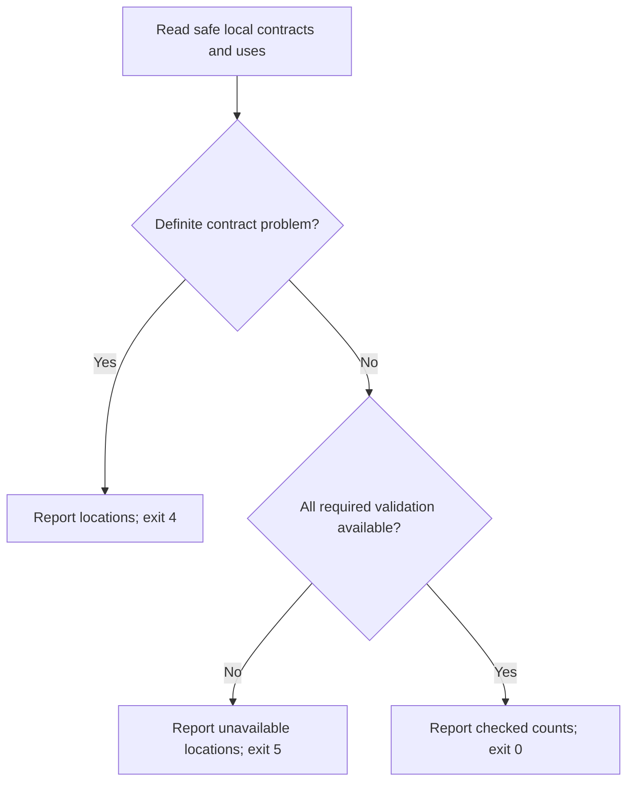

# Local shared-contract commands

Own `src/contracts.mjs`. Module function
`runContracts({words,options,cwd}, {env,stdout,stderr})` returns an exit code.
`words: []` lists contracts; `words: ['sync']` previews migration;
`options['--write'] === true` applies it. Syntax belongs to the command catalog.
With no words, `options['--check'] === true` checks the local plan contracts.
These routes read working files and private local Check history. They never
authenticate, reserve a runtime slot, upload, lint remotely or call a model.

Find the Git root as preflight does. Read Git-visible Markdown/JSON files under
`contracts/`, prompts and discovered scenarios using preflight's safe-file rules.
Do not follow symlinks or secret paths, including during writes. Use the
contract-reference module's catalog, expansion, comparison and migration APIs;
this command owns orchestration and presentation, not another resolver.

## Check the plan locally

`pdd contracts --check` checks working contracts and their current prompt/scenario
uses without needing a prompt, Story, test or previous Check. It does not read
Check history. It writes nothing, including hashes, expectations and approvals.
Plain listing and sync retain their advisory behavior below. `--check` cannot be
combined with sync or `--write`.

Check all independent available records, references, copy comparisons and world
values. Diagnostics name the file, canonical record or world key, and field JSON
Pointer (or the table column). A broken reference also retains its consumer and
requested target. Do not call a catalog warning a successful check: unresolved,
invalid, ambiguous or cyclic selected records are problems. A definite problem
wins over validation uncertainty; absent a definite problem, incomplete evidence
is unavailable, never a pass. Syntax/no-repository and native I/O retain their
own exits. Print a truthful checked-record/world-value count on success, including
zero when there is nothing to validate.

### Schema and data roles

Catalog records include worlds and JSON containers, so catalog membership alone
does not make a value a schema. Determine roles before validating:

- `contracts/seed-world.json` and every resolved `$seed` target are data, even
  when their keys resemble schema keywords. Never search business data for schemas.
- Every Markdown `###` JSON record and every explicit `$contract` or world-table
  Schema target is a schema. A selected empty or incomplete object is invalid;
  it cannot become a container merely because it lacks `type`.
- A nonseed JSON object with an executable schema keyword or a known forbidden
  schema keyword, or `$contract`, is a schema. Expand references before
  validating. Use the canonical preflight keyword vocabulary; annotations alone
  do not establish this role. Obtain that vocabulary from its module function
  `schemaKeywordNames()`, not a copied list. Thus `{"$ref":"x"}` is an
  invalid schema, not an ignored wrapper.
- A marker-free nonseed JSON object is a container only when every object-map
  branch ends in a marker-bearing schema. Stop at each schema; follow only its
  canonical schema positions during expansion/validation, never annotations or
  literal values. Include container leaf targets in `catalogRecords`' targets.
  A wrapper such as `{"defs":{"flag":{"type":"boolean"}}}` contains a schema
  at `#/defs/flag`; the wrapper is not itself a schema. An empty/unclassified
  branch or primitive metadata leaves its role unavailable. For example
  `{"defs":{"bad":{}}}` is unavailable unless that leaf is explicitly selected,
  when it is an invalid schema; `{"note":"hello"}` is unavailable.

Use `expandSource` with the safe file port for every selected schema and every
applicable prompt/scenario reference, including transitive uses. Use
`catalogRecords` for canonical identities/expanded records and `compareCopies`
for inline agreement. Exact copies pass; differing selected near copies are
drift problems, with their canonical target and constraint differences.
Ambiguous copy candidates leave agreement unavailable rather than choosing one.
Keep the reference owner's eligibility boundaries: this is not a claim to find
every possible copied schema. Literal inputs, expected values and annotations
are not copy candidates.

Validate expanded schemas and present world values through preflight's module
function `validateContract({schema_json,value_json?})`, retaining exact JSON text.
It owns the supported subset and concrete value evidence. Standalone component
schemas may have array or primitive roots; do not impose resource-interface
object-root rules on them. Map its problems to exit 4 and `unproved` to exit 5.
Never round numbers, coerce data, reserialize authored source or change own keys
to obtain a verdict. A numeric or pattern predicate that cannot be established
by the canonical validator remains unavailable with its field and reason.

### World keys and their seed values

`contracts/world.md` and `contracts/seed-world.json` are optional together. If
exactly one exists, checking the world is incomplete (exit 4, naming the missing
partner). The seed must expand to an object by the reference owner's seed rules.
Read the first actual contiguous Markdown table with `Key` and `Writer` columns
outside fences; unrelated tables and prose are not ownership declarations.
It must have a `Schema` column for this check. Listing/sync still accept existing
five-column ownership tables.

Each key cell is the exact top-level own seed key, plain or enclosed in backticks.
Its `Schema` cell is one plain/backticked repository-root contract target, resolved
by the reference owner; do not infer a link from a name, description or value.
Each row declares exactly one nonblank writer, a single name rather than a comma
list. Do not require a matching product part. Repeated rows with the same key,
resolved canonical schema and writer coalesce; distinct writers or schema mappings
for one key are problems. Missing key, writer or Schema cells are problems.

Validate every declared schema even when its key is absent from the starting
world. An absent declared key requires no seed value. Every present own seed key
must have a declaration, explicit schema and one writer; unknown seed keys cannot
be silently skipped. Empty containers, null, false, zero and absence remain
distinct. These checks establish declared ownership and seed shape, not the
actual runtime effects of a part's code.

## Listing and freshness

`pdd contracts` lists every catalog record's canonical target and owner file,
its current prompt/test users, and their Stories. Supply current used targets to
the catalog, including seeds and leaf schemas. Include transitive uses; ignore
literal business/expected values. Show unused records with no users. Report
catalog warnings without inventing a record or a user. Skip or warn for an
oversized catalog/discovery-only document before reading its contents; it cannot
abort independent listing, preview or selected good work. Report any affected
record/use or footprint evidence as unavailable rather than complete. Required
selected source retains preflight's bounded safe-read refusals.

Use `readContractHistory` from the runtime client for the most recent actual
Check baseline for each Story. Compare canonical target snapshots, including
removed targets, against that Story's current uses. Say `changed since the last
check` with the affected record identities and `stale: needs a new check` with
the affected Stories. A changed common record affects all its users. Another
record in the same file and another Story in the same batch do not become stale
merely because they shared a file or batch. Other source changes retain ordinary
source freshness behavior. Each Story's current effective footprint is independent
of which other tests were selected: checking one file, all tests for that Story,
or a multi-Story batch must produce the same footprint for unchanged Story
inputs. Account for all discovered tests belonging to that Story and their own
closures, without adding another Story's files. Preflight's
[unavailable-footprint rule](runtime-preflight.prompt.md#source-capture) applies:
report an incomplete current footprint as unavailable with its cause, never as
current or as a selected-source refusal merely because an unselected sibling is
broken. A baseline records a check, not necessarily a pass;
never display a failed result as passing.

With no actual Check baseline or a legacy baseline lacking reference provenance,
show `not checked` or `baseline unavailable`, respectively. Do not invent an old
value or a change. Lint, Try and file previews never advance these baselines.
Current user discovery reflects working files even without history. Unreadable
history is reported as unavailable, never treated as proof of freshness.

## Preview and write

`pdd contracts sync` prints proposed paths, schema locations, canonical targets
and constraint differences. It writes nothing. Ambiguous candidates warn and
skip while independent proposals remain available. Exact copies may migrate as
well as near copies; differing near copies explicitly adopt the canonical shape.

`pdd contracts sync --write` explicitly authorizes applying these proposals.
Before each write require the same safe destination and exact previewed `before`
bytes; a concurrent edit refuses that file without overwriting it. Write the
complete planned bytes into a new exclusive temporary regular file in the safe
destination directory, then atomically rename it into place. Recheck destination
identity, safe ancestors and exact `before` bytes immediately before replacement;
a concurrent content/identity change or symlink refuses without overwriting it
or its target. Failed preparation or replacement leaves the original complete
and removes only this operation's temporary file. Readers see the complete
original or complete replacement, never a truncated/intermediate file. Preserve
unrelated files, prose and unmatched schemas. Write only planned `after` bytes;
report changed paths and skipped/failed paths. Use the planner's draft transition
for edited approved interfaces; never approve, fill hashes or change expectations.
A repeated write with unchanged inputs performs no writes.

Exit 0 for completed listing/preview/write, including advice and ambiguity;
2 for invalid syntax or no repository; 4 for an unsafe/missing required consumer,
reference or refused write; 5 for unavailable local I/O. Keep a finite cause on
stderr; every nonempty output line ends with one newline. No history or source
write happens while merely listing or previewing.
For `--check`, exit 0 only for complete successful validation; 4 for definite
schema, reference, drift, mapping, writer or seed problems; 5 for unavailable
local validation or I/O; 2 for invalid syntax or no repository.

## Dependencies

- [References](contract-refs.prompt.md): required generation and verification
  context for record, expansion, comparison and migration rules; its native
  module functions `parseJsonValue`, `stringifyJsonValue`, `jsonNumberText` and
  `jsonValuesEqual` supply lossless read-only JSON inspection when determining
  roles and passing selected values to validation, without a second codec.
- [Preflight](runtime-preflight.prompt.md): required generation and verification
  context for Git discovery and safe native reads; native module functions
  `schemaKeywordNames` and `validateContract` supply role vocabulary and the
  supported-schema/concrete-value verdicts.
- [Runtime client](runtime-client.prompt.md#shared-contract-check-history):
  required generation and verification context for the local history API only.

The native discovery/history/write effects are not bound by the expansion
Runtime entry. Supplied blob replies do not prove host-file or history safety.
