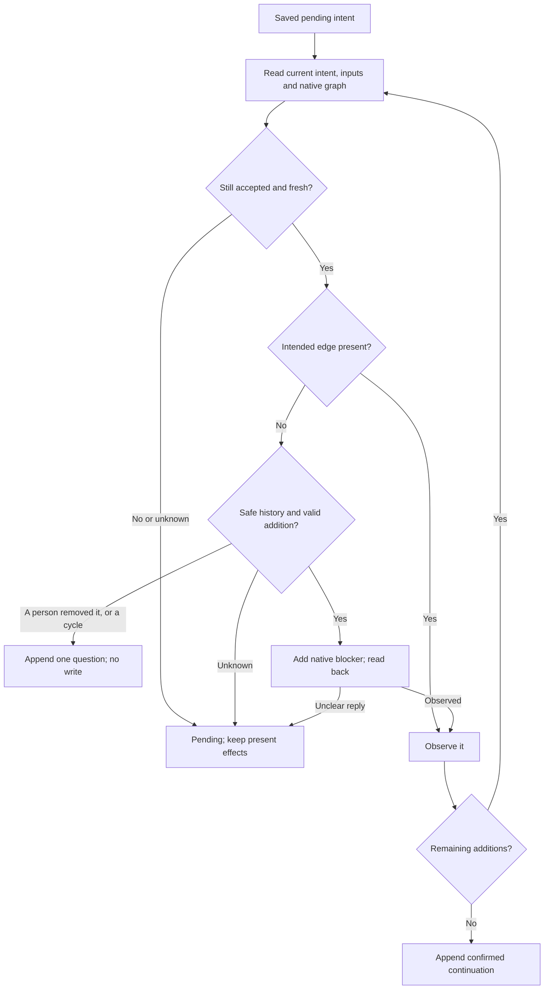

# Durable GitHub dependency observations and effects

Own `src/issue-dependencies-github.mjs`. Export module functions
`readDependencySnapshot({cwd,repository,inputs},ports)`,
`saveDependencyReview({repository,issue,review},ports)` and
`applyDependencyChanges({cwd,repository,issue,reviewId},ports)` and
`saveDependencyImpact({repository,issue,impact},ports)`, plus the claim
heartbeat functions `refreshClaimHeartbeat` and `withoutClaimHeartbeat`
([claims](#claims-heartbeat-and-expiry)), and the
[saved snapshot](#saved-dependency-snapshot) functions `dependencySnapshotStore`,
`issueRowVersion` and `commandGithubFloor`.
Own GitHub transport, append-only review storage and recovery. The pure model owns
which review is current and what is ready. No function calls AI or starts work.
All outside access uses injected ports. Existing issue bodies and comments remain
unchanged. Preserve native human relationships and their edited readable reasons.

Export module function `createDependencyReadPorts({cwd}, supplied)` to supply the
native GitHub, authority, context, evidence, clock, owners and settings ports;
supplied ports override defaults. The factory delegates trust decisions to the
existing Autopilot trust owner.
Its native settings port reads current launcher state for automatic admission:
`enabled: false` maps to mode `off`; missing or malformed state or enabled flag
is unavailable and fails closed. For `enabled: true`, preserve the current configured mode, activation and cap;
configured off remains off. Manual workflows without
automatic context remain usable while stopped.

For current local occupancy, preserve waiting, paused, stuck and question run identity and allocation. A registered current worker with native `done` and positively valid, equal saved and observed session identities has completed its turn: return its run state with `occupied: false`, without implying chat exit, run completion or claim release. Working, unconfirmed, mismatched or unknown observations remain occupied; a stale saved starting state alone does not override a positive current done observation. Confirmed absence with ended or failed evidence keeps its existing treatment. Use the existing lifecycle observation. A paused run that waits for the interpreter (it has a saved `runtimeWait`) also returns `waiting: "runtime"`; the snapshot then adds the hold `Waiting for the interpreter` to its issue, so `pdd graph` shows the wait. This hold is visible state only: it changes no review, impact, dependency or eligibility rule of another issue.

## Read complete native observations

Resolve an omitted repository through the existing repository resolver. Explicit
canonical OWNER/REPO works outside a checkout. `cwd` may be empty for that read.
Read all pages of root open issues, their blocked-by/blocking, comments and relevant
native relationship history, and recursively all linked prerequisite issues even
when closed or cross-repository. Also read pending intent prerequisites as context
for cycle validation before a proposed new native link exists. Those proposals
add no graph edge. Expand each proposed blocker's reachable native prerequisites.
Deduplicate by full identity and stable issue ID.
Do not equate a failed page, 404 private blocker or an unchanged open-list ETag with
an empty edge list. Read known relationships independently on every catch-up.
A partial read returns complete false and warnings; preserve known observations.
Read capture time through injected `clock.now({})`, returning `{iso}`.

The default native adapter may batch fresh observations for unclaimed root issues:
read their issue fields, including the complete current GitHub Assignees field,
lossless native IDs, labels, complete comments, blocked-by,
blocking and cross-referenced open PR history directly from GitHub. Without a
[saved snapshot](#saved-dependency-snapshot), reuse these observations only within
that snapshot. With one, a saved read whose change facts match the current issue
row is current for review data; a saved projection or issue timestamp never
establishes freshness for a [safety read](#safety-reads). Each nested connection
must be complete and validated.
If the batch, any required field or pagination is unavailable or incomplete, use
the existing REST reads for the affected root; a failed required read makes the
snapshot incomplete. Claimed issues retain full current claim-history and owner
reads. Recursively linked and cross-repository issues retain full closure reads.
Execution and its coverage apply to root-repository issues only. A linked issue in
another repository is only a prerequisite there, and its native state decides.
Recheck current authority, required source inputs, occupancy, settings and cap at
their existing boundaries. Caller-supplied GitHub ports keep their existing contract.

`github.page({repository,kind,issue,cursor})` is a raw service port; kind is issues,
comments, blockedBy, blocking, or timeline, issue is zero for repository issues,
and cursor is initially empty. Its JSON envelope contains `{items,next}` (empty
next ends pagination), or `{error,status}`. `github.issue({repository,issue})`
returns raw GitHub issue JSON, or that error envelope. Ports default to gh argv
calls using the documented native dependency REST endpoints, not shell strings.
Transport the actual native GitHub Assignees list as `assignees` on each normalized
issue. A missing, malformed or incomplete native list is unknown, never an empty
list. A PR reference or saved workflow record alone must not become an execution
hold or running execution for new selection; retain verified claim/run provenance
for the existing own-claim start check and recovery.
Canonical normalized observations use the model's Runtime schema. Supply unknown
linked placeholders when inaccessible. Only raw native relationships become edges.

`context.read({cwd,repository})` returns JSON containing relevant requirement/source
revision observations (`inputs`) and issue semantic conditions/execution holds.
Read substantive issue title/body and currently trusted requirement comments;
exclude unchanged PDD marker records, claims, sync and review bookkeeping. Derive
stable revisions from actual content (not updated_at). No whole-source commit or
unrelated file change alone invalidates a review. Unknown context stays explicit.
Optional read inputs name additional required non-issue rows from completion.
After parsing saved records, `context.read({cwd,repository,inputs})` rereads the
union of their durable non-issue locators; inputs is omitted when that union is empty.
A review's link row comes from native links through the pure model; it is not a locator to read.
Its default uses actual bytes in a verified selected-repository checkout, or the
same repository's current default-branch content API when no matching checkout
exists. Within one context read, the verified checkout/repository resolution may be reused for its source locators; each source byte is still read fresh, and a later context read resolves again. Read native comments by their owning repository/issue/comment identity.
A comment row takes its body from the complete comment pages of its issue that
this process read (the [read session](#saved-dependency-snapshot)): one GET for
each comment is not needed. A comment that is not on those complete pages is
gone, hence missing. Only a comment of an issue that this process did not read is
one more read. The native context reads the supplied inputs once, at the end of
the snapshot, with the saved review rows; a supplied context port keeps its first
read with the inputs.
An unavailable local-only plan or required source stays missing, hence stale or
pending. Recovery with empty cache follows the saved input locators, never a local
cache or the old packet. Unrelated paths are not part of this comparison.
`evidence.read` in intake uses these same locators and content revisions for text;
the snapshot must include a matching current input row for every examined item.
Condition source facts and current executionClaim/runIds come from the same
native requirement/claim/run observations. Unknown provenance is not a claim-only
hold that the pre-start check may discard. The selected native coordinator supplies semantic conditions; the adapter does
not infer installation or deployment from a PR merge.

<a id="conditional-reads"></a>
## Conditional reads and call purposes

The native REST reads use `gh api --include`. With a supplied `githubCache` port
(`{get(endpoint), set(endpoint, entry)}`, the ETag cache of
[GitHub calls](github-calls.prompt.md#etag-cache)), each GET with a saved entry
sends `If-None-Match: ETAG`. A 304 reply is a current GitHub answer that the
resource has not changed; it does not count against the limit. Return the saved
body and next page for it. gh exits with 1 for a 304 and prints the headers:
read the reply from that failed command too. A saved entry for a
[full last page](github-calls.prompt.md#full-last-page) (`githubFullLastPage` of
the endpoint, the saved list and its saved next page), or one whose body does not
parse, sends no ETag: the page is read in full. Otherwise a 304 for a page of
exactly 100 comments or history events keeps the saved "no next page", and the
read misses item 101 and still reports `complete`. This rule covers the claim
check's history and comment pages and the comment pages that a record append
searches for its own earlier comment, so a new claim, a label event or a record
after a full page is seen. A 200 reply with an ETag replaces
the saved entry. Without a saved entry, or for a write, the request is as before;
any other non-2xx reply is the existing failure. This is not a saved projection:
each read still asks GitHub, so freshness stays as above. The launcher tick
supplies its cache. For every other caller of the native ports (the `pdd
dependencies` commands, the workflow start and continuation checks, the graph)
the default is the same ETag file of the repository when Autopilot runs for it on
this machine (its [call ledger](github-calls.prompt.md#ledger) exists in the state
root); each top-level read, owners read, record save and evidence read saves it.
For another repository, and with caller-supplied GitHub ports, no request changes.

Native reads for a repository with an Autopilot ledger initialize the
[floor guard](github-calls.prompt.md#floor-guard) from current native settings
and machine ledgers when no `githubFloor` is supplied. Share that guard within
one native read session and across ports derived from it, including repository
observations during automatic start and direct snapshot reads. An explicit guard overrides this default.
Each native GET and the batch GraphQL read first ask the guard, unless it is a
[safety read](#safety-reads); a blocked read fails like an unavailable read, so
the snapshot is incomplete. Each reply goes to `observe`. Writes never ask it.

The native runner passes an optional `purpose` in the options of each call for
the [call ledger](github-calls.prompt.md#ledger): the claim reads of the owners
port (issue, timeline and comments of a claimed issue), plus heartbeat reads
and writes, name `claims`, and the
batch GraphQL read names its `repository`. Saved-snapshot issue-index and
link-identity reads explicitly name purpose `dependencies`, including with an
injected native runner.
`github.page` and `github.issue` accept an optional `purpose` field for this; a
supplied port can ignore it. Native transport defaults an omitted purpose to
`dependencies`, including with an injected runner. The native default runner
records each gh call through `nativeGithubCounter` in the ledger of the
repository that the call names.

<a id="saved-dependency-snapshot"></a>
## Saved dependency snapshot

Why: on a repository with about 200 open issues, each tick read every issue,
comment, link and history again, and Autopilot used the whole GitHub limit of the
login. Most issues do not change in 30 minutes. So one process reads only what
changed since the saved snapshot, and all callers use the same snapshot.

**Read session.** `createDependencyReadPorts` gives native ports (no supplied
`github`) one read session as the port `dependencyReads`, and keeps a supplied
one; the ports that a caller passes on keep it. A session lives for one process
(one tick, one command). It holds: the issue list and the issue reads of this
process, the saved snapshot of each repository, the comment bodies of the
complete comment pages read (`noteComments`), replacing all prior comments of an
issue on each reread and clearing them on invalidation, the claims of the last snapshot
(`owners`), the trust lookups of each repository, and a safety count for
readbacks.

**Store.** `dependencySnapshotStore({root, repository, fs})` keeps
`ROOT/github/H.snapshot.json` (the `H` of the [call ledger](github-calls.prompt.md#ledger)),
folder 0700, file 0600, written through a temporary file and a rename. Hold an
exclusive repository file lock across load, merge and rename. A busy lock waits
briefly and retries; an unavailable lock refuses the save without replacing data. Version 1:
`{v:1, repository, refreshedAt, list:{readAt, since, rows}, issues, invalid, pendingList?}`.
`pendingList` holds `{at, rows}` from an incomplete incremental index read; it
never advances `list.readAt` or `list.since`, and is not complete coverage.
`rows` maps each open issue number (no pull requests) to its issue row, including
`nativeLinkVersion`, the SHA-256 digest of the JSON list of sorted unique full
issue URLs in blocked-by order, then blocking order; `issues`
maps an issue number to `{version, observedAt, kinds:{comments, blockedBy,
blocking, timeline}, raw?, partialTimeline?}`; `invalid` maps an issue number to
the time of a write. Another version or repository is no snapshot. `save` merges
with the file as it is then: the newer `refreshedAt` wins; with the same one, the
newer list read wins (this save on a tie), each issue keeps its newer observation,
and an observation older than the issue's `invalid` time is dropped. Keep the
greatest invalidation time per issue across both files, including different
full-refresh periods. A stale process must never restore invalidated observations. The oldest
issue reads go first above 64 MiB or 10,000 issues; a list alone above 64 MiB is
not saved. The store also has `completion` (`read`, `save`, `clear`) for the
[kept completion](issue-dependencies-intake.prompt.md#kept-completion) beside it,
`ROOT/github/H.completion.json`, mode 0600. A lost or failed save only costs reads.
The launcher supplies the store as `snapshotStore`. Native ports default to the
store of a repository where Autopilot runs on this machine (its ledger exists
under `autopilotStateRoot`, else `$HOME/.local/state/pdd/autopilot`);
`snapshotStore: null` turns it off. Without a store, no read is reused across
processes and the snapshot reads as before.

**Change facts.** `issueRowVersion(row)` is the JSON list `[updated_at, comments,
state, issue_dependencies_summary]`, or null when `updated_at` is not a valid time.
A null version is never reused. Saved freshness also compares the current native
link identity version against the complete saved link pages.
Link counts and update times alone cannot detect a swap of blockers. Compare the
sorted full issue identities in each direction on every incremental catch-up,
including known closed prerequisites. Batch these lightweight link observations
through GraphQL; zero counts in both directions in the current open index need
no link query. Incomplete
or unavailable connections use complete REST link pages instead. If those reads
fail, the list is incomplete and cannot establish saved freshness. The version
covers each direction separately. An identity change invalidates saved details
even when all counts and update times stay equal. Continue conditionally reading
open index pages for row metadata outside `since`; missing rows leave only at the
daily full refresh. Unchanged comments and history need no reread.

**Issue list.** With a store, the snapshot reads the open issue list through the
session:

| Saved snapshot | Read |
|---|---|
| None, older than 24 hours, or from the future | Full refresh: `state=open&per_page=100`, all pages. `refreshedAt` is now; no saved issue read is reused |
| Current | `state=all&sort=updated&direction=desc&since=W&per_page=100`, all pages, applied to the saved rows: an open issue replaces its row, any other row leaves the list, and a closed issue whose facts changed loses its saved read |
| Current, and the caller asks for the saved list (`savedList`) and this process wrote nothing | No list read: the saved rows |

`W` is the newest `updated_at` that a read saw, minus 5 minutes, and it never
moves back. All list reads use the ETag cache. A list that is not read in full
gives its rows so far as partial roots (incomplete scope), without advancing
complete coverage. A
deleted or transferred issue leaves the list only at the next full refresh,
within 24 hours.

**Issue reads.** An issue read is current when this process read it after the
list, or when its saved read has the change facts of its current row, was
observed after `refreshedAt`, and no write of this process or a later saved
`invalid` time came after it. A closed same-repository issue outside the list
keeps its saved read only between full refreshes (a `since` read shows its
changes). An issue in another repository is always read. With a store, an open
root issue is its current list row; a current saved read serves its comments,
links and history; the batch GraphQL read covers only the roots that are not
current; every other read goes to GitHub and is recorded. At the end of a
snapshot whose list read was complete, the session saves the list and each issue
read in full; a partial issue read is not saved, and its row then shows that it
needs a read. A failed list read keeps the last complete list and its watermark;
its partial rows cannot establish complete coverage. With a prior complete
list in the same full-refresh period, keep those rows as `pendingList` and keep finished issue reads. The next
read starts with those rows but uses the last complete watermark. A successful
list read clears older pending rows.

**Writes.** A comment append or a new link through the session first and again
after the write marks the issue: this process reads it live again, its row
leaves the session list, and the saved store gets its `invalid` time.

**Claims.** The claim scan inside a snapshot reads through the session, so an
unchanged claimed issue costs no call, and claim expiry is computed again with
the current time. Its observation is the session's `owners`, so the tick and
prepare need no second claim read of all open issues. A failed scan stays
incomplete; these callers must not fall back to a live all-issue claim scan. A batch history has only
PR references, so a claim check never takes it from the store.

<a id="safety-reads"></a>
**Safety reads.** These always ask GitHub. A 304 reply is a live answer; a skip
because of `since`, the change facts or the store is not allowed:

- the default owners port (`owners.read` outside a snapshot): the claim checks
  before a start, a push, an approve, a park, an open, a yield and a merge, and the
  owner check of a completion; the native owners port is live, and only the claim
  scan inside one snapshot reads through the session;
- the subject of `checkDependencyStart`: the session reads its issue, claim,
  labels and links live (`live`), not from the store; those reads bypass the floor
  and the review-data batch;
- the heartbeat of an own claim and its readback;
- trust: the repository and collaborator reads (once for each repository in one
  process);
- the history and comments that a write depends on, and the readback of each
  comment append and new link.

The floor guard never stops a safety read. The pre-write history read of
`applyDependencyChanges` uses the live port, and its readback snapshots after a
link write count as safety reads.

`commandGithubFloor({cwd,repository},ports)` returns the floor guard for native
dependency reads of a repository where Autopilot runs on this machine: the
floor of `autopilot.github` in the checkout's `pdd.json` (default 1,000) and the
newest limit in the ledgers of this machine. It returns a supplied `githubFloor`,
and null for other repositories or caller-supplied GitHub ports. Native ports
created by this module retain default guard initialization.

## Claims, heartbeat and expiry

Only Autopilot uses `pdd:working`. The native owners port reads the winning claim
of each labeled issue: the earliest label event of the current claim era (a native
removal ends an era), and the one trusted comment by that event's actor whose JSON
record names the repository, coordinatorId, machine and that labelEventId. Each
claim is `{issue,owner,active,coordinatorId,machine,commentId,labelEventId}` with
optional `lastSeen` (ISO time), `expired: true`, `stuckSince` (time of the
current `pdd:stuck` label event), `claimedAt`, `takeovers`, `previousOwner` and
`longRunningAlertedAt` (see [takeovers](#takeovers)). The owners reply also
gives `localMachine`, the machine of the local launcher state, next to
`localOwner`. Read the time through `clock.now({})`. The
default clock follows the caller's injected `now` in milliseconds.

| Claim | Expired when |
|---|---|
| Heartbeat: the one matching claim record has a top-level `lastSeen` member, with any value (`""` too) | 4 hours after its last-seen time: the claim comment's GitHub `updated_at` (its `created_at` when it has no `updated_at`), and at most now. Other issue activity does not refresh it. `lastSeen` is that last-seen time. |
| Legacy: a matching record with no top-level `lastSeen` (as older pdd writes it), no unique matching comment, a bare label, or a matching comment with no GitHub time | 24 hours with no issue activity: the latest issue update, comment creation or edit, or timeline event. `lastSeen` is that activity time. |

A new claim record has `"lastSeen": ""`, so it uses the heartbeat rule from its
creation; the first heartbeat writes a time. The member, not its value, selects the
heartbeat rule. Only the GitHub server times of the claim comment count. A recorded `lastSeen`
value never extends a claim and never shortens it: a wrong or fast writer clock,
a future or copied old time, or a failed heartbeat readback does not change the
last-seen time. A recorded `lastSeen` is advisory. Any edit of the claim comment
counts as a heartbeat.

An unknown time or clock never expires a claim. An expired claim has `active: false`:
it is not owned elsewhere, and it does not admit its old owner to a start or a
continuation. In the snapshot, it replaces the `Claimed` hold with the hold
`Expired claim, last seen <lastSeen>`, and execution follows the run observation.
The pure model shows that hold as a reason and does not block on it. A takeover
removes and adds `pdd:working`, so a new era starts and the old record no longer
matches. Never edit or delete an old claim comment.

`refreshClaimHeartbeat({cwd,repository,claim,coordinatorId,machine,at},ports)`
acts only on an active claim of that coordinator and machine. It rereads the
comment by `commentId`, requires the same record identity and labelEventId, sets
the top-level `lastSeen` to `at` (adds it when absent) and keeps every other byte
of the comment. Before the edit, check that the new body parses to the same record
with only the new top-level `lastSeen`; never change a nested `lastSeen`. When no
such edit exists, make no edit and throw. The edit uses the scan's admission guard,
like other scan mutations. Read back the saved `lastSeen`. Return
`{state:"refreshed",lastSeen}` or `{state:"skipped"}`; an unavailable read, edit or
readback throws. A repeated heartbeat is safe: it only sets a time.
`recordLongRunningAlert({cwd,repository,claim,coordinatorId,machine,at},ports)`
does the same for the top-level `longRunningAlertedAt` member and returns
`{state:"recorded",longRunningAlertedAt}` or `{state:"skipped"}`.
`withoutClaimHeartbeat(body)` returns the body without its top-level `lastSeen`
and `longRunningAlertedAt` members, with the same check, or the same body when
there are none or no such edit exists, so that a tick edit is not new trusted
work.

### Takeovers

Count takeovers from GitHub data, not from a value an agent writes. Each ended
era (its `pdd:working` label was removed) ends in one of three ways:

- A takeover: its claim was already expired when its label was removed (apply the
  expiry rules above at the removal time, with only earlier facts; a claim comment
  edited after the removal counts as seen at the removal), and the actor of the
  removal added the label again at once, within 10 minutes, for a claim record of
  another coordinator ID or machine.
- A re-claim: the same, but both claim records name the same coordinator ID and
  machine. It is not a takeover.
- Else a release: the normal end of a live claim, or a person's removal of an
  expired label that no new claim follows at once. It ends the claim chain, and
  the count starts again at 0.

A takeover and a re-claim continue the claim chain. `claimedAt` is the label
event time of the first era of the current chain. A removal of `pdd:stuck` at a
time when the claim was takeover-limited (below) also starts the count again at
0: this is how a person lets Autopilot continue after the limit. A removal before
the limit changes nothing. `takeovers` is the count over the eras since the last
reset (omit it when 0). With `takeovers`, `previousOwner` is
`{coordinatorId,machine}` of the most recent earlier era of the chain whose claim
record names another owner than the current claim. `longRunningAlertedAt` is the
earliest top-level `longRunningAlertedAt` of a claim record in the current chain.

Export `takeoverLimited(claim, self)`: true when `takeovers` plus 1 for an
expired claim is more than 3. `self` (`{coordinatorId,machine}`, optional) is the
reader's own coordinator: its own expired claim adds no 1, because taking it back
is a re-claim. Such a limited claim is not taken over a 4th time, and a 4th
takeover made anyway does not admit a start. In the snapshot, add the hold
`Taken over N times; take the stuck path, not another takeover` (N is
`takeovers`), with `self` from `localOwner` and `localMachine`. It is an ordinary
hold, so the issue is not eligible. The limit 3 and the 10 minutes are
constants, not settings.

## Repository-bound authority

`authority.read({repository,author})` returns trusted, outsider or unverified using
the existing Autopilot trust owner with repository-bound read ports. This is a
read adapter for that owner's policy, not another trust implementation. Resolve
current authority separately for each record's actual repository and subject.
Never use checkout A's local extra names for explicit repository B. When the
current checkout is verified as another repository, or no checkout is given, apply
the trust owner's default policy to that repository's own GitHub data: its owner
and collaborators with write permission are trusted, and other authors are
outsiders. An unresolved checkout, a failed or incomplete owner/collaborator lookup,
or an unreadable local setting is unverified, not trusted. No login, setup, clone
or AI is allowed to resolve it.
Never treat a PDD marker as authority. Preserve malformed/unsupported/edited trusted
records as unresolved observations; do not hide them by returning an older record.
Use actual comment identity and creation/edit evidence to set `intact`.

## Append a review before native effects

Save a readable result and plain edge reasons followed by one disclosed JSON
record, marked `<!-- pdd-dependency-review:v1 -->`. The saved JSON is version 1
with envelope `{schema_version:"pdd.dependency-review.v1",review:REVIEW}`
and the raw review schema below; actual comment ID, authority and integrity come
from GitHub on read and are never accepted as caller attestations. `issue` is the
full canonical dependent issue URL. Reject a foreign issue/review identity.
Save complete `dependencies: []` for a checked empty result. A question preserves
questions and makes no edge addition. A proposal with additions has outcome pending,
effects pending, and the full immutable intended analysis saved first. An append
failure returns pending/error and permits no native effect. The `github.appendComment`
port returns a verified comment ID only after readback confirms that native ID and
the same parsed versioned record. A supplied port must honor that boundary. An
unresolved append or readback must not return a verified comment ID; the owning
function returns pending/error as already specified. Return the ID from a successful
verified port reply. A lost reply stays unresolved until a matching current record
is observed; never blindly append a second intent. Reconcile analysis/base identity
from comments.
Impact coverage is stored with the same append-only discipline and marker family
`pdd-dependency-impact:v1`; use envelope `{schema_version:"pdd.dependency-impact.v1",impact:IMPACT}`.
IMPACT omits model read metadata id/trusted/intact; supply these from the actual
comment and current authority, never caller attestation. The normalized snapshot also carries `host`, the canonical issue URL that
owns the comment. This host comes from the actual GitHub location, never from the
saved impact JSON.



Recovery uses injected `snapshots.read({cwd,repository,inputs})`, defaulting to this module's
`readDependencySnapshot`, with the same normalized schema. It is a production
read boundary for each recovery observation. cwd defaults to an empty string;
The initial read omits inputs and discovers them from the saved intent; subsequent
observations supply its nonempty non-issue rows. The default reader discovers
these locators again from saved comments when inputs is omitted, including after
restart. Neither an empty cache nor missing checkout drops required inputs.

Read the initial recovery snapshot once. Before EACH absent edge write or retry, reread current records, substantive input
revisions and reachable native graph. Use the pure model's current head and change
validation. A superseded/edited/stale/conflicting intent stops remaining additions.
Keep already present edges. Never compensate by deleting them. Existing duplicate
edges need no add. Native history must distinguish never-applied intent from a
later human removal. A person's change wins: refuse an absent named blocker when a
person removed that link. That is so when the blocker is in the model's `removed`
link facts, or when the subject's native history has a "blocked by" removal
(`blocked_by_removed`) whose `blocked_by` issue is that blocker. A "blocking" removal
in the subject's history changes another issue's links and refuses nothing. A
"blocked by" removal whose blocker is unknown refuses every absent addition. Also
refuse an addition that would close a cycle. Check before the first write, so a
refused intent writes nothing, and again before each write. A link that a person
added and then removed refuses only that link, not the subject's other links.
A refused addition never stays a pending intent that nothing delivers again. Append
one question review: base is the intent ID; analysis, issue, candidates and the
non-link inputs come from the intent; the link row is current; dependencies are
empty, effects are none, and one plain question names the refused links. Return
`{state:"question",added,warnings,questions,reviewId}` with the warning `Human
dependency change` (or `Dependency cycle`). Use the admission guard before that
append. An uncertain append stays pending, and recovery finds the same record. An
unknown history read stays pending and is tried again. An explicit trusted removal is
outside automatic addition and needs the existing coordinator's separate
instruction; this module never removes an edge automatically.

`github.addBlocker({repository,issue,blockerId})` targets the dependent repository
and issue number. `blockerId` is the decimal string of the blocker's raw REST
`id`, including cross-repo. The native transport serializes that exact decimal as
REST JSON integer `issue_id` without precision loss; reject unavailable/invalid
write identities. Never use issue number or GraphQL node_id as issue_id.
Reject self edges and cycles through the model. Read back after each effect and
before confirmation. A timeout with present native edge completes observation
without duplicate add. A partial two-edge batch whose inputs changed preserves
the first edge and leaves the second absent/pending. A concurrent post-write cycle
remains visible and prevents affected starts; APIs do not promise atomicity.
When called from an automatic scan, use its native admission guard immediately
before each new native effect and confirmation append, after all slow validation.
Hold the existing admission boundary through each single native mutation request, releasing it before readback; a denied or unavailable guard leaves the intent pending. An already admitted effect may finish. Manual calls without that guard retain their existing behavior.
Append confirmed complete continuation only after every intended effect is observed
and the intent is still fresh. Confirmation refers to its own pending comment ID.

A fresh partial snapshot reports the model's explicit coverage and body-free
warnings. A complete root index with usable native identities and title/body
revisions establishes scope. Continue reading comments and authority for every
listed root even if a separate issue detail read fails. The reviewImpact
coverage bit records whether that issue's current issue, authority and comments
were read; it is not proof that a review is unaffected. For each saved review
revision deficit (a changed input or named prerequisite), require that row's
reviewImpact coverage and a trusted, intact, complete impact record that names
the current revision and review ID. Missing relevant comments, an affected result or a
missing impact record keeps the review stale. Unread rows outside the changed
rows and the subject's prerequisite/input closure do
not veto that review; their own graph nodes remain incomplete. A missing comment
page on a changed row or a direct/transitive prerequisite remains unknown
and blocks the affected subject. Identify relevant context and execution per
subject; a failure unrelated to its required locators does not defeat it.
Report the missing resource without asserting a dependency.
A validated root index may retain its candidate revision when detail is missing,
but that issue's detail coverage remains false. Mark each resource only after a
complete successful read; failed context, execution, relationship, timeline or
authority observation remains unknown. Never infer coverage for a legacy packet.

## Dependencies

- [GitHub App identity](github-app.prompt.md): required native generation and verification context for installation authentication and quota identity.

- [GitHub calls](github-calls.prompt.md): required native generation and verification context for the call ledger and the ETag cache.
- [Pure dependency model](issue-dependencies.prompt.md): required for authoring,
  generation, runtime and verification; canonical observation schema, current
  review, coverage, readiness and change validation. Native imports call these
  public functions; the interpreter loads their rules without per-edge AI calls.
- [Repository discovery](workflow-github.prompt.md): generation/verification context
  for default local repository resolution only.
- [Existing trust owner](autopilot.prompt.md): generation/verification context for
  repository-bound `authority.read`; its existing policy must be reused unchanged.

<details><summary>Runtime interface</summary>

```json
{"status":"draft","prose_sha256":"7a5f0d978b544696b194da4146aa219c6fad7dd76163512f7b69baa526f91018","entries":[{"operation":"readDependencySnapshot","input_schema":{"type":"object","properties":{"cwd":{"type":"string"},"repository":{"type":"string"},"inputs":{"type":"array","items":{"type":"object","properties":{"key":{"type":"string"},"revision":{"type":"string"}},"required":["key","revision"],"additionalProperties":false}}},"required":["cwd","repository"],"additionalProperties":false},"result_schema":{"type":"object","properties":{"snapshot":{"type":"object","properties":{"repository":{"type":"string"},"capturedAt":{"type":"string"},"complete":{"type":"boolean"},"issues":{"type":"array","items":{"type":"object","properties":{"key":{"type":"string"},"nodeId":{"type":"string"},"title":{"type":"string"},"revision":{"type":"string"},"state":{"type":"string","enum":["open","completed","not_planned","unknown"]},"authority":{"type":"string","enum":["trusted","untrusted","unknown"]},"conditions":{"type":"array","items":{"type":"string"}},"execution":{"type":"string","enum":["idle","running","unknown"]},"holds":{"type":"array","items":{"type":"string"}},"conditionSources":{"type":"array","items":{"type":"object","properties":{"text":{"type":"string"},"source":{"type":"string"},"inputs":{"type":"array","items":{"type":"object","properties":{"key":{"type":"string"},"revision":{"type":"string"}},"required":["key","revision"],"additionalProperties":false}}},"required":["text","source","inputs"],"additionalProperties":false}},"executionClaim":{"type":"object","properties":{"coordinatorId":{"type":"string"},"commentId":{"type":"string"},"labelEventId":{"type":"string"}},"required":["coordinatorId","commentId","labelEventId"],"additionalProperties":false},"runIds":{"type":"array","items":{"type":"string"}},"assignees":{"type":"array","items":{"type":"string"}}},"required":["key","nodeId","title","revision","state","authority","conditions","execution","holds"],"additionalProperties":false}},"edges":{"type":"array","items":{"type":"object","properties":{"dependent":{"type":"string"},"blocker":{"type":"string"}},"required":["dependent","blocker"],"additionalProperties":false}},"reviews":{"type":"array","items":{"type":"object","properties":{"id":{"type":"string"},"analysis":{"type":"string"},"base":{"type":"array","items":{"type":"string"}},"continuation":{"type":"string"},"issue":{"type":"string"},"inputs":{"type":"array","items":{"type":"object","properties":{"key":{"type":"string"},"revision":{"type":"string"}},"required":["key","revision"],"additionalProperties":false}},"candidates":{"type":"array","items":{"type":"object","properties":{"key":{"type":"string"},"revision":{"type":"string"}},"required":["key","revision"],"additionalProperties":false}},"outcome":{"type":"string","enum":["complete","question","pending"]},"dependencies":{"type":"array","items":{"type":"object","properties":{"key":{"type":"string"},"reason":{"type":"string"},"evidence":{"type":"array","items":{"type":"string"}}},"required":["key","reason","evidence"],"additionalProperties":false}},"questions":{"type":"array","items":{"type":"string"}},"intact":{"type":"boolean"},"effects":{"type":"string","enum":["none","pending","confirmed"]},"authority":{"type":"string","enum":["trusted","outsider","unverified"]}},"required":["id","analysis","base","continuation","issue","inputs","candidates","outcome","dependencies","questions","intact","effects","authority"],"additionalProperties":false}},"impacts":{"type":"array","items":{"type":"object","properties":{"id":{"type":"string"},"inputs":{"type":"array","items":{"type":"object","properties":{"key":{"type":"string"},"revision":{"type":"string"}},"required":["key","revision"],"additionalProperties":false}},"reviews":{"type":"array","items":{"type":"string"}},"affected":{"type":"array","items":{"type":"string"}},"complete":{"type":"boolean"},"trusted":{"type":"boolean"},"intact":{"type":"boolean"},"authority":{"type":"string","enum":["trusted","outsider","unverified"]},"host":{"type":"string"}},"required":["id","inputs","reviews","affected","complete","trusted","intact","host"],"additionalProperties":false}},"inputs":{"type":"array","items":{"type":"object","properties":{"key":{"type":"string"},"revision":{"type":"string"}},"required":["key","revision"],"additionalProperties":false}},"coverage":{"type":"object","properties":{"scope":{"type":"boolean"},"issues":{"type":"array","items":{"type":"object","properties":{"key":{"type":"string"},"issue":{"type":"boolean"},"authority":{"type":"boolean"},"comments":{"type":"boolean"},"blockedBy":{"type":"boolean"},"blocking":{"type":"boolean"},"timeline":{"type":"boolean"},"reviewImpact":{"type":"boolean"},"missing":{"type":"array","items":{"type":"string"}},"context":{"type":"boolean"},"execution":{"type":"boolean"}},"required":["key","issue","authority","comments","blockedBy","blocking","timeline","reviewImpact","missing","context","execution"],"additionalProperties":false}}},"required":["scope","issues"],"additionalProperties":false},"warnings":{"type":"array","items":{"type":"string"}}},"required":["repository","capturedAt","complete","issues","edges","reviews","impacts","inputs"],"additionalProperties":false},"warnings":{"type":"array","items":{"type":"string"}}},"required":["snapshot","warnings"],"additionalProperties":false},"errors":["invalid-repository"]},{"operation":"saveDependencyReview","input_schema":{"type":"object","properties":{"repository":{"type":"string"},"issue":{"type":"string"},"review":{"type":"object","properties":{"analysis":{"type":"string"},"base":{"type":"array","items":{"type":"string"}},"continuation":{"type":"string"},"issue":{"type":"string"},"inputs":{"type":"array","items":{"type":"object","properties":{"key":{"type":"string"},"revision":{"type":"string"}},"required":["key","revision"],"additionalProperties":false}},"candidates":{"type":"array","items":{"type":"object","properties":{"key":{"type":"string"},"revision":{"type":"string"}},"required":["key","revision"],"additionalProperties":false}},"outcome":{"type":"string","enum":["complete","question","pending"]},"dependencies":{"type":"array","items":{"type":"object","properties":{"key":{"type":"string"},"reason":{"type":"string"},"evidence":{"type":"array","items":{"type":"string"}}},"required":["key","reason","evidence"],"additionalProperties":false}},"questions":{"type":"array","items":{"type":"string"}},"effects":{"type":"string","enum":["none","pending","confirmed"]}},"required":["analysis","base","continuation","issue","inputs","candidates","outcome","dependencies","questions","effects"],"additionalProperties":false}},"required":["repository","issue","review"],"additionalProperties":false},"result_schema":{"type":"object","properties":{"id":{"type":"string"},"state":{"type":"string","enum":["saved","pending"]},"warnings":{"type":"array","items":{"type":"string"}}},"required":["id","state","warnings"],"additionalProperties":false},"errors":["invalid-review"]},{"operation":"applyDependencyChanges","input_schema":{"type":"object","properties":{"repository":{"type":"string"},"issue":{"type":"string"},"reviewId":{"type":"string"},"cwd":{"type":"string"}},"required":["repository","issue","reviewId"],"additionalProperties":false},"result_schema":{"type":"object","properties":{"state":{"type":"string","enum":["confirmed","pending","question"]},"added":{"type":"array","items":{"type":"string"}},"warnings":{"type":"array","items":{"type":"string"}},"questions":{"type":"array","items":{"type":"string"}},"reviewId":{"type":"string"}},"required":["state","added","warnings"],"additionalProperties":false},"errors":["invalid-review"]},{"operation":"saveDependencyImpact","input_schema":{"type":"object","properties":{"repository":{"type":"string"},"issue":{"type":"string"},"impact":{"type":"object","properties":{"inputs":{"type":"array","items":{"type":"object","properties":{"key":{"type":"string"},"revision":{"type":"string"}},"required":["key","revision"],"additionalProperties":false}},"reviews":{"type":"array","items":{"type":"string"}},"affected":{"type":"array","items":{"type":"string"}},"complete":{"type":"boolean"}},"required":["inputs","reviews","affected","complete"],"additionalProperties":false}},"required":["repository","issue","impact"],"additionalProperties":false},"result_schema":{"type":"object","properties":{"id":{"type":"string"},"state":{"type":"string","enum":["saved","pending"]},"warnings":{"type":"array","items":{"type":"string"}}},"required":["id","state","warnings"],"additionalProperties":false},"errors":["invalid-review"]}],"calls":[],"resources":[{"name":"github","kind":"port","access":"write","operations":[{"name":"page","access":"read","arguments_schema":{"type":"object","properties":{"repository":{"type":"string"},"kind":{"type":"string"},"issue":{"type":"integer"},"cursor":{"type":"string"}},"required":["repository","kind","issue","cursor"],"additionalProperties":false},"result_schema":{"type":"object","properties":{"json":{"type":"string"}},"required":["json"],"additionalProperties":false}},{"name":"issue","access":"read","arguments_schema":{"type":"object","properties":{"repository":{"type":"string"},"issue":{"type":"integer"}},"required":["repository","issue"],"additionalProperties":false},"result_schema":{"type":"object","properties":{"json":{"type":"string"}},"required":["json"],"additionalProperties":false}},{"name":"appendComment","access":"write","arguments_schema":{"type":"object","properties":{"repository":{"type":"string"},"issue":{"type":"integer"},"body":{"type":"string"}},"required":["repository","issue","body"],"additionalProperties":false},"result_schema":{"type":"object","properties":{"json":{"type":"string"}},"required":["json"],"additionalProperties":false}},{"name":"addBlocker","access":"write","arguments_schema":{"type":"object","properties":{"repository":{"type":"string"},"issue":{"type":"integer"},"blockerId":{"type":"string"}},"required":["repository","issue","blockerId"],"additionalProperties":false},"result_schema":{"type":"object","properties":{"ok":{"type":"boolean"}},"required":["ok"],"additionalProperties":false}}]},{"name":"authority","kind":"port","access":"read","operations":[{"name":"read","access":"read","arguments_schema":{"type":"object","properties":{"repository":{"type":"string"},"author":{"type":"string"}},"required":["repository","author"],"additionalProperties":false},"result_schema":{"type":"object","properties":{"authority":{"type":"string","enum":["trusted","outsider","unverified"]}},"required":["authority"],"additionalProperties":false}}]},{"name":"context","kind":"port","access":"read","operations":[{"name":"read","access":"read","arguments_schema":{"type":"object","properties":{"cwd":{"type":"string"},"repository":{"type":"string"},"inputs":{"type":"array","items":{"type":"object","properties":{"key":{"type":"string"},"revision":{"type":"string"}},"required":["key","revision"],"additionalProperties":false}}},"required":["cwd","repository"],"additionalProperties":false},"result_schema":{"type":"object","properties":{"json":{"type":"string"}},"required":["json"],"additionalProperties":false}}]},{"name":"snapshots","kind":"port","access":"read","operations":[{"name":"read","access":"read","arguments_schema":{"type":"object","properties":{"repository":{"type":"string"},"inputs":{"type":"array","items":{"type":"object","properties":{"key":{"type":"string"},"revision":{"type":"string"}},"required":["key","revision"],"additionalProperties":false}},"cwd":{"type":"string"}},"required":["repository"],"additionalProperties":false},"result_schema":{"type":"object","properties":{"snapshot":{"type":"object","properties":{"repository":{"type":"string"},"capturedAt":{"type":"string"},"complete":{"type":"boolean"},"issues":{"type":"array","items":{"type":"object","properties":{"key":{"type":"string"},"nodeId":{"type":"string"},"title":{"type":"string"},"revision":{"type":"string"},"state":{"type":"string","enum":["open","completed","not_planned","unknown"]},"authority":{"type":"string","enum":["trusted","untrusted","unknown"]},"conditions":{"type":"array","items":{"type":"string"}},"execution":{"type":"string","enum":["idle","running","unknown"]},"holds":{"type":"array","items":{"type":"string"}},"conditionSources":{"type":"array","items":{"type":"object","properties":{"text":{"type":"string"},"source":{"type":"string"},"inputs":{"type":"array","items":{"type":"object","properties":{"key":{"type":"string"},"revision":{"type":"string"}},"required":["key","revision"],"additionalProperties":false}}},"required":["text","source","inputs"],"additionalProperties":false}},"executionClaim":{"type":"object","properties":{"coordinatorId":{"type":"string"},"commentId":{"type":"string"},"labelEventId":{"type":"string"}},"required":["coordinatorId","commentId","labelEventId"],"additionalProperties":false},"runIds":{"type":"array","items":{"type":"string"}},"assignees":{"type":"array","items":{"type":"string"}}},"required":["key","nodeId","title","revision","state","authority","conditions","execution","holds"],"additionalProperties":false}},"edges":{"type":"array","items":{"type":"object","properties":{"dependent":{"type":"string"},"blocker":{"type":"string"}},"required":["dependent","blocker"],"additionalProperties":false}},"reviews":{"type":"array","items":{"type":"object","properties":{"id":{"type":"string"},"analysis":{"type":"string"},"base":{"type":"array","items":{"type":"string"}},"continuation":{"type":"string"},"issue":{"type":"string"},"inputs":{"type":"array","items":{"type":"object","properties":{"key":{"type":"string"},"revision":{"type":"string"}},"required":["key","revision"],"additionalProperties":false}},"candidates":{"type":"array","items":{"type":"object","properties":{"key":{"type":"string"},"revision":{"type":"string"}},"required":["key","revision"],"additionalProperties":false}},"outcome":{"type":"string","enum":["complete","question","pending"]},"dependencies":{"type":"array","items":{"type":"object","properties":{"key":{"type":"string"},"reason":{"type":"string"},"evidence":{"type":"array","items":{"type":"string"}}},"required":["key","reason","evidence"],"additionalProperties":false}},"questions":{"type":"array","items":{"type":"string"}},"intact":{"type":"boolean"},"effects":{"type":"string","enum":["none","pending","confirmed"]},"authority":{"type":"string","enum":["trusted","outsider","unverified"]}},"required":["id","analysis","base","continuation","issue","inputs","candidates","outcome","dependencies","questions","intact","effects","authority"],"additionalProperties":false}},"impacts":{"type":"array","items":{"type":"object","properties":{"id":{"type":"string"},"inputs":{"type":"array","items":{"type":"object","properties":{"key":{"type":"string"},"revision":{"type":"string"}},"required":["key","revision"],"additionalProperties":false}},"reviews":{"type":"array","items":{"type":"string"}},"affected":{"type":"array","items":{"type":"string"}},"complete":{"type":"boolean"},"trusted":{"type":"boolean"},"intact":{"type":"boolean"},"authority":{"type":"string","enum":["trusted","outsider","unverified"]}},"required":["id","inputs","reviews","affected","complete","trusted","intact"],"additionalProperties":false}},"inputs":{"type":"array","items":{"type":"object","properties":{"key":{"type":"string"},"revision":{"type":"string"}},"required":["key","revision"],"additionalProperties":false}},"coverage":{"type":"object","properties":{"scope":{"type":"boolean"},"issues":{"type":"array","items":{"type":"object","properties":{"key":{"type":"string"},"issue":{"type":"boolean"},"authority":{"type":"boolean"},"comments":{"type":"boolean"},"blockedBy":{"type":"boolean"},"blocking":{"type":"boolean"},"timeline":{"type":"boolean"},"reviewImpact":{"type":"boolean"},"missing":{"type":"array","items":{"type":"string"}},"context":{"type":"boolean"},"execution":{"type":"boolean"}},"required":["key","issue","authority","comments","blockedBy","blocking","timeline","reviewImpact","missing","context","execution"],"additionalProperties":false}}},"required":["scope","issues"],"additionalProperties":false},"warnings":{"type":"array","items":{"type":"string"}}},"required":["repository","capturedAt","complete","issues","edges","reviews","impacts","inputs"],"additionalProperties":false}},"required":["snapshot"],"additionalProperties":false}}]},{"name":"clock","kind":"port","access":"read","operations":[{"name":"now","access":"read","arguments_schema":{"type":"object","properties":{},"required":[],"additionalProperties":false},"result_schema":{"type":"object","properties":{"iso":{"type":"string"}},"required":["iso"],"additionalProperties":false}}]}],"limits":{"max_steps":30,"max_model_calls":12},"conventions":[]}
```
</details>

## Installation quota selection

For native command floor guards, resolve the optional [App identity](github-app.prompt.md)
through its adapter before selecting machine ledger entries. Use only the active
installation's entries, or personal entries when no App is selected. Scope native
ETag caches by the configured App id and private key path, or by personal identity.
App authentication failures stop observations rather than using personal history.
