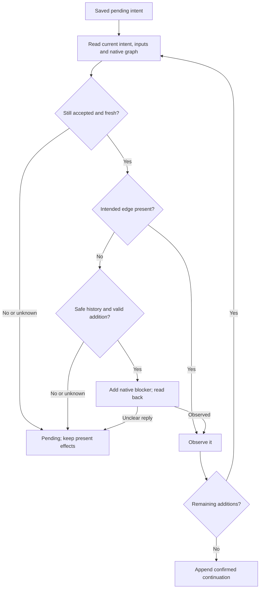

# Durable GitHub dependency observations and effects

Own `src/issue-dependencies-github.mjs`. Export module functions
`readDependencySnapshot({cwd,repository,inputs},ports)`,
`saveDependencyReview({repository,issue,review},ports)` and
`applyDependencyChanges({cwd,repository,issue,reviewId},ports)` and
`saveDependencyImpact({repository,issue,impact},ports)`.
Own GitHub transport, append-only review storage and recovery. The pure model owns
which review is current and what is ready. No function calls AI or starts work.
All outside access uses injected ports. Existing issue bodies and comments remain
unchanged. Preserve native human relationships and their edited readable reasons.

## Read complete native observations

Resolve an omitted repository through the existing repository resolver. Explicit
canonical OWNER/REPO works outside a checkout. `cwd` may be empty for that read.
Read all pages of root open issues, their blocked-by/blocking, comments and relevant
native relationship history, and recursively all linked prerequisite issues even
when closed or cross-repository. Also read pending intent prerequisites as context
for cycle validation before a proposed new native link exists. Those proposals
add no graph edge. Expand each proposed blocker's reachable native prerequisites.
Deduplicate by full identity and stable issue ID.
Do not equate a failed page, 404 private blocker or an unchanged open-list ETag with
an empty edge list. Read known relationships independently on every catch-up.
A partial read returns complete false and warnings; preserve known observations.
Read capture time through injected `clock.now({})`, returning `{iso}`.

`github.page({repository,kind,issue,cursor})` is a raw service port; kind is issues,
comments, blockedBy, blocking, or timeline, issue is zero for repository issues,
and cursor is initially empty. Its JSON envelope contains `{items,next}` (empty
next ends pagination), or `{error,status}`. `github.issue({repository,issue})`
returns raw GitHub issue JSON, or that error envelope. Ports default to gh argv
calls using the documented native dependency REST endpoints, not shell strings.
Canonical normalized observations use the model's Runtime schema. Supply unknown
linked placeholders when inaccessible. Only raw native relationships become edges.

`context.read({cwd,repository})` returns JSON containing relevant requirement/source
revision observations (`inputs`) and issue semantic conditions/execution holds.
Read substantive issue title/body and currently trusted requirement comments;
exclude unchanged PDD marker records, claims, sync and review bookkeeping. Derive
stable revisions from actual content (not updated_at). No whole-source commit or
unrelated file change alone invalidates a review. Unknown context stays explicit.
Optional read inputs name additional required non-issue rows from completion.
After parsing saved records, `context.read({cwd,repository,inputs})` rereads the
union of their durable non-issue locators; inputs is omitted when that union is empty.
Its default uses actual bytes in a verified selected-repository checkout, or the
same repository's current default-branch content API when no matching checkout
exists. Read native comments by their owning repository/issue/comment identity.
An unavailable local-only plan or required source stays missing, hence stale or
pending. Recovery with empty cache follows the saved input locators, never a local
cache or the old packet. Unrelated paths are not part of this comparison.
`evidence.read` in intake uses these same locators and content revisions for text;
the snapshot must include a matching current input row for every examined item.
Condition source facts and current executionClaim/runIds come from the same
native requirement/claim/run observations. Unknown provenance is not a claim-only
hold that the pre-start check may discard. The selected native coordinator supplies semantic conditions; the adapter does
not infer installation or deployment from a PR merge.

## Repository-bound authority

`authority.read({repository,author})` returns trusted, outsider or unverified using
the existing Autopilot trust owner with repository-bound read ports. This is a
read adapter for that owner's policy, not another trust implementation. Resolve
current authority separately for each record's actual repository and subject.
Never use checkout A's local extra names for explicit repository B. Missing local
extra trust or lookup failure is unverified, not trusted. Native graph reads still
work with that limit. No login, setup, clone or AI is allowed to resolve it.
Never treat a PDD marker as authority. Preserve malformed/unsupported/edited trusted
records as unresolved observations; do not hide them by returning an older record.
Use actual comment identity and creation/edit evidence to set `intact`.

## Append a review before native effects

Save a readable result and plain edge reasons followed by one disclosed JSON
record, marked `<!-- pdd-dependency-review:v1 -->`. The saved JSON is version 1
with envelope `{schema_version:"pdd.dependency-review.v1",review:REVIEW}`
and the raw review schema below; actual comment ID, authority and integrity come
from GitHub on read and are never accepted as caller attestations. `issue` is the
full canonical dependent issue URL. Reject a foreign issue/review identity.
Save complete `dependencies: []` for a checked empty result. A question preserves
questions and makes no edge addition. A proposal with additions has outcome pending,
effects pending, and the full immutable intended analysis saved first. An append
failure returns pending/error and permits no native effect. Return the actual
comment ID after readback; a lost append reply is unresolved, never a reason to
append a second intent blindly. Reconcile analysis/base identity from comments.
Impact coverage is stored with the same append-only discipline and marker family
`pdd-dependency-impact:v1`; use envelope `{schema_version:"pdd.dependency-impact.v1",impact:IMPACT}`.
IMPACT omits model read metadata id/trusted/intact; supply these from the actual
comment and current authority, never caller attestation.



Recovery uses injected `snapshots.read({cwd,repository,inputs})`, defaulting to this module's
`readDependencySnapshot`, with the same normalized schema. It is a production
read boundary for each recovery observation. cwd defaults to an empty string;
The initial read omits inputs and discovers them from the saved intent; subsequent
observations supply its nonempty non-issue rows. The default reader discovers
these locators again from saved comments when inputs is omitted, including after
restart. Neither an empty cache nor missing checkout drops required inputs.

Read the initial recovery snapshot once. Before EACH absent edge write or retry, reread current records, substantive input
revisions and reachable native graph. Use the pure model's current head and change
validation. A superseded/edited/stale/conflicting intent stops remaining additions.
Keep already present edges. Never compensate by deleting them. Existing duplicate
edges need no add. Native history must distinguish never-applied intent from a
later human removal. Unknown ordering stays pending. Never restore an absent edge
from an already confirmed review. An explicit trusted removal is outside automatic
addition and needs the existing coordinator's separate instruction; this module
never removes an edge automatically.

`github.addBlocker({repository,issue,blockerId})` targets the dependent repository
and issue number. `blockerId` is the decimal string of the blocker's raw REST
`id`, including cross-repo. The native transport serializes that exact decimal as
REST JSON integer `issue_id` without precision loss; reject unavailable/invalid
write identities. Never use issue number or GraphQL node_id as issue_id.
Reject self edges and cycles through the model. Read back after each effect and
before confirmation. A timeout with present native edge completes observation
without duplicate add. A partial two-edge batch whose inputs changed preserves
the first edge and leaves the second absent/pending. A concurrent post-write cycle
remains visible and prevents affected starts; APIs do not promise atomicity.
Append confirmed complete continuation only after every intended effect is observed
and the intent is still fresh. Confirmation refers to its own pending comment ID.

## Dependencies

- [Pure dependency model](issue-dependencies.prompt.md): required for authoring,
  generation, runtime and verification; canonical observation schema, current
  review, coverage, readiness and change validation. Native imports call these
  public functions; the interpreter loads their rules without per-edge AI calls.
- [Repository discovery](workflow-github.prompt.md): generation/verification context
  for default local repository resolution only.
- [Existing trust owner](autopilot.prompt.md): generation/verification context for
  repository-bound `authority.read`; its existing policy must be reused unchanged.

<details><summary>Runtime interface</summary>

```json
{"status":"approved","prose_sha256":"9ab60788cfd7f86fc2c6949f75a0e4f8888fd3ff6d71f6f5682ce886735c44e2","entries":[{"operation":"readDependencySnapshot","input_schema":{"type":"object","properties":{"cwd":{"type":"string"},"repository":{"type":"string"},"inputs":{"type":"array","items":{"type":"object","properties":{"key":{"type":"string"},"revision":{"type":"string"}},"required":["key","revision"],"additionalProperties":false}}},"required":["cwd","repository"],"additionalProperties":false},"result_schema":{"type":"object","properties":{"snapshot":{"type":"object","properties":{"repository":{"type":"string"},"capturedAt":{"type":"string"},"complete":{"type":"boolean"},"issues":{"type":"array","items":{"type":"object","properties":{"key":{"type":"string"},"nodeId":{"type":"string"},"title":{"type":"string"},"revision":{"type":"string"},"state":{"type":"string","enum":["open","completed","not_planned","unknown"]},"authority":{"type":"string","enum":["trusted","untrusted","unknown"]},"conditions":{"type":"array","items":{"type":"string"}},"execution":{"type":"string","enum":["idle","running","unknown"]},"holds":{"type":"array","items":{"type":"string"}},"conditionSources":{"type":"array","items":{"type":"object","properties":{"text":{"type":"string"},"source":{"type":"string"},"inputs":{"type":"array","items":{"type":"object","properties":{"key":{"type":"string"},"revision":{"type":"string"}},"required":["key","revision"],"additionalProperties":false}}},"required":["text","source","inputs"],"additionalProperties":false}},"executionClaim":{"type":"object","properties":{"coordinatorId":{"type":"string"},"commentId":{"type":"string"},"labelEventId":{"type":"string"}},"required":["coordinatorId","commentId","labelEventId"],"additionalProperties":false},"runIds":{"type":"array","items":{"type":"string"}}},"required":["key","nodeId","title","revision","state","authority","conditions","execution","holds"],"additionalProperties":false}},"edges":{"type":"array","items":{"type":"object","properties":{"dependent":{"type":"string"},"blocker":{"type":"string"}},"required":["dependent","blocker"],"additionalProperties":false}},"reviews":{"type":"array","items":{"type":"object","properties":{"id":{"type":"string"},"analysis":{"type":"string"},"base":{"type":"array","items":{"type":"string"}},"continuation":{"type":"string"},"issue":{"type":"string"},"inputs":{"type":"array","items":{"type":"object","properties":{"key":{"type":"string"},"revision":{"type":"string"}},"required":["key","revision"],"additionalProperties":false}},"candidates":{"type":"array","items":{"type":"object","properties":{"key":{"type":"string"},"revision":{"type":"string"}},"required":["key","revision"],"additionalProperties":false}},"outcome":{"type":"string","enum":["complete","question","pending"]},"dependencies":{"type":"array","items":{"type":"object","properties":{"key":{"type":"string"},"reason":{"type":"string"},"evidence":{"type":"array","items":{"type":"string"}}},"required":["key","reason","evidence"],"additionalProperties":false}},"questions":{"type":"array","items":{"type":"string"}},"intact":{"type":"boolean"},"effects":{"type":"string","enum":["none","pending","confirmed"]},"authority":{"type":"string","enum":["trusted","outsider","unverified"]}},"required":["id","analysis","base","continuation","issue","inputs","candidates","outcome","dependencies","questions","intact","effects","authority"],"additionalProperties":false}},"impacts":{"type":"array","items":{"type":"object","properties":{"id":{"type":"string"},"inputs":{"type":"array","items":{"type":"object","properties":{"key":{"type":"string"},"revision":{"type":"string"}},"required":["key","revision"],"additionalProperties":false}},"reviews":{"type":"array","items":{"type":"string"}},"affected":{"type":"array","items":{"type":"string"}},"complete":{"type":"boolean"},"trusted":{"type":"boolean"},"intact":{"type":"boolean"},"authority":{"type":"string","enum":["trusted","outsider","unverified"]}},"required":["id","inputs","reviews","affected","complete","trusted","intact"],"additionalProperties":false}},"inputs":{"type":"array","items":{"type":"object","properties":{"key":{"type":"string"},"revision":{"type":"string"}},"required":["key","revision"],"additionalProperties":false}}},"required":["repository","capturedAt","complete","issues","edges","reviews","impacts","inputs"],"additionalProperties":false},"warnings":{"type":"array","items":{"type":"string"}}},"required":["snapshot","warnings"],"additionalProperties":false},"errors":["invalid-repository"]},{"operation":"saveDependencyReview","input_schema":{"type":"object","properties":{"repository":{"type":"string"},"issue":{"type":"string"},"review":{"type":"object","properties":{"analysis":{"type":"string"},"base":{"type":"array","items":{"type":"string"}},"continuation":{"type":"string"},"issue":{"type":"string"},"inputs":{"type":"array","items":{"type":"object","properties":{"key":{"type":"string"},"revision":{"type":"string"}},"required":["key","revision"],"additionalProperties":false}},"candidates":{"type":"array","items":{"type":"object","properties":{"key":{"type":"string"},"revision":{"type":"string"}},"required":["key","revision"],"additionalProperties":false}},"outcome":{"type":"string","enum":["complete","question","pending"]},"dependencies":{"type":"array","items":{"type":"object","properties":{"key":{"type":"string"},"reason":{"type":"string"},"evidence":{"type":"array","items":{"type":"string"}}},"required":["key","reason","evidence"],"additionalProperties":false}},"questions":{"type":"array","items":{"type":"string"}},"effects":{"type":"string","enum":["none","pending","confirmed"]}},"required":["analysis","base","continuation","issue","inputs","candidates","outcome","dependencies","questions","effects"],"additionalProperties":false}},"required":["repository","issue","review"],"additionalProperties":false},"result_schema":{"type":"object","properties":{"id":{"type":"string"},"state":{"type":"string","enum":["saved","pending"]},"warnings":{"type":"array","items":{"type":"string"}}},"required":["id","state","warnings"],"additionalProperties":false},"errors":["invalid-review"]},{"operation":"applyDependencyChanges","input_schema":{"type":"object","properties":{"repository":{"type":"string"},"issue":{"type":"string"},"reviewId":{"type":"string"},"cwd":{"type":"string"}},"required":["repository","issue","reviewId"],"additionalProperties":false},"result_schema":{"type":"object","properties":{"state":{"type":"string","enum":["confirmed","pending"]},"added":{"type":"array","items":{"type":"string"}},"warnings":{"type":"array","items":{"type":"string"}}},"required":["state","added","warnings"],"additionalProperties":false},"errors":["invalid-review"]},{"operation":"saveDependencyImpact","input_schema":{"type":"object","properties":{"repository":{"type":"string"},"issue":{"type":"string"},"impact":{"type":"object","properties":{"inputs":{"type":"array","items":{"type":"object","properties":{"key":{"type":"string"},"revision":{"type":"string"}},"required":["key","revision"],"additionalProperties":false}},"reviews":{"type":"array","items":{"type":"string"}},"affected":{"type":"array","items":{"type":"string"}},"complete":{"type":"boolean"}},"required":["inputs","reviews","affected","complete"],"additionalProperties":false}},"required":["repository","issue","impact"],"additionalProperties":false},"result_schema":{"type":"object","properties":{"id":{"type":"string"},"state":{"type":"string","enum":["saved","pending"]},"warnings":{"type":"array","items":{"type":"string"}}},"required":["id","state","warnings"],"additionalProperties":false},"errors":["invalid-review"]}],"calls":[],"resources":[{"name":"github","kind":"port","access":"write","operations":[{"name":"page","access":"read","arguments_schema":{"type":"object","properties":{"repository":{"type":"string"},"kind":{"type":"string"},"issue":{"type":"integer"},"cursor":{"type":"string"}},"required":["repository","kind","issue","cursor"],"additionalProperties":false},"result_schema":{"type":"object","properties":{"json":{"type":"string"}},"required":["json"],"additionalProperties":false}},{"name":"issue","access":"read","arguments_schema":{"type":"object","properties":{"repository":{"type":"string"},"issue":{"type":"integer"}},"required":["repository","issue"],"additionalProperties":false},"result_schema":{"type":"object","properties":{"json":{"type":"string"}},"required":["json"],"additionalProperties":false}},{"name":"appendComment","access":"write","arguments_schema":{"type":"object","properties":{"repository":{"type":"string"},"issue":{"type":"integer"},"body":{"type":"string"}},"required":["repository","issue","body"],"additionalProperties":false},"result_schema":{"type":"object","properties":{"json":{"type":"string"}},"required":["json"],"additionalProperties":false}},{"name":"addBlocker","access":"write","arguments_schema":{"type":"object","properties":{"repository":{"type":"string"},"issue":{"type":"integer"},"blockerId":{"type":"string"}},"required":["repository","issue","blockerId"],"additionalProperties":false},"result_schema":{"type":"object","properties":{"ok":{"type":"boolean"}},"required":["ok"],"additionalProperties":false}}]},{"name":"authority","kind":"port","access":"read","operations":[{"name":"read","access":"read","arguments_schema":{"type":"object","properties":{"repository":{"type":"string"},"author":{"type":"string"}},"required":["repository","author"],"additionalProperties":false},"result_schema":{"type":"object","properties":{"authority":{"type":"string","enum":["trusted","outsider","unverified"]}},"required":["authority"],"additionalProperties":false}}]},{"name":"context","kind":"port","access":"read","operations":[{"name":"read","access":"read","arguments_schema":{"type":"object","properties":{"cwd":{"type":"string"},"repository":{"type":"string"},"inputs":{"type":"array","items":{"type":"object","properties":{"key":{"type":"string"},"revision":{"type":"string"}},"required":["key","revision"],"additionalProperties":false}}},"required":["cwd","repository"],"additionalProperties":false},"result_schema":{"type":"object","properties":{"json":{"type":"string"}},"required":["json"],"additionalProperties":false}}]},{"name":"snapshots","kind":"port","access":"read","operations":[{"name":"read","access":"read","arguments_schema":{"type":"object","properties":{"repository":{"type":"string"},"inputs":{"type":"array","items":{"type":"object","properties":{"key":{"type":"string"},"revision":{"type":"string"}},"required":["key","revision"],"additionalProperties":false}},"cwd":{"type":"string"}},"required":["repository"],"additionalProperties":false},"result_schema":{"type":"object","properties":{"snapshot":{"type":"object","properties":{"repository":{"type":"string"},"capturedAt":{"type":"string"},"complete":{"type":"boolean"},"issues":{"type":"array","items":{"type":"object","properties":{"key":{"type":"string"},"nodeId":{"type":"string"},"title":{"type":"string"},"revision":{"type":"string"},"state":{"type":"string","enum":["open","completed","not_planned","unknown"]},"authority":{"type":"string","enum":["trusted","untrusted","unknown"]},"conditions":{"type":"array","items":{"type":"string"}},"execution":{"type":"string","enum":["idle","running","unknown"]},"holds":{"type":"array","items":{"type":"string"}},"conditionSources":{"type":"array","items":{"type":"object","properties":{"text":{"type":"string"},"source":{"type":"string"},"inputs":{"type":"array","items":{"type":"object","properties":{"key":{"type":"string"},"revision":{"type":"string"}},"required":["key","revision"],"additionalProperties":false}}},"required":["text","source","inputs"],"additionalProperties":false}},"executionClaim":{"type":"object","properties":{"coordinatorId":{"type":"string"},"commentId":{"type":"string"},"labelEventId":{"type":"string"}},"required":["coordinatorId","commentId","labelEventId"],"additionalProperties":false},"runIds":{"type":"array","items":{"type":"string"}}},"required":["key","nodeId","title","revision","state","authority","conditions","execution","holds"],"additionalProperties":false}},"edges":{"type":"array","items":{"type":"object","properties":{"dependent":{"type":"string"},"blocker":{"type":"string"}},"required":["dependent","blocker"],"additionalProperties":false}},"reviews":{"type":"array","items":{"type":"object","properties":{"id":{"type":"string"},"analysis":{"type":"string"},"base":{"type":"array","items":{"type":"string"}},"continuation":{"type":"string"},"issue":{"type":"string"},"inputs":{"type":"array","items":{"type":"object","properties":{"key":{"type":"string"},"revision":{"type":"string"}},"required":["key","revision"],"additionalProperties":false}},"candidates":{"type":"array","items":{"type":"object","properties":{"key":{"type":"string"},"revision":{"type":"string"}},"required":["key","revision"],"additionalProperties":false}},"outcome":{"type":"string","enum":["complete","question","pending"]},"dependencies":{"type":"array","items":{"type":"object","properties":{"key":{"type":"string"},"reason":{"type":"string"},"evidence":{"type":"array","items":{"type":"string"}}},"required":["key","reason","evidence"],"additionalProperties":false}},"questions":{"type":"array","items":{"type":"string"}},"intact":{"type":"boolean"},"effects":{"type":"string","enum":["none","pending","confirmed"]},"authority":{"type":"string","enum":["trusted","outsider","unverified"]}},"required":["id","analysis","base","continuation","issue","inputs","candidates","outcome","dependencies","questions","intact","effects","authority"],"additionalProperties":false}},"impacts":{"type":"array","items":{"type":"object","properties":{"id":{"type":"string"},"inputs":{"type":"array","items":{"type":"object","properties":{"key":{"type":"string"},"revision":{"type":"string"}},"required":["key","revision"],"additionalProperties":false}},"reviews":{"type":"array","items":{"type":"string"}},"affected":{"type":"array","items":{"type":"string"}},"complete":{"type":"boolean"},"trusted":{"type":"boolean"},"intact":{"type":"boolean"},"authority":{"type":"string","enum":["trusted","outsider","unverified"]}},"required":["id","inputs","reviews","affected","complete","trusted","intact"],"additionalProperties":false}},"inputs":{"type":"array","items":{"type":"object","properties":{"key":{"type":"string"},"revision":{"type":"string"}},"required":["key","revision"],"additionalProperties":false}}},"required":["repository","capturedAt","complete","issues","edges","reviews","impacts","inputs"],"additionalProperties":false}},"required":["snapshot"],"additionalProperties":false}}]},{"name":"clock","kind":"port","access":"read","operations":[{"name":"now","access":"read","arguments_schema":{"type":"object","properties":{},"required":[],"additionalProperties":false},"result_schema":{"type":"object","properties":{"iso":{"type":"string"}},"required":["iso"],"additionalProperties":false}}]}],"limits":{"max_steps":30,"max_model_calls":12},"conventions":[]}
```
</details>
