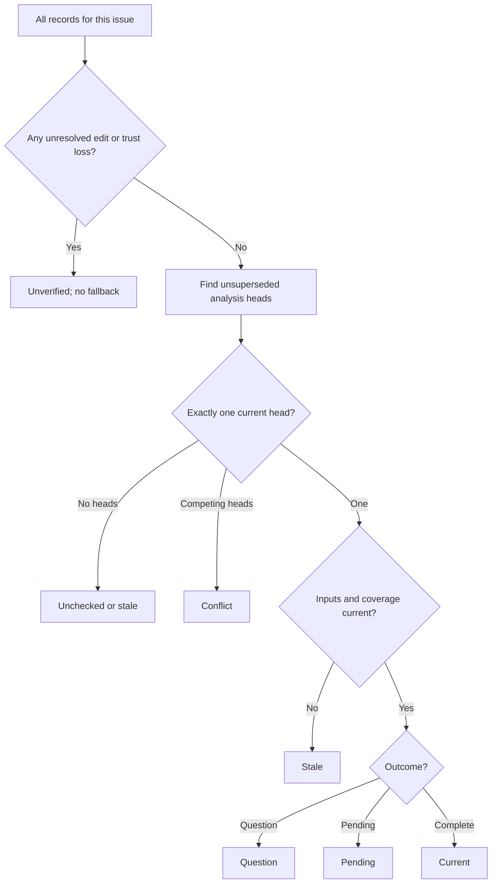

# Shared native issue dependency model

Own `src/issue-dependencies.mjs`. Export module functions
`projectIssueGraph({snapshot})` and `validateDependencyChange({snapshot,dependent,blocker})`.
These pure functions own identities, current-review selection, freshness, native edge
meaning and dependency eligibility. They use supplied observations only. They have
no AI, filesystem, network, clock, scheduler or browser port. This is a new interface;
preserve the existing workflow, trust and allocation owners.

## Native facts and identity

`key` is a canonical `https://github.com/OWNER/REPO/issues/N` URL. Canonicalize
repository spelling for equality; retain full repository and positive issue number.
`nodeId` is the decimal string of raw REST issue `id`. It is the stable REST
write identity, distinct from issue `number` and GraphQL `node_id`. Do not infer
it from either. An inaccessible placeholder uses an empty nodeId and cannot be
written. GraphQL identity is not needed by this interface. Edges point from dependent to
blocker. Only `snapshot.edges` creates graph edges. Saved proposals never do.
Deduplicate native edges and retain input issue order, adding missing linked nodes
as unknown placeholders. A partial snapshot establishes clear dependencies for a subject only with the explicit current coverage below.
A native edge with no qualifying saved reason shows `GitHub dependency; no saved reason`.
A saved edge absent in native state stays absent; show `Human dependency change`
and reviewState question until a current trusted coordinator resolves the override.

## Partial observation coverage

A partial snapshot may carry `coverage` and body-free `warnings`. Coverage has
boolean `scope`, and unique issue rows with `key`, boolean `issue`, `authority`,
`comments`, `blockedBy`, `blocking`, `timeline`, `context`, `execution`, and
`reviewImpact`, plus body-free `missing` reasons. All members are required.
Scope establishes the complete current root index and candidate revisions.
The subject and its full transitive blocker closure need their current issue,
authority, comments, relationships, timeline, relevant required context and
execution. For the selected head, apply the existing freshness rule: only an
input or candidate revision deficit requires current relevant impact discovery.
When that discovery is required, `reviewImpact` must be true; unavailable
evidence is unknown, not proof that a missing record affects the subject. An
unavailable required locator of the selected head gives the body-free reason
`Required context unavailable` and holds that subject. Missing, duplicate or malformed
coverage holds; legacy partial snapshots never imply coverage. Preserve global
`complete: false` and warnings, while applying all existing current-review,
candidate, impact, trust, condition, execution and ownership requirements.

## Current review and coverage

The adapter supplies version-1 parsed records with actual comment `id`, current
repository-bound `authority` (trusted, outsider, or unverified) and `intact` (unaltered structured bytes since creation).
A record identifies one `analysis`, its superseded `base` comment IDs, and optional
`continuation` ID (empty string means none). IDs are opaque, not time ordering.
The snapshot `inputs` table supplies current non-issue input revisions.
Each input key is its durable locator: the canonical issue URL, native comment
URL (`.../issues/N#issuecomment-ID`), or source/plan URL
`https://github.com/OWNER/REPO/blob/HEAD/PATH` with an encoded repository path.
HEAD here denotes the selected repository's current source, not a commit pin.
Revision is the actual item's content revision; absent/unreadable items have no
current revision row and cannot match. Never substitute an entire commit or a
caller-supplied revision for a read. These same key/revision rows bind evidence,
review inputs and revalidation; no second context store is required.
Review inputs identify the subject, examined requirement comments, and only relevant
source/plan revisions. Candidate coverage lists the examined issue revisions.
The adapter excludes unchanged PDD review/claim bookkeeping from those revisions.
An empty completed dependency list is an explicit checked result.



**Heads.** Ignore copied markers from known untrusted outsiders as authority.
A previously accepted record whose authority is now unknown/revoked, an edited
structured record, or an unreadable newer trusted record leaves `unverified`.
The adapter represents these as unverified or non-intact records with their known
issue/base identity; it must not silently omit the unresolved record. An intact
trusted record supersedes only the named known base heads for this issue. A fresh
root has empty base; two roots or two children of one base conflict. A continuation
must name an existing pending record with the same analysis, base, issue, inputs,
candidates and dependencies. A valid confirmed continuation supersedes only that pending record.
Only its confirmed complete continuation can finish
that intent. Invalid continuations are unresolved, never alternative completions.
A resolution names every competing head in base. A newer question or pending head
suppresses its base complete result. Comment arrival time alone never breaks ties.
Record cycles, missing bases and unsupported records remain unverified. An
unresolved observation is one not explicitly resolved by a current intact trusted
head naming its identity in base; superseded old revisions or authority loss do
not invalidate that replacement.

**Display-only saved reason.** When the authoritative selection has no current
reason for a native edge, the same head and continuation rules may select one
intact non-outsider observation for display, treating unknown authority only
as sufficient to inspect its structure. Known outsiders are excluded. All
substantive `inputs` of the selected observation must match current revisions;
candidate coverage or impact gaps do not hide this observation. If exactly one
structurally valid unsuperseded head qualifies and names that native edge, show
its reason prefixed `Unverified saved reason: ` and its evidence. An edited,
invalid, competing, superseded or input-changed observation supplies no reason.
This display grants no authority, eligibility or permission to write; review and
dependency states and intake decisions retain their existing rules.

**Freshness.** Compare substantive revisions by identity and value, never
`updated_at` or an entire repository commit alone. Unknown or changed required
inputs are stale. Current candidate coverage must account for every current visible
root issue revision. A completed intact trusted impact record may extend named
review IDs across its examined new/changed input revisions, only when those inputs
are still current and the issue is not in `affected`. The impact's `reviews` names
the exact still-applicable review heads checked for impact. An impact can prove
freshness for a head only when its saved comment is hosted in that head's root
repository. This keeps one repository's graph decisions from being overridden
by an unrelated repository's comment. Unfinished, stale, foreign or untrusted
coverage grants nothing. Distinguish unchanged subject inputs
with a candidate-coverage gap from changed subject inputs: the former awaits
impact, and does not require replacing its head before impact is examined.
For each exact prior head and changed input revision, applicable positive impact
wins over negative coverage in either input order. A known edited or unverified
competing impact also leaves that coverage unresolved; a known outsider grants
nothing. Impact authority is explicit when available; legacy trusted true means
trusted, false without a known outsider observation means unverified. No arrival-order tie break applies. A current trusted replacement review
that examines the disputed revisions resolves it; impacts for old heads cannot
stale that replacement. Report disputed old heads as stale/ineligible.
Affected work queues reanalysis;
unaffected work reuses its completed review on an empty local cache. A new issue
must be examined for both its prerequisites and what existing work it blocks.
An unrelated source commit or unchanged PDD bookkeeping does not invalidate reviews.

## Dependency and execution results

`reviewState` follows the view above. No accepted record gives `unchecked`; an
applicable but changed record gives `stale`. `review` is the selected head ID or
empty when unresolved. Incomplete reads give dependencyState `unknown`.
Persist unresolved install/deploy/product requirements as `questions` on a
question review. An explicit trusted replacement resolves them; a restart does
not erase them. A subject's own supplied conditions prevent eligibility. When
checking a prerequisite, retain its supplied conditions and unresolved saved
questions, including questions whose current authority cannot be verified.
A blocker is satisfied only when its native state is `completed` and it has no
such unresolved condition. A completed blocker with no saved review needs no
invented review merely to establish its native completion. Open blockers wait even after a PR merge. `not_planned`,
unknown/inaccessible issues and missing install/deploy/product conditions wait.
Preserve native cycles (including cross-repository cycles) as `cycle` for affected
nodes. Never remove a human edge to break a cycle. Unknown linked facts give
`unknown`; otherwise unresolved blockers give `waiting`, and no blocker gives
`clear`. These dependency states do not overwrite review or execution state.

Optional issue executionClaim and runIds retain current claim/run provenance for
the intake owner's own-claim start check. They do not relax model eligibility.
Execution is `running` only from current run/claim evidence supplied as running;
otherwise holds give `held`, then preserve idle/unknown. `eligible` means only
native state open AND current completed review AND clear dependencies AND trusted subject AND idle
execution AND no supplied holds AND complete relevant observation coverage. It is a dependency handoff,
not proof of account room, approval, backlog activation, or permission to start.
Reasons explain each independent hold. For an incomplete selected subject or
its transitive blocker closure, identify each unavailable issue, authority,
comments, relationship direction, timeline, context or execution resource with
its canonical issue key. When an actual freshness deficit needs unavailable impact
discovery, identify that resource and any known source issue. Report an unavailable
root index separately. Construct these body-free reasons from validated keys and
coverage flags; never echo arbitrary warning, missing, body or comment text. A completed subject emits `Issue completed`;
a not-planned subject emits `Issue not planned` and neither is eligible for new work.
Each node retains `nativeState` and `facts`, alongside filterable reason codes.
A fact has `{kind,text,issue,source,inputs}`: kind question or condition, exact text,
its owning issue, canonical source URL and the relevant examined key/revision rows.
Question sources are their actual owning issue/comment URLs, including unresolved
heads; keep supplied issue conditions even without a review. Optional issue
`conditionSources` supplies `{text,source,inputs}`; absent provenance uses the issue
URL and subject revision, without inventing deployment evidence. Retain unresolved
prerequisite facts on the dependent as well as on their own node. A trusted
replacement drops resolved old questions and exposes its current facts. Cache and
viewer consume these facts directly; no comment reread or semantic inference.
 Emit stable reason codes `Unchecked`,
`Stale review`, `Review question`, `Pending effects`, `Unverified review`,
`Conflicting reviews`, `Incomplete sync`, `Open prerequisite`, `Unknown prerequisite`,
`Prerequisite not planned`, `Required condition`, `Dependency cycle`, `Untrusted issue`,
and the supplied holds, plus the native/human difference labels above. Reasons are
unique in encounter order. No missing fact is treated as ready.

**Change validation.** Return `{allowed,reason}`. Self edge: `self`; existing edge:
`duplicate`; either endpoint missing/unknown or its prerequisite reachability
incomplete: `unknown`; in a partial snapshot, complete explicit coverage of both
endpoints and their prerequisite closures establishes that reachability. An edge
that closes any reachable
same- or cross-repo cycle: `cycle`; otherwise `ok`. Use that precedence. This
validation promises no atomic transaction across machines. Post-write projection
must expose a concurrent cycle and stop affected starts.

## Dependencies

None. Runtime schemas below are the required public normalized observation and
projection declarations. Empty `continuation` and `review` mean absent identity.

<details><summary>Runtime interface</summary>

```json
{"status":"draft","prose_sha256":"2e3ae6a1c445d7954f82dd1f95658b19a427e372e65ba57fc9d1bf4688ffd0ab","entries":[{"operation":"projectIssueGraph","input_schema":{"type":"object","properties":{"snapshot":{"type":"object","properties":{"repository":{"type":"string"},"capturedAt":{"type":"string"},"complete":{"type":"boolean"},"issues":{"type":"array","items":{"type":"object","properties":{"key":{"type":"string"},"nodeId":{"type":"string"},"title":{"type":"string"},"revision":{"type":"string"},"state":{"type":"string","enum":["open","completed","not_planned","unknown"]},"authority":{"type":"string","enum":["trusted","untrusted","unknown"]},"conditions":{"type":"array","items":{"type":"string"}},"execution":{"type":"string","enum":["idle","running","unknown"]},"holds":{"type":"array","items":{"type":"string"}},"conditionSources":{"type":"array","items":{"type":"object","properties":{"text":{"type":"string"},"source":{"type":"string"},"inputs":{"type":"array","items":{"type":"object","properties":{"key":{"type":"string"},"revision":{"type":"string"}},"required":["key","revision"],"additionalProperties":false}}},"required":["text","source","inputs"],"additionalProperties":false}},"executionClaim":{"type":"object","properties":{"coordinatorId":{"type":"string"},"commentId":{"type":"string"},"labelEventId":{"type":"string"}},"required":["coordinatorId","commentId","labelEventId"],"additionalProperties":false},"runIds":{"type":"array","items":{"type":"string"}}},"required":["key","nodeId","title","revision","state","authority","conditions","execution","holds"],"additionalProperties":false}},"edges":{"type":"array","items":{"type":"object","properties":{"dependent":{"type":"string"},"blocker":{"type":"string"}},"required":["dependent","blocker"],"additionalProperties":false}},"reviews":{"type":"array","items":{"type":"object","properties":{"id":{"type":"string"},"analysis":{"type":"string"},"base":{"type":"array","items":{"type":"string"}},"continuation":{"type":"string"},"issue":{"type":"string"},"inputs":{"type":"array","items":{"type":"object","properties":{"key":{"type":"string"},"revision":{"type":"string"}},"required":["key","revision"],"additionalProperties":false}},"candidates":{"type":"array","items":{"type":"object","properties":{"key":{"type":"string"},"revision":{"type":"string"}},"required":["key","revision"],"additionalProperties":false}},"outcome":{"type":"string","enum":["complete","question","pending"]},"dependencies":{"type":"array","items":{"type":"object","properties":{"key":{"type":"string"},"reason":{"type":"string"},"evidence":{"type":"array","items":{"type":"string"}}},"required":["key","reason","evidence"],"additionalProperties":false}},"questions":{"type":"array","items":{"type":"string"}},"intact":{"type":"boolean"},"effects":{"type":"string","enum":["none","pending","confirmed"]},"authority":{"type":"string","enum":["trusted","outsider","unverified"]}},"required":["id","analysis","base","continuation","issue","inputs","candidates","outcome","dependencies","questions","intact","effects","authority"],"additionalProperties":false}},"impacts":{"type":"array","items":{"type":"object","properties":{"id":{"type":"string"},"inputs":{"type":"array","items":{"type":"object","properties":{"key":{"type":"string"},"revision":{"type":"string"}},"required":["key","revision"],"additionalProperties":false}},"reviews":{"type":"array","items":{"type":"string"}},"affected":{"type":"array","items":{"type":"string"}},"complete":{"type":"boolean"},"trusted":{"type":"boolean"},"intact":{"type":"boolean"},"authority":{"type":"string","enum":["trusted","outsider","unverified"]},"host":{"type":"string"}},"required":["id","inputs","reviews","affected","complete","trusted","intact","host"],"additionalProperties":false}},"inputs":{"type":"array","items":{"type":"object","properties":{"key":{"type":"string"},"revision":{"type":"string"}},"required":["key","revision"],"additionalProperties":false}},"coverage":{"type":"object","properties":{"scope":{"type":"boolean"},"issues":{"type":"array","items":{"type":"object","properties":{"key":{"type":"string"},"issue":{"type":"boolean"},"authority":{"type":"boolean"},"comments":{"type":"boolean"},"blockedBy":{"type":"boolean"},"blocking":{"type":"boolean"},"timeline":{"type":"boolean"},"reviewImpact":{"type":"boolean"},"missing":{"type":"array","items":{"type":"string"}},"context":{"type":"boolean"},"execution":{"type":"boolean"}},"required":["key","issue","authority","comments","blockedBy","blocking","timeline","reviewImpact","missing","context","execution"],"additionalProperties":false}}},"required":["scope","issues"],"additionalProperties":false},"warnings":{"type":"array","items":{"type":"string"}}},"required":["repository","capturedAt","complete","issues","edges","reviews","impacts","inputs"],"additionalProperties":false}},"required":["snapshot"],"additionalProperties":false},"result_schema":{"type":"object","properties":{"repository":{"type":"string"},"capturedAt":{"type":"string"},"complete":{"type":"boolean"},"nodes":{"type":"array","items":{"type":"object","properties":{"key":{"type":"string"},"title":{"type":"string"},"reviewState":{"type":"string","enum":["unchecked","current","question","pending","stale","unverified","conflict"]},"dependencyState":{"type":"string","enum":["clear","waiting","unknown","cycle"]},"executionState":{"type":"string","enum":["idle","running","held","unknown"]},"eligible":{"type":"boolean"},"reasons":{"type":"array","items":{"type":"string"}},"blockers":{"type":"array","items":{"type":"string"}},"review":{"type":"string"},"nativeState":{"type":"string","enum":["open","completed","not_planned","unknown"]},"facts":{"type":"array","items":{"type":"object","properties":{"kind":{"type":"string","enum":["question","condition"]},"text":{"type":"string"},"issue":{"type":"string"},"source":{"type":"string"},"inputs":{"type":"array","items":{"type":"object","properties":{"key":{"type":"string"},"revision":{"type":"string"}},"required":["key","revision"],"additionalProperties":false}}},"required":["kind","text","issue","source","inputs"],"additionalProperties":false}}},"required":["key","title","reviewState","dependencyState","executionState","eligible","reasons","blockers","review","nativeState","facts"],"additionalProperties":false}},"edges":{"type":"array","items":{"type":"object","properties":{"dependent":{"type":"string"},"blocker":{"type":"string"},"reason":{"type":"string"},"evidence":{"type":"array","items":{"type":"string"}}},"required":["dependent","blocker","reason","evidence"],"additionalProperties":false}}},"required":["repository","capturedAt","complete","nodes","edges"],"additionalProperties":false},"errors":["invalid-snapshot"]},{"operation":"validateDependencyChange","input_schema":{"type":"object","properties":{"snapshot":{"type":"object","properties":{"repository":{"type":"string"},"capturedAt":{"type":"string"},"complete":{"type":"boolean"},"issues":{"type":"array","items":{"type":"object","properties":{"key":{"type":"string"},"nodeId":{"type":"string"},"title":{"type":"string"},"revision":{"type":"string"},"state":{"type":"string","enum":["open","completed","not_planned","unknown"]},"authority":{"type":"string","enum":["trusted","untrusted","unknown"]},"conditions":{"type":"array","items":{"type":"string"}},"execution":{"type":"string","enum":["idle","running","unknown"]},"holds":{"type":"array","items":{"type":"string"}},"conditionSources":{"type":"array","items":{"type":"object","properties":{"text":{"type":"string"},"source":{"type":"string"},"inputs":{"type":"array","items":{"type":"object","properties":{"key":{"type":"string"},"revision":{"type":"string"}},"required":["key","revision"],"additionalProperties":false}}},"required":["text","source","inputs"],"additionalProperties":false}},"executionClaim":{"type":"object","properties":{"coordinatorId":{"type":"string"},"commentId":{"type":"string"},"labelEventId":{"type":"string"}},"required":["coordinatorId","commentId","labelEventId"],"additionalProperties":false},"runIds":{"type":"array","items":{"type":"string"}}},"required":["key","nodeId","title","revision","state","authority","conditions","execution","holds"],"additionalProperties":false}},"edges":{"type":"array","items":{"type":"object","properties":{"dependent":{"type":"string"},"blocker":{"type":"string"}},"required":["dependent","blocker"],"additionalProperties":false}},"reviews":{"type":"array","items":{"type":"object","properties":{"id":{"type":"string"},"analysis":{"type":"string"},"base":{"type":"array","items":{"type":"string"}},"continuation":{"type":"string"},"issue":{"type":"string"},"inputs":{"type":"array","items":{"type":"object","properties":{"key":{"type":"string"},"revision":{"type":"string"}},"required":["key","revision"],"additionalProperties":false}},"candidates":{"type":"array","items":{"type":"object","properties":{"key":{"type":"string"},"revision":{"type":"string"}},"required":["key","revision"],"additionalProperties":false}},"outcome":{"type":"string","enum":["complete","question","pending"]},"dependencies":{"type":"array","items":{"type":"object","properties":{"key":{"type":"string"},"reason":{"type":"string"},"evidence":{"type":"array","items":{"type":"string"}}},"required":["key","reason","evidence"],"additionalProperties":false}},"questions":{"type":"array","items":{"type":"string"}},"intact":{"type":"boolean"},"effects":{"type":"string","enum":["none","pending","confirmed"]},"authority":{"type":"string","enum":["trusted","outsider","unverified"]}},"required":["id","analysis","base","continuation","issue","inputs","candidates","outcome","dependencies","questions","intact","effects","authority"],"additionalProperties":false}},"impacts":{"type":"array","items":{"type":"object","properties":{"id":{"type":"string"},"inputs":{"type":"array","items":{"type":"object","properties":{"key":{"type":"string"},"revision":{"type":"string"}},"required":["key","revision"],"additionalProperties":false}},"reviews":{"type":"array","items":{"type":"string"}},"affected":{"type":"array","items":{"type":"string"}},"complete":{"type":"boolean"},"trusted":{"type":"boolean"},"intact":{"type":"boolean"},"authority":{"type":"string","enum":["trusted","outsider","unverified"]}},"required":["id","inputs","reviews","affected","complete","trusted","intact"],"additionalProperties":false}},"inputs":{"type":"array","items":{"type":"object","properties":{"key":{"type":"string"},"revision":{"type":"string"}},"required":["key","revision"],"additionalProperties":false}},"coverage":{"type":"object","properties":{"scope":{"type":"boolean"},"issues":{"type":"array","items":{"type":"object","properties":{"key":{"type":"string"},"issue":{"type":"boolean"},"authority":{"type":"boolean"},"comments":{"type":"boolean"},"blockedBy":{"type":"boolean"},"blocking":{"type":"boolean"},"timeline":{"type":"boolean"},"reviewImpact":{"type":"boolean"},"missing":{"type":"array","items":{"type":"string"}},"context":{"type":"boolean"},"execution":{"type":"boolean"}},"required":["key","issue","authority","comments","blockedBy","blocking","timeline","reviewImpact","missing","context","execution"],"additionalProperties":false}}},"required":["scope","issues"],"additionalProperties":false},"warnings":{"type":"array","items":{"type":"string"}}},"required":["repository","capturedAt","complete","issues","edges","reviews","impacts","inputs"],"additionalProperties":false},"dependent":{"type":"string"},"blocker":{"type":"string"}},"required":["snapshot","dependent","blocker"],"additionalProperties":false},"result_schema":{"type":"object","properties":{"allowed":{"type":"boolean"},"reason":{"type":"string","enum":["self","duplicate","unknown","cycle","ok"]}},"required":["allowed","reason"],"additionalProperties":false},"errors":["invalid-snapshot"]}],"calls":[],"resources":[],"limits":{"max_steps":30,"max_model_calls":12},"conventions":[]}
```
</details>
