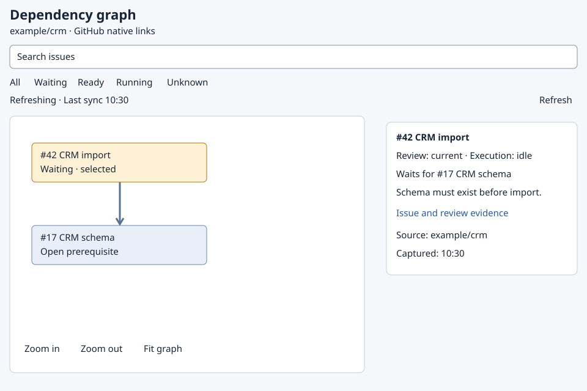
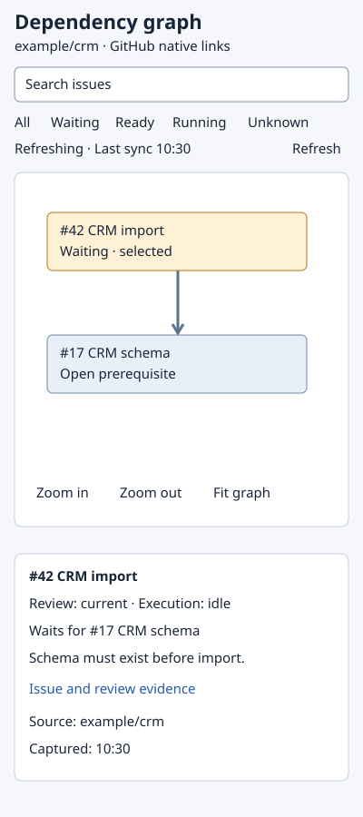
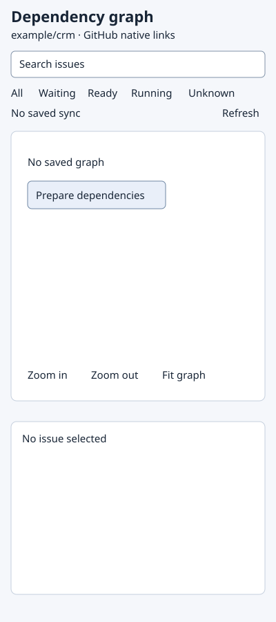

# Interactive native dependency graph

Own `src/issue-dependency-graph-view.mjs`. Export module function
`renderIssueGraph({graph,query,filter,selected,sync,lastSync})` returning HTML and
the visible facts declared below. Browser events bind search, filter, selection,
pan, zoom and refresh display to that same renderer and shared model. The browser
renders saved facts; it does not decide trust/readiness, invoke AI or mutate GitHub.
This is a new relational design, with no existing appearance to preserve.

## Appearance

Fidelity: relational. These are comparison references for the named synthetic
`waiting-refreshing` and `waiting-offline` states and the `empty` state. In the synthetic waiting states, CRM issue 42 waits for issue 17. Real titles, counts,
reasons, links, states and timestamps come only from `graph`. The drawing owns
parts and their relationships; prose owns behavior and responsive conditions.

View `waiting-refreshing__split-pane`, at 960 by 640, applies when search, graph
and details fit side by side. Keep `graph-header`, `search`, `filters`, `sync-status`,
`graph-canvas`, `zoom-in`, `zoom-out`, `fit-graph` and `issue-details` regions.
Use `filter-all`, `filter-waiting`, `filter-ready`, `filter-running`, `filter-unknown`
and `refresh-graph` as the named controls. The graph is the main region, and the
selected issue's reasons and evidence sit beside it.



View `waiting-refreshing__stacked`, at 400 by 900, applies when those panes cannot
fit without clipped labels. Keep header/search/filters first, graph next and
selected issue reasons below it. The viewport is a reference, not a fixed size.



View `waiting-offline__split-pane`, at 960 by 640, uses the split-pane
arrangement when refresh has failed. The last saved graph and selected details
remain visible, with offline status and the last successful sync.


View `empty__stacked`, at 400 by 900, uses the stacked arrangement before any
graph is saved. The `empty-message` says `No saved graph`, `sync-status` says
`No saved sync`, and `issue-details` says `No issue selected`. The separate
`prepare-dependencies` action is labeled `Prepare dependencies`.
The illustration shows example/crm as a synthetic repository identity.



## Explore the same facts

For the Simulator and browser, search is form `search` with named field `query`;
filter button values are `filter-all`, `filter-waiting`, `filter-ready`,
`filter-running`, `filter-unknown`. Node button values are their canonical issue
keys. IDs include repository and issue number so linked repos cannot collide.
The synthetic `issue-example-crm-42` region is above the
`issue-example-crm-17` region in graph-canvas.

Search matches issue number, canonical key and title case-insensitively. Filters
all, waiting, ready, running and unknown use the model fields: ready means eligible,
waiting means waiting/cycle or review question/pending, unknown means unknown
dependency or unchecked/stale/unverified/conflict review. Running uses execution.
Return matching `visible` keys in graph order. Retain their reachable prerequisites
as dimmed `context` keys so filtering never hides the reason for a wait. Counts
state whether they count matches or context. Do not change model readiness.

Selecting a node keeps the surrounding graph and shows its full issue link,
review/dependency/execution states, each blocker reason, evidence links, missing
reason, conditions and unknown facts. Return `reasons` from the selected node
plus its native edge reasons, unique in that order. Return selected `facts`
unchanged, and show their exact text, owning issue, source and native state. A
comment identity must use its owning issue in the link. Use no generic reason code
as a replacement for the saved question or condition. A missing selection is empty,
with no invented issue. Selecting an external linked node retains its repository.
Node labels include number and short title; full titles remain available in details.
Edges point from dependent to prerequisite and visually differ from any optional
hierarchy, which is never interpreted as blocking. Do not require a project board.

Controls labeled `Zoom in`, `Zoom out`, and `Fit graph` change the viewport only.
The search control is labeled `Search issues`. Pan changes the viewport only. Search and filter preserve selected issue;
background model updates preserve selection/viewport where the node still exists.
The cache paints first; show refreshing and last successful sync while the read
owner refreshes. A failed refresh keeps graph facts and says offline; do not turn
an empty/error response into readiness. `refresh-graph` requests the read owner's
refresh only. Display source repository/capture time and any unavailable VM facts.
`graph:null` is the read owner's no-cache result and is accepted directly by
this renderer. Return empty visible/context/reasons/facts, selected empty, and
emptyMessage `No saved graph`; render that message and the separate `prepare-dependencies` intake action. Reading or refreshing the graph does not run analysis; preparation requires that separate explicit action.
Never convert null into an apparently current empty graph. Non-null graphs return
emptyMessage empty. runIssueGraph passes null unchanged to the bundled renderer
through viewer.open graphJson `null`, including --open before the first refresh.

## Access and inert content

Use text nodes for private issue content; escape it in generated HTML. Only
validated canonical GitHub evidence links become hrefs. No issue text becomes
HTML, CSS, scripts, event handlers or shell content. No external assets or tokens
enter the page. Keyboard order is search, filters, refresh, viewport controls,
node list, selected details. Nodes and edge reasons have accessible names and a
list/details alternative. Enter/Space selects, Escape clears; focus remains on
the chosen control. Announce refresh/offline and selection in a polite live region.
Controls have visible focus; color is not the only state cue. Touch and keyboard
users can select and zoom without dragging. Keep labels readable at narrow width.

## Dependencies

- [Pure graph model](issue-dependencies.prompt.md): required for authoring,
  generation, runtime and verification; supplies all domain states and facts.
- [Split pane view](views/waiting-refreshing__split-pane.ui.svg): required appearance
  context for generation and verification, same asset shown above.
- [Stacked view](views/waiting-refreshing__stacked.ui.svg): required appearance context
  for generation and verification, same asset shown above.
- [Offline split pane](views/waiting-offline__split-pane.ui.svg) and [empty stacked](views/empty__stacked.ui.svg): required appearance context for generation and verification, same assets shown above.

<details><summary>Runtime interface</summary>

```json
{"status":"draft","prose_sha256":"a5f73561aaacd215bb0a7a489bd82adf6a61c581152698ffde7e6eb18c0c6726","entries":[{"operation":"renderIssueGraph","input_schema":{"type":"object","properties":{"graph":{"oneOf":[{"type":"object","properties":{"repository":{"type":"string"},"capturedAt":{"type":"string"},"complete":{"type":"boolean"},"nodes":{"type":"array","items":{"type":"object","properties":{"key":{"type":"string"},"title":{"type":"string"},"reviewState":{"type":"string","enum":["unchecked","current","question","pending","stale","unverified","conflict"]},"dependencyState":{"type":"string","enum":["clear","waiting","unknown","cycle"]},"executionState":{"type":"string","enum":["idle","running","held","unknown"]},"eligible":{"type":"boolean"},"reasons":{"type":"array","items":{"type":"string"}},"blockers":{"type":"array","items":{"type":"string"}},"review":{"type":"string"},"nativeState":{"type":"string","enum":["open","completed","not_planned","unknown"]},"facts":{"type":"array","items":{"type":"object","properties":{"kind":{"type":"string","enum":["question","condition"]},"text":{"type":"string"},"issue":{"type":"string"},"source":{"type":"string"},"inputs":{"type":"array","items":{"type":"object","properties":{"key":{"type":"string"},"revision":{"type":"string"}},"required":["key","revision"],"additionalProperties":false}}},"required":["kind","text","issue","source","inputs"],"additionalProperties":false}}},"required":["key","title","reviewState","dependencyState","executionState","eligible","reasons","blockers","review","nativeState","facts"],"additionalProperties":false}},"edges":{"type":"array","items":{"type":"object","properties":{"dependent":{"type":"string"},"blocker":{"type":"string"},"reason":{"type":"string"},"evidence":{"type":"array","items":{"type":"string"}}},"required":["dependent","blocker","reason","evidence"],"additionalProperties":false}}},"required":["repository","capturedAt","complete","nodes","edges"],"additionalProperties":false},{"type":"null"}]},"query":{"type":"string"},"filter":{"type":"string","enum":["all","waiting","ready","running","unknown"]},"selected":{"type":"string"},"sync":{"type":"string","enum":["refreshing","current","offline","empty"]},"lastSync":{"type":"string"}},"required":["graph","query","filter","selected","sync","lastSync"],"additionalProperties":false},"result_schema":{"type":"object","properties":{"html":{"type":"string"},"visible":{"type":"array","items":{"type":"string"}},"context":{"type":"array","items":{"type":"string"}},"selected":{"type":"string"},"reasons":{"type":"array","items":{"type":"string"}},"sync":{"type":"string"},"facts":{"type":"array","items":{"type":"object","properties":{"kind":{"type":"string","enum":["question","condition"]},"text":{"type":"string"},"issue":{"type":"string"},"source":{"type":"string"},"inputs":{"type":"array","items":{"type":"object","properties":{"key":{"type":"string"},"revision":{"type":"string"}},"required":["key","revision"],"additionalProperties":false}}},"required":["kind","text","issue","source","inputs"],"additionalProperties":false}},"emptyMessage":{"type":"string"}},"required":["html","visible","context","selected","reasons","sync","facts","emptyMessage"],"additionalProperties":false},"errors":[]}],"calls":[],"resources":[],"limits":{"max_steps":30,"max_model_calls":12},"conventions":[]}
```
</details>
