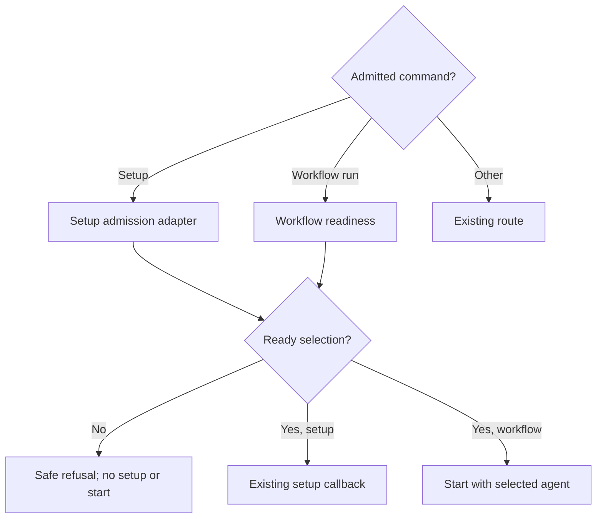

# Local authoring-kit CLI

Own `src/pdd-cli.mjs`; export `renderHelp(prefix, packageRoot)` (packageRoot defaults to this package's root) and `runPdd(argv, dependencies)`. Help, version, completion and recipe discovery operate using public local files only. pdd prints no guide text: help names the installed guide files and gives a short summary ([Learn PDD](command-catalog.prompt.md#learn-pdd)); the agent loads the pdd-prompting skill. Parse with `parseArgv` from the required argument-parser contract before reading skills or workflows; unsupported input gets a finite stderr diagnostic/exit2 and no private fallback.

Use the package-root metadata version. For `--version`, print only that version followed by one newline, without the package name or any prefix. Then call [skills install](skills-install.prompt.md) `findSkills` with the same arguments as setup, and for each agent result whose `stale` is `'older'` or whose `staleSkills` includes an older skill print the stale line below to stderr (0.1.8 tester: no command showed that the installed skills were older than pdd). A failure of that check prints nothing and never changes the exit code. `workflow list` reads the bundled workflow areas only; it does not start work. Preserve stdout for successful values and stderr for errors. `setup` runs the existing setup actions only after the admission below permits them. Within that action, first it calls [skills install](skills-install.prompt.md) `setupSkills({packageRoot, cwd, home, claudeConfigDir})` with home from the HOME environment value (else `os.homedir()`) and `CLAUDE_CONFIG_DIR`. For each agent result it prints `Updated N PDD skills in ROOT: NAMES` when it updated copies, then, when found, `PDD skills found in FOLDER`, or when `stale` is set the stale line `PDD skills in FOLDER are older than pdd VERSION. DETAILS. For copies installed by pdd in user folders, run: pdd setup. For other copies, run: npx skills add promptdriven/pdd -g -a codex -a claude-code -y` (`differ from the skills of pdd VERSION` for `'differs'`; VERSION from the package metadata; leave out ` -g` when FOLDER is `<cwd>/.agents/skills` or `<cwd>/.claude/skills`). `DETAILS` names every affected skill and its installed version from `staleSkills` (for example `pdd-autopilot is 0.1.20`; use `unknown` for a missing version, and identify same-version differences). Omit ` DETAILS.` when there are no details. Mention that `pdd setup` updates copies installed by pdd in user folders; copies without its marker, symlinks and project copies use the shown `npx skills add` command. Do not imply that setup replaces those copies. Print this `npx skills add` command, never `npx skills update`: update changes only skills that `npx skills add` recorded, and says "No global skills tracked" for copies that pdd setup or a person made (0.1.8 tester). `add` replaces any copy, and later `update` works too, else `Installed N PDD skills to ROOT: NAMES` when it copied any. NAMES are the skill folder names, joined by `, `, in the order of `PDD_SKILL_NAMES`. Use `skill` instead of `skills` when N is 1. An agent error prints `pdd setup: the PDD skills could not be installed in ROOT (REASON).` to stderr. Then it calls [project setup](project-setup.prompt.md) `setupProject({cwd, packageRoot})` and prints `Wrote the PDD block in FILE.` or `FILE already has this PDD block. No change.`; its error prints `pdd setup: ` and the message to stderr. Then, only when cwd is in a Git repository, it calls project setup `ignorePddFolder({root})` with the Git top-level folder and prints `Added .pdd/ to FILE. pdd test keeps its local cache there.` when it wrote the file, `FILE has a "!" line for .pdd/, so pdd setup did not change the file.` when it returned `negated`, and nothing when `.pdd/` was already ignored; its error prints `pdd setup: ` and the message to stderr. Outside Git it prints nothing for this part. Setup reads the Git context (`gitContext(cwd)`) once, for this part and the Autopilot part. Each part runs even when the other fails. Exit 1 if any part failed, else 0. No other command installs skills. pdd starts Autopilot through its launcher and workflow chats through the workflow runner; `product start` may delegate to a normal feature run. Keep imports and injection defaults self-contained, with no private transport/backend dependency.

For setup, version reporting and workflow startup, use [PATH diagnostics](path-diagnostic.prompt.md). Print the returned lines to stderr. Setup uses the full report; `--version` uses its conflict-only mode while stdout remains exactly the package version and newline; the `workflow-run` plan uses its compact shadowing warning before dispatch. Other commands, help and invalid syntax do not discover or probe PATH. A diagnostic failure must not prevent the requested command. No installer script is part of this package; setup is the supported install check.

For a `CommandInputError`, print its message once to stderr, leave stdout empty
and return its exitCode (2). Every line written to stdout or stderr ends with
one newline. Preserve other commands and their existing dispatch and effects.

A [removed name](argument-parser.prompt.md#removed-names) is a `CommandInputError`, so pdd prints its one line and runs nothing: no help, PATH probe, skill check, sign-in, file read or interpreter call.

Dispatch `workflow-cost` to workflow runner `runCosts({ref,cwd,input}, ports)`; input is absent without --input, otherwise require --input exactly `-` and read UTF-8 JSON from stdin. Reject malformed JSON with exit 2 before dispatch. Forward `autopilot status --json` as `json:true` to the launcher, and skip settings-on-GitHub warnings for this local JSON route.

Forward workflow run/open model, herdrAgentName and codexThreads unchanged from
their text options to the runner. Pass the invocation environment on open as on
run, so fake and native callers select account folders by the same route.

## Authoring

Read the entire [Prompting guide](../../docs/prompting-guide.md) before authoring prompts or Stories. Follow [public alpha boundary](public-boundary.prompt.md) for native authoring/generation scope and shared local command policy. Runtime parsing/forwarding receives no guide input; applicable concrete validation and route facts remain with the required parser/catalog contracts.

For admitted setup, after the existing skills, project and MCP actions in the setup callback, call [Autopilot settings](autopilot.prompt.md) `runAutopilot({action: "setup", interactive, inRepo}, ports)` once; derive terminal and repository context from actual stdin and Git, and supply real terminal-question, config and GitHub ports or their injected substitutes. Include its failure in the setup exit status while retaining other actions; print a setup message only when nonempty, so outside-repository setup adds no Autopilot output. Setup never writes to GitHub. When the root `pdd.json` had no `autopilot` key before that call and has a valid mode after it (exit 0), print one more stdout line: `Setup saved the Autopilot mode only in this checkout. Autopilot workers read pdd.json on GitHub; to update it there, run pdd autopilot MODE.` Dispatch catalog dispositions `autopilot.off`, `autopilot.observe`, `autopilot.auto`, `autopilot-trust` and `autopilot-untrust` to the same function, with action mode and the named mode, or trust/untrust and parsed names respectively. For settings writes, supply the launcher’s native `withAutopilotModeLock({cwd,env}, action, ports)` as the settings write boundary; take it only for the final fresh read and save, after any setup questions. Preserve the settings result and non-repository behavior. Read-only setup takes no boundary. Print its message once to stdout on exit 0, stderr otherwise, and return its exit code. Autopilot workers start from the default branch on GitHub and read `pdd.json` there. So after a mode, trust or untrust action with exit 0, call [Autopilot settings on GitHub](autopilot-github.prompt.md) `publishAutopilotSettings({cwd, action, mode, names, retry}, autopilotGithubPorts)` with the parsed names and with retry the same command (`pdd autopilot MODE`, or `pdd autopilot trust|untrust NAMES`), and print its nonempty message to stdout. Tests may inject `dependencies.autopilotGithub` (the module) and `autopilotGithubPorts`. When that call throws, print `pdd.json on GitHub was not updated. To retry, run RETRY.` This line never changes the exit code, and the local write stays. Permit injected module and ports; a thrown error yields one finite diagnostic and exit 1. No Autopilot settings route starts a workflow or interpreter.

Dispatch `issue-dependency-graph` to injected `issueGraph` (default `src/issue-dependency-graph.mjs`) module function `runIssueGraph({cwd,repository,issue,open}, issueGraphPorts)`, mapping repository and issue from the corresponding options and open to a Boolean. Print its message to stdout on exit 0, stderr otherwise, and return its exitCode. On a throw, print a finite diagnostic and return 1.

Dispatch `dependencies-prepare` and `dependencies-complete` to an injected
`dependencyIntake` module (default src/issue-dependencies-intake.mjs), using separate
`dependencyIntakePorts`. Before reading stdin or importing a mutation path, require
complete's --input to be exactly `-` and prepare's optional --issue to be a positive
issue number. Pass prepare `{command:"prepare",cwd,issue}`; pass complete
`{command:"complete",cwd,stdin}` with the exact UTF-8 stdin payload. The intake
owner validates JSON. After complete returns exitCode 0, call launcher module function `requestAutopilotCompletion` once with `{cwd,env}` using the injected `autopilotLauncher`
(default src/autopilot-launcher.mjs) and `autopilotLauncherPorts`. This includes
pending results that may already have saved durable work. Do not trigger on
prepare, rejected or thrown intake; an exception may leave effects uncertain.
Print the intake message once to stdout on exitCode 0, stderr otherwise, and
return its exitCode unchanged. Treat a launcher import or call throw, or a malformed launcher result, as unknown.
On busy or unknown, write a separate finite warning to stderr that reconciliation
was not confirmed; preserve the original intake message, stream and exit code.
Do not change the JSON, retry automatically or claim a wake. A finite throw returns 1 with one safe
line and no automatic retry. No route silently chooses or calls an AI model.
Preserve every existing evidence-associate route and --test text-list behavior.

Dispatch `workflow-suite` through the workflow runner's `runSuite` with cwd,
env, command from `--command` and optional timeout from `--timeout`. Require a
nonblank command before importing execution. Pass workflow ports plus a `say`
port for live queue status to stdout; use normal result stream and exit handling.
The required [queue contract](test-suite-queue.prompt.md) owns execution.

Dispatch `workflow-park` to the native workflow runner `parkAutomaticRun` with reason, step (from `--step`), runtime (true only for `--interpreter`) and cwd, using existing workflow ports and result handling.

Dispatch `workflow-yield` to workflow runner module function `yieldAutomaticCapacity` with the supplied run reference and cwd, using the existing workflow runner ports and result handling.

The `autopilot start --resume-custody FILE` option passes the file path unchanged to the launcher; the launcher owns recovery checks and effects.

Dispatch `project-files` to `runProjectFiles({cwd,json}, {stdout,stderr})`
from the files view module, with json from --json. Return its exit code. This
local route imports no Runtime client, reads no token and installs no skills.

## Finished chat maintenance route

Dispatch `workflow-tidy` to runner `tidyRuns({dryRun,cwd}, ports)`, forwarding
`--dry-run` as a Boolean and the caller environment. Print its result normally.

## Dependencies

- [Shared full-suite queue](test-suite-queue.prompt.md): required execution, status and paused inactivity contract.


- [Files view](files.prompt.md): required generation/verification/testing context for read-only file inspection and exits.

- [Metrics command](metrics-command.prompt.md): required native generation/verification context for local metrics dispatch.

- [Issue dependency graph](issue-dependency-graph.prompt.md): required generation and verification context for graph dispatch.

- [Structured dependency intake](issue-dependencies-intake.prompt.md): required generation and verification context for prepare/complete dispatch.

- [Workflow scope](workflow-scope.prompt.md): required authoring, generation, runtime, verification and testing context for scope dispatch and its ports.

- [Autopilot launcher](autopilot-launcher.prompt.md): required native generation/verification context for launch, tick, stop, status and backlog selection. These native effects are not bound by the existing syntax transport. Launcher ports are separate from the settings module's `autopilotPorts`.

- [Autopilot settings](autopilot.prompt.md): required authoring, generation, runtime, verification and testing context for setup and Autopilot dispatch.
- [Autopilot settings on GitHub](autopilot-github.prompt.md): required generation, verification and testing context for the GitHub copy of the settings after the mode, trust, untrust, start and status commands.

- [Autopilot alerts](autopilot-alerts.prompt.md): required native generation, verification and testing context for alert and destination dispatch.

- [Command catalog](command-catalog.prompt.md): required authoring/generation/runtime/verification/testing context for route facts, complete help entries and `PUBLIC_HELP_TEXT` heading, closing, Learn PDD and prompting topic templates. This module renders the common help wrapper and forwards parsed values; it does not own a second help table.

- [Contract commands](contracts.prompt.md): required generation and verification
  context for local list/sync dispatch; the syntax-only Runtime entry does not
  bind these native effects.

- [Runtime slots](runtime-slots.prompt.md): required generation/verification context for local jobs dispatch. The existing syntax-only Runtime entry does not bind its native filesystem effects.

- [Workflow runner](workflow-runner.prompt.md#workspace-evidence-association): required authoring/generation/verification/testing context for the native evidence association dispatch. It owns registration, source and persistence policy; the syntax-only Interpreter entry does not bind this operation.
- [Old-code proof](workflow-prove.prompt.md): required authoring/generation/runtime/verification context for the explicit prove dispatch and injected callback contract.
- [Argument parser](argument-parser.prompt.md) is required for authoring,
  generation, runtime, verification and testing: it owns command validation and
  exact input-error messages. The CLI owns only their stream and exit handling.

- [Workflow admission](workflow-agents.prompt.md): required authoring/generation/runtime/verification/testing context; owns readiness, default preference, explicit choice and safe refusal messages.
- [Setup admission adapter](workflow-setup.prompt.md): required authoring/generation/runtime/verification/testing context; owns guarding the supplied setup action.

- [Skills install](skills-install.prompt.md), [project setup](project-setup.prompt.md), [agent MCP setup](agent-mcp-setup.prompt.md), and [PATH diagnostics](path-diagnostic.prompt.md): required authoring/generation/runtime/verification/testing context for the existing setup actions, their streams and consent, and optional PATH reporting.

Native integration uses the public APIs linked in the route sections below. Runtime bindings cover only the declared operations and supplied replies; unrelated command effects remain native.

## Autopilot dispatch

For catalog dispositions `autopilot-start`, `autopilot-stop`, `autopilot-status` and `autopilot-add`, dynamically import [Autopilot launcher](autopilot-launcher.prompt.md). Call its module function `runAutopilotLauncher({command, issues, runs, checks, resumeCustody, all, cwd, packageRoot, env}, ports)`: command is the disposition suffix, issues are the operands unchanged, runs is the --runs text when present, checks is the --checks text when present, resumeCustody is the --resume-custody path when present, and all is true only for `autopilot status --all`. Tests may inject `dependencies.autopilotLauncher` and `autopilotLauncherPorts`. Print its {exitCode,message} once, stdout on zero and stderr otherwise, and return that code. After `autopilot-start` or `autopilot-status` without `--all` with exit 0, call [Autopilot settings on GitHub](autopilot-github.prompt.md) `checkAutopilotSettings({cwd}, autopilotGithubPorts)` and print its nonempty warning as one stderr line; a throw prints nothing. This check never writes, never changes the exit code, and start never writes `pdd.json` to GitHub. Invalid replies or exceptions produce one finite diagnostic and exit 1 without retry. Help and parsing do not load the launcher or check sign-ins. Existing admission applies only to setup and workflow-run; the launcher owns its own startup checks.

For catalog dispositions `autopilot-alert` and `autopilot-alerts`, dynamically import [Autopilot alerts](autopilot-alerts.prompt.md) and call its module function `runAutopilotAlerts({action, cwd, env, text, issue, kind, update}, ports)`. The action is `alert` for `autopilot-alert`, else the `set`, `test` or `clear` operand. For `alert`, `--input` must be `-`; otherwise return 2 with one line before importing the module. Read all stdin as UTF-8 `text` for `alert` and `set` only, and not for `set` with `--token-command`; when `set` reads a terminal, first print one hint line to stderr. Pass `--issue`, `--kind` and the `--update` flag unchanged, pass `--destination` as `destination` only when given, and pass `--discord-channel` as `discordChannel` and `--token-command` as `tokenCommand` only when given. Either of these two options with `test` or `clear` returns 2 with one line. Tests may inject `dependencies.autopilotAlerts` and `autopilotAlertsPorts`. Print the reply once, stdout on zero and stderr otherwise. An invalid reply or exception prints one fixed line without the error text, so a webhook URL can never reach the output, and returns 1.

## Workflow dispatch

The runner routes (run, done, ask, approve, changes, cancel, status, open, card) call the matching export of `src/workflow-runner.mjs` (startRun, stepDone, askPerson, approveRun, changeRun, cancelRun, runStatus, openRun, showStoryCard) with the parsed values, cwd and packageRoot. For done, pass `--summary` as `summary` and `--skipped` as `skipped`, each only when given. Only for startRun, obtain admission below before importing or invoking the runner, and pass the selected agent instead of an unconditional default. Pass the caller env unchanged as runner `ports.env`, alongside `say`, so agent configuration follows the same environment as readiness. For startRun, pass `base` only when `--base` was given, using its text unchanged; the runner owns branch validation and selection. For startRun, pass `adoptCorpus` only when `--adopt-corpus` was given, using its text unchanged; the runner owns adoption policy. For startRun and approveRun, pass `draft: true` only when `--draft` is supplied; do not infer it from approval words. For startRun and approveRun, pass `through` only when `--through` is supplied, with its value unchanged. For card, pass `ref` from the optional issue operand. For approveRun, pass `said: options["--said"]` only when supplied, without trimming or joining. Forward the literal `-` marker unchanged; dispatch never reads stdin or interprets person words. For status, pass `all`, `cancelled` and `json` only when their flag is given. For open, pass `area` only when the optional area operand was given and `newSession: true` only when --new was given; otherwise preserve the existing openRun arguments. The runner owns selection, replacement safety and persistence. Tests may inject the runner module. Print the returned message once: stdout when exitCode is 0, stderr otherwise. Return the exitCode. A missing export, an invalid reply or a thrown error prints one finite line and returns 1; never retry.

For catalog disposition `workflow-evidence-associate`, require nonblank `--workspace`, `--stage` and a nonempty `--test` list before importing or invoking the runner; missing values return 2 with one finite diagnostic. Call module function `associateEvidenceWorkspace({ref: operands[0], workspace: options['--workspace'], stage: options['--stage'], tests: options['--test'], cwd}, ports)` in `src/workflow-runner.mjs` through the existing injectable `workflowRunner`. Forward parsed values unchanged and use the workflow stream, exit and unexpected-error handling above. The required workspace-association owner governs every registration effect. Help remains local.

For catalog route `workflow.request-uptake`, require nonblank `--summary` before importing or invoking the runner; missing summary returns 2 with one finite diagnostic. Reuse normal parser validation for missing/extra operands, duplicate/blank options and help/completion. Call the actual module function `acknowledgeRequest({requestId: operands[0], summary: options['--summary'], cwd}, ports)` on the existing injectable `workflowRunner`, using the workflow stream/error handling above. Derive command hints from the catalog prefix by stable id; dispatch on the catalog's stable disposition, never a second public verb. `bin/pdd.mjs` remains a thin entry point. Interpreter resource `dispatch.requestUptake` binds this same injected module function, not native journal execution.

workflow list uses `listWorkflowAreas({packageRoot,cwd,home})` (home from the HOME environment value) and `formatWorkflowList` from [workflow areas](workflow-areas.prompt.md). A read failure returns 1. Local help/version/skill/completion do not import the runner.

## Durable scope dispatch

For the four `workflow-scope-*` dispositions, resolve the trusted repository common Git directory from cwd, and dispatch to module function `manageScope(request, ports)` in [workflow scope](workflow-scope.prompt.md), with injectable scope module and storage and permission ports. Map batch and comma-separated runs/issues to the owner's selector, preserving each exact member; use empty fields as its interface requires. Forward the exact `--said` argument, including `-`, to the permission boundary without reading or judging it; select said when supplied, otherwise terminal for mutations, and empty route for show. Resolve strict policy and permit stdin consumption only as the owner specifies. Validate syntax and required combinations before imports or effects. Print the owner's message and selected records for show or changed results, including repository, members, limit and history; `changed` and `shown` exit 0, refusal exits 2, unsafe state and unexpected errors exit 1 with a finite diagnostic. Never report success on uncertain commit. Help remains local; these routes do not start chats or call the interpreter.

## Product commands

For product-status, product-next and product-start dynamically import
[Product](product.prompt.md). Resolve the invoking cwd with the shared
`gitContext(cwd, ports)` from [run records](workflow-runs.prompt.md); tests may
inject this callback as `dependencies.gitContext`. Pass its `toplevel` as cwd to
`runProduct({command, run, noRun, agent, json, cwd, packageRoot}, ports)` with the
parsed command and options. A missing repository context or resolution error is
one finite stderr diagnostic and exit 1, before any GitHub or runtime mutation.
Tests may inject the product module and its ports. Print its returned message once to stdout on
exitCode 0, stderr otherwise; return that exitCode. A missing export, malformed
reply or thrown error is one finite diagnostic and exit 1. No PATH probes,
authentication or runtime-client import belongs to these routes.

## Help contract

The required [catalog help text](command-catalog.prompt.md#help-text) owns the heading and closing lines. Root help (`pdd`, `pdd --help`, `pdd -h`, `pdd help`) prints the heading, one empty line, every complete [catalog help entry](command-catalog.prompt.md#help-forms) in order, one empty line, the learn line and the two path lines of [Learn PDD](command-catalog.prompt.md#learn-pdd), one empty line, then the closing lines. `pdd WORDS --help` prints the heading, one empty line, only the complete catalog help entries whose form starts with `pdd WORDS`, one empty line and the closing lines, with no learn or path lines. A [quiet name](argument-parser.prompt.md#quiet-names) gets the lines of its route: `pdd sim --help` gives the `pdd simulate` lines and `pdd workflow start --help` the `pdd workflow run` line. A removed name gets no help, also with a help flag or after `help`. Print each help entry exactly as the catalog lists it, including quoted heredocs, never a made-up `Usage:` line.

Render `pdd help prompting` from the catalog's heading, one empty line, prompting lines, one empty line and the two path lines. Substitute `PACKAGE_ROOT` with the absolute `packageRoot` of `runPdd`, defaulting to the parent folder of `src/`, never cwd or the person's repo. Read no file to print the paths. Help is exit 0, writes nothing to stderr and is local, with no runner, network or auth effects.

## Help forms

The required [command catalog](command-catalog.prompt.md#help-forms) owns every route form, description, order and multiline approval example. Render its complete selected help entries, including quoted heredocs. The catalog also owns the Learn PDD lines and prompting topic text. This dispatcher owns only the common wrapper, package-root path substitution and route-prefix filtering above. Do not keep a separate exact help table here.

## Local jobs

For `runtime-jobs`, dynamically import [runtime slots](runtime-slots.prompt.md), pass the injected env/stdout/stderr to runJobs and return its exit code. Permit an injected slots module for native tests. No repository, gh, fetch, skill discovery, PATH probing or workflow runner is needed. Parsing remains catalog-owned. A listing failure prints one finite cause and returns5.

## Runtime commands

For the `prompt-approve` plan, import [prompt approve](prompt-approve.prompt.md) dynamically and return `runApprove({words, cwd, ...(options["--said"] !== undefined ? {said: options["--said"]} : {})}, {stdout, stderr, env})` unchanged.

For the `runtime-check` and `runtime-try` plans, import the [runtime client](runtime-client.prompt.md) dynamically and call `runCheck` or `runTry` with the operands, the options and cwd, plus stdout, stderr and the injected env. Pass `cache:true` for every `runtime-check` plan (test and lint); the runtime client decides which modes use it. Return its exit code unchanged. The runtime client also owns local `lint --local` and `test --screen URL --drawing PATH`; dispatch them with the same operands, options, cwd and ports, without adding runtime authentication in this router. Help for test, lint and simulate stays local. If the client throws, write `pdd stopped with an internal error. If it sent checks, read them with pdd test --read. Do not send them again.` to stderr and return 3, because checks may have been sent.

For `workflow-view`, dynamically import [read-only review](workflow-view.prompt.md) and call `viewRun({ref: operands[0], cwd})`. Print the result once (stdout on success, stderr on failure) and return its exit code. This route must not import the workflow runner, inspect Herdr, or execute PATH version probes.

Route workflow-evidence to workflow runner recordEvidence with issue ref and required --summary file path; missing summary is a CLI input error. It records evidence only, not workflow progression.


For `workflow-prove`, require both `--test` and `--expect` before importing or invoking any effectful dependency; missing options print exactly `pdd workflow prove requires nonblank --test and --expect.` to stderr and return 2. Dynamically import `src/workflow-prove.mjs` (or injected `dependencies.workflowProve`) and call module function `proveRun({ref: operands[0], test: options.test, expect: options.expect, cwd}, provePorts)`, adding `timeoutMinutes: Number(options.timeout)` only when the person gave `--timeout MIN`. Preserve quoted strings unchanged. Print its `{exitCode,message}` once, stdout on zero and stderr otherwise, and return its exitCode. Reuse workflow-route safe unexpected-error handling, without retry. `provePorts` is the injected operation ports object; defaults belong to the prove module. Help/discovery never loads it. This explicit route is the sole supplied-command execution exception; it grants no hosted-runtime/auth/token authority.

## Progress and unexpected errors

Pass the runner a `say` port that writes one line to stderr, so slow workflow steps show progress while stdout keeps the result. An unexpected error in a runner, runtime or view route keeps its fixed safe line and adds `Reason: <cleaned first line of the error>` (the [cause helper](runtime-output.prompt.md#progress-and-causes)), so the person sees what really failed.

## Try MCP transport and registration

For local `mcp`, dynamically import [Try MCP](try-mcp.prompt.md) and return `runMcp({cwd, env}, {stdin, stdout, stderr})`. Accept injected `mcpServer` for tests. This route performs no PATH diagnostics, skill checks or stdout chatter; stdout belongs exclusively to MCP. A startup error prints one finite cause to stderr and returns 1.

After setup's existing skills and project-block actions, dynamically import [agent MCP setup](agent-mcp-setup.prompt.md) and await `setupAgentMcp({env, packageRoot}, {stdin, stdout, stderr, confirm})`. Combine its failure with the existing exit status; preserve the earlier actions even if registration is declined or fails. Accept stdin (default process.stdin) and optional confirm as ports. Only registration is covered by its consent; the existing setup actions retain their behavior.

Runtime resource `dispatch.prove` binds the actual injected `workflowProve.proveRun` module function; call it once only for valid prove input. Resource arguments preserve the forwarded native input; the module's operation ports remain its dependency injection. Optional Runtime input `cwd` binds existing `dependencies.cwd` (default `.` in this transport); it is not a new argv option. The admission and setup/startRun bindings below also apply; unrelated native effects remain outside this entry.

The `runPdd` entry observes the existing public module function in
`src/pdd-cli.mjs`: supply argv and capture its stdout/stderr ports and returned
exit code as the result fields below. This transport does not change that
function's signature. Invalid syntax is resolved locally before any dependency
with external effects is invoked; no runtime resource is called for that path.

## Setup and workflow admission

`runPdd` is the public module function owning when admission occurs. For valid `setup`, call existing `setupWithWorkflowAgent({cwd,env}, ports)` with stderr, the optional injected status-process port and one setup callback containing the existing skills/project/MCP sequence. Follow the adapter's outcome unchanged. For valid `workflow-run`, call existing `checkWorkflowAgents({cwd,env,requested}, ports)` once, supplying `requested` only for explicit `--agent`. On refusal, print its safe message to stderr and exit 1, with empty stdout and no runner import, allocation or launch. On success, print its optional one-line `hint` to stderr before the runner starts, and pass the runner the result's entry `name` when it has one (an agents.json entry), else its `agent`. Unexpected readiness failure uses the setup adapter's safe status-command recovery line and exit 1; never expose raw authentication output or retry. Other routes do not call either admission function. PATH diagnostics retain their existing position and failure policy.



Optional fields in the existing `dependencies` object may inject the existing `workflowAgents` module for workflow admission, `workflowAgentPorts` for the adapter/helper's status-process port, and existing `setupSkills`, `setupProject`, `setupAgentMcp` and `pathDiagnostic` functions. Defaults remain the public package modules; these are dependency substitutions, not argv options or new operations. The setup adapter remains the setup gate; its selected agent does not restrict which existing setup actions run or change MCP consent.

Runtime `agents.checkWorkflowAgents` represents that existing module function, including the adapter's internal call on setup. Supply exact cwd/env and omit requested when absent; use the supplied reply rather than inspecting files or running programs. Runtime `setup.setupSkills`, `setup.setupProject`, `setup.setupAgentMcp` and `diagnostics.pathDiagnostic` bind those actual module functions. The first wraps its native array as `{results}`, MCP wraps its integer as `{exitCode}`, and diagnostics wraps its array as `{lines}`. The MCP function retains its stdin/stdout/stderr/confirm ports and consent internally; its fixture returns only the exit code and cannot establish real config writes or consent. The setup callback invokes each bound action once in existing order after admission, with the arguments already specified above. Runtime binds no Git context: treat a Runtime cwd as outside Git, so the `.gitignore` part prints nothing there.

Runtime `dispatch.startRun` binds existing `workflowRunner.startRun(input, ports)`: its `input` member is the unchanged native first argument, and `env` maps to second-argument `ports.env`; progress `say` remains the captured stderr port. Preserve optional base/adoptCorpus/draft fields and stream/exit handling. Optional Runtime cwd/packageRoot/env fields bind existing dependencies (transport defaults `.`, `.`, and an empty fixture env respectively); native defaults remain unchanged. Runtime env is a closed fixture projection of HOME, PATH, CODEX_HOME and CLAUDE_CONFIG_DIR, not a restriction or filtered copy of the native environment. The fake readiness reply proves admission dispatch only, not native probing or credential validity.

## Local contract commands

For `contracts` and `contracts-sync`, dynamically import
[contract commands](contracts.prompt.md), allowing an injected contracts module
for native tests. Call runContracts with words [] or ['sync'], parsed options unchanged,
cwd and env/stdout/stderr; return its exit code. Do not do runtime authentication,
slot admission, skill discovery or PATH probing here. A thrown error prints one
finite local cause and returns 5. Catalog owns all syntax.

<details>
<summary>Runtime interface</summary>

```json
{"status":"draft","prose_sha256":"2fbe043fdf2e455aeb54574a406501e0f471fd9197617a9dbf95e0bd296774cd","entries":[{"operation":"runPdd","input_schema":{"type":"object","properties":{"argv":{"type":"array","items":{"type":"string"}},"cwd":{"type":"string"},"env":{"type":"object","properties":{"HOME":{"type":"string"},"PATH":{"type":"string"},"CODEX_HOME":{"type":"string"},"CLAUDE_CONFIG_DIR":{"type":"string"}},"required":[],"additionalProperties":false},"packageRoot":{"type":"string"}},"required":["argv"],"additionalProperties":false},"result_schema":{"type":"object","properties":{"exit_code":{"type":"integer"},"stdout":{"type":"string"},"stderr":{"type":"string"}},"required":["exit_code","stdout","stderr"],"additionalProperties":false},"errors":[]}],"calls":[],"resources":[{"name":"dispatch","kind":"port","access":"write","operations":[{"name":"prove","access":"write","arguments_schema":{"type":"object","properties":{"ref":{"type":"string"},"test":{"type":"string"},"expect":{"type":"string"},"cwd":{"type":"string"},"timeoutMinutes":{"type":"integer","minimum":1,"maximum":120}},"required":["ref","test","expect","cwd"],"additionalProperties":false},"result_schema":{"type":"object","properties":{"exitCode":{"type":"integer"},"message":{"type":"string"}},"required":["exitCode","message"],"additionalProperties":false}},{"name":"requestUptake","access":"write","arguments_schema":{"type":"object","properties":{"requestId":{"type":"string"},"summary":{"type":"string"},"cwd":{"type":"string"}},"required":["requestId","summary","cwd"],"additionalProperties":false},"result_schema":{"type":"object","properties":{"exitCode":{"type":"integer"},"message":{"type":"string"}},"required":["exitCode","message"],"additionalProperties":false}},{"name":"startRun","access":"write","arguments_schema":{"type":"object","properties":{"input":{"type":"object","properties":{"name":{"type":"string"},"issue":{"type":"string"},"agent":{"type":"string","enum":["codex","claude"]},"cwd":{"type":"string"},"packageRoot":{"type":"string"},"base":{"type":"string"},"adoptCorpus":{"type":"string"},"draft":{"type":"boolean"},"origin":{"type":"string","enum":["manual","autopilot","unknown"]},"decisionId":{"type":"string"},"outcome":{"type":"string","enum":["code","prompt-only"]}},"required":["name","issue","agent","cwd","packageRoot"],"additionalProperties":false},"env":{"type":"object","properties":{"HOME":{"type":"string"},"PATH":{"type":"string"},"CODEX_HOME":{"type":"string"},"CLAUDE_CONFIG_DIR":{"type":"string"}},"required":[],"additionalProperties":false}},"required":["input","env"],"additionalProperties":false},"result_schema":{"type":"object","properties":{"exitCode":{"type":"integer"},"message":{"type":"string"}},"required":["exitCode","message"],"additionalProperties":false}}]},{"name":"agents","kind":"port","access":"write","operations":[{"name":"checkWorkflowAgents","access":"write","arguments_schema":{"type":"object","properties":{"cwd":{"type":"string"},"env":{"type":"object","properties":{"HOME":{"type":"string"},"PATH":{"type":"string"},"CODEX_HOME":{"type":"string"},"CLAUDE_CONFIG_DIR":{"type":"string"}},"required":[],"additionalProperties":false},"requested":{"type":"string","enum":["codex","claude"]}},"required":["cwd","env"],"additionalProperties":false},"result_schema":{"type":"object","properties":{"ok":{"type":"boolean"},"agent":{"oneOf":[{"type":"string","enum":["codex","claude","gemini","agy"]},{"type":"null"}]},"message":{"type":"string"},"hint":{"type":"string"}},"required":["ok","agent","message"],"additionalProperties":false}}]},{"name":"diagnostics","kind":"port","access":"write","operations":[{"name":"pathDiagnostic","access":"write","arguments_schema":{"type":"object","properties":{"packageRoot":{"type":"string"},"cwd":{"type":"string"},"env":{"type":"object","properties":{"HOME":{"type":"string"},"PATH":{"type":"string"},"CODEX_HOME":{"type":"string"},"CLAUDE_CONFIG_DIR":{"type":"string"}},"required":[],"additionalProperties":false},"mode":{"type":"string","enum":["setup","version","workflow"]}},"required":["packageRoot","cwd","env","mode"],"additionalProperties":false},"result_schema":{"type":"object","properties":{"lines":{"type":"array","items":{"type":"string"}}},"required":["lines"],"additionalProperties":false}}]},{"name":"setup","kind":"port","access":"write","operations":[{"name":"setupSkills","access":"write","arguments_schema":{"type":"object","properties":{"packageRoot":{"type":"string"},"cwd":{"type":"string"},"home":{"type":"string"},"claudeConfigDir":{"type":"string"}},"required":["packageRoot","cwd","home"],"additionalProperties":false},"result_schema":{"type":"object","properties":{"results":{"type":"array","items":{"type":"object","properties":{"agent":{"type":"string"},"root":{"type":"string"},"found":{"oneOf":[{"type":"string"},{"type":"null"}]},"stale":{"oneOf":[{"type":"string"},{"type":"null"}]},"staleSkills":{"type":"array","items":{"type":"object","properties":{"name":{"type":"string"},"version":{"oneOf":[{"type":"string"},{"type":"null"}]},"state":{"type":"string","enum":["older","differs"]}},"required":["name","version","state"],"additionalProperties":false}},"installed":{"type":"array","items":{"type":"string"}},"updated":{"type":"array","items":{"type":"string"}}},"required":["agent","root","found","stale","installed","updated"],"additionalProperties":false}}},"required":["results"],"additionalProperties":false}},{"name":"setupProject","access":"write","arguments_schema":{"type":"object","properties":{"cwd":{"type":"string"},"packageRoot":{"type":"string"}},"required":["cwd","packageRoot"],"additionalProperties":false},"result_schema":{"type":"object","properties":{"file":{"type":"string"},"changed":{"type":"boolean"}},"required":["file","changed"],"additionalProperties":false}},{"name":"setupAgentMcp","access":"write","arguments_schema":{"type":"object","properties":{"env":{"type":"object","properties":{"HOME":{"type":"string"},"PATH":{"type":"string"},"CODEX_HOME":{"type":"string"},"CLAUDE_CONFIG_DIR":{"type":"string"}},"required":[],"additionalProperties":false},"packageRoot":{"type":"string"}},"required":["env","packageRoot"],"additionalProperties":false},"result_schema":{"type":"object","properties":{"exitCode":{"type":"integer"}},"required":["exitCode"],"additionalProperties":false}}]}],"limits":{"max_steps":10,"max_model_calls":12},"conventions":[]}
```

</details>

Dispatch each metrics route to [metrics command](metrics-command.prompt.md) with the selected arguments, current cwd, stdout and stderr; return its exit code without an interpreter call. Forward optional origin, decisionId and outcome metadata alongside existing base, adoptCorpus and draft fields to startRun; these observations grant no workflow authority.
