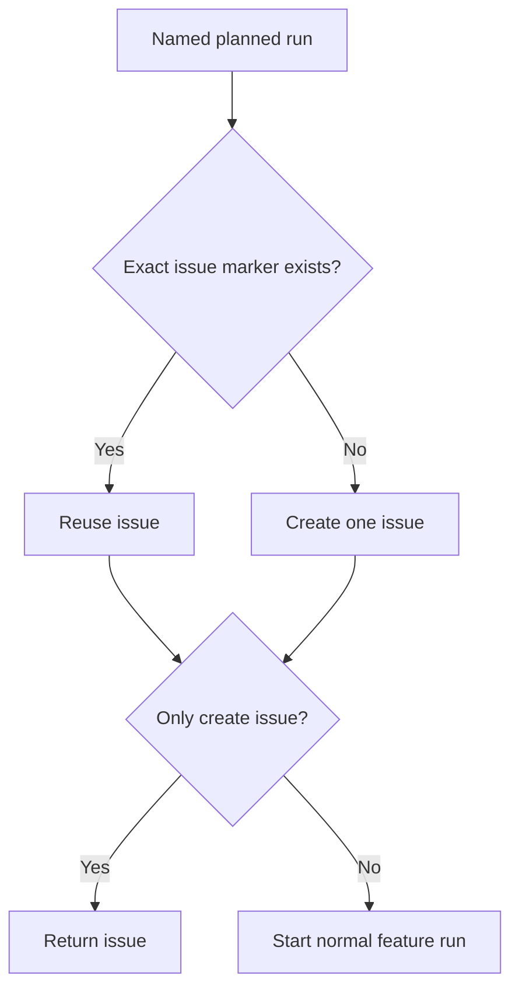

# Product plans and progress

Own `src/product.mjs`: read a product plan, show progress and ready runs, and
start one normal feature run. Product commands never call the PDD runtime,
control child runs, approve gates, merge, or commit evidence. Preserve existing
feature workflow behavior by delegating startup to its public runner.

Export module functions `readProduct({cwd}, ports)`,
`productStatus({cwd}, ports)`, `productNext({cwd}, ports)`,
`productStart({cwd, run, noRun=false, agent='codex', packageRoot}, ports)` and
`runProduct({command, run, noRun, agent, json, cwd, packageRoot}, ports)`.
The result structures of the first four are declared below. `runProduct` returns
`{exitCode,message}` for the CLI, catches finite input/dependency failures, and
formats the same structured results. It never retries a mutation automatically.

## Read the durable plan

For these module functions, cwd is the explicit product repository root (or the
logical root supplied by an injected filesystem). The CLI resolves an invoking
subdirectory to that root before calling this module. Read `product/map.md` and
optional `product/plan.md` beneath cwd through the injected readFile callback.
Missing plan is allowed for the small path. Parse
Markdown tables by heading and column name, trimming cells, ignoring separator
rows and preserving row order. Backtick-wrapped cell values are plain values.
Split comma lists; empty or `-` is an empty list. Ignore unrelated headings.
The map heading supplies name without its `: map` suffix; its Size line supplies
the chosen small, medium or large path. Do not override the person's chosen size.

Parts, Stories, Journeys and Questions use the columns in the required file
format. Keep CORE and LATER Stories distinct. Return only unanswered question
IDs. Runs come from the plan; their slice is a string. Missing map, unreadable
required input, duplicate part/Story/run IDs or references to unknown parts,
Stories or needs give `invalid-product` with the file and offending ID. Do not
reject an oversized run. An `all` run may name journey IDs. A small map without
a plan has one implicit run named for its sole part, slice `1`, all its CORE
Stories, and no needs. Its guidance says "run one feature run". No map/plan file
is changed by these module functions.

## Current progress

Use the shared repository run listing and shared Story evidence; never copy
source matching or parse saved check lines independently. Find each planned
run's GitHub issue by the exact HTML marker `<!-- pdd-product: run=RUN -->` in
its body, including closed issues. Match a local workflow record by that issue
number. Read issue bodies and linked PRs with gh through the injected execFile
callback, using argument arrays, never a shell. Search results must be filtered
by the exact marker, so phone-1 does not match phone-10. Read all relevant issue
pages; a truncated first page must not create a duplicate issue. Use resolveWorkflowRepository, the shared
repository-resolution helper to name the repository explicitly for gh requests.
A gh failure is a finite error, never an empty search authorizing creation.

A checked Story's basename starts with its map ID followed by `-`, `.`, or end
of name, with case preserved; P01 does not match P010. Count each planned CORE
Story once per part and once per slice. Journey IDs form a separate `journeys`
part row. `pass` means a matching current saved pass; `stale` means only an
older/unverified pass exists; `notRun` means neither, including explicit failures
and unknown results. Thus total = pass + stale + notRun. Choose current evidence
before stale evidence, and the newest named row within each category.

When no local run record exists, read Runtime check lines from that issue's PR
bodies using the shared parser. Identify the latest PR evidence as `fromPr:N` and
show "from PR #N" in text. Remote pass counts are reported progress from that PR,
not proof against local files. Never silently label remote evidence current.
Part and slice progress may include those reported passes, with the run's source
label visible in both text and JSON. Retain missing evidence as notRun.

A planned-run dependency is done only when its final implementation PR is
merged. A completed workflow, a merged prompt-only PR, a closed issue or a
passing check alone is not completion. `plan PR` is satisfied when
`product/plan.md` is present on the base branch: use the saved product workflow's
baseBranch, otherwise the resolved repository defaultBranch. Read it through
planOnBase, using the local origin-tracking base ref when it exists, otherwise
the local base branch. A missing plan on an existing origin-tracking ref does
not fall back to a local-only plan. Do not fetch or mutate refs. A missing base
ref or plan leaves this need
unresolved; a transport failure is a finite diagnostic. Local refs may be stale,
so this is not proof of a person's approval. A run with an existing
issue/workflow is tracked rather than offered as a fresh ready run.

## Next and start



`productNext` lists unstarted runs whose Needs are satisfied and lists unresolved
needs for waiting runs. Preserve plan order. When at least two runs are ready,
its guidance says "These can run in parallel, or one person can start them in order."
`runProduct` prints that guidance and the exact `pdd product start RUN` for each ready run.
For small products print their one-run guidance. It never starts anything.

`productStart` rejects an unknown run before any mutation. For a new issue, use
the product name and run in its title, then name the product issue if a product
workflow record supplies it, plan path, run, slice, Story IDs and texts, prompt
folder, boundary contract files and world contract. Say that other parts are
fakes from contracts and `contracts/` must not change. Include exactly one run
marker. Pass multiline text as data (a body argument or body file), never shell
code. Repeated sequential starts reuse the issue, including a closed one; do not
create another. Concurrent start locking is outside this promise.

After finding/creating the issue, `--no-run` returns it. Otherwise invoke
`startRun({name:'feature', issue:N, agent, cwd, packageRoot})` once. Keep the
runner's reply and failure visible; a startup failure must not delete the issue.
Default agent is codex; claude is supported. More than 12 Stories in a planned
run produces a warning in status/next/start, never a refusal. No prerequisite is
an added hard gate on an explicit start; show unmet needs as advice.

## Ports and preservation

Defaults use public local files, the existing workflow-run records/evidence and
gh helpers, and the public feature runner. Permit injected `readFile(path)`,
`listRuns({cwd})`, `storyEvidence(run)`, `execFile(file,args,{cwd})`,
`resolveRepository({cwd})`, `planOnBase({cwd,baseBranch})`,
`createIssue({repository,title,body})` and `startRun`. The optional createIssue
effect returns `{url}` and only transports an actual GitHub issue creation;
productStart still owns lookup, title/body policy and returned URL validation.
Its default delegates to execFile with `gh issue create`, passing multiline body
as an argument, so existing execFile injection remains usable.
Runtime resources below bind those same callbacks: files.read returns content;
runs.list and runs.evidence serialize the existing callback result as JSON;
github.repository binds resolveWorkflowRepository through resolveRepository;
repository.planOnBase binds the read-only base-ref lookup and returns present.
Its default uses execFile with Git argv arrays. Read this port only when a need
names `plan PR`; the small path has no such need. Runtime bindings may record
callback requests without changing the native operation's read-only meaning.
github.run binds read invocations of execFile('gh',args,{cwd}) and returns stdout;
github.createIssue binds the issue-creation effect and records its typed payload.
workflow.start binds startRun. No resource reads another Story's expected output. Native Git
identity, process transport and simultaneous-start races need native verification.
All successful CLI values go to stdout; finite errors go to stderr. Every emitted
line ends with one newline. Invalid input and errors never call a model.

The [command catalog](command-catalog.prompt.md) owns CLI syntax.

## Dependencies

- [Product file formats](../../skills/pdd-product/references/files.md): required authoring, generation and verification context for tables, size paths and contracts.
- [Workflow runs](workflow-runs.prompt.md): required generation/runtime context for repository-scoped `listRuns`, which reuses runsIn.
- [Workflow runner](workflow-runner.prompt.md): required generation/runtime context for startup, shared `storyEvidence`, `storyCount`, `matchesSource` and Runtime-line parsing. Export the parser for remote PR evidence rather than duplicate it.
- [GitHub helpers](workflow-github.prompt.md): required generation/runtime context for repository identity and gh invocation.

<details><summary>Runtime interface</summary>

```json
{
  "status": "draft", "prose_sha256": "408bd5191bc3e94ec43c207c5b9ec6e3dd5ae9f3b5e912e1acf2eb5335717c32",
  "entries": [
    {"operation":"readProduct","input_schema":{"type":"object","properties":{"cwd":{"type":"string"}},"required":["cwd"],"additionalProperties":false},"result_schema":{"type":"object","properties":{"name":{"type":"string"},"size":{"type":"string"},"parts":{"type":"array","items":{"type":"object","properties":{"part":{"type":"string"},"folder":{"type":"string"},"description":{"type":"string"}},"required":["part","folder","description"],"additionalProperties":false}},"stories":{"type":"array","items":{"type":"object","properties":{"id":{"type":"string"},"part":{"type":"string"},"story":{"type":"string"},"tag":{"type":"string"}},"required":["id","part","story","tag"],"additionalProperties":false}},"journeys":{"type":"array","items":{"type":"object","properties":{"id":{"type":"string"},"journey":{"type":"string"},"stories":{"type":"array","items":{"type":"string"}}},"required":["id","journey","stories"],"additionalProperties":false}},"runs":{"type":"array","items":{"type":"object","properties":{"run":{"type":"string"},"part":{"type":"string"},"slice":{"type":"string"},"stories":{"type":"array","items":{"type":"string"}},"needs":{"type":"array","items":{"type":"string"}}},"required":["run","part","slice","stories","needs"],"additionalProperties":false}},"questions":{"type":"array","items":{"type":"string"}}},"required":["name","size","parts","stories","journeys","runs","questions"],"additionalProperties":false},"errors":["invalid-product"]},
    {"operation":"productStatus","input_schema":{"type":"object","properties":{"cwd":{"type":"string"}},"required":["cwd"],"additionalProperties":false},"result_schema":{"type":"object","properties":{"name":{"type":"string"},"size":{"type":"string"},"parts":{"type":"array","items":{"type":"object","properties":{"part":{"type":"string"},"total":{"type":"integer"},"pass":{"type":"integer"},"stale":{"type":"integer"},"notRun":{"type":"integer"}},"required":["part","total","pass","stale","notRun"],"additionalProperties":false}},"slices":{"type":"array","items":{"type":"object","properties":{"slice":{"type":"string"},"total":{"type":"integer"},"pass":{"type":"integer"},"stale":{"type":"integer"},"notRun":{"type":"integer"}},"required":["slice","total","pass","stale","notRun"],"additionalProperties":false}},"runs":{"type":"array","items":{"type":"object","properties":{"run":{"type":"string"},"issue":{"oneOf":[{"type":"integer"},{"type":"null"}]},"state":{"type":"string"},"prs":{"type":"array","items":{"type":"integer"}},"fromPr":{"oneOf":[{"type":"integer"},{"type":"null"}]}},"required":["run","issue","state","prs","fromPr"],"additionalProperties":false}},"ready":{"type":"array","items":{"type":"string"}},"questions":{"type":"array","items":{"type":"string"}}},"required":["name","size","parts","slices","runs","ready","questions"],"additionalProperties":false},"errors":["invalid-product"]},
    {"operation":"productNext","input_schema":{"type":"object","properties":{"cwd":{"type":"string"}},"required":["cwd"],"additionalProperties":false},"result_schema":{"type":"object","properties":{"ready":{"type":"array","items":{"type":"string"}},"waiting":{"type":"array","items":{"type":"object","properties":{"run":{"type":"string"},"needs":{"type":"array","items":{"type":"string"}}},"required":["run","needs"],"additionalProperties":false}},"guidance":{"type":"string"}},"required":["ready","waiting","guidance"],"additionalProperties":false},"errors":["invalid-product"]},
    {"operation":"productStart","input_schema":{"type":"object","properties":{"cwd":{"type":"string"},"run":{"type":"string"},"noRun":{"type":"boolean"},"agent":{"type":"string"},"packageRoot":{"type":"string"}},"required":["cwd","run"],"additionalProperties":false},"result_schema":{"type":"object","properties":{"exitCode":{"type":"integer"},"message":{"type":"string"},"issue":{"oneOf":[{"type":"integer"},{"type":"null"}]},"created":{"type":"boolean"},"started":{"type":"boolean"}},"required":["exitCode","message","issue","created","started"],"additionalProperties":false},"errors":[]}
  ],
  "calls": [],
  "resources": [
    {"name":"files","kind":"blob","access":"read","operations":[{"name":"read","access":"read","arguments_schema":{"type":"object","properties":{"path":{"type":"string"}},"required":["path"],"additionalProperties":false},"result_schema":{"type":"object","properties":{"content":{"type":"string"}},"required":["content"],"additionalProperties":false}}]},
    {"name":"runs","kind":"port","access":"read","operations":[{"name":"list","access":"read","arguments_schema":{"type":"object","properties":{"cwd":{"type":"string"}},"required":["cwd"],"additionalProperties":false},"result_schema":{"type":"object","properties":{"json":{"type":"string"}},"required":["json"],"additionalProperties":false}},{"name":"evidence","access":"read","arguments_schema":{"type":"object","properties":{"run_json":{"type":"string"}},"required":["run_json"],"additionalProperties":false},"result_schema":{"type":"object","properties":{"json":{"type":"string"}},"required":["json"],"additionalProperties":false}}]},
    {"name":"github","kind":"port","access":"write","operations":[{"name":"run","access":"write","arguments_schema":{"type":"object","properties":{"args":{"type":"array","items":{"type":"string"}},"cwd":{"type":"string"}},"required":["args","cwd"],"additionalProperties":false},"result_schema":{"type":"object","properties":{"stdout":{"type":"string"}},"required":["stdout"],"additionalProperties":false}},{"name":"repository","access":"read","arguments_schema":{"type":"object","properties":{"cwd":{"type":"string"}},"required":["cwd"],"additionalProperties":false},"result_schema":{"type":"object","properties":{"repository":{"type":"string"},"defaultBranch":{"type":"string"}},"required":["repository","defaultBranch"],"additionalProperties":false}},{"name":"createIssue","access":"write","arguments_schema":{"type":"object","properties":{"repository":{"type":"string"},"title":{"type":"string"},"body":{"type":"string"}},"required":["repository","title","body"],"additionalProperties":false},"result_schema":{"type":"object","properties":{"url":{"type":"string"}},"required":["url"],"additionalProperties":false}}]},
    {"name":"repository","kind":"port","access":"read","operations":[{"name":"planOnBase","access":"read","arguments_schema":{"type":"object","properties":{"cwd":{"type":"string"},"baseBranch":{"type":"string"}},"required":["cwd","baseBranch"],"additionalProperties":false},"result_schema":{"type":"object","properties":{"present":{"type":"boolean"}},"required":["present"],"additionalProperties":false}}]},
    {"name":"workflow","kind":"port","access":"write","operations":[{"name":"start","access":"write","arguments_schema":{"type":"object","properties":{"name":{"type":"string"},"issue":{"type":"integer"},"agent":{"type":"string"},"cwd":{"type":"string"},"packageRoot":{"type":"string"}},"required":["name","issue","agent","cwd"],"additionalProperties":false},"result_schema":{"type":"object","properties":{"exitCode":{"type":"integer"},"message":{"type":"string"}},"required":["exitCode","message"],"additionalProperties":false}}]}
  ],
  "limits": {"max_steps": 20, "max_model_calls": 12}, "conventions": []
}
```
</details>
