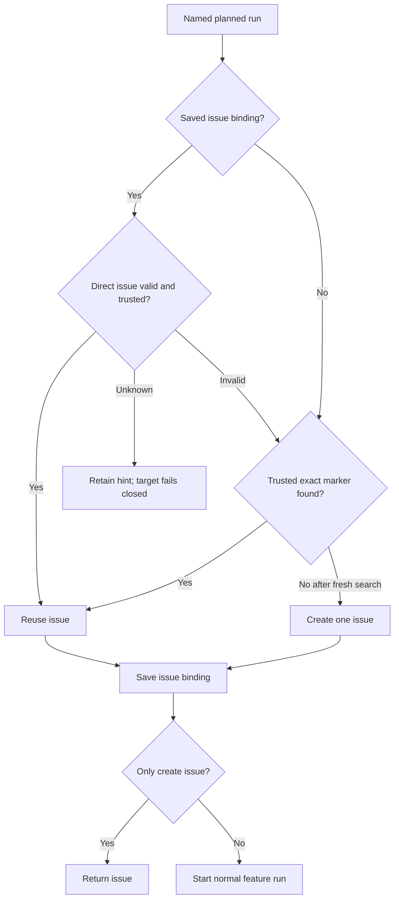

# Product plans and progress

Own `src/product.mjs`: read a product plan, show progress and ready runs, and
start one normal feature run. Product commands never call the PDD runtime,
control child runs, approve gates, merge, or commit evidence. Preserve existing
feature workflow behavior by delegating startup to its public runner.

Export module functions `readProduct({cwd}, ports)`,
`productStatus({cwd}, ports)`, `productNext({cwd}, ports)`,
`productStart({cwd, run, noRun=false, agent='codex', packageRoot}, ports)` and
`runProduct({command, run, noRun, agent, json, cwd, packageRoot}, ports)`.
The result structures of the first four are declared below. `runProduct` returns
`{exitCode,message}` for the CLI, catches finite input/dependency failures, and
formats the same structured results. It never retries a mutation automatically.

## Pure document parser

Export `parseProductDocuments({mapText,planText=''})` for synchronous snapshot-safe consumers. It owns the existing product map/plan table parsing and validation, returning `{product,boundaries}` with the same values currently produced by documents; boundaries retain the plan's From, To, What crosses and Contract string columns. It performs no reads/effects. Existing async readProduct and documents read their files normally then delegate to it, preserving all prior public behavior/errors. Product composition reads attempt-local bytes and calls this parser; never duplicate parsing or pre-read asynchronously outside captureSource. Native integration must prove existing readProduct results and errors unchanged.

## World writer declarations

Export pure module function `parseProductWorldWriters({worldText}) -> [{key,writer}]` for composition’s ownership check. Parse the canonical world.md Markdown table through this module’s existing table parser, using required `Key` and `Writer` columns (trimmed header/cell values, optional surrounding backticks, separator rows ignored). Return rows in document order with key and writer strings, preserving every declaration including duplicate keys and repeated identical rows: distinct-writer conflict policy belongs to composition. Missing required columns or a declaration with an empty key or writer gives `invalid-product` naming world.md and the deficient column/row. Do not read files, collapse duplicates, infer ownership from seed contents or apply effects. Other columns are descriptive and do not alter writer identity.

## Read the durable plan

For these module functions, cwd is the explicit product repository root (or the
logical root supplied by an injected filesystem). The CLI resolves an invoking
subdirectory to that root before calling this module. Read `product/map.md` and
optional `product/plan.md` beneath cwd through the injected readFile callback.
Missing plan is allowed for the small path. Parse
Markdown tables by heading and column name, trimming cells, ignoring separator
rows and preserving row order. Backtick-wrapped cell values are plain values.
Split comma lists; empty or `-` is an empty list. Ignore unrelated headings.
The map heading supplies name without its `: map` suffix; its Size line supplies
the chosen small, medium or large path. Do not override the person's chosen size.

Parts, Stories, Journeys and Questions use the columns in the required file
format. Keep CORE and LATER Stories distinct. Return only unanswered question
IDs. Runs come from the plan; their slice is a string. Missing map, unreadable
required input, duplicate part/Story/run IDs or references to unknown parts,
Stories or needs give `invalid-product` with the file and offending ID. Do not
reject an oversized run. An `all` run may name journey IDs. A small map without
a plan has one implicit run named for its sole part, slice `1`, all its CORE
Stories, and no needs. Its guidance says "run one feature run". No map/plan file
is changed by these module functions.

## Current progress

Use the shared repository run listing, Story evidence and Runtime-line parser.
The product module chooses which planned issue and PRs belong to a run; the
shared evidence owner decides whether a saved local result matches its files.
All three commands use the same trusted issue selection below.

<details>
<summary>Find a trusted planned issue without loading the repository history</summary>

Use the [planned-run marker grammar](../../skills/pdd-product/references/files.md#planned-run-identity).
Before any search, read local product state and directly look up this run's saved
issue binding, or an issue named by a local feature record with this exact
`productMarker`. Validate the actual issue's repository, positive number, exact
single marker and author trust below. A binding is a lookup hint, never authority.
A bad saved binding or local feature hint affects only its planned run. Status
marks that run `unverified`, with the issue number, a reason and the action
"Run `pdd product start RUN` to link it again"; next carries the same warning.
Do not read its PRs, count evidence, offer it ready, or advance its dependents.
Other planned runs remain usable, including explicit starts for other runs.

A confirmed 404, foreign repository, wrong/missing marker, or author known to be
untrusted invalidates the hint. Drop that persisted run/issue binding and exclude
that same issue from local hints and cached selection in this command. Read
commands leave the affected run unverified for this invocation. An explicit
start of that run may discover and save a trusted replacement, or create after
a complete fresh search proves no eligible issue; it must not repeatedly fail
on the invalid local record. A transport failure, malformed lookup, non-404 HTTP
failure, or unavailable actor identity leaves the issue unresolved: retain the
hint, isolate the run, and fail its explicit start with the reason and repair
action, without creation or workflow launch. Such uncertainty never proves
absence. Apply the same distinction to direct revalidation of cached candidates.
For start, resolve its target first: a valid binding returns/reuses that issue
without searching unrelated runs.

For unresolved runs, use one shared repository issue-search query for the prefix
`<!-- pdd-product: run=` across this product's commands, then exact-match the
planned markers locally, including closed issues. phone-1 never matches phone-10.
One query may require several pages: read each bounded page separately with at
most ten items, projecting only issue identity/body, author, association,
creation time and state. Do not load all repository history or combine pages in
one subprocess output buffer. Use gh argv arrays and a verified repository.

Read the complete relevant search result. Transport failure, malformed pages,
`incomplete_results`, or the search ceiling without completeness proof is a
finite dependency error, never an empty search authorizing creation. Deduplicate
responses by issue number. Persist only complete raw search snapshots for 60,000
milliseconds, scoped by verified repository and Git common directory. A snapshot
is usable only at age 0 through 59,999 milliseconds;
malformed, future-dated, expired or foreign-scope snapshots are misses. Across
separate CLI processes status, next and start reuse a valid snapshot. Before
creating from a cached negative, refresh the shared query once; a query freshly
completed in this command is already sufficient. Never issue a second fresh
query in one command. Revalidate a cached selected issue by direct lookup before
claiming it; cached association/body alone cannot establish trust.

A candidate is trusted only when its `author_association` is OWNER, MEMBER or
COLLABORATOR, or its `user.login` is the current authenticated person's login.
Compare logins case-insensitively. Resolve the current actor only for that
exception, once per command. A failed lookup or malformed/missing/blank login
memoizes unavailable identity: candidates requiring that exception are untrusted,
while repository-associated candidates remain eligible. Unavailable identity for
a saved hint follows the unresolved-hint rule above; identity lookup failure
itself never throws. Unbound candidates remain untrusted and do
not prevent the commands from continuing.
An outsider's marker cannot claim the run or cause its text to be run.

Among trusted exact-marker issues, prefer one with an actual local feature run
record for that issue number; an explicit foreign `productMarker` vetoes that
record, while absent markers in legacy records are allowed after issue discovery.
Never infer a planned-run assignment from branch shape or runId. Within the
preferred group, or among all trusted issues when none has a local feature run,
choose oldest creation time then lowest issue number. Warn about trusted
duplicates and the selected issue, and ignored untrusted claims. Closed trusted
issues remain eligible. Save the selected run-to-issue binding immediately when
found and immediately after confirmed creation, before returning --no-run or
launching a workflow. A state-write failure stops startup and reports the
already-created issue rather than deleting it or retrying creation.

</details>

<details>
<summary>Associate only this run's PRs, and retain its prompt results</summary>

Read timeline pages separately and consider only `cross-referenced` events
whose source is a canonical PR in the same repository. A comment containing a
PR URL is not a PR association. Read each candidate's actual metadata. Reject
fork heads and foreign repositories. The actual canonical PR URL and number
must match the requested repository and PR. Any explicitly foreign head owner or
repository name, or `isCrossRepository:true`, vetoes membership; a false flag
cannot override contradicting head metadata. With no contradiction,
same-repository proof is `isCrossRepository:false` or matching
`headRepositoryOwner.login` plus `headRepository.name`. Missing proof stays
unverified. Warn about rejected PR provenance only when its body claims this
run with its exact own-line marker; ordinary references from other runs are quiet.

An otherwise eligible PR belongs to this planned run when its body carries the
exact product marker on its own line, or its actual head branch equals an own
branch saved in this issue's local run record (`pr[].branch` or `branch`). Use
actual saved assignments, not a branch-name pattern, title, `Unblocks`, a
comment or `PR 2` prose. The allocation branch suffix and the workflow runId are
independent. A legacy workflow marker plus branch shape alone is insufficient
when no actual assignment binds it to this run. Preserve the workflow GitHub
owner's canonical URL and metadata rules.

Among this run's eligible PRs, use the most recently updated PR that has usable
named Runtime check lines, with the higher PR number for an equal update time.
A later code PR without check lines cannot hide prompt-PR results. Parse the
chosen body through `runtimeLines`, never an independent parser. Its `fromPr:N`
and the text "from PR #N" name that evidence provider, not a later PR with no
results. Remote passes are reported progress, not proof against local files.
Retain missing evidence as notRun. Only an eligible merged implementation PR
completes a planned run: implementation stage is established by the saved run's
code-stage assignment or its canonical workflow marker's code stage, never by
stage prose alone.

</details>

A checked Story's basename starts with its map ID followed by `-`, `.`, or end
of name, with case preserved; P01 does not match P010. Count each planned CORE
Story once per part and once per slice. Journey IDs form a separate `journeys`
part row. `pass` means a matching current saved pass; `stale` means only an
older/unverified pass exists; `notRun` means neither, including explicit failures
and unknown results. Thus total = pass + stale + notRun. Choose current evidence
before stale evidence, and the newest named row within each category.

<details>
<summary>Compare merged work against the base, and report waiting needs</summary>

For an unmerged local run, keep its existing own-worktree evidence comparison.
For a run whose eligible implementation PR is merged, call the shared
`storyEvidence(run, {comparisonRoot})` against the current base source instead.
Prefer an actual checkout of the local base branch, including its current edits.
Otherwise use its current local base ref; use the origin-tracking base ref only
when that local ref is absent. Never fetch or change the person's refs. The
base is the run's saved baseBranch, otherwise the resolved repository default.
One read-only view may serve several runs with the same base within a command.
The base-view lifecycle ports below supply files, not precomputed Story answers.
Always close owned views in finally, including on errors, and never remove a
person's existing checkout. If no base is available, pass explicit null to the
shared comparison and warn; do not fall back to the finished run's old files or
claim a current pass. A base contract/prompt edit can therefore make merged work
stale while an unchanged base can verify it after the run worktree changes or
is removed. Status text names each actual local comparison base, for example
"Compared with your local main. Run `git pull` to see changes merged on GitHub."
Use the actual branch name, including alpha when appropriate; never imply a fetch
was performed. Remote-only counts retain their separate from-PR attribution.

A dependency is done only when its eligible final implementation PR is merged.
A completed workflow, a merged prompt-only PR, a closed issue or a passing check
alone is not completion. `plan PR` retains its separate existing lookup:
product/plan.md must be on the saved product workflow's baseBranch, otherwise the
resolved defaultBranch, using the local origin-tracking ref first and local base
only when that ref is absent. A missing plan on an existing tracking ref is not
replaced by a local-only plan. Local refs may be stale and do not prove approval.
A missing ref/plan leaves the need unresolved; a transport failure is finite.
An existing trusted issue/workflow is tracked rather than offered as a new run.

Needs between planned runs may form a cycle, including a self-cycle. Report a
finite diagnostic with a real closed dependency path, for example
"Needs form a cycle: server-1 → journeys → server-1", in status and next instead
of silently leaving that group waiting forever. The special `plan PR` need is
not a run edge. Preserve normal readiness for unrelated runs. This diagnosis is
advice, not a new hard gate on an explicit start.

</details>

Optional `warnings` arrays in status/next carry these diagnostics only when
nonempty; omit the field otherwise to preserve existing result shapes. CLI text
shows each warning. Start includes its relevant warnings in its message.

## Next and start



`productNext` lists unstarted runs whose Needs are satisfied and lists unresolved
needs for waiting runs. Preserve plan order. When at least two runs are ready,
its guidance says "These can run in parallel, or one person can start them in order."
`runProduct` prints that guidance and the exact `pdd product start RUN` for each ready run.
For small products print their one-run guidance. It never starts anything.

`productStart` rejects an unknown run before any mutation. For a new issue,
name the product, run and each planned Story ID in its title when that fits
GitHub's 256-character limit (Unicode code points). If it does not fit, use a
clear count or first/last summary and warn. Shorten an overlong product/run
label as needed rather than send an invalid title; the full run and every Story
ID/text remain in the body. This compaction is not a refusal or a new Story
limit.
The body names the product issue when a product workflow record supplies it,
plan path, run, slice, full Story IDs/texts, prompt folder, boundary contracts and
world contract. Include actionable filename guidance: name every Story file with
its map ID first, such as `P01-menu.md` (use the first planned ID for its example). When a product workflow record supplies the parent issue, include the body line `Part of #N (product).`, replacing N with that issue number. Say that other parts are
fakes from contracts and `contracts/` must not change. Include exactly one run
marker. Pass multiline text as data (a body argument or body file), never shell
code. Repeated sequential starts reuse the issue, including a closed one; do not
create another. Exactly-once issue creation by concurrent starts of the same
run is outside this promise.

After saving the issue binding, `--no-run` returns it. Otherwise invoke
`startRun({name:'feature', issue:N, agent, cwd, packageRoot})` once. Keep the
runner's reply and failure visible; a startup failure must not delete the issue.
Default agent is codex; claude is supported. More than 12 Stories in a planned
run produces a warning in status/next/start, never a refusal. No prerequisite is
an added hard gate on an explicit start; show unmet needs as advice.

## Ports and preservation

Defaults use public local files, the existing workflow records/evidence, normal
gh login and the public feature runner. Existing injected callbacks remain:
`readFile(path)`, `listRuns({cwd})`, `storyEvidence(run, options?)`,
`execFile(file,args,{cwd})`, `resolveRepository({cwd})`,
`planOnBase({cwd,baseBranch})`, `createIssue({repository,title,body})` and
`startRun`. `createIssue` returns `{url}`; its default still delegates to
execFile with `gh issue create`, passing multiline body as data. ProductStart
owns the issue contents and returned-URL validation.

<details>
<summary>Raw GitHub read ports and base-source view lifecycle</summary>

The optional raw read callbacks below default to gh through the existing
execFile callback; they do not return a selected issue, dependency verdict or
Story result. Native callers receive service values. Runtime resources serialize
those same raw values as `json` so closed transport schemas need not reproduce
GitHub's changing record envelope.

| Callback | Actual outside observation |
|---|---|
| `issuePage({cwd,repository,marker,page,perPage})` | Raw Search response `{items,total_count,incomplete_results}` for the shared product marker prefix, all states. Page is one-based; perPage is ten or less. |
| `issueByNumber({cwd,repository,number})` | Raw issue identity/body, author, association, creation time and state from the requested repository issue endpoint, or the actual HTTP failure `{status,message}`; transport failure throws. No selection or trust verdict. |
| `readProductState({cwd,repository})` | `{json}` containing raw saved JSON text, or null for absent state. |
| `writeProductState({cwd,repository,json})` | `{}` after atomically replacing that product state with the supplied JSON text. |
| `lockProductState({cwd,repository})` | `{handle}` after acquiring exclusive state access for this repository/common-directory scope; handle is an owned opaque string. |
| `unlockProductState({handle})` | `{}` after releasing only that owned lock. |
| `now()` | `{milliseconds}`: current Unix epoch milliseconds. |
| `timelinePage({cwd,repository,issue,page,perPage})` | One raw issue-timeline event array, with the same bounded page size. |
| `pullRequest({cwd,repository,number})` | Actual PR fields needed for number/URL, body, state/draft, updated time, head branch and same-repository/fork proof. |
| `currentActor({cwd})` | `{login}` from the authenticated gh account. |
| `openBaseSource({cwd,baseBranch})` | `{root,handle}`: an existing base checkout or a private read-only local snapshot; root and handle may be null when unavailable. |
| `closeBaseSource({handle})` | `{}` after releasing only the view owned by that non-null handle. |

State adapters store data beneath the Git common directory, keyed by verified
repository, so every checkout of that repository shares bindings and snapshots.
They never write product source files. The module uses these raw adapters;
filesystem realpath of cwd is not a module decision or state-scope condition.
The module owns decoding, validation and selection. Version-2 state contains
`version:2`, `repository`, `bindings:[{run,issue}]` and optional
`search:{at,items}` with raw projected issue records; no productRoot. Only
well-formed positive-integer bindings for this repository are usable. Missing
state is empty; malformed binding state is a finite error before creation,
not absence. Cache corruption alone invalidates the snapshot.

Native adapters retain compatible version-1 folder-keyed state from within the
same Git common directory: its fields are `version:1`, `repository`,
`productRoot`, `bindings` and optional `search`. A different productRoot does not
discard that repository's links. Merge distinct run/issue hints; retain conflicting
legacy hints for normal trust and local-run selection, never choose arbitrarily.
Read both accepted versions; persist version 2. Foreign-repository state is not
imported. Once repository-wide version-2 state exists, it is authoritative: do
not reimport version-1 hints removed by committed version-2 updates or deletions.
Migration and state replacement use the same coordination below.

Every state mutation acquires lockProductState, rereads current state under the
lock, and merges only this command's explicit changes. An upsert changes its
run's binding; a deletion names both run and observed issue and removes only that
pair, preserving a concurrent replacement. Untouched bindings survive. Replace
the search snapshot only with a newer complete snapshot; a stale writer must
not resurrect a deleted binding or overwrite a newer snapshot. Atomically write
the merged state, then release the owned lock in finally, including on errors.
Do not hold the state lock over GitHub or workflow operations. Atomic reads may
be lock-free. This protects different-run updates and deletions; it does not
promise exactly-once concurrent issue creation.

The base adapter may allocate a private local Git snapshot from an existing
local ref. It copies no credentials, performs no network fetch and changes no
original repository ref, checkout or file. Its opaque handle is allocation
ownership, not a path supplied by a caller; cleanup may never delete an existing
base checkout. The product caller releases each non-null handle in finally,
caches only for that invocation and reports a finite cleanup failure.

</details>

Runtime bindings: files.read returns content; runs.list and runs.evidence
serialize the existing callback reply, with optional comparison_root passed to
storyEvidence. github.repository binds resolveRepository; github.issuePage,
github.timelinePage and github.pullRequest serialize their raw callbacks;
github.currentActor returns its raw reply as json (including malformed replies).
github.issueByNumber serializes its raw callback reply. productState.read/write
bind the raw state callbacks; productState.lock/unlock bind their lock lifecycle,
and clock.now binds now; none computes a verdict.
repository.planOnBase returns present and
is read only when a need names `plan PR`. repository.openBaseSource and
repository.closeBaseSource bind the view lifecycle. github.run remains the
legacy gh read transport through execFile; github.createIssue records the typed
creation payload; workflow.start binds the normal runner. These raw service and
file-view callbacks do not choose the issue, establish PR ownership or decide
product progress; those decisions remain with their owners above.

All successful CLI values go to stdout; finite errors go to stderr. Every emitted
line ends with one newline. Invalid input and errors never call a model.

The [command catalog](command-catalog.prompt.md) owns CLI syntax.

## Dependencies

- [Product file formats](../../skills/pdd-product/references/files.md): required authoring, generation and verification context for tables, size paths and contracts.
- [Workflow runs](workflow-runs.prompt.md): required generation/runtime context for repository-scoped `listRuns`, which reuses runsIn.
- [Workflow runner](workflow-runner.prompt.md): required generation/runtime context for startup, shared `storyEvidence`, `storyCount`, `matchesSource` and Runtime-line parsing. Export the parser for remote PR evidence rather than duplicate it.
- [GitHub helpers](workflow-github.prompt.md): required generation/runtime context for repository identity and gh invocation.

<details><summary>Runtime interface</summary>

```json
{
  "status": "draft", "prose_sha256": "a0a35ba0a839b2abadcb69a18ac7a2280ac99fc1a49d8510b7d57a074a4796c3",
  "entries": [
    {"operation":"readProduct","input_schema":{"type":"object","properties":{"cwd":{"type":"string"}},"required":["cwd"],"additionalProperties":false},"result_schema":{"type":"object","properties":{"name":{"type":"string"},"size":{"type":"string"},"parts":{"type":"array","items":{"type":"object","properties":{"part":{"type":"string"},"folder":{"type":"string"},"description":{"type":"string"}},"required":["part","folder","description"],"additionalProperties":false}},"stories":{"type":"array","items":{"type":"object","properties":{"id":{"type":"string"},"part":{"type":"string"},"story":{"type":"string"},"tag":{"type":"string"}},"required":["id","part","story","tag"],"additionalProperties":false}},"journeys":{"type":"array","items":{"type":"object","properties":{"id":{"type":"string"},"journey":{"type":"string"},"stories":{"type":"array","items":{"type":"string"}}},"required":["id","journey","stories"],"additionalProperties":false}},"runs":{"type":"array","items":{"type":"object","properties":{"run":{"type":"string"},"part":{"type":"string"},"slice":{"type":"string"},"stories":{"type":"array","items":{"type":"string"}},"needs":{"type":"array","items":{"type":"string"}}},"required":["run","part","slice","stories","needs"],"additionalProperties":false}},"questions":{"type":"array","items":{"type":"string"}}},"required":["name","size","parts","stories","journeys","runs","questions"],"additionalProperties":false},"errors":["invalid-product"]},
    {"operation":"productStatus","input_schema":{"type":"object","properties":{"cwd":{"type":"string"}},"required":["cwd"],"additionalProperties":false},"result_schema":{"type":"object","properties":{"name":{"type":"string"},"size":{"type":"string"},"parts":{"type":"array","items":{"type":"object","properties":{"part":{"type":"string"},"total":{"type":"integer"},"pass":{"type":"integer"},"stale":{"type":"integer"},"notRun":{"type":"integer"}},"required":["part","total","pass","stale","notRun"],"additionalProperties":false}},"slices":{"type":"array","items":{"type":"object","properties":{"slice":{"type":"string"},"total":{"type":"integer"},"pass":{"type":"integer"},"stale":{"type":"integer"},"notRun":{"type":"integer"}},"required":["slice","total","pass","stale","notRun"],"additionalProperties":false}},"runs":{"type":"array","items":{"type":"object","properties":{"run":{"type":"string"},"issue":{"oneOf":[{"type":"integer"},{"type":"null"}]},"state":{"type":"string"},"prs":{"type":"array","items":{"type":"integer"}},"fromPr":{"oneOf":[{"type":"integer"},{"type":"null"}]}},"required":["run","issue","state","prs","fromPr"],"additionalProperties":false}},"ready":{"type":"array","items":{"type":"string"}},"questions":{"type":"array","items":{"type":"string"}},"warnings":{"type":"array","items":{"type":"string"}}},"required":["name","size","parts","slices","runs","ready","questions"],"additionalProperties":false},"errors":["invalid-product"]},
    {"operation":"productNext","input_schema":{"type":"object","properties":{"cwd":{"type":"string"}},"required":["cwd"],"additionalProperties":false},"result_schema":{"type":"object","properties":{"ready":{"type":"array","items":{"type":"string"}},"waiting":{"type":"array","items":{"type":"object","properties":{"run":{"type":"string"},"needs":{"type":"array","items":{"type":"string"}}},"required":["run","needs"],"additionalProperties":false}},"guidance":{"type":"string"},"warnings":{"type":"array","items":{"type":"string"}}},"required":["ready","waiting","guidance"],"additionalProperties":false},"errors":["invalid-product"]},
    {"operation":"productStart","input_schema":{"type":"object","properties":{"cwd":{"type":"string"},"run":{"type":"string"},"noRun":{"type":"boolean"},"agent":{"type":"string"},"packageRoot":{"type":"string"}},"required":["cwd","run"],"additionalProperties":false},"result_schema":{"type":"object","properties":{"exitCode":{"type":"integer"},"message":{"type":"string"},"issue":{"oneOf":[{"type":"integer"},{"type":"null"}]},"created":{"type":"boolean"},"started":{"type":"boolean"}},"required":["exitCode","message","issue","created","started"],"additionalProperties":false},"errors":[]},
    {"operation":"parseProductDocuments","input_schema":{"type":"object","properties":{"mapText":{"type":"string"},"planText":{"type":"string"}},"required":["mapText"],"additionalProperties":false},"result_schema":{"type":"object","properties":{"product":{"type":"object","properties":{"name":{"type":"string"},"size":{"type":"string"},"parts":{"type":"array","items":{"type":"object","properties":{"part":{"type":"string"},"folder":{"type":"string"},"description":{"type":"string"}},"required":["part","folder","description"],"additionalProperties":false}},"stories":{"type":"array","items":{"type":"object","properties":{"id":{"type":"string"},"part":{"type":"string"},"story":{"type":"string"},"tag":{"type":"string"}},"required":["id","part","story","tag"],"additionalProperties":false}},"journeys":{"type":"array","items":{"type":"object","properties":{"id":{"type":"string"},"journey":{"type":"string"},"stories":{"type":"array","items":{"type":"string"}}},"required":["id","journey","stories"],"additionalProperties":false}},"runs":{"type":"array","items":{"type":"object","properties":{"run":{"type":"string"},"part":{"type":"string"},"slice":{"type":"string"},"stories":{"type":"array","items":{"type":"string"}},"needs":{"type":"array","items":{"type":"string"}}},"required":["run","part","slice","stories","needs"],"additionalProperties":false}},"questions":{"type":"array","items":{"type":"string"}}},"required":["name","size","parts","stories","journeys","runs","questions"],"additionalProperties":false},"boundaries":{"type":"array","items":{"type":"object","properties":{"From":{"type":"string"},"To":{"type":"string"},"What crosses":{"type":"string"},"Contract":{"type":"string"}},"required":["From","To","What crosses","Contract"],"additionalProperties":false}}},"required":["product","boundaries"],"additionalProperties":false},"errors":["invalid-product"]}
  ],
  "calls": [],
  "resources": [
    {"name":"files","kind":"blob","access":"read","operations":[{"name":"read","access":"read","arguments_schema":{"type":"object","properties":{"path":{"type":"string"}},"required":["path"],"additionalProperties":false},"result_schema":{"type":"object","properties":{"content":{"type":"string"}},"required":["content"],"additionalProperties":false}}]},
    {"name":"runs","kind":"port","access":"read","operations":[{"name":"list","access":"read","arguments_schema":{"type":"object","properties":{"cwd":{"type":"string"}},"required":["cwd"],"additionalProperties":false},"result_schema":{"type":"object","properties":{"json":{"type":"string"}},"required":["json"],"additionalProperties":false}},{"name":"evidence","access":"read","arguments_schema":{"type":"object","properties":{"run_json":{"type":"string"},"comparison_root":{"oneOf":[{"type":"string"},{"type":"null"}]}},"required":["run_json"],"additionalProperties":false},"result_schema":{"type":"object","properties":{"json":{"type":"string"}},"required":["json"],"additionalProperties":false}}]},
    {"name":"github","kind":"port","access":"write","operations":[{"name":"run","access":"write","arguments_schema":{"type":"object","properties":{"args":{"type":"array","items":{"type":"string"}},"cwd":{"type":"string"}},"required":["args","cwd"],"additionalProperties":false},"result_schema":{"type":"object","properties":{"stdout":{"type":"string"}},"required":["stdout"],"additionalProperties":false}},{"name":"repository","access":"read","arguments_schema":{"type":"object","properties":{"cwd":{"type":"string"}},"required":["cwd"],"additionalProperties":false},"result_schema":{"type":"object","properties":{"repository":{"type":"string"},"defaultBranch":{"type":"string"}},"required":["repository","defaultBranch"],"additionalProperties":false}},{"name":"createIssue","access":"write","arguments_schema":{"type":"object","properties":{"repository":{"type":"string"},"title":{"type":"string"},"body":{"type":"string"}},"required":["repository","title","body"],"additionalProperties":false},"result_schema":{"type":"object","properties":{"url":{"type":"string"}},"required":["url"],"additionalProperties":false}},{"name":"issuePage","access":"read","arguments_schema":{"type":"object","properties":{"cwd":{"type":"string"},"repository":{"type":"string"},"page":{"type":"integer","minimum":1},"perPage":{"type":"integer","minimum":1,"maximum":10},"marker":{"type":"string"}},"required":["cwd","repository","page","perPage","marker"],"additionalProperties":false},"result_schema":{"type":"object","properties":{"json":{"type":"string"}},"required":["json"],"additionalProperties":false}},{"name":"timelinePage","access":"read","arguments_schema":{"type":"object","properties":{"cwd":{"type":"string"},"repository":{"type":"string"},"page":{"type":"integer","minimum":1},"perPage":{"type":"integer","minimum":1,"maximum":10},"issue":{"type":"integer","minimum":1}},"required":["cwd","repository","page","perPage","issue"],"additionalProperties":false},"result_schema":{"type":"object","properties":{"json":{"type":"string"}},"required":["json"],"additionalProperties":false}},{"name":"pullRequest","access":"read","arguments_schema":{"type":"object","properties":{"cwd":{"type":"string"},"repository":{"type":"string"},"number":{"type":"integer","minimum":1}},"required":["cwd","repository","number"],"additionalProperties":false},"result_schema":{"type":"object","properties":{"json":{"type":"string"}},"required":["json"],"additionalProperties":false}},{"name":"currentActor","access":"read","arguments_schema":{"type":"object","properties":{"cwd":{"type":"string"}},"required":["cwd"],"additionalProperties":false},"result_schema":{"type":"object","properties":{"json":{"type":"string"}},"required":["json"],"additionalProperties":false}},{"name":"issueByNumber","access":"read","arguments_schema":{"type":"object","properties":{"cwd":{"type":"string"},"repository":{"type":"string"},"number":{"type":"integer","minimum":1}},"required":["cwd","repository","number"],"additionalProperties":false},"result_schema":{"type":"object","properties":{"json":{"type":"string"}},"required":["json"],"additionalProperties":false}}]},
    {"name":"repository","kind":"port","access":"read","operations":[{"name":"planOnBase","access":"read","arguments_schema":{"type":"object","properties":{"cwd":{"type":"string"},"baseBranch":{"type":"string"}},"required":["cwd","baseBranch"],"additionalProperties":false},"result_schema":{"type":"object","properties":{"present":{"type":"boolean"}},"required":["present"],"additionalProperties":false}},{"name":"openBaseSource","access":"read","arguments_schema":{"type":"object","properties":{"cwd":{"type":"string"},"baseBranch":{"type":"string"}},"required":["cwd","baseBranch"],"additionalProperties":false},"result_schema":{"type":"object","properties":{"root":{"oneOf":[{"type":"string"},{"type":"null"}]},"handle":{"oneOf":[{"type":"string"},{"type":"null"}]}},"required":["root","handle"],"additionalProperties":false}},{"name":"closeBaseSource","access":"read","arguments_schema":{"type":"object","properties":{"handle":{"type":"string"}},"required":["handle"],"additionalProperties":false},"result_schema":{"type":"object","properties":{},"required":[],"additionalProperties":false}}]},
    {"name":"workflow","kind":"port","access":"write","operations":[{"name":"start","access":"write","arguments_schema":{"type":"object","properties":{"name":{"type":"string"},"issue":{"type":"integer"},"agent":{"type":"string"},"cwd":{"type":"string"},"packageRoot":{"type":"string"}},"required":["name","issue","agent","cwd"],"additionalProperties":false},"result_schema":{"type":"object","properties":{"exitCode":{"type":"integer"},"message":{"type":"string"}},"required":["exitCode","message"],"additionalProperties":false}}]},
    {"name":"productState","kind":"port","access":"write","operations":[{"name":"read","access":"read","arguments_schema":{"type":"object","properties":{"cwd":{"type":"string"},"repository":{"type":"string"}},"required":["cwd","repository"],"additionalProperties":false},"result_schema":{"type":"object","properties":{"json":{"oneOf":[{"type":"string"},{"type":"null"}]}},"required":["json"],"additionalProperties":false}},{"name":"write","access":"write","arguments_schema":{"type":"object","properties":{"cwd":{"type":"string"},"repository":{"type":"string"},"json":{"type":"string"}},"required":["cwd","repository","json"],"additionalProperties":false},"result_schema":{"type":"object","properties":{},"required":[],"additionalProperties":false}},{"name":"lock","access":"write","arguments_schema":{"type":"object","properties":{"cwd":{"type":"string"},"repository":{"type":"string"}},"required":["cwd","repository"],"additionalProperties":false},"result_schema":{"type":"object","properties":{"handle":{"type":"string"}},"required":["handle"],"additionalProperties":false}},{"name":"unlock","access":"write","arguments_schema":{"type":"object","properties":{"handle":{"type":"string"}},"required":["handle"],"additionalProperties":false},"result_schema":{"type":"object","properties":{},"required":[],"additionalProperties":false}}]},
    {"name":"clock","kind":"port","access":"read","operations":[{"name":"now","access":"read","arguments_schema":{"type":"object","properties":{},"required":[],"additionalProperties":false},"result_schema":{"type":"object","properties":{"milliseconds":{"type":"number"}},"required":["milliseconds"],"additionalProperties":false}}]}
  ],
  "limits": {"max_steps":20,"max_model_calls":12}, "conventions": []
}
```
</details>
