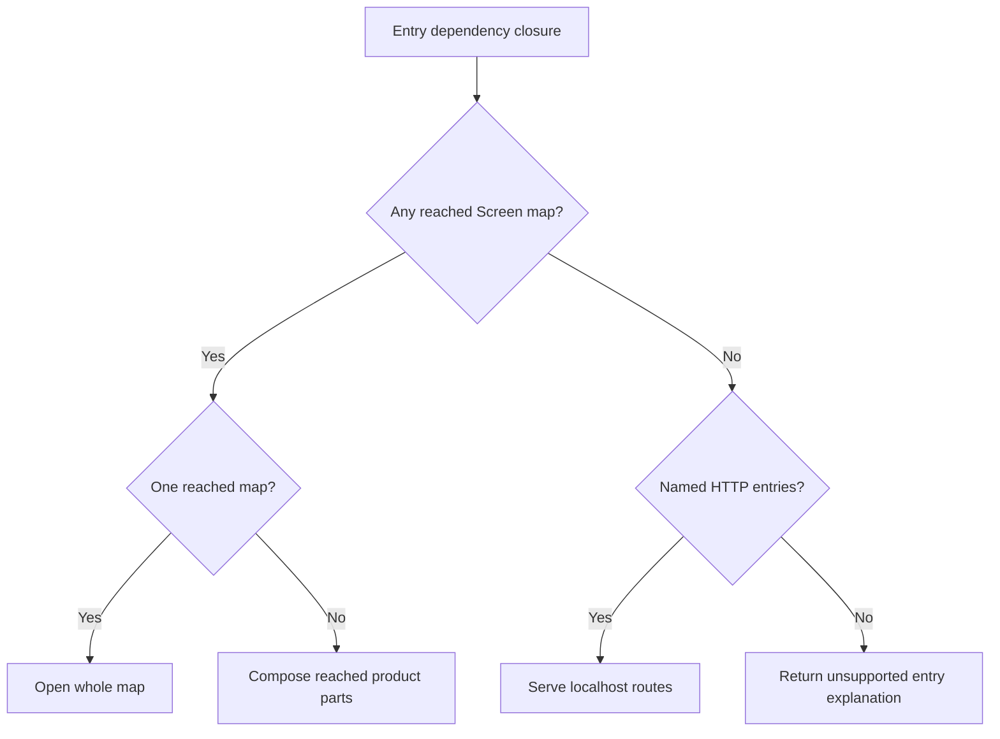

# Open a prompt program as an app

Own `src/program-app.mjs`, with public async module function
`runApp({file,root,env,flags}, ports) -> integer exit code`. The entry is a
repository prompt selected by the program dispatcher. Public synchronous module
function `appKind({file,root}, ports) -> 'screen' | 'http' | null` applies the
same selection rules before B chooses CLI/typed execution. Screen wins when both
capabilities exist. A genuine absence returns null; malformed or unsafe required
source keeps its diagnostic rather than silently classifying as a typed program.
Classification reads through injected safe source ports, creates no session and
performs no authentication or upload. Open its whole Screen app,
or serve its named HTTP routes, without requiring or inventing a Story or test.
Preserve existing source capture, standalone simulations, authenticated transport,
HTTP adaptation and local-server safety. This module does not own CLI parsing,
program data, session identity or fake-resource policy.

## Select the app from its entry

Follow the entry prompt's Runtime `calls` targets and required local
`## Dependencies` context transitively, using the source-capture owner's discovery
rules. Screen candidates are Git-visible `app-map.json`, `app/app-map.json` and
`app/maps/*.json` whose screens contain a `prompt_path` in that entry closure.
Loading one screen selects its entire map: retain all screens, handlers, tab
navigation, stylesheets and their prompt dependencies, including screens the
entry did not otherwise reach. Unrelated maps do not become product parts.
Named routes are admitted entries in the closure with the HTTP title contract
owned by [the server](try-http.prompt.md).

When multiple maps are reached, use product composition and its product part
ordering; select precisely the reached parts, retaining selected parts without
screens when their prompts are reached. If the product metadata cannot identify
a faithful composition, report the authored maps and the missing relationship;
never choose the first map or discard navigation. A single reached map needs no
product metadata. Screen admission comes from authenticated session metadata,
never local inference alone. When both capabilities are reached, keep the admitted
map and named HTTP routes in one session and serve both through the existing
localhost proxy; its Screen URL is the one printed app URL.

## Prepare one captured source

Use `captureSource` with explicit entry prompt selection, zero selected tests,
and the selected map. Reuse its attempt-local preparation hook for product
artifacts, contract expansion and dependency closure. No synthetic Story, scenario,
archive or generated prompt is needed. Product composition owns map/seed contents.
The composed seed remains an overlay upload artifact, never a test or an
implicit replacement for data chosen by the program data owner. Preserve source diagnostics and authored paths;
recovery refers to the entry and authored map/product files, never virtual artifact
paths. A retry retains entry, flags and product selection and cannot fall back to
Story mode. Do all source/admission work before upload. The composition's full
worst-case draw, handler, called-prompt and after cost must explain any tap exceeding
40 calls before upload; direct handler count alone is not that bound.

## Reuse the program session and server

Call B's `programData({root,program,flags:{fresh,data}}, ports)` with the entry
prompt name, then `openProgramSession({root,file,program,data,appMap,overlay}, ports)` and use its
no-Story session. `appMap` is the selected/joined map object; `overlay` carries
generated upload files through the capture hook. Both are optional for HTTP-only
runs. The agreed adapter consumes result `{id,url,serve}`: admitted session ID,
Screen page URL and authenticated proxy context respectively. Exact runtime wire
fields remain owned by the session helper. B owns `.pdd/run/<program>/`, initial-data/reset behavior,
persistence, default fake bindings, authentication and session lifecycle; reuse
`closeProgramSession` according to that owner's lifecycle. The `data` returned
by `programData` is authoritative, including persisted data, explicit --data input
and the empty world chosen for --fresh. Pass it unchanged to the session helper;
C must not substitute or overlay the composed product seed onto any of those
chosen values. Options passed here
are pdd flags parsed before the file. Do not reinterpret words after the file.

For a Screen-only app, print its admitted hosted Screen URL once. For HTTP-only
entries, use `openServe` at 127.0.0.1, port 8080 by default, and print its endpoint
URL. For mixed Screen and HTTP entries, start one `openServe` listener with the
same admitted map and session, print only that listener's Screen URL, and serve
the named routes there as well. Keep each local listener alive until Ctrl-C;
closing it retains program data. Reuse `openServe`'s routing,
security, response and accounting behavior. In program context its recovery says
`pdd [FLAGS] FILE.prompt.md` and points to authored files. Print a clear notice
that answers come from prompts and this does not test generated code. Do not
print a Story invitation, a second Screen URL, credentials or an unconfirmed URL.
Failures retain finite diagnostics and return a nonzero exit code; do not retry
an uncertain action or create a second session to conceal setup uncertainty.

All file, network, listener, terminal and session effects are injected ports.
Native defaults are thin adapters to the existing owners. Tests can supply
`programData`, `openProgramSession`, `closeProgramSession`, `captureSource` and
`openServe`; a fake must return resource facts, never compute expected behavior.
The adapter receives the composed seed artifact in overlay and hands the
prepared source/map to the B-owned session helper. Exact runtime wire fields
remain the session owner's interface; no alternate session API is authorized
here. Required adapter gap: when the session owner reports no existing or
explicit starting data, how its no-Story session consumes the composed seed as a
default initial world is unresolved. Keep that gap explicit; uploading a seed
artifact alone does not prove initial-world binding. This gap cannot weaken the
authority of data already chosen by `programData`.

## Dependencies

- [Source capture](runtime-preflight.prompt.md): required generation/runtime context for closure discovery, safe readers, prompt/interface admission and captured uploads.
- [Product composition](product-composition.prompt.md): required generation/runtime context when joining reached maps and seeding the product.
- [HTTP and Screen proxy](try-http.prompt.md): required generation/runtime context for `openServe`, named routes and unchanged transport policy.
- B-owned `program-data.mjs` and `program-session.mjs`: required native integration interfaces supplied by the agreed step B/C adapter; unavailable runtime wire fields must be reported, never guessed.

## Native execution boundary

This orchestration module has no executable Runtime binding. Its native effects
must be replayed through injected adapters and the local fake runtime. Do not
interpret an invented integer response as proof of file capture, hosted navigation
or a listening HTTP server.
