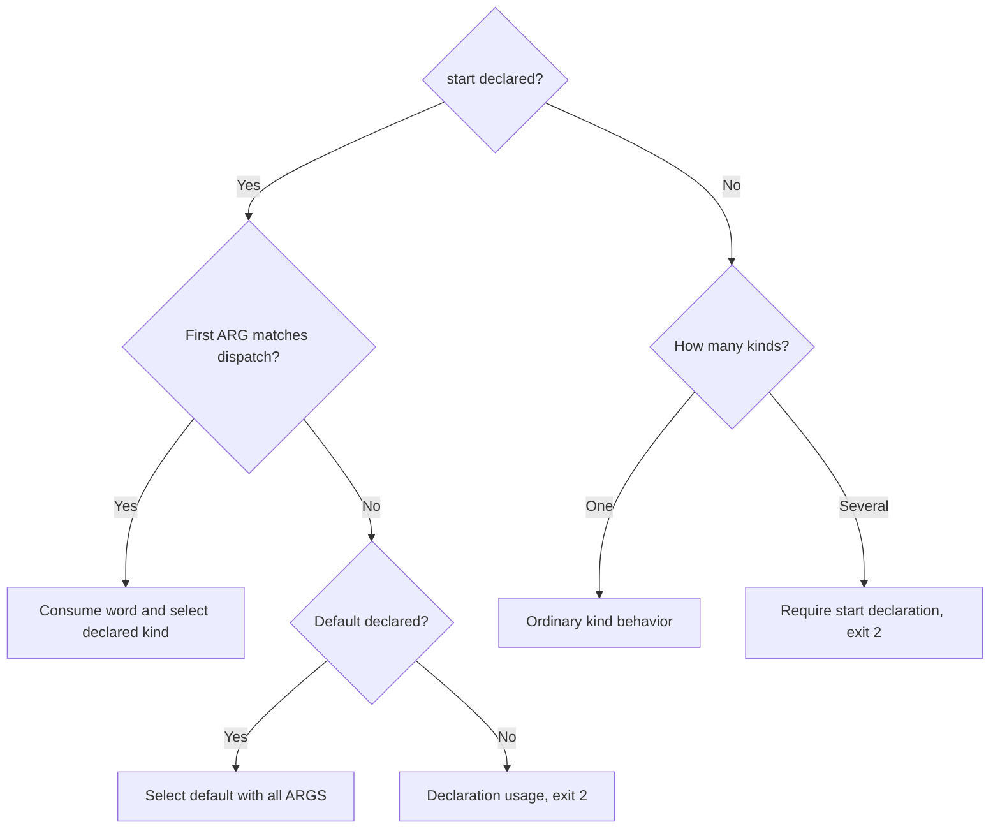

# Direct prompt programs

Own src/program-run.mjs; export module function
`runProgram({file, args, root, env, flags}, ports)` returning an exit code. Run an entry
prompt as a CLI or typed operation with fake outside resources and no Story.
Preserve existing simulate, Try and test behavior. Screen/HTTP launches belong to
C's src/program-app.mjs. Before B's CLI or typed classification, lazily load
that module and call its exported `appKind({file,root,all:true},ports)` first. Its extended
result is `{kinds,httpOperations,screenOperations}`: kinds enumerates all admitted
`http`/`screen` kinds; the optional operation arrays identify C-owned entries
excluded from typed selection. Keep remaining real typed operations. For a screen
map owning render and select, excluding both leaves one screen kind: no words
delegates one link without authentication in B.
Accept legacy `'screen'`, `'http'` or null; either legacy string owns all non-CLI
entries as that single C kind. Mixed C/typed selection requires the extended
descriptor. The start selection below decides whether to delegate to its exported
`runApp({file,root,env,flags,kind},ports)` and awaits its exit code; asynchronous rejection uses the same plain pdd error
handling as local failures, never a raw Node stack. Pass the parsed
pdd prefix flags with every file-valued option (including data) resolved to a
full path from invocation cwd; program suffix words never become pdd flags.
Null or a missing module continues B's CLI/typed classification. No entry means
context, not an executable: exit2 with `pdd: FILE has no entry, so it cannot run.`,
explain it is context for other prompts, and list actual repository prompts that
use it. Discover callers locally; never invent callers. Inspect local dependency declarations
without performing full source/graph capture separately for every candidate. More than one CLI entry refuses2 before authentication. A file may contain
several kinds; each run selects exactly one through its start declaration.
C owns screen/HTTP classification and app-map ambiguity. Preserve appKind FIRST
and never duplicate its inference through schema titles or app-map guesses. For deterministic tests, ports.programApp may
supply that module's public exports instead of loading it; both paths use the
same classification precedence and arguments. Never edit C's module. Messages
never tell people to add an adapter or cli convention.

## Kind selection

Read optional `start` from the Runtime interface locally, before authentication.
Its `default` is cli, shell, http, app or call; `default_operation` names the
non-CLI typed entry for default call. `dispatch` is an array of
`{word,kind,operation?,app_map?}`: a unique nonempty single word not beginning
with `-`, one of the same kinds, an existing typed operation for call, and an
optional repository-relative app_map PATH string for app. cli/shell require a
CLI entry; http/app require C to admit that kind, except an explicit app_map
selects a custom map for C to validate even if ordinary appKind returns null. Reject unknown/missing kinds,
missing/nonexistent call operations, unavailable kinds, malformed declarations,
duplicate/dash words and unsafe app_map paths with one plain line, exit2 and no
authentication or interpreter requests. This is launch validation, not lint.

pdd reserves no argument words: serve, app and the CLI heading have no special
meaning unless declared. Dispatch wins over a CLI subcommand with the same word.
An explicit cli selection executes once even with argv []; shell with ARGS runs
CLI once, while shell without ARGS follows the shell behavior below. http/app
with leftover ARGS print declaration usage and exit2, with no launch. Map app to
C's `kind:'screen'`, http to `kind:'http'`; pass an app dispatch's optional map as
`runApp({file,root,env,flags,kind:'screen',appMap},ports)`. Validate the map's safe
repository-relative string before delegation; C/session capture retain disk,
overlay and Git-visible rules. Pass prefix port unchanged to C.

Without start, a sole CLI or C kind runs normally. Only typed operations count
as one typed kind; multiple typed operations select by their own operation names,
and a sole typed operation needs no selector. Remove C-owned httpOperations and
screenOperations before counting typed entries. Several kinds have no implicit
CLI default: print `pdd: FILE has N kinds (KINDS) and no "start" in its Interface.`,
then `  Declare what starts, for example:` and the literal example
`  "start": {"default": "shell", "dispatch": [{"word": "runserver", "kind": "http"}]}`,
and exit2 before authentication. No entry keeps the context behavior above.

Prefix `--read ID FILE` wins over declaration validation, selectors, suffix
input and reset/data/no-cache initialization: restore the saved pending operation
and CLI/typed kind even with different or invalid suffix words. Preserve pending
ID, program, source and login checks. A pending setup/stop has no operation and
is acknowledged by GET without selection/app launch. Recovery uses GET only,
never resends input, resets data or creates another backup.

## Entry and input

A CLI entry has cli conventions on both schemas; its first heading supplies only the shell command name. Apply Try's safe
name, reserved-name and launcher protections only when opening that shell. With ARGS,
a heading with spaces or punctuation must not prevent execution;
call once with exact argv and read piped UTF-8 only if stdin is declared. Never
consume undeclared stdin, including an enclosing shell read loop. Preserve exact
stdout/stderr and return program exit_code 0–255 except reserved 125.
For shell mode with no ARGS create the safe real-command launcher locally. Only terminal stdin
opens the injected shell(shell, env) port (native interactive shell by default).
Without a terminal, print a correctly shell-quoted `export PATH="...:$PATH"`
line with `# then: NAME --help` on stdout and exit0: no child, authentication,
source lint, session or network. The shim invokes the CLI once, even with zero
words. It carries selected reset/data and no-cache settings: reset/data initialization
and backup happen once on the first shim call; no-cache applies on every call. In a terminal, pdd-owned informational lines go to stderr prefixed
`pdd:`: NAME is a command in this shell; type exit to leave, the data directory,
and prompt behavior, not tested code. On shell exit report saved world.json,
restore caller PATH and return the shell exit code. Quiet hides those lines.
Invoking that launcher with zero words calls the CLI once with empty argv; it
never opens another shell or re-enters declared dispatch: every word stays CLI
argv. Prefix reset/data select the shell data before its commands run, including
that zero-word invocation.
Never open a browser for CLI or typed input.

For typed input, --name value fills input_schema fields. Parse integers, finite
numbers and true/false booleans by schema; strings retain exact value. Repeated
array flags append items in order with item types; repeated scalar flags refuse.
Without start, typed-only operations use their operation names as selectors; a
sole operation is implicit. Declared call selection uses its explicit operation. Never consume an unmatched arbitrary word as an operation. --input JSON or
--input @file supplies the whole object; resolve that file from the invocation
current folder, even when the repository root differs. Piped JSON supplies it only when no flags
were given. Whole-input and field flags cannot mix; stdin never merges with flags.
Whole JSON supports nested objects and nullable fields. Validate all admitted
schema constraints locally before authentication, lint, session creation or calls.
--help after FILE prints schema usage, exits0, sends nothing. Invalid input prints
that usage and a plain reason, exits2, sends nothing. With no ARGS and no nonempty piped JSON, print usage and exit2 even if the schema
accepts {}; do this before authentication. Explicit piped `{}` is supplied input.
Usage distinguishes required flags from optional bracketed flags and shows schema
types and enum alternatives. Successful result prints JSON,
one line when piped; a declared error exits1.

## Saved data and reuse

Use [program data](program-data.prompt.md) for initial and confirmed world and
last-record persistence, and [program sessions](program-session.prompt.md) for
source identity, automatic replacement and confirmed answer reuse. Show-data
prints JSON without executing a call. Reset/data change the selected world but
do not forbid reuse for an exact before-world/key match. No-cache bypasses local
reuse, sends fresh:true, and keeps the world unless combined with reset/data.
Its informational notice says `asked again, data kept` only without reset/data;
combined selection says `asked again` alongside the reset notice. The interpreter
may still reuse a saved answer for an exact key; explain that limit without issue
numbers in person-facing lines. Quiet hides these notices. Use program data's
shared reset renderer, never duplicate it.

## Transport, budget and failures

Use runtime-client's direct transport and runtime-preflight's entry graph capture.
No Story or synthetic scenario is uploaded. Outside resources stay fake; absent
bindings use interpreter defaults, never real files/databases/services.
Compute the selected effective graph's admission bound, including projected fake
calls, before choosing the default cap. For each selected entry n,
W(n)=1+SUM(bound*(W(child)+1)) over its effective internal calls; the extra1
charges caller resume. Follow declared calls using target_operation and respect
entry call_operations and resource_operations when supplied. Unselected operations
and unrelated resources contribute nothing. A default http/command/model/port
service (except clock.now) projects to a leaf W=1 with bound
min(20, declaring prompt limits.max_steps). A selected http.prompt/port.prompt
simulation binding instead follows its target operation and entire nested closure
with the binding's max_calls. Explicit simulation always wins over automatic
bindings/defaults. Dependencies affect source identity but add no call cost unless
reached as an effective call. Deterministic resources, clock and explicit fixture
bindings remain external edges and add no fake-provider term. If any reachable
selected external edge remains after projection, admission bound is
max(W(root),20,root prompt limits.max_model_calls); otherwise it is W(root).
This ceiling is required for interpreter admission even when a deterministic
resource itself uses0 fake-provider calls. Default per-call cap is
min(admission bound,100). Explicit --max-calls accepts1–1000
and changes only this per-call cap. Always send max_calls and boolean fresh in
the call request, including fresh:false. The interpreter enforces insufficient
caps; never refuse locally because cap is below worst case. Cycles/indeterminate estimates
refuse clearly. Do not add a local refusal merely because the default worst case
exceeds100; the interpreter enforces its limits. Above20 print `pdd: may use up to N AI calls.` before dispatch.
Session allowance must permit per-call cap and interpreter remaining admission.
After a run stderr has one `pdd: N AI calls · T s` summary, using `1 AI call`
for one call and whole rounded seconds; cached results say
`cached · 0 AI calls`; reached drafts add DRAFT; a new session adds
`prompt behavior, not tested code`. Every pdd-owned stderr line starts `pdd:` (traceback frames and usage/error
continuations may remain indented). Quiet hides all informational status, warnings,
accounting and fake-call summaries, never program stderr or useful failure reasons. Accounting uses receipts, never another call.
For supplied call_chain print `Traceback (prompt calls, most recent call last):`, then
ordered `prompt, operation OP` lines, appending `(call I of at most M)` for nested
frames' call_index/max_calls. Finish `CODE: MESSAGE` without an `Error ` prefix. Never invent frames.
Use the final direct-call receipt: result.output is the CLI/typed result and
result.world is the exact confirmed after-world. Never overwrite it from a later
state GET. This module validates the terminal receipt before writing its world,
acknowledging its pending request or emitting output/last-run metadata. report.verdict
is required and must be passed, failed or refused; never infer it from outer state.
Outer passed confirms transport completion and may contain any of those semantic
verdicts. An outer non-passed terminal state must not contradict the semantic
outcome or turn into success; successful output requires outer passed and semantic
passed together. If result.refusals is supplied it must be an array, and every
entry must be a refusal object with string code and message; null entries and
nonarray containers are invalid. An absent result.refusals remains equivalent to
an empty array for legacy receipts. Semantic passed requires that array to be
empty, irrespective of any individual entry. These checks also precede world
persistence, pending acknowledgment and output/cache publication. A missing/invalid
verdict, malformed refusal container or entry, or contradictory receipt
exits125 with a plain interpreter-failure reason and same-ID read hint: no result
stdout (including --json), no world replacement, no cacheable receipt and no pending
clear. Keep the accepted ID for GET-only recovery until a valid confirmed outcome.
For report.error, null and absence both mean no error. A supplied non-null error
must be an object with a nonempty string code; message is optional, but when
provided must be a string. Reject malformed errors and semantic passed with a
non-null error before any acknowledgment, persistence or output, using the same
uncertain-receipt recovery above. Missing message never invalidates a declared
error or refusal; display its supplied code without inventing a message.
A valid report.verdict passed yields CLI exit_code or typed0; failed with a
declared report.error yields1; refused yields125 even when report.error exists.
Preserve result.refusals and report.error code/message, fix/hint/field and graph
cap evidence. Render `pdd: refused, N AI calls.` with supplied evidence and Fix
advice. A declared failure prints only its supplied fix/hint, never a generic
Fix line. Both a semantic refused receipt and a structured HTTP admission refusal
whose resolved semantic error/refusal code is exactly `session-call-cap`
(including a supplied result.refusals entry), or whose structured HTTP
error.code is exactly `session-call-cap`, supply a concrete `pdd --max-calls N FILE ARGS`
command with an increased suitable cap supported by the graph or supplied refusal
evidence. Preserve the original FILE and all original selector/program words in
ARGS, and preserve any supplied fix too. Other refusal codes/messages, including capture and capacity, never earn this
max-calls advice merely by containing "cap". Never automatically retry a call-cap
refusal with another POST or a raised cap. A session
remaining-allowance hint must preserve the current world, never recommend reset
(which empties it). report.replayed:true displays cached and0 AI calls. Report accounting uses
confirmed calls/seconds and includes report_url as details only when a report
link exists; never print `details: undefined`. Semantic refused accounting also
uses `1 AI call` for one call. Preserve call_chain
frames in order and disclose omitted frames using call_chain_total; never fabricate
frames or lose the report link. Declared errors exit1. Interpreter refusals, exhausted calls, ten-minute limits,
invalid results, transport failures and unknown outcomes exit125 with plain reason
and recovery/fix hint. Ctrl-C exits130, retains accepted ID and prints
`pdd --read ID FILE`; this prefix option uses GET only, never resends a call.
Lost POST replies recover that same ID without duplicate execution.

## Structured output and outside calls

Prefix --json prints one JSON receipt, with output, outside_calls, call_chain,
session_id, report_url, exit_code and ai_calls, preserving provided metadata.
Never mix raw program stdout into that JSON. Normal CLI mode preserves program
stdout/stderr byte for byte; typed mode prints result.output as JSON. When supplied,
report.outside_calls is rendered on stderr under `pdd: outside calls:`, one
prefixed summary line per call ending in `(MODE, SOURCE)`. Use the reported mode;
an absent mode is `unknown`, never inferred as fake or real. SOURCE is the supplied
source, falling back to legacy level and then `unknown`. Preserve call order.
Quiet hides these lines; JSON and last-run.json retain complete supplied records
unchanged. A run may mix fake and real calls; never claim nothing real was called.
Retain server error code and field, include supplied Fix or setup/size/cap recovery advice. session-busy exits125.
Confirmed session-stopped/session-unknown admission errors may replace the session
with confirmed world and execute once; uncertain POST outcomes always use same-ID
GET recovery and never repeat the uncertain operation.

## Dependencies

- [Program data](program-data.prompt.md): required native generation/verification/testing persisted-world policy.
- [Program sessions](program-session.prompt.md): required native generation/verification/testing no-Story session lifecycle.

- [Runtime client](runtime-client.prompt.md): required native generation,
  verification/testing transport, authentication, receipts and injected ports.
- [Runtime preflight](runtime-preflight.prompt.md): required native generation,
  verification/testing capture, interface/schema and privacy primitives.
- [Try doors](try-doors.prompt.md): required native generation, verification/testing
  safe launchers, names and CLI stream conventions only. Preserve Story behavior.

## Runtime interface

This native orchestrator binds filesystem, shell, streams and transport through
ports. Deterministic fake-interpreter tests invoke the existing public runPdd;
there is no model-executed Runtime operation for native process launching.
